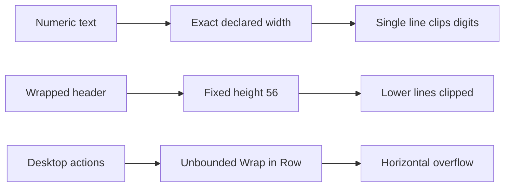
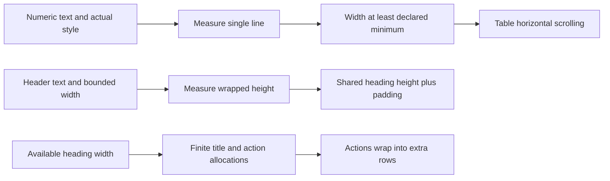

# Analytics Studio UI - Wave 1 Review Repairs Implementation Plan

> **For Gemini:** Read the master, approved design and this repair plan. Execute R1-R4 sequentially, inline, with executing-plans, test-driven-development and verification-before-completion. No agent dispatch. Repair Wave 1 before starting Wave 2. Do not reimplement completed tasks 1-3.

**Goal:** Fix the four review findings without changing analysis calculations, table data, identifiers or callbacks.

**Architecture:** Keep existing public constructors. Numeric text measures its own readable width under the actual inherited style and text scaler; table column widths are minimums for numeric content. Headers retain bounded wrapping widths and get a measured shared row height. Heading actions receive finite horizontal constraints.

**Tech stack:** Existing Flutter/Dart workspace and pinned SDK; no dependency changes.

**Spec:** [Approved design](analytics-studio-ui-design.md), [master constraints](analytics-studio-ui-implementation.md), [original Wave 1](analytics-studio-ui-wave1-implementation.md). This amendment resolves review findings in `94d8562..96f6459`, recorded on 2026-10-12.

## Global constraints and evidence

- All master constraints remain in force. Preserve four themes, full identifiers, CSV, numeric/statistical oracles, callbacks and shared population constants.
- Starting review head: `96f6459ebf37f4d8d0fc6d455cf2744b13968df3`. Later commits are allowed: inspect them before editing. If these defects are already fixed, run the regressions and report that rather than duplicating a fix.
- Review gates passed: shared 65, server 271, app 110 tests; all analyzers clean. These are historical counts, not required future counts.
- Owner ledger changes may be dirty. Preserve them; never stage the ledger automatically. Do not commit all files with `git add .`.
- Keep repairs in four task commits. Do not push. Do not implement Waves 2-6 as part of this repair request.
- Tests below are plan code, not precompiled source. Check signatures against current files, demonstrate real behavioral failures, then implement. Do not weaken dimension assertions to `find.text` or `takeException` alone.
- No hardcoded 255-pixel or 120-pixel expected dimensions: those were diagnostic observations, and fonts/themes alter measurements. Measure the current render object's own text/style/scaler.

| ID | Confirmed trigger | Repair owner |
|---|---|---|
| BUG-0023 | Numeric 12-digit value at scale 1.5 gets width 80 but needs about 255 | R1 |
| BUG-0022 | Any-order Funnel header at width 140 and scale 1.5 gets height 56 but needs about 120 | R2 |
| BUG-0024 | Six heading actions at content width 800 overflow by about 559 | R3 |
| BUG-0025 | Version-impact empty state says 20 although each cohort gate is 10 | R4 |

## Current and target flow





## File map

| Task | Files | Responsibility |
|---|---|---|
| R1 | `app/lib/src/widgets/studio_table.dart`; `app/test/studio_table_test.dart`; new `app/test/support/studio_text_assertions.dart` | Numeric measurement, column minimums, reusable readability assertions |
| R1 | `app/test/dashboard_widgets_test.dart`; `app/test/funnel_widgets_test.dart`; `app/lib/src/widgets/funnel_step_table.dart` only if needed | Actual Stage/Funnel count regressions and wrapped interactive numeric cells |
| R2 | `app/lib/src/widgets/studio_table.dart`; `app/test/studio_table_test.dart`; `app/test/funnel_widgets_test.dart` | Header height measurement and actual any-order label regression |
| R3 | `app/lib/src/widgets/studio_layout.dart`; `app/test/studio_layout_test.dart` | Bounded action layout, width/scale/theme regression |
| R4 | `app/lib/src/pages/analytic/survival_tab.dart`; `app/test/analytic_survival_test.dart`; `server/lib/src/analysis/version_impact.dart` | Correct version eligibility message, branch coverage and documentation |

## Review focus

| Failure mode | Required regression |
|---|---|
| Numeric digits clip silently without Flutter exception | R1 rendered width at least intrinsic width |
| Wrapped header loses lower lines without Flutter exception | R2 rendered height at least independently laid-out full height |
| Numeric text inside InkWell or badge bypasses direct-child detection | R1 actual Funnel interactive counts plus callback checks |
| Theme or text scaler changes after first layout | R1 and R2 repump same table key at scale 1 then 1.5 |
| Wrong survival fixture hides version-impact branch | R4 survival data with a curve and null reason; impact alone has too_few_players |

## R1 - Preserve complete numeric values

**Consumes:** Existing `StudioColumn`, `StudioRow`, `StudioTextCell`, `StudioTable` constructors. `MediaQuery.textScalerOf`, `DefaultTextStyle`, `TextPainter`.
**Produces:** Same public API; numeric `width` means a minimum readable width. Nonnumeric text retains bounded wrapping. `expectCompleteSingleLine` and `expectCompleteWrappedText` test helpers below.

- [ ] Read `studio_table.dart`, four migrated table widgets and pinned Flutter `material/data_table.dart`. Note how DataTable supplies its actual data text style. Check current git status.
- [ ] Create `app/test/support/studio_text_assertions.dart` with this complete content:

```dart
import 'package:flutter/rendering.dart';
import 'package:flutter_test/flutter_test.dart';

void expectCompleteSingleLine(WidgetTester t, Finder finder) {
  final p = t.renderObject<RenderParagraph>(finder);
  final painter = TextPainter(
    text: p.text,
    textDirection: p.textDirection,
    textAlign: p.textAlign,
    textScaler: p.textScaler,
    locale: p.locale,
    maxLines: 1,
  )..layout();
  expect(p.size.width + 0.5, greaterThanOrEqualTo(painter.width),
      reason: 'Every numeric glyph must fit; horizontal scrolling cannot restore clipped digits.');
  expect(p.didExceedMaxLines, isFalse);
  painter.dispose();
}

void expectCompleteWrappedText(WidgetTester t, Finder finder) {
  final p = t.renderObject<RenderParagraph>(finder);
  final painter = TextPainter(
    text: p.text,
    textDirection: p.textDirection,
    textAlign: p.textAlign,
    textScaler: p.textScaler,
    locale: p.locale,
  )..layout(maxWidth: p.size.width);
  expect(p.size.height + 0.5, greaterThanOrEqualTo(painter.height),
      reason: 'The full wrapped paragraph must fit vertically.');
  expect(p.didExceedMaxLines, isFalse);
  painter.dispose();
}
```

These helpers target `find.text(...)`, whose render object is RenderParagraph. Do not apply them to the enclosing cell or SizedBox. They intentionally use the actual paragraph InlineSpan rather than an assumed font size. If pinned RenderParagraph APIs differ, inspect the SDK and adapt the accessor, not the readability requirement.

- [ ] Add imports for the helper and `stage_table.dart`/`analytic_shared` where required. Add these bodies inside `main` of `studio_table_test.dart`:

```dart
for (final style in AppStyle.values) {
  testWidgets('numeric minimum width preserves all digits in ${style.name}', (t) async {
    for (final scale in [1.0, 1.5]) {
      await pumpStudio(t, const StudioTable(
        key: ValueKey('numeric-table'),
        columns: [StudioColumn('Players', width: 80, numeric: true)],
        rows: [StudioRow([
          StudioTextCell('123456789012', numeric: true,
              style: TextStyle(fontWeight: FontWeight.w700)),
        ])],
      ), style: style, textScale: scale);
      expectCompleteSingleLine(t, find.text('123456789012'));
      expect(t.takeException(), isNull);
    }
  });

  testWidgets('StageTable long measured count fits in ${style.name}', (t) async {
    await pumpStudio(t, const StageTable(stages: [
      StageRow(stage: 1, players: 123456789012, starts: 2,
        completes: 1, fails: 1, winRate: 0.5,
        attemptsPerClear: 2, dropOff: 0.1),
    ]), style: style, textScale: 1.5);
    expectCompleteSingleLine(t, find.text('123456789012'));
    expect(t.takeException(), isNull);
  });
}
```

`pumpStudio` recreates ProviderScope. Add this separate retained-state test in `studio_table_test.dart`; do not memoize dimensions in `initState`:

```dart
testWidgets('numeric width reacts to inherited theme and scale changes', (t) async {
  t.view.physicalSize = const Size(720, 1200);
  t.view.devicePixelRatio = 1;
  addTearDown(t.view.reset);
  for (final scale in [1.0, 1.5]) {
    await t.pumpWidget(MaterialApp(
      theme: buildTheme(scale == 1 ? AppStyle.tremor : AppStyle.midnight),
      home: MediaQuery(data: MediaQueryData(
        size: const Size(720, 1200), textScaler: TextScaler.linear(scale)),
        child: const Scaffold(body: StudioTable(
          key: ValueKey('retained-numeric-table'),
          columns: [StudioColumn('Players', width: 80, numeric: true)],
          rows: [StudioRow([
            StudioTextCell('123456789012', width: 40, numeric: true),
          ])],
        )),
      ),
    ));
    await t.pumpAndSettle();
    expectCompleteSingleLine(t, find.text('123456789012'));
    expect(t.takeException(), isNull);
  }
});
```

`AppStyle.midnight` is the existing Midnight Game enum value, verified in `app_style.dart` during plan authoring.

- [ ] Run from `app`: `flutter test test/studio_table_test.dart --reporter expanded`. Expected red: intrinsic numeric width exceeds rendered width. Record the actual assertion failure.
- [ ] Replace the numeric branch in `StudioTextCell.build` with this measurement kernel; keep its nonnumeric branch and constructor:

```dart
final inherited = DefaultTextStyle.of(context).style;
final effectiveStyle = style == null ? inherited : inherited.merge(style);
if (numeric) {
  final painter = TextPainter(
    text: TextSpan(text: text, style: effectiveStyle),
    textDirection: Directionality.of(context),
    textScaler: MediaQuery.textScalerOf(context),
    locale: Localizations.maybeLocaleOf(context),
    maxLines: 1,
  )..layout();
  final measured = painter.width.ceilToDouble() + 1;
  painter.dispose();
  final minimum = width ?? 0;
  return SizedBox(
    width: measured > minimum ? measured : minimum,
    child: Padding(
      padding: const EdgeInsets.symmetric(vertical: 8),
      child: Text(text, style: effectiveStyle, softWrap: false,
        maxLines: 1, textAlign: TextAlign.right),
    ),
  );
}
```

Measure in `build` so theme, inherited style and scaler updates recalculate automatically. The rendered numeric Text must use the same effective style/scaler as the measurement. Do not cap to viewport width, format with ellipsis, insert line breaks, lower font size or modify the value.

- [ ] Replace direct-child fixed-width logic in StudioTable with a column-aware cell builder. For **every numeric column**, wrap the supplied Widget in `ConstrainedBox(constraints: BoxConstraints(minWidth: column.width), child: cell)` without a maxWidth. For a nonnumeric direct `StudioTextCell` with null width, retain `SizedBox(width: column.width, child: cell)`. For other nonnumeric Widgets, preserve their own layout. Use `column.numeric` for column sizing; numeric StudioTextCell handles its own readable width even when nested in InkWell. Do not make the entire table fill the viewport with infinite width.

```dart
Widget buildCell(StudioColumn column, Widget cell) {
  if (column.numeric) {
    return ConstrainedBox(
      constraints: BoxConstraints(minWidth: column.width), child: cell);
  }
  if (cell is StudioTextCell && cell.width == null) {
    return SizedBox(width: column.width, child: cell);
  }
  return cell;
}
```

Keep a single horizontal controller/scroller, row selection and disposal behavior unchanged. An explicitly supplied numeric StudioTextCell width is also a minimum. Verify a numeric cell with `width: 40` and the same 12-digit value with the helper; it must expand beyond 40.

- [ ] Add an integration test to `funnel_widgets_test.dart`, importing the helper and `support/studio_test_host.dart`. Use this test-only fixture:

```dart
const largeCountResult = FunnelResult(steps: [
  FunnelStepResult(index: 0, event: 'start', players: 223456789012,
    fromPrevious: null, fromFirst: 1, dropped: null, medianSeconds: null),
  FunnelStepResult(index: 1, event: 'finish', players: 123456789012,
    fromPrevious: 0.55, fromFirst: 0.55, dropped: 100000000000,
    medianSeconds: 40),
], totalConversion: 0.55, biggestDropIndex: 1);
```

Add this body inside main, using `largeCountResult` above. It asserts complete single-line text for both player counts and the dropped badge:

```dart
testWidgets('interactive Funnel counts preserve digits and callbacks', (t) async {
  final selected = <(int, FunnelPlayerOutcome)>[];
  await pumpStudio(t, FunnelStepTable(result: largeCountResult,
    onSelectStep: (step, outcome) => selected.add((step, outcome))),
    width: 1600, textScale: 1.5);
  for (final value in ['223456789012', '123456789012', '−100000000000']) {
    expectCompleteSingleLine(t, find.text(value));
  }
  await Scrollable.ensureVisible(t.element(find.text('123456789012')));
  await t.pumpAndSettle();
  await t.tap(find.text('123456789012'));
  await Scrollable.ensureVisible(t.element(find.text('−100000000000')));
  await t.pumpAndSettle();
  await t.tap(find.text('−100000000000'));
  expect(selected, [(2, FunnelPlayerOutcome.converted),
    (2, FunnelPlayerOutcome.dropped)]);
  expect(t.takeException(), isNull);
});
```

If badge sizing still constrains digits, fix its `Align` with `widthFactor: 1` and give the badge Text `softWrap: false, maxLines: 1`; retain padding, color and callback. Do not remove InkWell to make measurement easier. Run existing CSV tests unchanged.

- [ ] Run targeted tests, then app analyze/full suite. Inspect full diff for data/callback changes.
- [ ] Commit only owned files: `fix(ui): preserve complete numeric table values`. Update BUG-0023 with failure and green evidence; leave ledger unstaged.

## R2 - Size headers for complete wrapped text

**Consumes:** R1's unchanged StudioTable API and `expectCompleteWrappedText` helper.
**Produces:** Explicit `headingTextStyle`/`headingRowHeight` matching measured text. Column header label width remains declared width; DataTable reserves sort-arrow space outside that label.

- [ ] Add this body to `studio_table_test.dart` for each AppStyle, using the existing helper imports:

```dart
testWidgets('wrapped sortable heading is fully readable in ${style.name}', (t) async {
  const label = 'Median time from step 1';
  for (final scale in [1.0, 1.5]) {
    await pumpStudio(t, StudioTable(
      columns: [StudioColumn(label, width: 140, numeric: true,
          onSort: (index, ascending) {})],
      sortColumnIndex: 0,
      rows: const [StudioRow([StudioTextCell('40s', numeric: true)])],
    ), style: style, textScale: scale);
    expectCompleteWrappedText(t, find.text(label));
    expect(t.takeException(), isNull);
  }
});
```

Add this retained-key theme/scaler regression separately; it also pins the sort callback:

```dart
testWidgets('header height updates while sort callback stays intact', (t) async {
  t.view.physicalSize = const Size(720, 1200);
  t.view.devicePixelRatio = 1;
  addTearDown(t.view.reset);
  final sorted = <(int, bool)>[];
  const label = 'Median time from step 1';
  for (final scale in [1.0, 1.5]) {
    await t.pumpWidget(MaterialApp(
      theme: buildTheme(scale == 1 ? AppStyle.tremor : AppStyle.midnight),
      home: MediaQuery(data: MediaQueryData(
        size: const Size(720, 1200), textScaler: TextScaler.linear(scale)),
        child: Scaffold(body: StudioTable(
          key: const ValueKey('retained-header-table'),
          columns: [StudioColumn(label, width: 140, numeric: true,
            onSort: (i, ascending) => sorted.add((i, ascending)))],
          sortColumnIndex: 0, sortAscending: true,
          rows: const [StudioRow([StudioTextCell('40s', numeric: true)])],
        )),
      ),
    ));
    await t.pumpAndSettle();
    expectCompleteWrappedText(t, find.text(label));
    expect(t.takeException(), isNull);
  }
  await t.tap(find.text(label));
  expect(sorted, [(0, false)]);
});
```

- [ ] In `funnel_widgets_test.dart`, add this separate regression using the existing `result` fixture. This pins the real consumer rather than only a synthetic table:

```dart
testWidgets('any-order Funnel header fits every wrapped line', (t) async {
  await pumpStudio(t, const FunnelStepTable(
    result: result, order: FunnelOrder.any), textScale: 1.5);
  expectCompleteWrappedText(t, find.text('Median time from step 1'));
  expect(t.takeException(), isNull);
});
```
- [ ] Run both test files. Expected red: measured full header height exceeds paragraph's rendered height.
- [ ] In StudioTable.build, resolve header style and minimum height consistently with pinned DataTable source, then measure all labels before constructing DataTable:

```dart
final theme = Theme.of(context);
final tableTheme = DataTableTheme.of(context);
final baseStyle = tableTheme.headingTextStyle ??
    theme.dataTableTheme.headingTextStyle ?? theme.textTheme.titleSmall!;
final headingStyle = DefaultTextStyle.of(context).style.merge(baseStyle);
var headingHeight = tableTheme.headingRowHeight ??
    theme.dataTableTheme.headingRowHeight ?? 56.0;
for (final column in widget.columns) {
  final painter = TextPainter(
    text: TextSpan(text: column.label, style: headingStyle),
    textDirection: Directionality.of(context),
    textAlign: column.numeric ? TextAlign.right : TextAlign.left,
    textScaler: MediaQuery.textScalerOf(context),
    locale: Localizations.maybeLocaleOf(context),
  )..layout(maxWidth: column.width);
  final needed = painter.height.ceilToDouble() + 16;
  if (needed > headingHeight) headingHeight = needed;
  painter.dispose();
}
```

Pass `headingTextStyle: headingStyle, headingRowHeight: headingHeight` to DataTable; also pass `style: headingStyle` explicitly on header Text. Render headers with `softWrap: true` and unlimited lines. The shared row height is max of the themed minimum and every measured label plus 8-pixel vertical breathing room per side. Do not set a universal 120/160 height, make all columns wider to conceal clipping or reduce text scale. Keep header `SizedBox(width: column.width)` even when numeric body text expands. DataTable's sort arrow is outside this box; do not subtract arrow width from the label a second time or draw your own arrow.

- [ ] Run studio table, Funnel, dashboard, segment and CSV tests, then app analyzer/full suite. Confirm long nonnumeric body text still wraps and only one horizontal Scrollbar is present.
- [ ] Commit `fix(ui): measure wrapped table header height`. Update canonical BUG-0022 evidence/status, retaining its owner-report history; leave ledger unstaged.

## R3 - Constrain desktop heading actions

**Consumes/produces:** Same StudioHeading API; desktop side-by-side title/action groups and below-720 stacked layout remain.

- [ ] Add this regression in `studio_layout_test.dart`. Import `app_style.dart` and `support/studio_test_host.dart`:

```dart
for (final style in AppStyle.values) {
  for (final width in [719.0, 720.0, 800.0, 1200.0]) {
    testWidgets('heading actions fit ${style.name} at $width', (t) async {
      await pumpStudio(t, StudioHeading(
        title: 'Analytics Studio overview',
        subtitle: 'Measured activity for the selected date range',
        actions: [for (var i = 0; i < 6; i++)
          FilledButton(onPressed: () {}, child: Text('Refresh data $i'))],
      ), width: width, style: style, textScale: 1.5);
      expect(t.takeException(), isNull);
      for (var i = 0; i < 6; i++) {
        final button = find.widgetWithText(FilledButton, 'Refresh data $i');
        final rect = t.getRect(button);
        expect(rect.left, greaterThanOrEqualTo(-0.5));
        expect(rect.right, lessThanOrEqualTo(width + 0.5));
      }
    });
  }
}
```

- [ ] Run `flutter test test/studio_layout_test.dart --reporter expanded`. Expected red above the 720 boundary: RenderFlex overflow and button rectangles outside the available width.
- [ ] Keep no-actions layout as just `titleWidget`. For actions and content width below 720, keep the existing stacked Column with a Wrap bounded to full content width. At or above 720, replace the non-flex action group with finite allocation:

```dart
final actionWidth = (constraints.maxWidth - 16) * 0.4;
return Row(
  crossAxisAlignment: CrossAxisAlignment.start,
  children: [
    Expanded(child: titleWidget),
    const SizedBox(width: 16),
    SizedBox(width: actionWidth, child: Wrap(
      spacing: 8, runSpacing: 8,
      crossAxisAlignment: WrapCrossAlignment.center,
      children: [for (final action in actions)
        ConstrainedBox(constraints: BoxConstraints(maxWidth: actionWidth),
          child: action)],
    )),
  ],
);
```

Below 720, similarly constrain each action to `constraints.maxWidth`. This supports ordinary wrapping Text buttons, keeps all six actions accessible and permits heading height to grow. Do not use an OverflowBox, clip the actions, shrink text or add horizontal scrolling. The 40-percent action allocation is the chosen repair policy; retain full title width when actions are empty. Existing arbitrary Widgets with hardcoded oversized internals cannot be generically repaired here; callers must provide actions capable of respecting finite constraints.

- [ ] Add this regression for a 120-character unbroken action label. A normal Text child must wrap under the max constraint. Re-run existing long title/six-metric test unchanged:

```dart
testWidgets('long action label respects finite heading allocation', (t) async {
  final label = List.filled(120, 'X').join();
  await pumpStudio(t, StudioHeading(title: 'Overview', actions: [
    FilledButton(onPressed: () {}, child: Text(label)),
  ]), width: 720, textScale: 1.5);
  expect(t.takeException(), isNull);
  final rect = t.getRect(find.widgetWithText(FilledButton, label));
  expect(rect.left, greaterThanOrEqualTo(-0.5));
  expect(rect.right, lessThanOrEqualTo(720.5));
});
```
- [ ] Run app analyzer/full suite and commit `fix(ui): bound Studio heading action groups`. Update BUG-0024 evidence; leave ledger unstaged.

## R4 - Correct version cohort instructions

**Consumes:** `minAnalysisPlayers` already exported by analytic_shared; existing `_FakeApiClient` in `analytic_survival_test.dart`.
**Produces:** Accurate version-impact empty-state copy. No server guard/calculation changes.

- [ ] Add this body to `analytic_survival_test.dart` inside main:

```dart
testWidgets('version impact empty state uses ten-player cohort policy', (t) async {
  const survival = SurvivalResult(players: 10, by: 'version', reason: null,
    curves: [SurvivalCurve(group: '1.0', players: 10, events: 0,
      censored: 10, medianDays: null, points: [
        SurvivalPoint(day: 0, survival: 1, ciLower: 1, ciUpper: 1,
          atRisk: 10, events: 0, censored: 0),
      ])], logRank: null);
  const impact = VersionImpactResult(targetVersion: '', targetPlayers: 0,
    baselineVersion: '', baselinePlayers: 0, metrics: [],
    availableVersions: [], reason: 'too_few_players');
  final client = _FakeApiClient(survival, impact);
  addTearDown(client.close);
  await t.pumpWidget(ProviderScope(
    overrides: [apiClientProvider.overrideWithValue(client)],
    child: const MaterialApp(home: Scaffold(body: SurvivalTab())),
  ));
  await t.pumpAndSettle();
  final message = find.text(
    'Version impact requires at least 2 versions with at least '
    '$minAnalysisPlayers players each to compare.');
  await t.scrollUntilVisible(message, 200,
    scrollable: find.byType(Scrollable).first);
  expect(message, findsOneWidget);
  expect(find.textContaining('20 players'), findsNothing);
});
```

The nonempty successful survival fixture is essential: if `survival.reason` is too_few_players or curves are empty, SurvivalTab returns before building the version card, and the test does not exercise this defect.

- [ ] Run `flutter test test/analytic_survival_test.dart --reporter expanded`. Expected red: requested message absent; old twenty-player message exists. If scrollUntilVisible fails first, inspect find.textContaining('20 players') to document the actual branch reached.
- [ ] Replace only the version-impact empty-state message with the exact two-string literal above, interpolating `$minAnalysisPlayers`. Existing imports already include analytic_shared. Do not modify the separate two-leaf churn rule message requiring 20 observations.
- [ ] Update `server/lib/src/analysis/version_impact.dart` documentation above `analyzeVersionImpact`: `/// Compares target version with previous chronological version having at least minAnalysisPlayers players.` Retain algorithms and seed/bootstrap behavior.
- [ ] Run app analyzer/full tests and server analyzer plus `dart test test/analysis_population_policy_test.dart test/analysis_version_impact_test.dart`. Verify existing 9/10/19 cohort eligibility tests unchanged.
- [ ] Commit `fix(ui): align version impact copy with cohort policy`. Update BUG-0025 evidence; leave ledger unstaged.

## Final verification and handoff

- [ ] Run master gates, sequentially by package: shared `dart analyze`, `dart test`; server `dart analyze`, `dart test`; app `flutter analyze`, `flutter test`; root `git diff --check`. Set `$env:Path = "D:\flutter\bin;$env:Path"` first. Stop and investigate failures; report real counts.
- [ ] Inspect `git status --short` and each task commit. Only owned product/test/doc files belong in task commits; owner plan/ledger edits stay separate.
- [ ] Record R1-R4 base/head, failing assertion and green commands/counts in `.cursor/plans/analytics-studio-ui-verification.md`. Label measurements as widget-test evidence. Preserve any existing report content.
- [ ] Windows visual checks: at text scale 1 and 1.5, inspect Retention, Progression and Funnel tables in all four themes; horizontally scroll to the rightmost header and count. Verify every header line/digit, dropped badge and callback; confirm CSV remains exact. Use existing real data read-only. Twelve-digit fixture values are test-only; never insert them into production storage. If live tooling or suitable real data is unavailable, report those visual checks pending with these steps.
- [ ] Mark BUG-0022-0025 RESOLVED only with the corresponding automated regression evidence; describe Windows visual acceptance separately as pending if unobserved. Never claim live verification from a build/test log.
- [ ] Stop after repair report. Wave 2 starts only when owner requests it. Do not rerun original Wave1 tasks or renumber tasks 0-17.

## Planning self-review

R1 covers full numeric values including actual Stage/Funnel consumers and inherited text styles. R2 covers actual any-order header, sort support and runtime scale changes. R3 covers 719/720 breakpoint, desktop width and four themes. R4 reaches the version-impact branch independently of survival eligibility. No public model/schema changes, new packages, statistical edits or production sample numbers are introduced. The snippets have not been executed during plan authoring; Gemini owns red/green proof and pinned-API validation.
