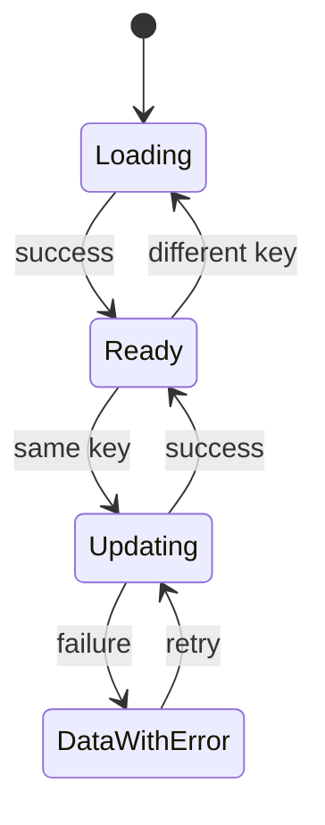
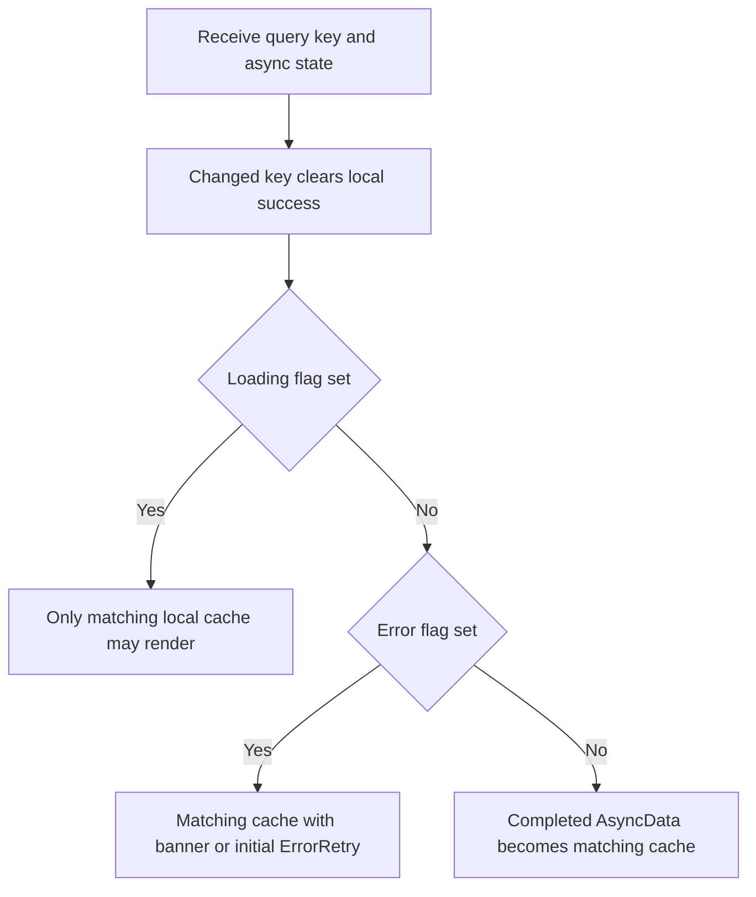

# Analytics Studio UI - Wave 2 Implementation Plan

> Read the master plan and design. Wave1, including [review repairs R1-R4](analytics-studio-ui-wave1-repair-implementation.md), must pass before tasks4-6. A green original Wave1 suite alone does not close BUG-0022-0025. Execute inline and commit per task.

> **Current execution entry, 2026-10-12:** Gemini implemented tasks4-6 at `16c96da`; code review found BUG-0033-0039. Execute [Wave2 review repairs W2R1-W2R7](analytics-studio-ui-wave2-repair-implementation.md), not original tasks4-6. That repair plan takes precedence for stable cached content, series legends, percentage domains, blank bar groups, source tooltips, motion handoff and measured labels. Stop after repair verification; Wave3 remains gated.

**Goal:** Give existing and future pages one reliable chart, motion and async presentation system.
**Architecture:** Pure chart models prepare finite domains and non-overlapping segments. Flutter chart widgets draw them, respecting theme and reduced motion. Async presentation retains data only for the same query.
**Tech stack:** existing Flutter/fl_chart; no dependencies.
**Spec:** design sections4-6,10-11.

## Review amendment - 2026-10-12

This plan was checked against repair head81649a3, pinned fl_chart1.2.0 and Riverpod2.6.1. Tasks4-6 are not implemented at that head. Follow the corrections and regression bodies below; do not rerun tasks1-3/R1-R4. The four original repairs passed code review and480 automated tests; live Windows checks remain pending. BUG-0026 is a separate nonblocking bold-text table follow-up, not authorization to expand Wave2 into another table repair.

**Global constraints:** Inherit all master constraints, preserve statistical oracles and theme preferences, use no new dependency, execute inline, commit one task at a time, and never stage owner plan/ledger changes automatically. Windows visual acceptance remains separate from widget tests.

**Review focus:** Tasks4-6 must pin finite domain spans, stable render identity after gaps change, reduced-motion theme switching at the app root, tooltip callback cardinality, and Riverpod previous-data wrappers crossing query keys. Add the exact regression bodies in the amendment sections before the owning implementation. Do not replace them with widget-existence assertions.

## Task 4 - Pure chart models, domains and stable styles

**Create:** app/lib/src/widgets/charts/chart_models.dart; app/test/chart_models_test.dart.
**Consumes:** finite numbers and explicit observation gaps.
**Produces:**

```dart
class ChartPoint {
  const ChartPoint(this.x, this.value, {required this.label, this.incomplete = false});
  final double x;
  final double? value;
  final String label;
  final bool incomplete;
}
class ChartSeries {
  const ChartSeries({required this.id, required this.label, required this.points});
  final String id;
  final String label;
  final List<ChartPoint> points;
}
class ChartBounds {
  const ChartBounds(this.minX, this.maxX, this.minY, this.maxY);
  final double minX, maxX, minY, maxY;
}
class ChartSegment {
  const ChartSegment(this.points, {required this.incomplete});
  final List<ChartPoint> points;
  final bool incomplete;
}
ChartBounds chartBounds(List<ChartSeries> series, {bool includeZero = true});
List<ChartSegment> splitSeries(List<ChartPoint> points);
class SeriesStyleRegistry {
  void registerAll(Iterable<String> ids);
  int slotFor(String id);
}
```

### Regression bodies

Imports: flutter_test plus chart_models.dart. Wrap these tests in main.

```dart
test('single zero point has a usable nonzero domain', () {
  final b = chartBounds(const [ChartSeries(id: 'a', label: 'A',
    points: [ChartPoint(0, 0, label: 'Oct 01')])]);
  expect(b.minX, 0);
  expect(b.maxX, 1);
  expect(b.minY, 0);
  expect(b.maxY, 1);
});
test('negative and huge values stay inside finite bounds', () {
  final b = chartBounds(const [ChartSeries(id: 'a', label: 'A',
    points: [ChartPoint(0, -2, label: 'a'), ChartPoint(1, 1000000000, label: 'b')])]);
  expect(b.minY, lessThanOrEqualTo(-2));
  expect(b.maxY, greaterThanOrEqualTo(1000000000));
  expect(b.minY.isFinite && b.maxY.isFinite, isTrue);
});
test('segments do not double-draw incomplete edges', () {
  final segments = splitSeries(const [
    ChartPoint(0, 1, label: 'a'),
    ChartPoint(1, 2, label: 'b', incomplete: true),
    ChartPoint(2, 3, label: 'c'),
    ChartPoint(3, 4, label: 'd'),
  ]);
  final edgeCounts = <String, int>{};
  for (final s in segments) {
    for (var i = 1; i < s.points.length; i++) {
      final key = '${s.points[i - 1].x}:${s.points[i].x}';
      edgeCounts[key] = (edgeCounts[key] ?? 0) + 1;
    }
  }
  expect(edgeCounts, {'0.0:1.0': 1, '1.0:2.0': 1, '2.0:3.0': 1});
  expect(segments.where((s) => s.incomplete).expand((s) => s.points)
    .map((p) => p.x).toSet(), {0.0, 1.0, 2.0});
});
test('missing observation breaks the connection', () {
  final segments = splitSeries(const [
    ChartPoint(0, 4, label: 'stored'),
    ChartPoint(1, null, label: 'not stored'),
    ChartPoint(2, 8, label: 'stored'),
  ]);
  expect(segments, hasLength(2));
  expect(segments.map((s) => s.points.length), [1, 1]);
});
test('series style survives rank changes', () {
  final registry = SeriesStyleRegistry();
  registry.registerAll(['b', 'a']);
  final a = registry.slotFor('a');
  final b = registry.slotFor('b');
  registry.registerAll(['a', 'b', 'c']);
  expect(registry.slotFor('a'), a);
  expect(registry.slotFor('b'), b);
  expect(a, isNot(b));
});
test('invalid measured values are rejected before painting', () {
  expect(() => chartBounds([ChartSeries(id: 'x', label: 'X',
    points: [ChartPoint(0, double.infinity, label: 'bad')])]), throwsArgumentError);
});
```

Expected-value reasoning: every finite adjacent edge appears once. Edges touching an incomplete point are dashed; a missing point contributes no edge. Zero-only domains cannot have identical min/max. Style registration sorts only new IDs, preserving old assignments.

- [ ] Run app: flutter test test/chart_models_test.dart; observe red.
- [ ] Implement the following domain algorithm exactly in meaning:
  - validate unique nonempty series IDs, finite x and finite non-null values; strictly increasing x within each series;
  - collect non-null observations for y; gaps can still establish x extent;
  - empty x gives0..1; a single ordinary x gives x..x+1, with the finite-span guard below for very large x;
  - y starts at measured extrema and includes zero when requested;
  - empty/all-zero y gives0..1;
  - nonzero span pads5% above max and below min, except retain zero baseline for all-positive count charts;
  - identical nonzero values use padding max(abs(value)*0.05,1), retaining measured value;
  - no NaN/infinity or zero/infinite domain span leaves this helper; use the finite-span guard below.
- [ ] splitSeries scans each contiguous non-null run. Start a new segment whenever edge status changes; share only the boundary point, not a duplicate edge. One-point runs produce a visible single-point segment.
- [ ] SeriesStyleRegistry implementation:

```dart
final Map<String, int> _slots = {};
void registerAll(Iterable<String> ids) {
  final fresh = ids.toSet().where((id) => !_slots.containsKey(id)).toList()..sort();
  for (final id in fresh) {
    _slots[id] = _slots.length;
  }
}
int slotFor(String id) => _slots.putIfAbsent(id, () => _slots.length);
```

- [ ] Run targeted tests, app analyze/full test.
- [ ] Commit: feat(ui): define safe chart domains gaps and stable series styles.

## Task 5 - Motion policy and responsive chart variants

**Create**
- app/lib/src/theme/motion_policy.dart.
- app/lib/src/widgets/charts/{chart_frame,time_series_chart,ranked_bar_chart,diverging_bar_chart,chart_motion}.dart.
- app/test/{motion_policy,studio_charts}_test.dart.

**Modify:** app/lib/src/theme/analytics_tokens.dart; app/lib/main.dart; app/lib/src/widgets/metric_line_chart.dart; app/lib/src/pages/overview_page.dart; app/lib/src/widgets/funnel_trend_view.dart only to preserve nulls and responsive chart layout.

Also modify app/lib/src/pages/analytic/anomalies_tab.dart in this task only to remove the fixed220-high outer SizedBox around MetricLineChart. Otherwise the new wrapping heading plus minimum plot height can break an intermediate wave. The full anomaly redesign remains Task14.

**Consumes:** Task4 models and registry, theme tokens, Task3 test host.
**Exact widget contracts:**

```dart
enum MotionKind { navigation, tab, expansion, chartEnter, chartUpdate, theme, hover }
Duration motionDuration(BuildContext context, MotionKind kind);
enum TimeChartKind { line, area, bars }
ChartFrame({Key? key, required String title, String? subtitle,
  required String unit, List<Widget> legend = const [],
  List<Widget> actions = const [], required Widget child, Widget? dataView,
  double plotHeight = 240});
TimeSeriesChart({Key? key, required List<ChartSeries> series,
  required String unit, TimeChartKind kind = TimeChartKind.line,
  bool percentage = false, String Function(num)? valueFormatter,
  double plotHeight = 240});
class RankedValue {
  const RankedValue(this.id, this.label, this.value, {this.detail});
  final String id, label;
  final double value;
  final String? detail;
}
RankedBarChart({Key? key, required List<RankedValue> values, required String unit,
  String Function(num)? valueFormatter});
DivergingBarChart({Key? key, required List<RankedValue> values, required String unit,
  String Function(num)? valueFormatter});
ChartMotion({Key? key, required Object dataRevision, required Widget child});
```

ChartFrame uses a Card and LayoutBuilder. Heading/subtitle/legend/actions are not inside a fixed-height plot box. It gives child a minimum-height preference via ConstrainedBox with no maximum height, rather than clipping a full chart body into a fixed slot. TimeSeriesChart owns a plot-only SizedBox of height max200,plotHeight below its naturally wrapping legend. Include an accessible "View data" ExpansionTile if dataView supplied. Header actions use the repaired StudioHeading or equivalently finite action widths; legends are bounded Wrap children, never unbounded Row Text. TimeSeriesChart itself supplies a per-series accessible legend with the same registry/patterns as its marks, since ChartFrame cannot infer its child's data. Do not create a second mismatched legend in the parent. Exact dataView is supplied by page adapters/legacy MetricLineChart and includes null observations as unavailable.

motionDuration returns zero if MediaQuery.disableAnimationsOf(context) OR MediaQuery.accessibleNavigationOf(context). Otherwise return the master durations. Add themeAnimationDuration200 ms to MaterialApp, using zero under reduced motion. AnalyticApp currently builds MaterialApp without an ancestor MediaQuery; the root wrapper and regression below are required rather than an optional MediaQuery lookup. Do not overwrite saved theme selection.

AnalyticsTokens.lerp must interpolate every Color field, radius and chart list values. Current palettes have nonempty chart lists; handle different nonempty lengths safely by reusing the nearest last element, not out-of-range indexing. At t0 return this and at t1 return other so endpoint list length equals that theme's list. For an empty custom chart list, normalize locally to a one-color list using that token's good color before intermediate interpolation; never mutate palettes or index an empty list. displayFont is discrete at t0.5. Keep no-other defaults and existing palette values.

### Token interpolation regression

Append to app/test/theme_test.dart:

```dart
test('custom palette colors interpolate instead of jumping', () {
  final a = buildTheme(AppStyle.tremor).extension<AnalyticsTokens>()!;
  final b = buildTheme(AppStyle.midnight).extension<AnalyticsTokens>()!;
  final halfway = a.lerp(b, 0.5);
  expect(halfway.sidebar, Color.lerp(a.sidebar, b.sidebar, 0.5));
  expect(halfway.chart.first, Color.lerp(a.chart.first, b.chart.first, 0.5));
  expect(halfway.radius, (a.radius + b.radius) / 2);
});
```

Add missing imports from app_style, analytics_tokens and material; do not alter existing palette or preference assertions.

Add this unequal/empty palette regression to theme_test.dart:

```dart
test('token interpolation handles palette lengths and exact endpoints', () {
  final a = buildTheme(AppStyle.tremor).extension<AnalyticsTokens>()!;
  final b = buildTheme(AppStyle.midnight).extension<AnalyticsTokens>()!
    .copyWith(chart: [Colors.red]);
  final middle = a.lerp(b, 0.5);
  expect(middle.chart, hasLength(a.chart.length));
  for (var i = 0; i < a.chart.length; i++) {
    expect(middle.chart[i], Color.lerp(a.chart[i], Colors.red, 0.5));
  }
  expect(a.lerp(b, 0).chart, a.chart);
  expect(a.lerp(b, 1).chart, b.chart);
  final empty = b.copyWith(chart: []);
  expect(a.lerp(empty, 0.5).chart, isNotEmpty);
  expect(a.lerp(empty, 1).chart, isEmpty);
});
```

Registry-based renderers normalize an empty interpolated/custom token palette to `[Theme.of(context).colorScheme.primary]` before modulo/indexing; exact theme endpoints still preserve the actual list as tested.

### Chart behavior regression

Import models, time_series_chart, chart_frame, support host, fl_chart and flutter_test/material.

```dart
testWidgets('responsive chart preserves real zero and missing gaps', (t) async {
  await pumpStudio(t, const ChartFrame(
    title: 'Actual counts', unit: 'events',
    child: TimeSeriesChart(unit: 'events', series: [
      ChartSeries(id: 'current', label: 'Current', points: [
        ChartPoint(0, 4, label: '2026-10-01'),
        ChartPoint(1, null, label: '2026-10-02'),
        ChartPoint(2, 0, label: '2026-10-03'),
      ]),
    ]),
  ), width: 720);
  final chart = t.widget<LineChart>(find.byType(LineChart));
  final finiteSpots = chart.data.lineBarsData.expand((b) => b.spots)
    .where((s) => !s.isNull()).toList();
  expect(finiteSpots.where((s) => s.x == 1), isEmpty);
  expect(finiteSpots.any((s) => s.x == 2 && s.y == 0), isTrue);
  expect(t.takeException(), isNull);
});
testWidgets('reduced motion uses immediate chart updates', (t) async {
  await pumpStudio(t, const TimeSeriesChart(unit: 'events', series: [
    ChartSeries(id: 'a', label: 'A',
      points: [ChartPoint(0, 1, label: '2026-10-01')]),
  ]), reducedMotion: true);
  final chart = t.widget<LineChart>(find.byType(LineChart));
  expect(chart.duration, Duration.zero);
  expect(t.takeException(), isNull);
});
```

Add the separate one-point, empty/all-gap, negative diverging, long frame and zero-bar bodies provided below. Assert signed values on both sides of zero, not just existence of BarChart.

### Rendering kernels

Use local fl_chart1.2.0 APIs: LineChart(data, duration: motionDuration(context, MotionKind.chartUpdate)), BarChart(data, duration: motionDuration(context, MotionKind.chartUpdate)), FlSpot.nullSpot. Do not use old swapAnimationDuration.

```dart
final spots = [
  for (final p in segment.points)
    p.value == null ? FlSpot.nullSpot : FlSpot(p.x, p.value!),
];
final dashPatterns = <List<int>?>[null, [6, 4], [2, 4], [8, 3, 2, 3]];
final cycle = slot ~/ tokens.chart.length;
final reference = series.id == 'previous' || series.id == 'alert-baseline';
final pattern = segment.incomplete ? const <int>[1, 4]
    : reference ? const <int>[6, 4] : dashPatterns[cycle % dashPatterns.length];
final line = LineChartBarData(
  spots: spots,
  color: tokens.chart[slot % tokens.chart.length],
  dashArray: pattern,
  dotData: FlDotData(show: spots.length == 1),
  barWidth: 2.5,
);
```

Because a series can have several segments, map each rendered bar index back to its original series ID. Legends are per series, not per segment. Deduplicate boundary-point tooltip entries for the same series/x by returning null for duplicate item positions, preserving callback list length; see the exact fl_chart contract below. Incomplete status must supplement the series pattern without implying a separate cohort.

The current palettes have four chart colors. When colors repeat, dash pattern changes by color cycle; do not use slot.isOdd alone, which would repeat both color and pattern for series0 and4. Include a six-series regression:

```dart
testWidgets('six series remain distinguishable when palette colors repeat', (t) async {
  await pumpStudio(t, TimeSeriesChart(unit: 'players', series: [
    for (var i = 0; i < 6; i++) ChartSeries(id: 'g$i', label: 'Group $i', points: [
      ChartPoint(0, i.toDouble(), label: 'Day 0'),
      ChartPoint(1, i + 1.0, label: 'Day 1'),
    ]),
  ]));
  final data = t.widget<LineChart>(find.byType(LineChart)).data;
  expect(data.lineBarsData[0].color, data.lineBarsData[4].color);
  expect(data.lineBarsData[4].dashArray, isNot(data.lineBarsData[0].dashArray));
});
```

Task13 uses the same color-cycle pattern rule in the specialized survival renderer; do not modify survival in Wave2. For an unusually large group set, retain full legends and data tables; never hide groups solely to fit a palette. Each stateful chart owns one SeriesStyleRegistry for its lifetime, registers sorted new IDs before building, and retains entries for temporarily absent series. Recreating the registry inside build defeats stable colors when a new alphabetically earlier ID appears. Chart type switches retain the TimeSeriesChart key/state and registry.

Axes:
- tick capacity max2,floor(plotWidth/88); stride ceil(pointCount/capacity);
- select ticks from actual ChartPoint.x positions and labels, skipping unknown/fractional ticks rather than assuming sparse level IDs are list indices;
- reserve y-axis space from measured labels/text scale;
- count/percent/unit formatting comes from format.dart;
- percentage plots accept fractions0..1 and use bounds0..1, rejecting non-null values outside that range rather than clipping or silently converting100-based inputs; signed effect sizes include zero symmetrically;
- hover text fits viewport, includes source date, name and real value;
- data table exposes every observation including unavailable labels.

Horizontal ranked bars can use Flutter Rows and FractionallySizedBox rather than forcing a vertical BarChart into rotation. Wrap names in bounded columns, put value/unit in a separate readable column. Diverging bars use a central zero guide, left for negative, right for positive. Do not replace a negative effect with its absolute value.

Forward valueFormatter to numeric labels and tooltips. Count bars default to fmtCount; effect-size/lift adapters specify `(v) => fmtDecimal(v.toDouble(), digits: 2)` so0.95 cannot round to1.0 and0.67 cannot round to0.7. Exact data tables keep the same precision/unit contract. Percentage default is `(v) => '${(v * 100).toStringAsFixed(1)}%'`; do not use fmtCount on raw fractions. Unit is a heading/tooltip context label: a formatter already returning a percent sign must not receive another appended percent sign.

ChartMotion:
- Own a controller for a one-time400 ms opacity reveal of plotted marks only.
- Same-topology dataRevision changes trigger350 ms input gating while fl_chart owns the350 ms geometry interpolation; do not fade the chart on every ordinary refresh or run a second geometry tween. No perpetual motion.
- Keep geometry/labels stable while revealing the plotted marks.
- Ignore plot input until animation completes.
- Respect TickerMode and reduced motion; dispose controllers.
- Preserve chart key for updates within the same series identity; use a new identity when changing the measured metric, not on every build.
- Sort drawing series by stable ID so rank changes cannot make fl_chart interpolate one cohort into another. When series IDs, chart kind, gap segmentation, incomplete-edge segmentation, or ordered x coordinates change, remount only the internal fl_chart plot with a topology key and reveal the new composition rather than morphing unrelated segment/bar indices. Same IDs alone do not establish interpolation safety; see the topology regression below. Keep the outer chart, registry and data-table state mounted.
- Derive dataRevision from values, not freshly allocated List identity. A suitable local expression with dart:convert imported is:

```dart
final revision = jsonEncode([
  for (final s in sortedSeries) {
    'id': s.id,
    'points': [for (final p in s.points)
      {'x': p.x, 'value': p.value, 'label': p.label, 'incomplete': p.incomplete}],
  },
]);
```

sortedSeries is a local copy of the input series sorted by id. Do not mutate caller-owned lists. Pass this stable String to ChartMotion.dataRevision.

Legacy MetricLineChart:
- retain constructor names and width/height optional arguments so existing callers compile;
- add optional String unit='events' and bool percentage=false, and forward valueFormatter to TimeSeriesChart;
- change values to List<num?>, accepting existing List<int>/List<double>;
- assert days/values lengths match and incomplete indices are in bounds;
- make legacy height a minimum plot/card preference, not a fixed overall height that clips a wrapping heading;
- delegate to ChartFrame and TimeSeriesChart;
- use a wrapping constrained parent rather than fixed460 width in responsive page grids.
- when parent width is finite, fill that available width; legacy width is a fallback only for an unbounded-width host. An explicit width double.infinity must never result in an infinite layout size.

FunnelTrendView currently maps unobservable conversion through a fallback. Keep null conversion as a ChartPoint null value; do not turn it into0. Existing trend/CSV expectations remain.

FunnelTrendView chart observations use fractions0..1 for percentage=true, unit='%', with valueFormatter=(v) => '${(v * 100).toStringAsFixed(1)}%'. Remove the current multiplication by100 only when building chart values; keep displayed percentages and CSV semantics unchanged. Total-conversion null remains null. For selected-step conversion, zero entrants or an absent step gives null, not0.

Set Overview chart units explicitly: DAU/new users -> players; sessions -> sessions; uninstalls -> removals. Do not label every metric as events merely because the legacy adapter has that default.

- [ ] Observe targeted red before implementation.
- [ ] Integrate Overview charts through StudioGrid, removing the fixed-width Wrap that exceeds narrow content.
- [ ] Run motion_policy_test.dart, studio_charts_test.dart, theme_test.dart, funnel_trend_widgets_test.dart, funnel_trend_view_test.dart and full app gates.
- [ ] Commit: feat(ui): add themed animated chart variants with gap-safe rendering.

## Task 6 - Query-aware loading, refresh and errors

**Create:** app/lib/src/widgets/studio_async_panel.dart; app/test/studio_async_panel_test.dart.
**Modify:** app/lib/src/api_client.dart; app/lib/src/widgets/error_retry.dart; app/test/api_client_test.dart.
**Consumes:** AsyncValue, stable query key and a builder; Task5 motion.
**Produces:**

```dart
StudioAsyncPanel<T>({Key? key, required Object queryKey,
  required AsyncValue<T> value, required Widget Function(T) builder,
  required VoidCallback onRetry, Widget? loading});
```

queryKey must include baseUrl plus every filter/local selection affecting the result. Examples: (baseUrl,f), (baseUrl,f,by), (baseUrl,f,targetVersion). It cannot be a freshly allocated List.

Regression body using ValueNotifier and StatefulBuilder-equivalent ValueListenableBuilder:

```dart
testWidgets('same-query failure retains data and shows error', (t) async {
  final state = ValueNotifier<AsyncValue<int>>(const AsyncData(7));
  addTearDown(state.dispose);
  await t.pumpWidget(MaterialApp(home: Scaffold(
    body: ValueListenableBuilder<AsyncValue<int>>(
      valueListenable: state,
      builder: (_, value, _) => StudioAsyncPanel<int>(
        queryKey: 'A', value: value, onRetry: () {},
        builder: (n) => Text('Measured $n'),
      ),
    ),
  )));
  state.value = AsyncError(StateError('refresh failed'), StackTrace.empty);
  await t.pumpAndSettle();
  expect(find.text('Measured 7'), findsOneWidget);
  expect(find.textContaining('refresh failed'), findsOneWidget);
  expect(find.text('Retry'), findsOneWidget);
});
```

Add a second test using query-key ValueNotifier:
- start key(baseURL1,A) with value7;
- change key(baseURL2,A) and AsyncLoading;
- assert Measured7 absent;
- load8 and assert Measured8.
A filter-key change receives the same assertion.

Implementation state machine:



Store last successful T only for the matching queryKey. Clear immediately in didUpdateWidget when query key changes. Accept into that cache only a completed `AsyncData<T>` with `!isLoading && !hasError`; do not cache valueOrNull/hasValue from loading or error wrappers. Riverpod can retain the prior server's data inside AsyncLoading or refreshing AsyncData; clearing a cache and immediately reseeding it from those wrappers still leaks old data. Use the explicit state priority below instead of AsyncValue.when's default skipLoading behavior. Same-key refresh shows data and a small "Updating" label/progress indicator. Same-key failure shows data plus an error/retry banner. Initial failure uses ErrorRetry. Initial loading may use CircularProgressIndicator; tests must use finite pump calls rather than pumpAndSettle while it is active.

Extend ApiException without breaking existing callers:

```dart
class ApiException implements Exception {
  ApiException(this.message, {this.statusCode, this.path});
  final String message;
  final int? statusCode;
  final String? path;
  @override
  String toString() => message;
}
```

At non2xx responses in _send, preserve existing error-message parsing but attach res.statusCode and request path. ErrorRetry for404 adds:
"This endpoint is unavailable. Restart the server with the current project version."
Do not reinterpret404 as no data.

Append a test that ApiClient.survival against MockClient404 throws ApiException with statusCode404 and path analysis/survival; assert message semantics remain compatible with existing non-JSON error tests. Mock only the HTTP boundary; keep real parsing/providers.

- [ ] Run targeted red, implement and rerun.
- [ ] Run app analyze/full test.
- [ ] Commit: fix(ui): preserve same-query data and expose actionable request errors.

## Task 4 amendment - finite spans and validation

Add these bodies to chart_models_test.dart before implementing task4:

```dart
test('large singleton x expands by a representable amount', () {
  final b = chartBounds(const [ChartSeries(id: 'a', label: 'A',
    points: [ChartPoint(1e20, 1, label: 'large x')])]);
  expect(b.minX, lessThanOrEqualTo(1e20));
  expect(b.maxX, greaterThanOrEqualTo(1e20));
  expect(b.maxX, greaterThan(b.minX));
  expect((b.maxX - b.minX).isFinite, isTrue);
});
test('finite endpoints with unrepresentable span fail before painting', () {
  expect(() => chartBounds(const [ChartSeries(id: 'a', label: 'A', points: [
    ChartPoint(0, -1e308, label: 'low'),
    ChartPoint(1, 1e308, label: 'high'),
  ])]), throwsArgumentError);
});
test('invalid series identities and x ordering are rejected', () {
  for (final series in [
    const [ChartSeries(id: '', label: 'A', points: [])],
    const [ChartSeries(id: 'a', label: 'A', points: []),
      ChartSeries(id: 'a', label: 'B', points: [])],
    const [ChartSeries(id: 'a', label: 'A', points: [
      ChartPoint(1, 1, label: 'a'), ChartPoint(1, 2, label: 'b')])],
    [ChartSeries(id: 'a', label: 'A', points: [
      ChartPoint(double.nan, null, label: 'bad')])],
  ]) {
    expect(() => chartBounds(series), throwsArgumentError);
  }
});
```

Implementation contract: after padding require `min.isFinite`, `max.isFinite`, `min < max` and `(max-min).isFinite` for each axis. For a singleton, try the specified `x..x+1`; if addition does not change x, expand by `max(abs(x)*0.05, 1)`. If expansion on one side overflows, expand on the other side while retaining x. If optional padding overflows, use unpadded extrema only when their span is positive and finite. If no finite representable span containing the measured values exists, throw ArgumentError with an explanatory magnitude message rather than passing bad bounds into fl_chart or replacing observations with zero. Renderers catch this specific validation error and display `These values cannot be displayed on a finite chart axis.`; their data view still contains the original values. Other exceptions must not be swallowed.

splitSeries applies the same finite-x/non-null-value and increasing-x validation to its own input, even when called without chartBounds. Registry rejects empty IDs consistently; slotFor delegates unregistered IDs through registerAll([id]). Snapshot input lists before sorting; no in-place mutation of models supplied by callers.

## Task 5 amendment - root motion, plot ownership and rendering

### Root theme reduced motion

Modify only AnalyticApp's return composition, retaining title/home/theme preferences. Use the existing inherited MediaQuery in tests if present; otherwise install a live view-derived MediaQuery **above** the Builder which computes MaterialApp's duration:

```dart
final selectedTheme = buildTheme(ref.watch(styleProvider));
final app = Builder(builder: (context) => MaterialApp(
  title: 'PVM Analytics', debugShowCheckedModeBanner: false,
  theme: selectedTheme,
  themeAnimationDuration: motionDuration(context, MotionKind.theme),
  home: const AppShell(),
));
return MediaQuery.maybeOf(context) != null
    ? app : MediaQuery.fromView(view: View.of(context), child: app);
```

MediaQuery.fromView listens to platform changes; computing a MediaQueryData snapshot once at startup does not. MaterialApp.builder is below MaterialApp and cannot set the enclosing theme animation duration.

Add to motion_policy_test.dart, importing main.dart, providers.dart, style.dart, material, flutter_riverpod and flutter_test:

```dart
testWidgets('app root reads reduced motion before creating MaterialApp', (t) async {
  await t.pumpWidget(ProviderScope(overrides: [
    daysProvider.overrideWith((ref) async => []),
    eventNamesProvider.overrideWith((ref) async => []),
    filterOptionsProvider.overrideWith((ref) async =>
      const FilterOptions(platforms: [], versions: [])),
    overviewProvider.overrideWith((ref, f) async => const OverviewData(
      kpis: Kpis(dau: 0, newUsers: 0, sessions: 0,
        sessionsPerDau: null, playtimeMinPerDau: null, uninstalls: 0),
      previous: null, daily: [])),
  ], child: const MediaQuery(data: MediaQueryData(
    size: Size(1440, 1000), disableAnimations: true),
    child: AnalyticApp())));
  await t.pump();
  final app = t.widget<MaterialApp>(find.byType(MaterialApp));
  expect(app.themeAnimationDuration, Duration.zero);
});
```

Also import analytic_shared for the fixtures. Add these independent MotionKind cases to motion_policy_test.dart; neither reduced-motion flag can be treated as optional. Existing preference tests remain intact:

```dart
testWidgets('all motion kinds obey both reduced-motion flags', (t) async {
  const milliseconds = {
    MotionKind.navigation: 180, MotionKind.tab: 200,
    MotionKind.expansion: 220, MotionKind.chartEnter: 400,
    MotionKind.chartUpdate: 350, MotionKind.theme: 200, MotionKind.hover: 120,
  };
  for (final flags in [(false, false), (true, false), (false, true)]) {
    await t.pumpWidget(MaterialApp(home: MediaQuery(data: MediaQueryData(
      disableAnimations: flags.$1, accessibleNavigation: flags.$2),
      child: Builder(builder: (context) {
        for (final entry in milliseconds.entries) {
          expect(motionDuration(context, entry.key),
            Duration(milliseconds: flags.$1 || flags.$2 ? 0 : entry.value));
        }
        return const SizedBox.shrink();
      }))));
  }
});
```

### Size ownership

TimeSeriesChart is a full usable chart body: put wrapping legend outside the plot, then a plot-only SizedBox of height max200,plotHeight. The new optional plotHeight defaults240 and preserves all later-wave call sites. ChartFrame renders its child in `ConstrainedBox(constraints: BoxConstraints(minHeight: max(200, plotHeight)), child: child)` with **no maxHeight**. This also lets variable-height ranked lists grow naturally. MetricLineChart forwards its height preference as plotHeight to both widgets and leaves ChartFrame.legend empty because the time chart already owns that legend. Other callers may supply distinct contextual legend entries to ChartFrame, but must not duplicate the time series legend. Remove existing fixed-height parents in the owning files; do not make TimeSeriesChart fit inside a smaller fixed overall height containing both legend and plot. No nested vertical ListView in an unbounded parent.

### Plot identity and animation ownership

Keep a stable outer TimeSeriesChart state/registry. Build sorted series and segment metadata, then derive a topology String from kind and ordered `(series.id, segment.incomplete, segment.points.x)` entries. Include null positions and their original x values in this signature; bars use the ordered union of all bucket x positions and series IDs. Key the inner LineChart/BarChart with ValueKey(topology). Do not key it by measured values or labels. Value-only updates keep that key and interpolate350ms; any topology change gets a new key and starts with current measured geometry, with a short fade rather than index interpolation. Geometry owners:

| Phase | ChartMotion | fl_chart duration | Interaction |
|---|---|---|---|
| Initial plot |400ms opacity reveal |zero |IgnorePointer until reveal completes |
| Same-topology measured update |350ms gate, no opacity replay |350ms |IgnorePointer until interpolation completes |
| New topology |350ms opacity fade, no geometry morph |zero |IgnorePointer until fade completes |
| Reduced motion or inactive TickerMode |immediate completion |zero |Enabled immediately |

Use a local InheritedWidget/private state handoff inside chart_motion.dart so the renderer can read the phase without changing public constructors. The ChartMotion subtree owns the plot only; headings, exact labels, legends and View data stay visible at actual values. When TickerMode is disabled, stop/complete the controller and render current data without a running gate; merely muting ticks can leave IgnorePointer active forever. On reactivation do not replay entrance. Dispose the controller and clear any tooltip selection when data/topology changes. No timer-based guesses separate from the animation controller.

### Tooltip callback cardinality

Pinned fl_chart line_chart_painter.dart rejects a tooltip list whose length differs from touched spots. Preserve one item slot per input spot and use null to suppress duplicate boundary samples. In getTooltipItems use `renderedSeriesIdByBarIndex` from the **current** rendered plot metadata:

```dart
final seen = <(String, double)>{};
return [for (final spot in touchedSpots)
  seen.add((renderedSeriesIdByBarIndex[spot.barIndex], spot.x))
    ? LineTooltipItem(
        tooltipTextForMeasuredPoint(spot), tooltipStyle)
    : null];
```

`tooltipTextForMeasuredPoint` is a private renderer helper Gemini must define: lookup the source ChartPoint by series ID and x, then format its source label, original measured value and unit. Do not use interpolated `spot.y`, round x into a list index or return a shortened list. FitInsideHorizontally/Vertically true; max tooltip width derives from plot width, and long names wrap. Incomplete points say `partial`; reference IDs keep their original label. Missing observations have no hoverable spot and appear unavailable in the data view.

### Bar gaps, ranked values and measurement

For TimeChartKind.bars, fl_chart BarChartGroupData.x is an int whereas ChartPoint.x is double. Build sorted union of the actual bucket x coordinates and map each to a stable ordinal int; labels/tooltips map ordinal back to the original x/label. Include gaps in this union so absent observations leave blank bucket positions. Never use x.toInt to collapse fractional or sparse x values; never create a zero rod for null. Real stored zero is a real zero-valued rod with an exact data entry. Multiple series get grouped rods with series metadata and legend colors from the same registry. All-gap input shows `No observations available` rather than a zero-activity plot.

RankedValue IDs are unique/nonempty, value must be finite. RankedBarChart is for nonnegative values and rejects negatives; DivergingBarChart keeps signed values and symmetric domain `[-M,M]`, using M1 only when all values are zero. Both show full numeric text/unit even for zero; zero has no fabricated positive bar length. Label/value rows have finite widths and natural height. Use Formatters' actual signature `fmtDecimal(double?, {int digits = 1})` when building lift/effect labels. Measurement helpers include inherited font, MediaQuery textScaler and boldText in effective style (do not reproduce BUG-0026 in new axes or numeric labels).

### Additional chart regression bodies

Add inside studio_charts_test.dart with the existing imports plus ranked_bar_chart, diverging_bar_chart, format.dart, metric_line_chart.dart and app_style.dart:

```dart
testWidgets('single-point chart shows a marker and nonzero domain', (t) async {
  await pumpStudio(t, const TimeSeriesChart(unit: 'events', series: [
    ChartSeries(id: 'a', label: 'A', points: [ChartPoint(0, 0, label: 'day')]),
  ]));
  final d = t.widget<LineChart>(find.byType(LineChart)).data;
  expect(d.maxX, greaterThan(d.minX));
  expect(d.maxY, greaterThan(d.minY));
  expect(d.lineBarsData.single.dotData.show, isTrue);
});
testWidgets('all-gap input does not fabricate a zero plot', (t) async {
  await pumpStudio(t, const TimeSeriesChart(unit: 'events', series: [
    ChartSeries(id: 'a', label: 'A', points: [ChartPoint(0, null, label: 'day')]),
  ]));
  expect(find.text('No observations available'), findsOneWidget);
  expect(find.byType(LineChart), findsNothing);
});
testWidgets('zero bars are retained but missing bars are absent', (t) async {
  await pumpStudio(t, const TimeSeriesChart(unit: 'events', kind: TimeChartKind.bars,
    series: [ChartSeries(id: 'a', label: 'A', points: [
      ChartPoint(0, 0, label: 'stored zero'),
      ChartPoint(1, null, label: 'missing'),
      ChartPoint(2, 0, label: 'stored zero again'),
    ])]));
  final d = t.widget<BarChart>(find.byType(BarChart)).data;
  // Review repair W2R4: missing rods are absent, but bucket groups retain spacing.
  expect(d.barGroups.map((g) => g.x), [0, 1, 2]);
  expect(d.barGroups.map((g) => g.barRods.length), [1, 0, 1]);
  expect(d.barGroups.expand((g) => g.barRods).every((r) => r.toY == 0), isTrue);
  expect(d.maxY, greaterThan(d.minY));
});
testWidgets('fractional bar buckets retain separate ordinal identities', (t) async {
  await pumpStudio(t, const TimeSeriesChart(unit: 'events', kind: TimeChartKind.bars,
    series: [ChartSeries(id: 'a', label: 'A', points: [
      ChartPoint(0.1, 4, label: 'bucket A'),
      ChartPoint(0.2, 7, label: 'bucket B'),
    ])]));
  final d = t.widget<BarChart>(find.byType(BarChart)).data;
  expect(d.barGroups.map((g) => g.x), [0, 1]);
  expect(d.barGroups.expand((g) => g.barRods).map((r) => r.toY), [4, 7]);
});
testWidgets('boundary tooltip keeps callback length and suppresses duplicate', (t) async {
  await pumpStudio(t, const TimeSeriesChart(unit: 'events', series: [
    ChartSeries(id: 'a', label: 'Actual', points: [
      ChartPoint(0, 1, label: 'day0'),
      ChartPoint(1, 2, label: 'day1', incomplete: true),
      ChartPoint(2, 3, label: 'day2'), ChartPoint(3, 4, label: 'day3'),
    ]),
  ]));
  final d = t.widget<LineChart>(find.byType(LineChart)).data;
  final touched = <LineBarSpot>[];
  for (var i = 0; i < d.lineBarsData.length; i++) {
    final bar = d.lineBarsData[i];
    for (final spot in bar.spots.where((s) => s.x == 2)) {
      touched.add(LineBarSpot(bar, i, spot));
    }
  }
  expect(touched, hasLength(2));
  final items = d.lineTouchData.touchTooltipData.getTooltipItems(touched);
  expect(items, hasLength(touched.length));
  expect(items.whereType<LineTooltipItem>(), hasLength(1));
  expect(items.whereType<LineTooltipItem>().single.text, contains('day2'));
});
testWidgets('gap topology change remounts plot even with same series ID', (t) async {
  Future<void> show(bool gap) async {
    await t.pumpWidget(MaterialApp(home: Scaffold(body: TimeSeriesChart(
      key: const ValueKey('same-chart'), unit: 'events', series: [
        ChartSeries(id: 'a', label: 'A', points: [
          const ChartPoint(0, 1, label: 'day0'),
          ChartPoint(1, gap ? null : 2, label: 'day1'),
          const ChartPoint(2, 3, label: 'day2'),
        ]),
      ],
    ))));
    await t.pumpAndSettle();
  }
  await show(false);
  final first = t.widget<LineChart>(find.byType(LineChart)).key;
  await show(true);
  final second = t.widget<LineChart>(find.byType(LineChart)).key;
  expect(first, isNotNull);
  expect(second, isNot(first));
  expect(t.takeException(), isNull);
});
testWidgets('signed bars retain signed values and readable precision', (t) async {
  await pumpStudio(t, DivergingBarChart(unit: 'effect size', values: const [
    RankedValue('negative', 'Negative', -0.95),
    RankedValue('positive', 'Positive', 0.67),
  ], valueFormatter: (v) => fmtDecimal(v.toDouble(), digits: 2)));
  expect(find.textContaining('-0.95'), findsWidgets);
  expect(find.textContaining('0.67'), findsWidgets);
  final values = t.widget<DivergingBarChart>(find.byType(DivergingBarChart)).values;
  expect(values.map((v) => v.value), [-0.95, 0.67]);
  final zero = t.getRect(find.byKey(const ValueKey('diverging-zero-guide'))).center.dx;
  expect(t.getRect(find.byKey(const ValueKey('ranked-bar:negative'))).center.dx,
    lessThan(zero));
  expect(t.getRect(find.byKey(const ValueKey('ranked-bar:positive'))).center.dx,
    greaterThan(zero));
  expect(t.takeException(), isNull);
});
testWidgets('long frame content grows outside its plot across themes', (t) async {
  for (final style in AppStyle.values) {
    await pumpStudio(t, ChartFrame(title: longIdentifier, unit: 'events',
      legend: [Text(longIdentifier)],
      actions: [FilledButton(onPressed: () {}, child: const Text('Refresh data'))],
      dataView: const Text('Exact value 4'),
      child: const SizedBox(key: ValueKey('plot'), height: 240)), style: style);
    expect(t.getSize(find.byKey(const ValueKey('plot'))).height,
      greaterThanOrEqualTo(200));
    expect(t.takeException(), isNull);
  }
});
```

Empty input `series: []` uses the same No observations available branch; add it to the all-gap test by a second pump. For the signed-bar test give painted mark Containers stable ValueKeys `ranked-bar:<id>` and the zero guide `diverging-zero-guide`; values alone are not proof of drawing direction.

ChartMotion regression must use `t.pump` at specific times, not pumpAndSettle which hides animation state. Add stable key `chart-motion-plot` on the owned IgnorePointer. Insert the following body with chart_motion.dart imported:

```dart
testWidgets('motion gates plot while exact data remains current', (t) async {
  Future<void> show(int revision, {bool reduced = false, bool active = true}) =>
    t.pumpWidget(MaterialApp(home: MediaQuery(data: MediaQueryData(
      size: const Size(720, 1200), disableAnimations: reduced),
      child: Scaffold(body: TickerMode(enabled: active, child: Column(children: [
        Text('Exact $revision'),
        ChartMotion(key: const ValueKey('motion'), dataRevision: revision,
          child: const SizedBox(width: 300, height: 240)),
      ]))))));
  bool ignored() => t.widget<IgnorePointer>(
    find.byKey(const ValueKey('chart-motion-plot'))).ignoring;
  await show(1);
  expect(ignored(), isTrue);
  await t.pump(const Duration(milliseconds: 401));
  expect(ignored(), isFalse);
  await show(2);
  expect(find.text('Exact 2'), findsOneWidget);
  expect(ignored(), isTrue);
  await t.pump(const Duration(milliseconds: 351));
  expect(ignored(), isFalse);
  await show(3, active: false);
  expect(ignored(), isFalse);
  await show(3, active: true);
  expect(ignored(), isFalse);
  await show(4, reduced: true);
  expect(ignored(), isFalse);
  expect(t.hasRunningAnimations, isFalse);
});
```

Keep data-table text outside that subtree. For topology changes inspect plot keys as above; for same topology but changed y, assert the plot key is unchanged. Internally expose phase to renderer via private inherited state, while preserving ChartMotion's public signature. The generic wrapper is not told geometry topology; TimeSeriesChart's renderer detects topology itself, remounts only its inner plot and applies the new-topology fade phase.

## Task 6 amendment - previous-data provenance and actual request errors

Task6 builds the reusable async panel; page adoption/query identity integration remains in later waves. It does not itself cancel requests or retroactively fix all current pages. Providers remain responsible for associating results with the correct key and rejecting old completions. A panel cannot identify a caller that incorrectly labels a completed old AsyncData with a new key.

### Explicit panel state priority



Never promote an embedded value from loading/error states into the new key. In initState/didUpdateWidget use this acceptance kernel, with fields `Object _cacheKey`, `T? _lastSuccess`, `bool _hasSuccess` so a valid T=null does not mean no success:

```dart
if (_cacheKey != widget.queryKey) {
  _cacheKey = widget.queryKey;
  _lastSuccess = null;
  _hasSuccess = false;
}
final incoming = widget.value;
if (!incoming.isLoading && !incoming.hasError && incoming is AsyncData<T>) {
  _lastSuccess = incoming.value;
  _hasSuccess = true;
}
```

Initialize `_cacheKey` from widget.queryKey before first acceptance. Render in order: isLoading, then hasError, then completed data. During loading with a cache render builder(cache) plus Updating; without cache render widget.loading or CircularProgressIndicator. During error with a cache render builder(cache) plus a bounded ErrorRetry/banner; without cache use ErrorRetry. Completed null is accepted when T is nullable. Do not store/update caches as a side effect of build. Preserve builder subtree identity during same-key refresh/error so scroll doesn't reset. The loading/error decorations change beside that subtree rather than reparenting it.

Add this full regression to studio_async_panel_test.dart (imports flutter_riverpod, flutter_test, material, studio_async_panel; no HTTP needed):

```dart
testWidgets('previous server data in Riverpod wrappers never seeds new query', (t) async {
  final key = ValueNotifier<Object>(('server1', 'filterA'));
  final value = ValueNotifier<AsyncValue<int>>(const AsyncData(7));
  addTearDown(key.dispose);
  addTearDown(value.dispose);
  await t.pumpWidget(MaterialApp(home: Scaffold(body:
    ValueListenableBuilder<Object>(valueListenable: key, builder: (_, k, __) =>
      ValueListenableBuilder<AsyncValue<int>>(valueListenable: value,
        builder: (_, v, __) => StudioAsyncPanel<int>(queryKey: k, value: v,
          onRetry: () {}, builder: (n) => Text('Measured $n')))))));
  expect(find.text('Measured 7'), findsOneWidget);
  key.value = ('server2', 'filterA');
  value.value = const AsyncLoading<int>().copyWithPrevious(
    const AsyncData<int>(7), isRefresh: false);
  await t.pump();
  expect(find.text('Measured 7'), findsNothing);
  value.value = AsyncError<int>(StateError('new server failed'), StackTrace.empty)
    .copyWithPrevious(const AsyncData<int>(7));
  await t.pump();
  expect(find.text('Measured 7'), findsNothing);
  expect(find.text('Retry'), findsOneWidget);
  value.value = const AsyncData(8);
  await t.pump();
  expect(find.text('Measured 8'), findsOneWidget);
  key.value = ('server2', 'filterB');
  value.value = const AsyncLoading<int>().copyWithPrevious(const AsyncData(8));
  await t.pump();
  expect(find.text('Measured 8'), findsNothing);
});
```

For same key, assert loading-with-previous keeps local7 plus Updating, followed by error-with-previous keeping local7 plus Retry; a successful8 replaces it. Initial loading/error has no stale data; nullable AsyncData<int?>(null) reaches builder. These are different cases from changed-key wrappers. Use only finite pumps for the loading phase.

### API exception context and 404 test

At both JSON-error and non-JSON non2xx branches attach `statusCode: res.statusCode, path: path` using the existing relative _send path exactly (`analysis/survival`, without query or leading slash). Keep error message/toString unchanged. Network/timeout failures have null statusCode; optionally retain path. Do not include credentials/query strings in displayed errors. Apply ErrorRetry's bounded wrapping layout to inline banners as well as initial failures; 404 must display both original error and restart/update guidance.

Add to api_client_test.dart, importing analytic_shared:

```dart
test('survival 404 preserves message and adds request context', () async {
  final client = ApiClient('http://host:8080', client: MockClient((request) async {
    expect(request.url.path, '/analysis/survival');
    return jsonRes({'error': 'route missing'}, 404);
  }));
  addTearDown(client.close);
  await expectLater(client.survival(const Filters(from: '2026-10-01', to: '2026-10-02')),
    throwsA(isA<ApiException>()
      .having((e) => e.statusCode, 'status', 404)
      .having((e) => e.path, 'path', 'analysis/survival')
      .having((e) => e.toString(), 'original message', 'route missing')));
});
```

Existing non-JSON HTTP error tests must still expect the same message. Add ErrorRetry widget coverage for ApiException404 guidance and retry callback, and a normal StateError without404 guidance. Run task6 targeted tests before all app gates.

## Wave 2 exit

- [ ] [W2R1-W2R7](analytics-studio-ui-wave2-repair-implementation.md) pass their State identity, actual legend, fraction-domain, rendered bucket-spacing, measured-tooltip, renderer-phase and dimension assertions. BUG-0033-0039 remain open until verified production fixes; a patched plan does not resolve them.

- [ ] Theme interpolation and reduced-motion tests pass.
- [ ] Root reduced-motion, topology remount, tooltip cardinality and previous-wrapper query regressions pass; do not infer these from generic loading or chart-existence tests.
- [ ] Empty/single/zero/missing/negative charts are readable.
- [ ] Incomplete edges drawn once; tooltips retain series identity.
- [ ] Same-query error retains data; new query/server never presents old data.
- [ ] Full app gates reported; stop before Wave3.

## Plan review evidence

Checked the current root MaterialApp, legacy chart/Funnel adapters, Wave1 repairs, later-wave consumers, pinned Riverpod copyWithPrevious/unwrapPrevious semantics, and pinned fl_chart tooltip cardinality/int bar-group APIs. Regression snippets are syntax-checked with the pinned Dart formatter during plan review, not type-checked or executed as future production tests. Gemini must prove red/green and run full gates after implementing tasks4-6. The amended public TimeSeriesChart contract adds only optional plotHeight; existing later-wave calls remain valid. No product code was changed during this plan audit.
