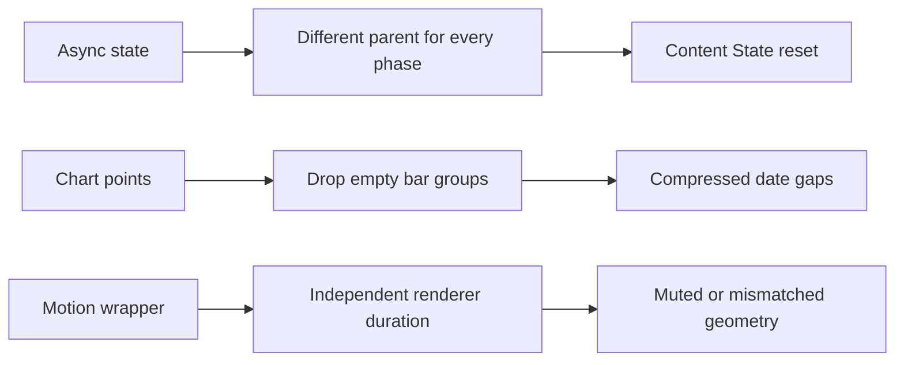
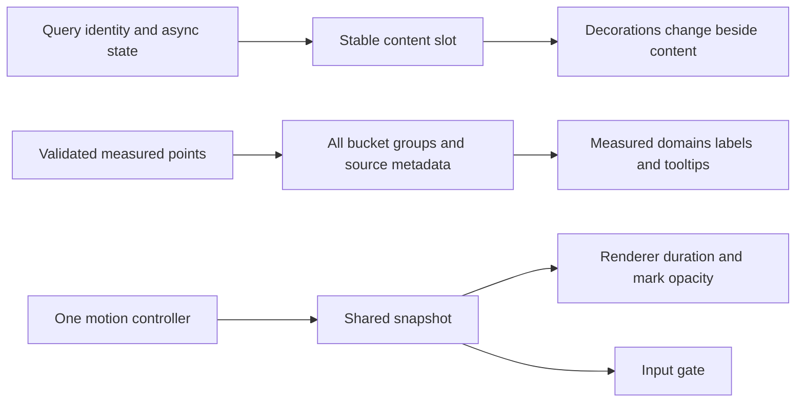
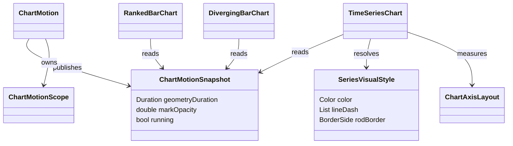

# Analytics Studio UI - Wave 2 Review Repairs Implementation Plan

> **For Gemini:** execute W2R1-W2R7 inline, in order, one commit per repair. Use systematic-debugging, test-driven-development, executing-plans and verification-before-completion. No subagents or pushes. Stop after the Wave 2 repair report. This is a repair of completed tasks4-6, not permission to repeat them or start Wave3.

**Goal:** Close BUG-0033 through BUG-0039 without changing analytics semantics or breaking later-wave chart consumers.

**Architecture:** Keep cached content mounted, preserve source provenance through chart metadata, and share one controller phase with each renderer. Layout measures actual styled text and retains natural content height. Existing public chart/async constructors stay callable; ChartMotion receives only the optional additions specified in W2R6.

**Tech stack:** pinned Flutter/Dart, Riverpod2.6.1 and fl_chart1.2.0; no new package or dependency upgrade.

**Spec:** [approved design](analytics-studio-ui-design.md), [master](analytics-studio-ui-implementation.md), [Wave2 contracts](analytics-studio-ui-wave2-implementation.md), [review and evidence](../../docs/reviews/2026-10-12-gemini-ui-wave2-review.md).

## Start and precedence

Reviewed base `81649a3`, implementation head `16c96da`: tasks4-6 are already committed. Read current source/status first. Original tasks and previous amendments remain contracts except where this repair plan explicitly replaces an algorithm/assertion. In particular, empty bar **groups** must remain although missing bar **rods** must not exist; the old `[0,2]` group expectation is wrong. W2R6 replaces the incomplete private motion handoff with an exact cross-file API.

| Order | Bug | Deliverable | Owned production files | Owned tests |
|---|---|---|---|---|
| W2R1 |0033 | Stable same-query subtree | `app/lib/src/widgets/studio_async_panel.dart` | `app/test/studio_async_panel_test.dart` |
| W2R2 |0034 | Bounded, pattern-aware actual legend | `app/lib/src/widgets/charts/time_series_chart.dart`; create `series_visual_style.dart` | `app/test/studio_charts_test.dart`; create `series_visual_style_test.dart` |
| W2R3 |0035 | Fixed fraction domains | `app/lib/src/widgets/charts/time_series_chart.dart` | `app/test/studio_charts_test.dart`, `funnel_trend_widgets_test.dart` |
| W2R4 |0036 | Empty bucket positions | `app/lib/src/widgets/charts/time_series_chart.dart` | `app/test/studio_charts_test.dart` |
| W2R5 |0037 | Source-based bar tooltips | `app/lib/src/widgets/charts/time_series_chart.dart` | `app/test/studio_charts_test.dart` |
| W2R6 |0038 | Controller phase and renderer ownership | `app/lib/src/widgets/charts/chart_motion.dart`, `time_series_chart.dart`, `ranked_bar_chart.dart`, `diverging_bar_chart.dart` | `app/test/studio_charts_test.dart`, `motion_policy_test.dart` |
| W2R7 |0039 | Complete ranked text and measured axes | create `app/lib/src/widgets/charts/chart_axis_layout.dart`; modify `time_series_chart.dart`, `ranked_bar_chart.dart`, `diverging_bar_chart.dart` | create `app/test/chart_axis_layout_test.dart`; modify `studio_charts_test.dart` |

Paths in the table are relative to repository root; the second and later test names in a cell are also under `app/test/`. No page adoption, server algorithm, provider cancellation or table bold-text repair belongs here.

## Global constraints and review focus

- Preserve all four themes, source values/units, fraction0..1 representation, unavailable gaps, genuine stored zeros, incomplete edges, confidence/statistical oracles and stable series registry lifetime.
- No count-up text. Legend/name/value/data-view text always represents current measured data; only marks reveal/interpolate.
- Keep TimeSeriesChart/MetricLineChart/ChartFrame/RankedBarChart/DivergingBarChart and StudioAsyncPanel existing constructor calls valid. Do not add required parameters.
- Keep ChartFrame minimum-height ownership and TimeSeriesChart plot-only height. Long legends/ranked lists grow; bounded frame parents may scroll.
- Use textScaler, inherited effective style and boldText when measuring new text. Do not touch `studio_table.dart` or BUG-0026.
- Preserve owner dirty plans/memory and all unrelated files. Stage explicit production/test files only, never plans or ledger automatically. No stash/reset/checkout of this worktree and no push.
- Bug status starts CONFIRMED. A written plan does not fix production. Move to VERIFY_PENDING after implementation, then RESOLVED only with the owning assertions passing. Record evidence without staging ledger.

| Easily missed input | Required proof |
|---|---|
| Same-query refresh/error following user scroll or selection | Child State and scroll offset survive; changed query creates new state |
| 120-character unbroken names, scale1.5, boldText and palette overflow | Actual series/ranked paragraphs fit; corresponding plot/legend pattern agrees |
| Fraction singleton, actual zero, null middle bucket, sparse/fractional x | Domains0..1; null group empty but position retained; zero rod retained |
| Missing rod changes its ordinal index in grouped bars | Tooltip uses current source metadata, never sorted-series index guess or tween value |
| Topology update, reduced motion and hidden ticker mid-animation | Exact geometry immediate when required; gate/reveal and renderer duration agree |

## Before and after







## Common test setup

Run commands from `app` unless stated otherwise. Existing `pumpStudio` is available in `test/support/studio_test_host.dart`; check its actual signature before reuse. For new tests below use this explicit local helper, which does **not** settle away motion state:

```dart
Future<void> pumpRepairChart(WidgetTester t, Widget child, {
  double width = 320,
  double scale = 1,
  bool bold = false,
  bool reduced = false,
  bool active = true,
  AppStyle style = AppStyle.tremor,
}) async {
  await t.pumpWidget(MaterialApp(theme: buildTheme(style),
    themeAnimationDuration: Duration.zero, home: MediaQuery(
    data: MediaQueryData(textScaler: TextScaler.linear(scale),
      boldText: bold, disableAnimations: reduced),
    child: Scaffold(body: Align(alignment: Alignment.topLeft,
      child: SizedBox(width: width, child: TickerMode(enabled: active,
        child: SingleChildScrollView(child: child))))),
  )));
}
```

Imports in `studio_charts_test.dart`: material, flutter_test, fl_chart, app_style, chart_models, time_series_chart, chart_motion, ranked_bar_chart, diverging_bar_chart, series_visual_style, chart_axis_layout and `support/studio_text_assertions.dart`. Helpers live outside `main`; tests live inside it. New helper/API tests may initially fail to compile because their owning production file is not created yet; record that separately from behavioral red assertions.

## W2R1 - Keep cached content State through every same-query phase

**Consumes:** existing queryKey equality, completed AsyncData-only acceptance and nullable success flag. **Produces:** same API and same cached data, with stable Element identity. Do not weaken loading/error provenance rules.

- [ ] Add this fixture and regression to `studio_async_panel_test.dart` before changing the panel:

```dart
class _ScrollProbe extends StatefulWidget {
  const _ScrollProbe();
  @override
  State<_ScrollProbe> createState() => _ScrollProbeState();
}
class _ScrollProbeState extends State<_ScrollProbe> {
  final controller = ScrollController();
  bool selected = false;
  @override
  void dispose() { controller.dispose(); super.dispose(); }
  @override
  Widget build(BuildContext context) => SizedBox(height: 160,
    child: ListView(controller: controller, children: [
      Switch(value: selected, onChanged: (v) => setState(() => selected = v)),
      for (var i = 0; i < 40; i++) SizedBox(height: 40, child: Text('row $i')),
    ]));
}
```

```dart
testWidgets('same query preserves State scroll and selection across phases', (t) async {
  final key = ValueNotifier<Object>('A');
  final value = ValueNotifier<AsyncValue<int>>(const AsyncData(7));
  addTearDown(key.dispose); addTearDown(value.dispose);
  await t.pumpWidget(MaterialApp(home: Scaffold(body:
    ValueListenableBuilder<Object>(valueListenable: key, builder: (_, k, __) =>
      ValueListenableBuilder<AsyncValue<int>>(valueListenable: value,
        builder: (_, v, __) => StudioAsyncPanel<int>(queryKey: k, value: v,
          onRetry: () {}, builder: (_) => const _ScrollProbe()))))));
  final original = t.state<_ScrollProbeState>(find.byType(_ScrollProbe));
  await t.tap(find.byType(Switch)); await t.pump();
  original.controller.jumpTo(200); await t.pump();
  for (final next in <AsyncValue<int>>[
    const AsyncLoading<int>().copyWithPrevious(const AsyncData(7)),
    AsyncError<int>(StateError('refresh failed'), StackTrace.empty)
      .copyWithPrevious(const AsyncData(7)),
    const AsyncData(8),
  ]) {
    value.value = next; await t.pump();
    final now = t.state<_ScrollProbeState>(find.byType(_ScrollProbe));
    expect(identical(now, original), isTrue);
    expect(now.controller.offset, 200);
    expect(now.selected, isTrue);
  }
  key.value = 'B'; value.value = const AsyncData(9); await t.pump();
  final replacement = t.state<_ScrollProbeState>(find.byType(_ScrollProbe));
  expect(identical(replacement, original), isFalse);
  expect(replacement.controller.offset, 0);
  expect(replacement.selected, isFalse);
});
```

- [ ] Run `flutter test test/studio_async_panel_test.dart --plain-name "same query preserves"`; current code must fail State identity on loading.
- [ ] Replace the three cached return shapes with one `_cachedContent` composition. Notification occupies child slot0, keyed content occupies slot1 in all cached phases. Use `KeyedSubtree(key: ValueKey(widget.queryKey), child: widget.builder(_lastSuccess as T))`; no freshly allocated List key or GlobalKey workaround. A hidden notification is `SizedBox.shrink`, not removal of its slot. The same wrapper and keyed subtree must be constructed for completed success, cached loading and cached error.

```dart
Widget cachedColumn({required Widget notice, required Widget content,
  required bool bounded}) {
  return Column(mainAxisSize: bounded ? MainAxisSize.max : MainAxisSize.min,
    crossAxisAlignment: CrossAxisAlignment.stretch, children: [
      notice,
      if (bounded) Expanded(child: content) else content,
    ]);
}
```

Use LayoutBuilder to select bounded height versus natural-height layout. Same host constraints retain the same branch through phases. In a bounded host, Expanded gives scrollable builders finite remaining height; in a vertical page scroll, natural content grows. ErrorRetry inline banner remains bounded/wrapping above data, not an overlay obscuring data. Updating banner remains small. A branch change because host height constraints genuinely change is outside the same-phase regression; never trigger one based on loading/error state itself.

- [ ] Test both the bounded scaffold fixture above and an unbounded SingleChildScrollView host with a Column builder, each through success/loading/error. Initial loading/error and nullable success tests remain intact; new-key previous wrappers must show no old content.
- [ ] Run `flutter test test/studio_async_panel_test.dart test/api_client_test.dart`; run `flutter analyze`.
- [ ] Commit only panel and owning test: `fix(ui): preserve async content state through refresh`.

## W2R2 - Bound the real series legend and share plot styles

**Consumes:** retained SeriesStyleRegistry, sorted IDs, theme palette, reference IDs `previous`/`alert-baseline`. **Produces:** reusable style resolver and production legend displaying those same styles. Do not create a second registry or alter existing slot assignment.

- [ ] Add actual TimeSeriesChart coverage, not a ChartFrame plain-Text legend test:

```dart
testWidgets('actual series legend wraps full long label', (t) async {
  final label = List.filled(20, 'long series name').join(' ');
  await pumpRepairChart(t, TimeSeriesChart(unit: 'events', series: [
    ChartSeries(id: 'reference', label: label,
      points: const [ChartPoint(0, 1, label: 'day')]),
  ]), scale: 1.5, bold: true, reduced: true);
  expect(t.takeException(), isNull);
  expectCompleteWrappedText(t, find.text(label));
  final paragraph = t.getRect(find.text(label));
  expect(paragraph.right, lessThanOrEqualTo(320.5));
});
```

- [ ] Run `flutter test test/studio_charts_test.dart --plain-name "actual series legend"`; current Row overflows.
- [ ] Create `series_visual_style.dart` with the exact interface below. Resolver validates nonempty palette/slot>=0, uses palette[slot%length], cycle=slot~/length. Reference line dash `[6,4]`; ordinary cycles use `null,[6,4],[2,4],[8,3,2,3]`; incomplete edge overrides with `[1,4]`. For rods, cycle0 ordinary uses BorderSide.none; repeated palette cycles or reference use an onSurface outline, width1 for cycle1/reference, width2 for cycle2, width3 for cycle3, then repeat. Apply partial rendering with the same outline plus an explicit partial legend key when such rods exist. Labels and source tooltips distinguish every series even after pattern cycles repeat.

```dart
class SeriesVisualStyle {
  const SeriesVisualStyle({required this.color, required this.lineDash,
    required this.rodBorder});
  final Color color;
  final List<int>? lineDash;
  final BorderSide rodBorder;
}
SeriesVisualStyle resolveSeriesVisualStyle({required List<Color> palette,
  required int slot, required String seriesId, required Color outline}) {
  if (palette.isEmpty || slot < 0) throw ArgumentError('Invalid series style input');
  final cycle = slot ~/ palette.length;
  final reference = seriesId == 'previous' || seriesId == 'alert-baseline';
  final patterns = <List<int>?>[null, [6, 4], [2, 4], [8, 3, 2, 3]];
  final outlineCycle = cycle > 0 ? cycle : 1;
  return SeriesVisualStyle(color: palette[slot % palette.length],
    lineDash: reference ? const [6, 4] : patterns[cycle % patterns.length],
    rodBorder: cycle == 0 && !reference ? BorderSide.none
      : BorderSide(color: outline, width: (((outlineCycle - 1) % 3) + 1).toDouble()));
}
```

Resolver source imports material; lineDash applies to complete edges, renderer applies incomplete override. Legend samples use a small CustomPainter that draws exact dash lengths at scale1 and same color; rod-kind samples draw the same fill/outline. Use keys `series-legend:<id>` on entry and `series-sample:<id>` on sample; Semantics describes solid/dashed/dotted/outlined/reference, no style info hidden from assistive text. Unit/partial context stays outside measured numeric strings.

- [ ] Put LayoutBuilder around Wrap. Each entry is ConstrainedBox(maxWidth: constraints.maxWidth) containing Row(mainAxisSize:min) with a fixed20px sample,6px gap and Flexible(loose) Text without maxLines/ellipsis. Short entries use natural width; long entries wrap fully. Legend stays outside plot-only SizedBox and outside mark fade/gate.

```dart
ConstrainedBox(constraints: BoxConstraints(maxWidth: availableWidth),
  child: Row(mainAxisSize: MainAxisSize.min, children: [
    sample,
    const SizedBox(width: 6),
    Flexible(child: Text(seriesLabel)),
  ]));
```

- [ ] Add `series_visual_style_test.dart` importing material/flutter_test/resolver. Assert slots0 and palette.length share color but have different lineDash and rodBorder; reference override equals `[6,4]`. Widget regression uses palette.length+1 series, then removes/reorders IDs and reinserts them; assert plot data and `series-sample:<id>` read the same resolved style via the sample CustomPainter's typed fields. Include long unbroken label and all four buildTheme(AppStyle) themes at scale1/1.5. Do not inspect only existence of sample keys.

```dart
test('palette overflow and reference keep identifiable styles', () {
  const palette = [Colors.blue, Colors.green];
  final first = resolveSeriesVisualStyle(palette: palette, slot: 0,
    seriesId: 'a', outline: Colors.black);
  final repeated = resolveSeriesVisualStyle(palette: palette, slot: 2,
    seriesId: 'c', outline: Colors.black);
  final reference = resolveSeriesVisualStyle(palette: palette, slot: 0,
    seriesId: 'previous', outline: Colors.black);
  expect(first.color, repeated.color);
  expect(first.lineDash, isNull);
  expect(repeated.lineDash, [6, 4]);
  expect(first.rodBorder, BorderSide.none);
  expect(repeated.rodBorder.width, greaterThan(0));
  expect(reference.lineDash, [6, 4]);
});
```
- [ ] Run `flutter test test/series_visual_style_test.dart test/studio_charts_test.dart`; analyze; commit only owned files: `fix(ui): wrap chart legends and match series patterns`.

## W2R3 - Fix percentage domains for line area and bars

**Consumes:** validated fraction values0..1, existing chartBounds x domain. **Produces:** exactly minY0/maxY1 for percentage=true, unchanged count/signed domains.

- [ ] Add regression before implementation:

```dart
testWidgets('fraction domains are fixed for every time chart kind', (t) async {
  for (final kind in TimeChartKind.values) {
    for (final value in [0.0, .3, 1.0]) {
      await pumpRepairChart(t, TimeSeriesChart(kind: kind, unit: '%',
        percentage: true, series: [ChartSeries(id: 'primary', label: 'Conversion',
          points: [ChartPoint(0, value, label: 'day')])]), reduced: true);
      final data = kind == TimeChartKind.bars
        ? t.widget<BarChart>(find.byType(BarChart)).data
        : t.widget<LineChart>(find.byType(LineChart)).data;
      // Branch explicitly to keep Dart static types exact.
      if (data is BarChartData) { expect(data.minY, 0); expect(data.maxY, 1); }
      if (data is LineChartData) { expect(data.minY, 0); expect(data.maxY, 1); }
    }
  }
});
```

- [ ] Run targeted test; current `.3` line/area minY=-.7.
- [ ] Keep chartBounds validation and finite positive x span. Within its existing try block, validate non-null percentage values are finite and in0..1; call chartBounds for structural validation, then replace y only. Preserve safe unavailable-domain fallback for unsupported finite magnitude. Do not silently clamp or divide100-based input. Existing argument-error policy for out-of-range percentages stays explicit and tested; do not swallow structural validation errors by rendering fabricated data.

```dart
final computed = chartBounds(sortedSeries,
  includeZero: widget.kind == TimeChartKind.bars || !widget.percentage);
bounds = widget.percentage
  ? ChartBounds(computed.minX, computed.maxX, 0, 1)
  : computed;
```

- [ ] Add mixed zero/null/one and invalid-.01/1.01/NaN/infinity cases; null has no measured mark. Count-only/negative tests still pass. Add Funnel integration assertion that displayed LineChart domain is0..1 while original source fractions, selected-step missing observations and percent copy/CSV remain unchanged.
- [ ] Run `flutter test test/studio_charts_test.dart test/funnel_trend_widgets_test.dart test/funnel_trend_view_test.dart`; analyze; commit: `fix(ui): constrain fraction chart axes to zero and one`.

## W2R4 - Keep blank bar buckets in painter layout

**Consumes:** sorted union of every source x, including nulls, and W2R2 rod styles. **Produces:** one group per actual bucket, zero rods for missing values, source-accurate ordinal identity.

- [ ] Replace old `zero bars are retained but missing bars are absent` assertion with groups `[0,1,2]`, rod counts `[1,0,1]`, actual zero-valued rods at0/2. This is the one authorized numeric expectation correction: the prior group-count oracle contradicted gap spacing. All other source-value oracles stay intact.
- [ ] Add this pinned painter-layout regression (import `package:fl_chart/src/extensions/bar_chart_data_extension.dart` **in tests only**):

```dart
testWidgets('blank bar bucket keeps physical space without a zero rod', (t) async {
  await pumpRepairChart(t, const TimeSeriesChart(kind: TimeChartKind.bars,
    unit: 'events', series: [ChartSeries(id: 'primary', label: 'Current', points: [
      ChartPoint(.1, 4, label: 'first'),
      ChartPoint(.2, null, label: 'missing'),
      ChartPoint(900, 8, label: 'last'),
    ])]), reduced: true);
  final d = t.widget<BarChart>(find.byType(BarChart)).data;
  expect(d.barGroups.map((g) => g.x), [0, 1, 2]);
  expect(d.barGroups[1].barRods, isEmpty);
  expect(d.barGroups[0].barRods.single.toY, 4);
  expect(d.barGroups[2].barRods.single.toY, 8);
  final positions = d.calculateGroupsX(240);
  expect(positions.length, 3);
  expect(positions[0], lessThan(positions[1]));
  expect(positions[1], lessThan(positions[2]));
  expect((positions[2] - positions[0]) / 2,
    closeTo(positions[1] - positions[0], .01));
  expect(find.text('missing'), findsOneWidget);
  expect(t.takeException(), isNull);
});
```

- [ ] Run targeted test; current group list length2 fails. Pinned group.width returns0 for empty rods and painter loops safely over empty lists; no sentinel zero rod required.
- [ ] Always append `BarChartGroupData(x: ord, barRods: rods, barsSpace: 0)` after rod collection. Set alignment: BarChartAlignment.spaceAround. Derive rodWidth under plot LayoutBuilder: `min(14.0, usableWidth / (2 * bucketCount * max(1, seriesCount)))`; positive finite usableWidth required before rendering. This caps total rod widths at half usable width, reserving positive spacing even for dense input; never clamp rodWidth upward and consume more width than available. Empty group still reserves spacing. For zero/negative available size show a bounded nonpainting SizedBox rather than dividing by zero.

```dart
barGroups.add(BarChartGroupData(x: ord, barRods: rods, barsSpace: 0));
```

- [ ] Keep all-gap branch before constructing BarChart; no fake plotted zero. Verify one-bucket, leading/trailing null, two consecutive nulls, grouped sparse series, fractional/sparse source x and stored zeros. Missing positions have labels when selected by axis stride; not all dates need visible ticks after W2R7.
- [ ] Run `flutter test test/studio_charts_test.dart test/chart_models_test.dart`; analyze; commit: `fix(ui): retain missing bucket positions in bar charts`.

## W2R5 - Format bar tooltips from current source metadata

**Consumes:** W2R4 group ordinal to source x, sorted series, rod order and original ChartPoint. **Produces:** current source-based tooltip with date/name/value/unit/partial, custom formatter and viewport fit.

- [ ] Add a `(group ordinal, rodIndex) -> (ChartSeries, ChartPoint)` map while adding each **actual** rod. Rod index is `rods.length` before insertion, not series index; missing earlier series means later rods shift. Empty groups have no metadata/touchable rod. Metadata gets rebuilt per measured revision; do not reuse it across topology updates.

```dart
final rodSources = <(int, int), (ChartSeries, ChartPoint)>{};
// In the valid, non-null point branch before rods.add:
rodSources[(ord, rods.length)] = (s, p);
```

- [ ] Configure exact callback under the renderer LayoutBuilder; tooltipStyle and formatter come from current theme/widget:

```dart
barTouchData: BarTouchData(touchTooltipData: BarTouchTooltipData(
  fitInsideHorizontally: true,
  fitInsideVertically: true,
  maxContentWidth: math.max(1.0, math.min(280.0, usableWidth - 32)),
  tooltipPadding: const EdgeInsets.all(8),
  getTooltipColor: (_) => theme.colorScheme.surfaceContainerHighest,
  getTooltipItem: (group, groupIndex, rod, rodIndex) {
    final source = rodSources[(group.x, rodIndex)];
    if (source == null) return null;
    final (series, point) = source;
    final formatted = _formatValue(point.value!);
    final valueText = widget.unit.isEmpty || widget.percentage
      ? formatted : '$formatted ${widget.unit}';
    return BarTooltipItem('${point.label}\n${series.label}: $valueText'
      '${point.incomplete ? ' (partial)' : ''}', tooltipStyle);
  },
)),
```

Never format `rod.toY` or use group.x as a rounded original x. Apply same maxContentWidth/padding fitting to line tooltips, retaining list cardinality. Very small usableWidth uses correspondingly bounded padding or omits nonessential popup while View data still exposes value; do not let fixed16px padding exceed available viewport.

- [ ] Add actual callback regression. Define local callback assertion helper inside this test; no invented fixture names:

```dart
testWidgets('bar tooltip maps sparse rods to original measured series', (t) async {
  await pumpRepairChart(t, const TimeSeriesChart(kind: TimeChartKind.bars,
    percentage: true, unit: '%', series: [
      ChartSeries(id: 'a', label: 'A missing', points: [
        ChartPoint(.1, null, label: 'bucket A'), ChartPoint(.2, .5, label: 'bucket B')]),
      ChartSeries(id: 'b', label: 'B actual', points: [
        ChartPoint(.1, .3, label: 'bucket A', incomplete: true),
        ChartPoint(.2, .7, label: 'bucket B')]),
    ]), reduced: true);
  final d = t.widget<BarChart>(find.byType(BarChart)).data;
  final group = d.barGroups.first;
  final tip = d.barTouchData.touchTooltipData;
  final item = tip.getTooltipItem(group, 0,
    group.barRods.first.copyWith(toY: .99), 0)!;
  expect(item.text, contains('bucket A'));
  expect(item.text, contains('B actual'));
  expect(item.text, contains('30.0%'));
  expect(item.text, contains('partial'));
  expect(item.text, isNot(contains('99.0%')));
  expect(item.text, isNot(contains('%%')));
  expect(tip.fitInsideHorizontally && tip.fitInsideVertically, isTrue);
  expect(tip.maxContentWidth, lessThanOrEqualTo(280));
});
```

- [ ] Run targeted regression red before implementation. Also test custom `(v) => v.toStringAsFixed(2)` with unit'lift' and value.95, ordinary count unit, reference label preservation, reordered series and topology update (metadata/current tooltip now names new bucket). Clear active tooltip selection on any measured revision: turn off built-in touch handling and own selected spot/indicator state so it can be cleared without remounting geometry on every value update. Implement touchCallback only for enabled events and clear selection on pointer exit/cancel. For line callbacks retain one output slot per input spot.
- [ ] Run `flutter test test/studio_charts_test.dart`; analyze; commit: `fix(ui): preserve source context in bar tooltips`.

## W2R6 - Give controller and renderer one motion phase

**Consumes:** topology key and measured revision, motionDuration policy, TickerMode, existing generic ChartMotion tests. **Produces:** backward-compatible optional constructor parameters and explicit read API. This supersedes earlier vague instruction to use a private cross-file handoff without explaining how renderers can read it.

### Exact interface and placement

Add to `chart_motion.dart`:

```dart
enum ChartMotionPhase { entrance, update, topology, settled }
class ChartMotionSnapshot {
  const ChartMotionSnapshot({required this.phase, required this.geometryDuration,
    required this.markOpacity, required this.running});
  final ChartMotionPhase phase;
  final Duration geometryDuration;
  final double markOpacity;
  final bool running;
}
// Optional additions to existing ChartMotion constructor:
// this.topologyRevision, this.fadeChild = true
// final Object? topologyRevision;
// final bool fadeChild;
// Static read API on ChartMotion:
// static ChartMotionSnapshot of(BuildContext context)
```

`ChartMotion.of` reads a private `_ChartMotionScope extends InheritedWidget` in this same file; no scope returns a settled snapshot with zero duration, opacity1 and running=false. `updateShouldNotify` compares all four snapshot fields. Existing callers with just dataRevision/child continue to get generic entrance fade and update gate. New chart renderers pass `fadeChild:false`: opacity is applied **only to mark colors**, leaving axes, row names, numeric labels and zero guide at full current values. ChartMotion still owns one `IgnorePointer(key: ValueKey('chart-motion-plot'))` gate and one controller.

TimeSeriesChart keeps legend outside and puts **Builder** under scope. Move fl_chart data/widget construction inside that Builder; reading duration above ChartMotion is the original bug.

```dart
ChartMotion(dataRevision: revision, topologyRevision: topology, fadeChild: false,
  child: Builder(builder: (context) {
    final motion = ChartMotion.of(context);
    final markColor = baseColor.withValues(alpha: baseColor.a * motion.markOpacity);
    // Build the complete plot here using markColor for marks only.
    return LineChart(lineData, key: ValueKey(topology),
      duration: motion.geometryDuration);
  }));
```

In that placement example, `baseColor` means the per-series resolved color and `lineData` is constructed inside the Builder using that color; do not capture a plot already constructed above the scope. BarChart follows identical ownership. Keep static themed axis/grid/tooltip styles; fade line strokes, single-point dots, area fill and rod fill/outline consistently. A FlDotCirclePainter must receive faded color for singleton reveal. Do not fade tooltips or exact text and do not use opacity to hide measured data during normal refresh.

### Controller transition table

| Trigger | Phase | Controller duration | Geometry duration | Mark opacity | Gate |
|---|---|---|---|---|---|
| First nonempty plot mount | entrance |400ms |zero |controller.value |while running |
| Same topology, changed measured revision | update |350ms |350ms |1 |while running |
| Changed topology or chart kind | topology |350ms |zero |controller.value |while running |
| Same input / theme rebuild only | preserve current phase |no restart |current phase duration |current phase rule |current phase rule |
| disableAnimations or accessibleNavigation or inactive TickerMode | settled |stop, value1 |zero |1 |false |
| TickerMode reactivated without new data | settled |no restart |zero |1 |false |
| Controller completes | settled |stopped |zero |1 |false |

In didUpdateWidget compare topologyRevision **before** dataRevision; a topology change starts topology even if values match. One controller restarted from0 handles interrupted updates; never create delayed futures/timers. In didChangeDependencies stop/complete immediately when either accessibility flag or ticker disables. Retain a consumed-entrance flag so reactivation cannot replay entrance. On disposal controller.dispose. Include kind/IDs/ordered x/null/partial masks in topology; labels/values belong revision, not geometry key. Horizontal ranked/diverging topology is ordered IDs and sign-side membership for diverging (sign change must not tween unrelated left/right slots); labels/values belong revision.

For RankedBarChart/DivergingBarChart wrap rows in ChartMotion(fadeChild:false) and a descendant Builder. Render each mark using TweenAnimationBuilder<double> keyed by `ranked-bar:<id>`, tween target=current normalized widthFactor and duration=snapshot.geometryDuration. Its builder constructs FractionallySizedBox(widthFactor:animated). New topology/entrance duration0 paints correct geometry immediately, then mark colors fade; ordinary updates tween350ms. Exact label/value widgets are built from current input outside the tween builder. One shared controller gates all marks; no controller per row, no second time-series geometry tween. Preserve existing signed guide/direction keys.

### Required actual-renderer regression

- [ ] Add tests before implementation:

```dart
testWidgets('actual renderer phase matches gate and topology', (t) async {
  Future<void> show(double y, {bool gap = false, bool active = true,
    bool reduced = false}) => pumpRepairChart(t, TimeSeriesChart(
      key: const ValueKey('stable-chart'), unit: 'events', series: [
        ChartSeries(id: 'primary', label: 'Current', points: [
          ChartPoint(0, y, label: 'a'), ChartPoint(1, gap ? null : 2, label: 'b')]),
      ]), active: active, reduced: reduced);
  bool gated() => t.widget<IgnorePointer>(
    find.byKey(const ValueKey('chart-motion-plot'))).ignoring;
  await show(1);
  final initialKey = t.widget<LineChart>(find.byType(LineChart)).key;
  expect(t.widget<LineChart>(find.byType(LineChart)).duration, Duration.zero);
  expect(gated(), isTrue);
  await t.pump(const Duration(milliseconds: 401)); expect(gated(), isFalse);
  await show(3);
  expect(t.widget<LineChart>(find.byType(LineChart)).key, initialKey);
  expect(t.widget<LineChart>(find.byType(LineChart)).duration,
    const Duration(milliseconds: 350));
  expect(gated(), isTrue);
  await t.pump(const Duration(milliseconds: 351)); expect(gated(), isFalse);
  await show(3, gap: true);
  expect(t.widget<LineChart>(find.byType(LineChart)).key, isNot(initialKey));
  expect(t.widget<LineChart>(find.byType(LineChart)).duration, Duration.zero);
  final context = t.element(find.byType(LineChart));
  expect(ChartMotion.of(context).markOpacity, lessThan(1));
  await show(4, gap: true, active: false);
  expect(t.widget<LineChart>(find.byType(LineChart)).duration, Duration.zero);
  expect(ChartMotion.of(t.element(find.byType(LineChart))).markOpacity, 1);
  expect(gated(), isFalse);
  await show(4, gap: true, active: true); expect(gated(), isFalse);
  expect(t.hasRunningAnimations, isFalse);
});
```

- [ ] Execute red phase; current initial renderer duration350 fails. Port the inactive/reduced assertions to actual BarChart, and check its source rod value changes immediately during inactivity. Test accessibleNavigation separately; pump finite intervals while animation active. Generic wrapper tests remain valid with optional additions.
- [ ] Add horizontal renderer test: first frame names/numeric text present and complete, mark opacity<1; after401ms opacity1; same-ID width change at175ms lies strictly between old/new rendered widths; at351ms equals target. Reduced/inactive update reaches target immediately with no gate. Use retained `ranked-bar:<id>` keys and RenderBox dimensions, not only hasRunningAnimations. Sign-crossing diverging update remounts marks with zero geometry duration, correct left/right direction and topology fade.
- [ ] Root coverage: in `motion_policy_test.dart` pump real AnalyticApp inside ProviderScope with existing provider overrides but **without an ancestor MediaQuery**; toggle `t.platformDispatcher.accessibilityFeaturesTestValue = FakeAccessibilityFeatures(disableAnimations:true)` and then accessibleNavigation. Import `package:flutter_test/flutter_test.dart` for FakeAccessibilityFeatures and register teardown `clearAccessibilityFeaturesTestValue`. Assert actual MaterialApp.themeAnimationDuration becomes zero; restore and assert200ms. Follow existing app fixture to avoid live HTTP; test must not depend on endpoint availability. This test already passes at16c96da; retain it as new coverage, not as a claimed repaired root defect.

The existing fixture uses `src/providers.dart`, not `src/state/providers.dart`; no prefsProvider exists. Imports already include AnalyticApp, providers, analytic_shared and Riverpod. Use this exact additional root test:

```dart
testWidgets('root view accessibility changes update theme duration', (t) async {
  addTearDown(t.platformDispatcher.clearAccessibilityFeaturesTestValue);
  await t.pumpWidget(ProviderScope(overrides: [
    daysProvider.overrideWith((ref) async => []),
    eventNamesProvider.overrideWith((ref) async => []),
    filterOptionsProvider.overrideWith((ref) async =>
      const FilterOptions(platforms: [], versions: [])),
    overviewProvider.overrideWith((ref, f) async => const OverviewData(
      kpis: Kpis(dau: 0, newUsers: 0, sessions: 0,
        sessionsPerDau: null, playtimeMinPerDau: null, uninstalls: 0),
      previous: null, daily: [])),
  ], child: const AnalyticApp()));
  await t.pump();
  for (final features in [
    const FakeAccessibilityFeatures(disableAnimations: true),
    const FakeAccessibilityFeatures(accessibleNavigation: true),
    const FakeAccessibilityFeatures(),
  ]) {
    t.platformDispatcher.accessibilityFeaturesTestValue = features;
    await t.pump();
    expect(t.widget<MaterialApp>(find.byType(MaterialApp)).themeAnimationDuration,
      features.disableAnimations || features.accessibleNavigation
        ? Duration.zero : const Duration(milliseconds: 200));
  }
});
```
- [ ] Run `flutter test test/motion_policy_test.dart test/studio_charts_test.dart test/theme_test.dart`; analyze; commit: `fix(ui): synchronize chart phases geometry and interaction`.

## W2R7 - Show complete ranked names and measure real axes

**Consumes:** current theme effective text style, source buckets, fraction/count formatter and available plot width. **Produces:** natural row height and consistent axis measurements, no new statistical formatting.

### Ranked and diverging rows

- [ ] Remove maxLines2/ellipsis; names wrap fully. Numeric text stays full precision/unit, never truncated or counted up. Let label/value paragraphs determine row height; keep mark band20px centered in that natural row. Preserve zero and signed guides.
- [ ] Use LayoutBuilder with shared label/value allocations across rows. Measure maximum formatted value width with TextPainter effective font/style/scaler/boldText plus8px. When `availableWidth >= maxValueWidth + 160`, allocate value width=maxValueWidth, label width=min(240,max(96,availableWidth*.35)), plot takes remaining width after16px gaps; reduce label width if required to retain at least64px plot. Below that width, each row has full-width wrapped name/value on top and full-width mark below, no fixed90px numeric cell. Same layout algorithm in both ranked variants; don't duplicate drifting kernels.
- [ ] In stacked diverging layout draw per-row zero guide at the mark band's center; in side-by-side layout guide spans mark bands only. Existing `diverging-zero-guide` key remains on the first guide so old direction test finds exactly one; additional guides use `diverging-zero-guide:<id>`. All marks share same symmetric maxAbs normalization.

```dart
testWidgets('ranked names and exact values fit natural rows', (t) async {
  final name = List.filled(30, 'VeryLongEventName').join();
  const number = 123456789012.0;
  for (final diverging in [false, true]) {
    final rows = [RankedValue('long', name, number)];
    final chart = diverging
      ? DivergingBarChart(values: rows, unit: 'events', valueFormatter: (n) => n.toStringAsFixed(0))
      : RankedBarChart(values: rows, unit: 'events', valueFormatter: (n) => n.toStringAsFixed(0));
    await pumpRepairChart(t, chart, width: 280, scale: 1.5, bold: true, reduced: true);
    expect(t.takeException(), isNull);
    expectCompleteWrappedText(t, find.text(name));
    expectCompleteWrappedText(t, find.text('123456789012 events'));
  }
});
```

### Axis layout helper

Create `chart_axis_layout.dart` importing math/material/chart_models. Exact interface:

```dart
class ChartAxisLayout {
  const ChartAxisLayout({required this.xTicks, required this.yTicks,
    required this.yReservedSize, required this.xReservedSize,
    required this.xLabelWidth});
  final Map<double, String> xTicks;
  final List<double> yTicks;
  final double yReservedSize, xReservedSize, xLabelWidth;
}
ChartAxisLayout measureChartAxes({required BuildContext context,
  required double width, required ChartBounds bounds,
  required List<ChartPoint> buckets, required bool ordinalBars,
  required String Function(num) formatY, required TextStyle style,
  double plotHeight = 240, List<double>? barCenters}) {
  if (!width.isFinite || width <= 0) throw ArgumentError('Axis width must be positive');
  if (barCenters != null && barCenters.length != buckets.length) {
    throw ArgumentError('Bar centers must match bucket count');
  }
  final effective = DefaultTextStyle.of(context).style.merge(style).copyWith(
    fontWeight: MediaQuery.boldTextOf(context) ? FontWeight.bold : style.fontWeight);
  final scaler = MediaQuery.textScalerOf(context);
  final direction = Directionality.of(context);
  Size measure(String value, {double maxWidth = double.infinity}) {
    final p = TextPainter(text: TextSpan(text: value, style: effective),
      textScaler: scaler, textDirection: direction)..layout(maxWidth: maxWidth);
    final size = p.size; p.dispose(); return size;
  }
  final ys = <double>[];
  for (final fraction in [0.0, .25, .5, .75, 1.0]) {
    final value = bounds.minY * (1 - fraction) + bounds.maxY * fraction;
    if (value.isFinite && !ys.contains(value)) ys.add(value);
  }
  final measuredY = ys.fold<double>(0,
    (largest, y) => math.max(largest, measure(formatY(y)).width)) + 8;
  final reservedY = width - measuredY - 8 >= 64 ? measuredY : 0.0;
  final usable = math.max(1.0, width - reservedY - 8);
  final capacity = math.max(2, (usable / 88).floor());
  final stride = math.max(1, (buckets.length / capacity).ceil());
  final labelWidth = math.max(1.0, usable / capacity - 8);
  final chosen = <double, String>{};
  var lastRight = double.negativeInfinity;
  var maxHeight = 0.0;
  for (var i = 0; i < buckets.length; i += stride) {
    final normalized = ordinalBars
      ? (barCenters?[i] ?? (i + .5) / buckets.length)
      : (buckets[i].x - bounds.minX) / (bounds.maxX - bounds.minX);
    final center = normalized.clamp(0.0, 1.0) * usable;
    final left = (center - labelWidth / 2).clamp(0.0, usable - labelWidth);
    if (left < lastRight + 8) continue;
    chosen[ordinalBars ? i.toDouble() : buckets[i].x] = buckets[i].label;
    lastRight = left + labelWidth;
    maxHeight = math.max(maxHeight, measure(buckets[i].label, maxWidth: labelWidth).height);
  }
  final measuredX = chosen.isEmpty ? 0.0 : maxHeight + 8;
  final reservedX = math.max(200.0, plotHeight) - measuredX >= 80 ? measuredX : 0.0;
  return ChartAxisLayout(xTicks: chosen, yTicks: ys, yReservedSize: reservedY,
    xReservedSize: reservedX, xLabelWidth: labelWidth);
}
```

Deduplicate bucket x in sorted order before calling. For bars, keys are **ordinal doubles** back to original source labels; for line/area, keys are original x. Effective style merges DefaultTextStyle and explicit axis style; if MediaQuery.boldTextOf is true apply FontWeight.bold before measurement/rendering. Pass MediaQuery.textScalerOf and Directionality.of to TextPainter. Dispose painters.

Pass actual widget.plotHeight into helper. For bars, first measure with default centers to get the y reservation, then build groups using that usable width. Compute normalized actual centers with the pinned spaceAround formula: eachSpace=(usableWidth-sumGroupWidths)/(2*groupCount); for each group accumulate eachSpace, half group width, record center/usableWidth, then accumulate half width and eachSpace. Call helper again with `barCenters` for final collision-filtered selection; y reservation does not depend on these centers, so this has no sizing feedback loop. Do not import a fl_chart `src` extension into production; the test uses pinned source as an independent oracle.

Algorithm and ownership:

1. Pick y tick targets across representable bounds using fractions0,.25,.5,.75,1. Compute `minY*(1-f)+maxY*f` to avoid span multiplication underflow/overflow where possible; discard duplicates/nonfinite positions. Format through same percentage/count/custom formatter. Measure widest y label +8px as yReservedSize; do not suppress endpoints merely because they're min/max. Axis helper tests use values with explicit custom long formatter so fmtCount abbreviation cannot hide clipping.
2. If yReservedSize would leave less64px plot, move y labels to a bounded full-width wrapped scale key above plot (each label contains its formatted value), set yReservedSize0 and hide left axis. Exact data remains available. Do not cap y width and clip digits. Above-plot scale key grows naturally outside plot height and mark reveal. Recalculate capacity after this fallback.
3. usableWidth=max(1,width-yReservedSize-8); capacity=max(2,floor(usableWidth/88)); stride=max(1,ceil(bucketCount/capacity)). Candidate original bucket indices are0,stride,2*stride...; never add a last tick if it would exceed capacity. Empty buckets can be selected; ticks never manufacture missing source coordinates. Single bucket selects one tick. For line/area sparse coordinates, capacity alone is insufficient: project each candidate using its actual source x and domain span, clamp its finite label box inside plot edges, then keep candidates left-to-right only when their boxes do not intersect the last kept box plus8px spacing. Thus `.1,.2,900` may display only `.1` and900; all source values remain in View data/tooltip. Do not move a label away from its bucket solely to retain another tick. Bars apply the same final collision filter using actual group center positions, not assumptions about equally sized groups.
4. xLabelWidth=max(1,usableWidth/capacity-8). Layout selected original labels with TextPainter(maxWidth:xLabelWidth), no maxLines/ellipsis; max measured height+8 determines xReservedSize. Selected labels wrap fully within that finite width. If that consumes so much height that plot would have less80px mark area, render selected date labels in a full-width wrapped key below the plot and set xReservedSize0/hide bottom titles; chart geometry remains finite rather than producing a negative canvas size.
5. Use SideTitles intervals only to request actual selected coordinates: for line irregular/fractional x, don't rely on default nice-step ticks to happen to hit source positions. Disable fl_chart bottom titles and draw a measured label strip with Stack/Positioned at source-domain fractions for line/area, or pinned group center positions for bars, using SideTitleWidget/edge-fit equivalent constraints. A regular ordinal bar axis may use SideTitles(interval:1) and lookup xTicks when selected. The strip is plot-width scoped, accounts for yReservedSize, and clamps label boxes inside left/right edges. Tick labels belong outside ChartMotion marks. If using strip instead of built-in titles, subtract its height exactly once from the plot's existing height, not twice. Unknown/fractional callback values never round into source indices.

Implementation kernel for candidate tick indices, followed by the collision filter specified above:

```dart
final capacity = math.max(2, (usableWidth / 88).floor());
final stride = math.max(1, (buckets.length / capacity).ceil());
final selected = <double, String>{
  for (var i = 0; i < buckets.length; i += stride)
    (ordinalBars ? i.toDouble() : buckets[i].x): buckets[i].label,
};
```

The helper exposes measurements/selected coordinates for pure layout assertions; it is not a replacement source model. Renderer uses exactly that selection, effective text style and formatter. Apply y interval consistently with helper targets (span/4 where representable), or draw the same measured y labels in a dedicated strip; avoid nice-step callbacks generating unmeasured labels. Keep grid alignment with the chosen y positions. Theme changes remeasure with new font; only measured data/topology changes restart chart motion.

- [ ] Add `chart_axis_layout_test.dart` pumping a Builder in MaterialApp/MediaQuery and calling helper with31 buckets. At width320 assert selected count<=max2,floor(usableWidth/88), each selected label comes from its source point and ordinalBars correctly maps fractional x. Measure y value string with independent TextPainter and assert reservation>=full width+8. Repeat scale1.5/boldtrue and all four themes.

Add these tests after importing material, flutter_test, `dart:math as math`, chart_axis_layout, chart_models and app_style. The formatter yields a long but still side-axis-fit label, so this test must not take the full-width scale-key fallback:

```dart
testWidgets('axis ticks use source coordinates and measured scaled style', (t) async {
  final buckets = [for (var i = 0; i < 31; i++)
    ChartPoint(i + .1, i.toDouble(), label: 'day $i')];
  for (final theme in AppStyle.values) {
    for (final bars in [false, true]) {
      await t.pumpWidget(MaterialApp(theme: buildTheme(theme), home: MediaQuery(
        data: const MediaQueryData(textScaler: TextScaler.linear(1.5), boldText: true),
        child: Builder(builder: (context) {
          final style = DefaultTextStyle.of(context).style.merge(
            const TextStyle(fontSize: 10)).copyWith(fontWeight: FontWeight.bold);
          String formatter(num n) => '${n.toStringAsFixed(2)} units';
          final layout = measureChartAxes(context: context, width: 320,
            bounds: const ChartBounds(.1, 30.1, 0, 30), buckets: buckets,
            ordinalBars: bars, formatY: formatter, style: style);
          final usable = math.max(1.0, 320 - layout.yReservedSize - 8);
          final capacity = math.max(2, (usable / 88).floor());
          expect(layout.xTicks.length, lessThanOrEqualTo(capacity));
          for (final entry in layout.xTicks.entries) {
            final index = bars ? entry.key.toInt()
              : buckets.indexWhere((p) => p.x == entry.key);
            expect(index, greaterThanOrEqualTo(0));
            expect(entry.value, buckets[index].label);
          }
          final painter = TextPainter(text: TextSpan(text: formatter(30), style: style),
            textDirection: Directionality.of(context),
            textScaler: MediaQuery.textScalerOf(context))..layout();
          expect(layout.yReservedSize + .5, greaterThanOrEqualTo(painter.width + 8));
          painter.dispose();
          return const SizedBox.shrink();
        }),
      )));
    }
  }
});
```

```dart
testWidgets('fractional line axis never rounds into list indices', (t) async {
  await t.pumpWidget(MaterialApp(home: Builder(builder: (context) {
    const buckets = [ChartPoint(.1, 1, label: 'A'),
      ChartPoint(.2, 2, label: 'B'), ChartPoint(900, 3, label: 'C')];
    final layout = measureChartAxes(context: context, width: 720,
      bounds: const ChartBounds(.1, 900, 0, 3), buckets: buckets,
      ordinalBars: false, formatY: (v) => v.toStringAsFixed(0),
      style: const TextStyle(fontSize: 10));
    expect(layout.xTicks, {.1: 'A', 900.0: 'C'});
    return const SizedBox.shrink();
  })));
});
```
- [ ] Add actual renderer tests with31 days at widths280/320/720 and long custom y labels. For every visible date/numeric Text call expectCompleteWrappedText and assert its rect inside chart width. Test sparse x `.1,.2,900` labels align with actual positions and no invented ordinal label appears on line. Verify plot remains at least80px mark area after overflow-key fallback. Use keys `chart-x-tick:<index>`, `chart-y-tick:<index>`, `chart-scale-key`, `chart-date-key` for targeted finders rather than broad find.text collisions.

Put tick keys on the actual Text widgets, `chart-scale-key`/`chart-date-key` on their fallback containers and `chart-mark-area` on the actual finite geometry area. These keys are layout-test hooks, not public constructor changes. Add this renderer dimension test in addition to the pure helper tests:

```dart
testWidgets('actual dense chart axes fit across themes widths and larger text', (t) async {
  final points = [for (var i = 0; i < 31; i++)
    ChartPoint(i.toDouble(), (i + 1).toDouble(), label: '2026-10-${i + 1}')];
  for (final style in AppStyle.values) {
    for (final width in [280.0, 320.0, 720.0]) {
      for (final kind in TimeChartKind.values) {
        await pumpRepairChart(t, TimeSeriesChart(kind: kind, unit: 'events',
          valueFormatter: (v) => '${v.toStringAsFixed(2)} measured events',
          series: [ChartSeries(id: 'primary', label: 'Current', points: points)]),
          style: style, width: width, scale: 1.5, bold: true, reduced: true);
        expect(t.takeException(), isNull);
        final labels = find.byWidgetPredicate((w) {
          if (w is! Text || w.key is! ValueKey<String>) return false;
          final key = (w.key! as ValueKey<String>).value;
          return key.startsWith('chart-x-tick:') || key.startsWith('chart-y-tick:');
        });
        expect(labels, findsWidgets);
        for (var i = 0; i < labels.evaluate().length; i++) {
          final label = labels.at(i);
          expectCompleteWrappedText(t, label);
          final rect = t.getRect(label);
          expect(rect.left, greaterThanOrEqualTo(-.5));
          expect(rect.right, lessThanOrEqualTo(width + .5));
        }
        expect(t.getSize(find.byKey(const ValueKey('chart-mark-area'))).height,
          greaterThanOrEqualTo(80));
      }
    }
  }
});
```

Fallback key labels also carry `chart-y-tick:<index>` or `chart-x-tick:<index>` so the same dimension assertions cover long above/below-plot keys. Row labels are not included in this finder. Complete source date access stays in View data/tooltip even when a tick is deliberately skipped for collision prevention.
- [ ] Execute new ranked regression red first; source at16c96da truncates names. Run axis helper tests red when file missing, then behavior red where helper exists. Add opposite-sign effect values/custom decimal formatter, zeros and12-digit counts to dimension matrix; existing direction, precision, CSV and Funnel tests remain unchanged.
- [ ] Run `flutter test test/chart_axis_layout_test.dart test/studio_charts_test.dart test/funnel_trend_widgets_test.dart`; analyze; commit: `fix(ui): measure chart labels and preserve full ranked names`.

## Final repair gates and report

- [ ] Integrate six review probes from `docs/reviews/2026-10-12-wave2-review-probe_test.dart` into owning permanent tests or retain equivalent stronger tests. Explain updated bar-gap assertion and no other changed source-value oracle. Existing512 count is historical; report fresh count, not expected count.
- [ ] Run each targeted command after its change, then final full gates: shared `dart analyze`/`dart test`; server `dart analyze`/`dart test`; app `flutter analyze`/`flutter test`. Run `git diff --check`. Stop on failure and repair its cause; do not continue later waves.
- [ ] If Windows Flutter batch bootstrap stalls on SDK cache lock under sandbox, invoke installed SDK directly without editing it:

```powershell
# cwd app; commands separate and stop after any nonzero exit code
& 'D:\flutter\bin\cache\dart-sdk\bin\dart.exe' 'D:\flutter\bin\cache\flutter_tools.snapshot' analyze --no-pub
& 'D:\flutter\bin\cache\dart-sdk\bin\dart.exe' 'D:\flutter\bin\cache\flutter_tools.snapshot' test --no-pub
# cwd shared, then server
& 'D:\flutter\bin\cache\dart-sdk\bin\dart.exe' analyze
& 'D:\flutter\bin\cache\dart-sdk\bin\dart.exe' test
```

- [ ] Append Wave2 repair evidence to `analytics-studio-ui-verification.md`: base/head, per-repair commits, exact red assertion and green command, analyzer output, current counts, matched source/legend styles, actual plot phase/dimension evidence and any pending Windows checks. Do not stage owner verification file automatically.
- [ ] Update BUG-0033-0039 only after owning verification. BUG-0039 needs executed rendered dimensions, not source-only resolution. BUG-0027-0032 remain historical plan-only resolutions. BUG-0026 remains open/out of scope.
- [ ] Windows live acceptance remains PENDING unless a current app is actually run and observed. Before later waves, host walkthrough should inspect Funnel conversions, long actual legends, state preservation and dense bar hover at narrow width/scale1.5 across themes. Unit/widget results do not count as a Windows screenshot or runtime walkthrough.
- [ ] Stop, report changes/risks/evidence/ledger statuses, and request code review. Never push or start Wave3 automatically.

## Planning verification boundary

This document specifies implementation and tests; writing it does not close production bugs. Planning author checks Markdown links/fences, conflicts and Dart snippet syntax. Actual future helper type checking, renderer integration and red/green cycles belong to Gemini. Previously executed six review probes establish the current failures; they are not evidence that this proposed implementation passes.

### Planning evidence - 2026-10-12

Seven proposed existing-API test bodies were compiled and executed in a temporary test file against16c96da: six failed as intended for0033/0034/0035/0036/0037/0039; the no-ancestor root accessibility test passed. The ranked-name probe measured60px allocated height versus2550px required in its test font/style, confirming truncation through rendered dimensions. Existing BUG-0038 inactive-ticker review probe separately fails350ms versus0. Those runs establish red evidence; neither future ChartMotion.of nor the complete production repair is implemented.

The exact style resolver and axis helper bodies above were compiled together in a throwaway test file; all three resolver/axis tests passed, including the four-theme scale1.5/bold style matrix and sparse `.1,.2,900` collision selection. This validates those local algorithms only, not fl_chart integration, pointer/tooltip behavior, Windows visuals or future full app gates. Gemini must still run owning tests in production and verify actual renderer dimensions/phases.

All25 Dart fenced blocks were syntax-parsed with the pinned formatter using appropriate declaration/statement/call wrappers. Plan links and fence balance checked; no unresolved link or placeholder marker remains. Signature/phase bodies that depend on future production changes are not claimed as currently integrated/type-checked. No production file changed in this planning session.
