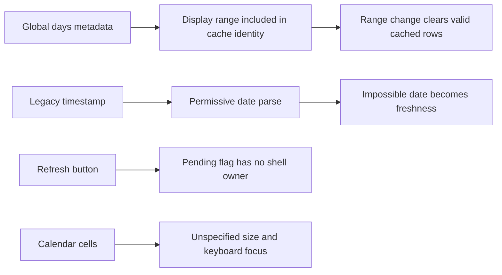
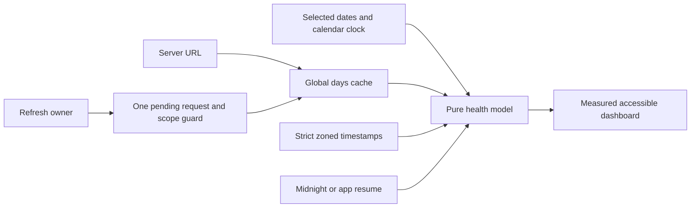
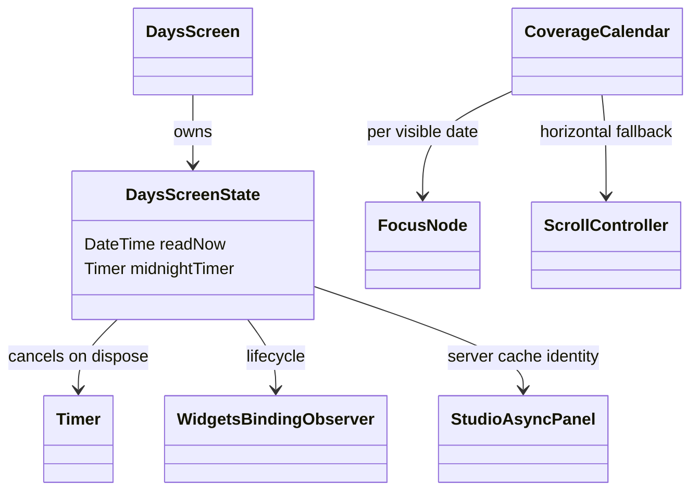
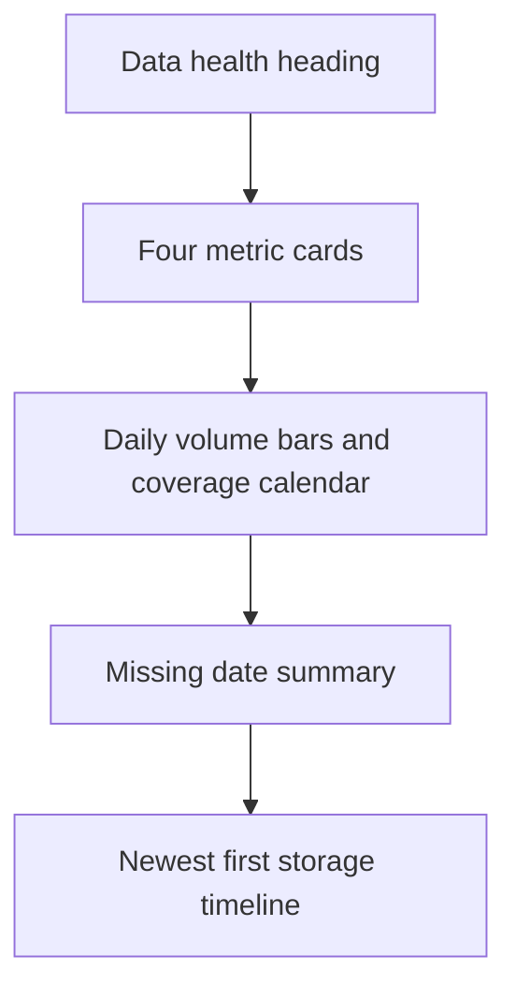

# Analytics Studio UI - Wave 3 Implementation Plan

> Execute tasks7-8 after Waves1-2 pass. Read master constraints and design section7 Data health.

> **Review amendment, 2026-10-12:** Wave2 repairs are in progress; do not start Wave3 until [W2R1-W2R7](analytics-studio-ui-wave2-repair-implementation.md) pass review. Follow the amendments below for storage query identity, real refresh completion, strict timestamp parsing, measured/focusable calendar cells, deterministic regression fixtures and midnight cleanup. These corrections take precedence over the original kernels where explicitly replaced. This is planning only; no Wave3 product code was implemented by this reviewer.

**Goal:** Replace the date list with trustworthy volume, coverage, freshness and timeline views.
**Architecture:** Pure storage observations distinguish missing, stored-zero, current-day and future data; one view model drives all visual sections.
**Tech stack:** existing DayStat, Flutter widgets and Wave2 chart primitives.
**Spec:** sections5-7,9-11.

## Review scope and contracts

Entry: global `/days` metadata and selected display dates. Exit: truthful Data health coverage/volume/freshness/calendar/timeline, retaining valid same-server rows through refresh. Owning layers: Task7 pure view models and Task8 screen/calendar/filter/shell integration. Excluded: gameplay aggregation, active analytics request ownership in Task15, new scheduler services, table BUG-0026, and concurrent Wave2 implementation.

| Contract | Required owner/test |
|---|---|
| `/days` depends on server URL only; dates filter cached rows locally | Task8 range-change-during-refresh and server-switch tests |
| Raw storage includes test/device/platform/version data; saved gameplay filters survive | Task8 disabled dropdown/chip and restoration tests |
| Local client calendar day matches existing FiltersNotifier; day arithmetic uses shared UTC helpers | Task7 boundary tests; Task8 midnight/resume tests |
| Timestamp is a real zoned instant, never a normalized impossible date | Task7 strict parser tests |
| Calendar labels/status stay readable and keyboard accessible | Task8 cell dimension/focus tests |
| Existing test values keep their meaning while old list copy changes | Task8 fixed-range timeline/KPI regression |

### Current and target flow







## Task 7 - Storage observations and Data health view model

**Create:** app/lib/src/view_models/{storage_observations,data_health_view_model}.dart; app/test/data_health_view_model_test.dart.
**Consumes:** List<DayStat>, Filters, injected DateTime now.
**Produces exact types:**

```dart
enum DayAvailability { stored, missing, incomplete, future }
class StoredObservation {
  const StoredObservation({required this.day, required this.count,
    required this.availability, this.updatedAt});
  final String day;
  final int? count;
  final DayAvailability availability;
  final DateTime? updatedAt;
}
List<StoredObservation> storedObservations(List<DayStat> stored, Filters f,
    {required DateTime now});

class DataHealthViewModel {
  const DataHealthViewModel({
    required this.timeline, required this.totalEvents,
    required this.storedDaysCount, required this.completedExpectedDays,
    required this.completedStoredDays, required this.missingDays,
    required this.latestStoredDay, required this.latestUpdate,
  });
  final List<StoredObservation> timeline;
  final int totalEvents, storedDaysCount, completedExpectedDays, completedStoredDays;
  final List<String> missingDays;
  final String? latestStoredDay;
  final DateTime? latestUpdate;
  double? get coverage => completedExpectedDays == 0
      ? null : completedStoredDays / completedExpectedDays;
}
DataHealthViewModel buildDataHealth(List<DayStat> stored, Filters f,
    {required DateTime now});
```

### Complete regression file

```dart
import 'package:analytic_app/src/view_models/data_health_view_model.dart';
import 'package:analytic_app/src/view_models/storage_observations.dart';
import 'package:analytic_shared/analytic_shared.dart';
import 'package:flutter_test/flutter_test.dart';

void main() {
  test('stored zero counts toward coverage while missing does not', () {
    const rows = [
      DayStat(day: '2026-10-03', rowCount: 0, pulledAt: '2026-10-04T01:00:00Z'),
      DayStat(day: '2026-10-01', rowCount: 12, pulledAt: '2026-10-02T01:00:00Z'),
    ];
    final m = buildDataHealth(rows,
      const Filters(from: '2026-10-01', to: '2026-10-04'),
      now: DateTime(2026, 10, 10));
    expect(m.totalEvents, 12);
    expect(m.storedDaysCount, 2);
    expect(m.completedExpectedDays, 4);
    expect(m.completedStoredDays, 2);
    expect(m.coverage, 0.5);
    expect(m.missingDays, ['2026-10-02', '2026-10-04']);
    expect(m.timeline.map((d) => d.count), [12, null, 0, null]);
    expect(m.timeline[2].availability, DayAvailability.stored);
    expect(m.latestStoredDay, '2026-10-03');
    expect(m.latestUpdate, DateTime.utc(2026, 10, 4, 1));
  });
  test('today and future dates do not inflate completed coverage', () {
    final m = buildDataHealth(const [
      DayStat(day: '2026-10-09', rowCount: 3, pulledAt: '2026-10-09T01:00:00Z'),
    ], const Filters(from: '2026-10-08', to: '2026-10-10'),
      now: DateTime(2026, 10, 9, 12));
    expect(m.completedExpectedDays, 1);
    expect(m.completedStoredDays, 0);
    expect(m.missingDays, ['2026-10-08']);
    expect(m.totalEvents, 3);
    expect(m.timeline[1].availability, DayAvailability.incomplete);
    expect(m.timeline[1].count, 3);
    expect(m.timeline[2].availability, DayAvailability.future);
    expect(m.timeline[2].count, isNull);
  });
  test('global freshness is independent of displayed interval and filters', () {
    final m = buildDataHealth(const [
      DayStat(day: '2026-10-01', rowCount: 12, pulledAt: '2026-10-05T09:00:00Z'),
      DayStat(day: '2026-10-08', rowCount: 20, pulledAt: '2026-10-08T09:00:00Z'),
    ], const Filters(from: '2026-10-01', to: '2026-10-02', platform: 'IOS',
      version: 'unknown', includeTest: false), now: DateTime(2026, 10, 9));
    expect(m.totalEvents, 12);
    expect(m.latestStoredDay, '2026-10-08');
    expect(m.latestUpdate, DateTime.utc(2026, 10, 8, 9));
  });
  test('invalid legacy timestamps remain unknown without losing counts', () {
    final m = buildDataHealth(const [
      DayStat(day: '2026-10-01', rowCount: 4, pulledAt: 'a'),
    ], const Filters(from: '2026-10-01', to: '2026-10-01'),
      now: DateTime(2026, 10, 9));
    expect(m.totalEvents, 4);
    expect(m.latestUpdate, isNull);
  });
}
```

Expected-value reasoning: four completed calendar dates contain two records; the record with zero events is still a stored day. Missing is null, not0. On Oct9, only Oct8 is a completed expected day in Oct8-10. Whole-storage freshness uses rows outside the visible range.

- [ ] Run flutter test test/data_health_view_model_test.dart; observe red.
- [ ] Implement observation conversion with this kernel:

```dart
if (!isValidDay(f.from) || !isValidDay(f.to) || f.from.compareTo(f.to) > 0) {
  throw ArgumentError('Storage interval must contain valid ascending calendar dates');
}
final today = formatDay(DateTime(now.year, now.month, now.day));
final byDay = {for (final row in stored) row.day: row};
return [
  for (final day in daysBetween(f.from, f.to))
    StoredObservation(
      day: day,
      count: day.compareTo(today) > 0 ? null : byDay[day]?.rowCount,
      availability: day.compareTo(today) > 0
          ? DayAvailability.future
          : day == today
              ? DayAvailability.incomplete
              : byDay.containsKey(day)
                  ? DayAvailability.stored : DayAvailability.missing,
      updatedAt: parseStoredTimestamp(byDay[day]?.pulledAt ?? ''),
    ),
];
```

The API has unique day rows. Preserve order using daysBetween; do not rely on input order.

buildDataHealth:
- completedExpectedDays = timeline days strictly before today;
- completedStoredDays = those days with availability stored;
- missingDays = completed days with availability missing;
- storedDaysCount = observations with non-null count, including today's stored snapshot;
- totalEvents = sum non-null counts in displayed interval;
- latestStoredDay = maximum stored day in whole input, not maximum pulledAt;
- latestUpdate = max strictly parsed zoned timestamp from whole input using parseStoredTimestamp, not last list item;
- coverage is null when no completed expected day exists.
Do not apply gameplay platform/version/test flags to storage rows.

- [ ] Run targeted tests and full app gates.
- [ ] Commit: feat(ui): model stored coverage and freshness without invented zeros.

## Task 8 - Data health dashboard and calendar

**Create:** app/lib/src/widgets/coverage_calendar.dart; app/test/data_health_dashboard_test.dart; app/test/coverage_calendar_test.dart.
**Modify:** app/lib/src/screens/days_screen.dart; app/lib/src/widgets/filter_bar.dart; app/lib/src/shell/app_shell.dart; app/test/days_screen_test.dart; app/test/filter_bar_test.dart.

**Consumes:** Task7 model, Task2 StudioHeading/Grid/Metric, Task3 StudioTable, Task5 charts, Task6 StudioAsyncPanel.
**Produces:** CoverageCalendar({Key? key, required List<StoredObservation> observations}); revised DaysScreen with optional now callback for deterministic tests; FilterBar gains storageScope=false and refreshing=false, retaining onRefresh callback.

### Regression body

Imports: shared, flutter_test/material/Riverpod, days_screen, providers, host, storage_observations and coverage_calendar.

```dart
testWidgets('health exposes missing versus stored-empty days visually', (t) async {
  await pumpStudio(t, DaysScreen(now: () => DateTime(2026, 10, 10)),
    overrides: [
      filtersProvider.overrideWith(() => FiltersNotifier(() => DateTime(2026, 10, 10))),
      daysProvider.overrideWith((ref) async => const [
        DayStat(day: '2026-10-01', rowCount: 12, pulledAt: '2026-10-02T01:00:00Z'),
        DayStat(day: '2026-10-03', rowCount: 0, pulledAt: '2026-10-04T01:00:00Z'),
      ]),
    ]);
  final container = ProviderScope.containerOf(t.element(find.byType(DaysScreen)));
  container.read(filtersProvider.notifier).setRange('2026-10-01', '2026-10-04');
  await t.pumpAndSettle();
  expect(find.textContaining('50%'), findsWidgets);
  expect(find.byType(CoverageCalendar), findsOneWidget);
  expect(find.byTooltip('2026-10-03: stored, 0 events'), findsOneWidget);
  expect(find.byTooltip('2026-10-02: missing'), findsOneWidget);
  expect(t.takeException(), isNull);
});
```

Add width720/1024/1440 and text-scale1/1.5 cases using host; empty store still says "No data yet"; API failure still has Retry. Existing days_screen_test fixtures currently contain non-date timestamps a/b: keep the malformed-timestamp test from Task7 and use ISO dates for assertions about displayed update times.

### Composition order



Build DaysScreen:
1. Watch global Filters and daysProvider; **queryKey = baseUrl** because this panel caches global List<DayStat>, not a date-filtered request. Rebuild the local model from cached global rows and current f. Range/platform/version/test changes do not invalidate daysProvider or clear its valid same-server cache. Base URL changes must clear it and reject previous-value wrappers.
2. Apply StudioAsyncPanel; builder derives buildDataHealth with now callback.
3. Heading "Data health"; subtitle "Stored raw data coverage. Gameplay filters do not apply."
4. Metric cards:
   - "Events stored" = totalEvents with displayed interval.
   - "Completed-day coverage" = completedStoredDays / completedExpectedDays and percentage, or "No completed days".
   - "Latest stored day" = global latestStoredDay, or unavailable; supporting copy "All stored dates on this server".
   - "Last import / pull" = global latestUpdate.toLocal formatted date/time, or "Unknown"; supporting copy "All stored dates on this server".
5. TimeSeriesChart kind bars; ChartPoint value=count?.toDouble, incomplete=status incomplete. Unstored dates retain a gap.
6. CoverageCalendar and gap summary.
7. StudioTable timeline descending, columns Day, Events, Last updated, Status. Missing count displays "--", stored zero "0", current day "May be incomplete". No scheduler-health claim.

CoverageCalendar:
- Group by calendar month; seven weekday columns with leading blank alignment cells.
- Use LayoutBuilder and a non-scrolling GridView with shrinkWrap:true inside the page's main scroll.
- Stored volume uses themed intensity; zero-stored uses a distinct border; missing uses hatch/border + text/semantic label; current day gets a partial marker; future is muted.
- Every cell exposes a Tooltip and Semantics with full date/status/count.
- Numeric counts remain available without hover through the timeline.
- No color-only distinction.
- Avoid month headers splitting a cell row unexpectedly.

Exact tooltip copies used by tests:
- "YYYY-MM-DD: stored, N events"
- "YYYY-MM-DD: missing"
- "YYYY-MM-DD: may be incomplete, N events" or "YYYY-MM-DD: may be incomplete, not stored"
- "YYYY-MM-DD: future"

FilterBar:
- Add optional bool storageScope=false, bool refreshing=false.
- Date selection remains available.
- Disable platform/version/test controls on Data health and show storage-scope note.
- Do not modify their saved filter selections while disabled; switching back restores them.
- Refresh button onPressed is null while refreshing and shows a finite loading state.
- Shell passes storageScope when current selected page is Data health. Keep existing _index until Task11 introduces shared navigation; that later task must switch the condition to AppPage.dataHealth.

Regression for filter restoration: start f.platform IOS, version2.0 and includeTest true; navigate Data health, assert controls disabled but f unchanged; navigate Events, assert controls enabled and IOS/version/test state retained. Date presets and custom selection remain enabled throughout.

- [ ] Run targeted red before dashboard code.
- [ ] Implement composition, calendar and scoped filter behavior.
- [ ] Remove the old ListTile-only list and its standalone RefreshIndicator. Use the existing shell toolbar as the single Data health refresh owner in this wave, wired as specified below. Retry still invalidates daysProvider; no second competing pull-to-refresh request.
- [ ] Run targeted health/filter/shell tests and full app gates.
- [ ] Commit: feat(ui): add Data health volume coverage and storage timeline.

## Task 7 amendment - Strict timestamp provenance and deterministic dates

Create `parseStoredTimestamp(String raw)` in storage_observations.dart and use it for both per-day updatedAt and global latestUpdate. Server event_store writes zoned UTC ISO timestamps. Legacy values a/b, date-only values, unzoned times and normalized impossible dates are **unknown**, never a fabricated midnight/future import. Count/coverage still use the stored row.

```dart
DateTime? parseStoredTimestamp(String raw) {
  final m = RegExp(r'^(\d{4}-\d{2}-\d{2})T(\d{2}):(\d{2}):(\d{2})'
    r'(?:\.(\d{1,6}))?(Z|[+-]\d{2}:\d{2})$').firstMatch(raw);
  if (m == null || !isValidDay(m[1]!)) return null;
  if (int.parse(m[2]!) > 23 || int.parse(m[3]!) > 59 || int.parse(m[4]!) > 59) {
    return null;
  }
  final zone = m[6]!;
  if (zone != 'Z' && (int.parse(zone.substring(1, 3)) > 23 ||
      int.parse(zone.substring(4, 6)) > 59)) return null;
  return DateTime.tryParse(raw)?.toUtc();
}
```

Imports: analytic_shared for isValidDay/formatDay/daysBetween/DayStat/Filters. Do not change server persistence or accept malformed fields because Dart can normalize them. Timestamp ordering compares UTC instants, not raw strings or input order. This parser is a local accepted timestamp grammar, not a general ISO8601 library.

Add inside existing Task7 regression main:

```dart
test('invalid or ambiguous timestamps stay unknown while counts survive', () {
  for (final raw in ['a', '2026-10-01', '2026-10-01T01:00:00',
    '2026-02-30T01:00:00Z', '2026-10-01T25:00:00Z']) {
    expect(parseStoredTimestamp(raw), isNull);
    final model = buildDataHealth([DayStat(day: '2026-10-01', rowCount: 4, pulledAt: raw)],
      const Filters(from: '2026-10-01', to: '2026-10-01'), now: DateTime(2026, 10, 9));
    expect(model.totalEvents, 4);
    expect(model.completedStoredDays, 1);
    expect(model.latestUpdate, isNull);
  }
});
test('global freshness orders real instants and ignores malformed newer text', () {
  final model = buildDataHealth(const [
    DayStat(day: '2026-10-01', rowCount: 1, pulledAt: '2026-10-08T23:30:00-07:00'),
    DayStat(day: '2026-10-02', rowCount: 2, pulledAt: '2026-10-09T06:00:00Z'),
    DayStat(day: '2026-10-08', rowCount: 3, pulledAt: '2026-13-99T01:00:00Z'),
  ], const Filters(from: '2026-10-01', to: '2026-10-02'), now: DateTime(2026, 10, 10));
  expect(model.latestUpdate, DateTime.utc(2026, 10, 9, 6, 30));
  expect(model.latestStoredDay, '2026-10-08');
  expect(model.totalEvents, 3);
});
test('zero completed days has unknown coverage rather than zero failure', () {
  final model = buildDataHealth(const [],
    const Filters(from: '2026-10-09', to: '2026-10-10'), now: DateTime(2026, 10, 9));
  expect(model.completedExpectedDays, 0);
  expect(model.coverage, isNull);
  expect(model.missingDays, isEmpty);
  expect(model.timeline.map((p) => p.availability),
    [DayAvailability.incomplete, DayAvailability.future]);
  expect(model.timeline.every((p) => p.count == null), isTrue);
});
test('invalid or reversed display intervals fail before day enumeration', () {
  for (final f in [
    const Filters(from: '2026-02-30', to: '2026-03-01'),
    const Filters(from: '2026-10-10', to: '2026-10-01'),
  ]) {
    expect(() => storedObservations(const [], f, now: DateTime(2026, 10, 10)),
      throwsArgumentError);
  }
});
```

Clock calendar fields have the same meaning as existing FiltersNotifier: production uses DateTime.now local client date. For date arithmetic and weekday alignment, parse day labels at UTC midnight/use addDays; never add24 hours to local-midnight date labels across DST. A supplied UTC clock uses its supplied UTC calendar fields consistently; do not mix now.toUtc date with local FiltersNotifier defaults. No server timezone setting exists in this wave.

- [ ] Add strict parser/range/zero-denominator tests before the owning Task7 implementation; observe red.
- [ ] Run `flutter test test/data_health_view_model_test.dart`; preserve the original stored-zero/global-freshness oracle values.

## Task 8 amendment A - Cache global rows, derive selected range locally

This replaces the original `(baseUrl,f.from,f.to)` key. StudioAsyncPanel<List<DayStat>> caches `/days` responses; their request scope is server URL only. `builder` uses current f and current clock to derive buildDataHealth, even while cached rows are displayed during a failed refresh. Changing range must not invalidate/refetch daysProvider and must not discard valid same-server rows. Changing base URL must discard them; keep Wave2's completed-AsyncData acceptance rule intact.

```dart
final f = ref.watch(filtersProvider);
final baseUrl = ref.watch(baseUrlProvider);
final rows = ref.watch(daysProvider);
return StudioAsyncPanel<List<DayStat>>(
  queryKey: baseUrl,
  value: rows,
  onRetry: () => ref.invalidate(daysProvider),
  builder: (stored) {
    final model = buildDataHealth(stored, f, now: _readNow());
    return _buildHealthContent(model, f, hasAnyStorage: stored.isNotEmpty);
  },
);
```

Define `_readNow()` and `_buildHealthContent(DataHealthViewModel model, Filters f, {required bool hasAnyStorage})` on the screen state. `_buildHealthContent` returns one persistent page ListView with a stable key/controller; no nested unconstrained vertical ListView. Empty store adds "No data yet. Run the daily pull on the server PC." **inside** this page, while still showing selected-range missing/future status and Unknown global freshness. Global rows outside the range do not cause an empty-store hint merely because the selected range has none. On range change, local summary/calendars/timeline change; same-server cache and page state remain mounted. Timeline/table may have its own stable range key if resetting only that horizontal offset is explicitly needed; do not remount the entire async panel.

Use ChartFrame(title:'Daily stored events', unit:'events', dataView:exactRows, child:TimeSeriesChart(...)) without wrapping the full chart in a fixed total height. The exact data view/timeline lists every selected date, including missing/today-not-stored/future as unavailable. For each ChartPoint use x=selected-range ordinal, label=actual day, value=count?.toDouble and incomplete=availability incomplete. Future/null observations have no rod; real zeros do. Follow Wave2 repairs' empty group and source tooltip behavior.

KPI keys/copy for stable tests: `health-total-events` and `health-completed-coverage` are keys on their existing StudioMetric widgets; assert StudioMetric.value rather than casting these cards to Text. Total value is exact totalEvents.toString(); coverage value is `N / D (P%)`, percentage rounded for display only; D0 says "No completed days". First two cards supporting text is "Selected interval FROM to TO"; last two supporting text is "All stored dates on this server". Timeline row cells use `health-timeline-day:DAY`, `health-timeline-count:DAY`, `health-timeline-update:DAY`, `health-timeline-status:DAY`. Count text is exact unabridged integer or `--`; timestamp text Unknown when parser rejects it. A calendar day can share the same date with a metric/tooltip; tests must target keys rather than assume find.text has one match.

Add this test to data_health_dashboard_test.dart (imports dart:async, shared/material/Riverpod/flutter_test/providers/days_screen and widgets/studio_layout.dart for StudioMetric):

```dart
testWidgets('range changes during failed global refresh retain valid same-server rows', (t) async {
  final pending = Completer<List<DayStat>>();
  final newServer = Completer<List<DayStat>>();
  var calls = 0;
  final container = ProviderContainer(overrides: [
    filtersProvider.overrideWith(() => FiltersNotifier(() => DateTime(2026, 10, 10))),
    daysProvider.overrideWith((ref) {
      final url = ref.watch(baseUrlProvider);
      calls++;
      if (url == 'http://new-server:8080') return newServer.future;
      return calls == 1 ? Future.value(const [
        DayStat(day: '2026-10-01', rowCount: 12, pulledAt: '2026-10-02T01:00:00Z'),
        DayStat(day: '2026-10-03', rowCount: 3, pulledAt: '2026-10-04T01:00:00Z'),
      ]) : pending.future;
    }),
  ]);
  addTearDown(container.dispose);
  container.read(filtersProvider.notifier).setRange('2026-10-01', '2026-10-03');
  await t.pumpWidget(UncontrolledProviderScope(container: container,
    child: MaterialApp(home: Scaffold(body: DaysScreen(now: () => DateTime(2026, 10, 10))))));
  await t.pumpAndSettle();
  expect(find.text('15'), findsWidgets);
  container.invalidate(daysProvider); await t.pump();
  container.read(filtersProvider.notifier).setRange('2026-10-02', '2026-10-03');
  await t.pump();
  expect(t.widget<StudioMetric>(find.byKey(const ValueKey('health-total-events'))).value, '3');
  expect(calls, 2, reason: 'Range selection must not issue another global days request');
  pending.completeError(StateError('refresh failed')); await t.pump(); await t.pump();
  expect(t.widget<StudioMetric>(find.byKey(const ValueKey('health-total-events'))).value, '3');
  expect(find.textContaining('refresh failed'), findsOneWidget);
  expect(find.text('Retry'), findsOneWidget);
  container.read(baseUrlProvider.notifier).set('http://new-server:8080');
  await t.pump();
  expect(find.byKey(const ValueKey('health-total-events')), findsNothing);
  newServer.complete(const [
    DayStat(day: '2026-10-02', rowCount: 7, pulledAt: '2026-10-03T01:00:00Z'),
  ]);
  await t.pumpAndSettle();
  expect(t.widget<StudioMetric>(find.byKey(const ValueKey('health-total-events'))).value, '7');
  await t.pumpWidget(const SizedBox.shrink());
});
```

The final new-server case uses a separate Completer, not a completed failed old-server future; old rows disappear until new rows arrive. Also repeat range change during **loading**, not only after failure, and change gameplay flags while loading; neither should clear cached storage or trigger extra `/days`. Never pumpAndSettle until pending request completes; use finite pumps for Updating/CircularProgressIndicator.

## Task 8 amendment B - Wire actual pending refresh and retain later-wave responsibilities

Task8 owns Data health's completion, not the later Task15 active analytics registry. Keep all existing provider invalidations, especially BUG-0013's five analysis families. Do not add navigation/refresh registry APIs before their owning wave.

| State/action | Required shell behavior |
|---|---|
| Begin toolbar refresh | Set `_refreshing=true` synchronously; reject repeated invocation before any invalidation |
| Data health provider already loading | Disable its toolbar refresh; do not invalidate same request again |
| Refresh request | Invalidate existing other provider families, use exactly one `ref.refresh(daysProvider.future)` |
| Await succeeds on unchanged server/page | Data health feedback "Refreshed Data health"; other pages retain current legacy feedback until Task15 |
| Await fails on unchanged Data health | "Could not refresh Data health"; panel retains cache and exposes Retry; no success feedback |
| User changes server or navigates away | Suppress this request's snackbar; do not relabel old-server success |
| Finally/disposal | Clear pending state only if mounted; no use of disposed context/ref after await |

Add `bool _refreshing=false` to `_AppShellState`. Derive `storageScope = _index == 7` from current nav order and pass both storageScope and refreshing to FilterBar. Until Task11, do not import nonexistent AppPage. For Data health, refreshing is `_refreshing || ref.watch(daysProvider).isLoading`; for other pages use `_refreshing`. If daysProvider is already loading on entry to `_refresh` for Data health, return without issuing a second request. Capture server URL and page index **before** invalidation; acquire ScaffoldMessenger only after confirming mounted/current scope following await.

Implementation shape (existing invalidation list stays between the marked read and request lines; exclude daysProvider from that list so it is refreshed exactly once):

```dart
if (_refreshing || (_index == 7 && ref.read(daysProvider).isLoading)) return;
final originUrl = ref.read(baseUrlProvider);
final originIndex = _index;
setState(() => _refreshing = true);
try {
  // Keep existing invalidations except daysProvider here.
  await ref.refresh(daysProvider.future);
  if (!mounted || ref.read(baseUrlProvider) != originUrl || _index != originIndex) return;
  ScaffoldMessenger.of(context).showSnackBar(SnackBar(content:
    Text(originIndex == 7 ? 'Refreshed Data health' : 'Refreshed')));
} catch (_) {
  if (mounted && originIndex == 7 && _index == originIndex &&
      ref.read(baseUrlProvider) == originUrl) {
    ScaffoldMessenger.of(context).showSnackBar(
      const SnackBar(content: Text('Could not refresh Data health')));
  }
} finally {
  if (mounted) setState(() => _refreshing = false);
}
```

FilterBar _OptionDropdown.onChanged changes to `ValueChanged<String?>?`; pass null under storageScope. Test devices onSelected is null under storageScope. Retain their current values/selected state, including values missing from `/filters`. Date controls remain enabled; don't call notifier setters to simulate disabling. Refresh IconButton keeps tooltip'Refresh', gains key`refresh-button`, onPressed=null when refreshing; its pending icon is a bounded12-18px progress widget with semantics'Refreshing data'. Do not use a timer to fake network completion. Hide/show stored-scope note in the existing Wrap so it fits narrow toolbar space; bound date text/action without changing date selection semantics.

Extend existing app_shell_test.dart pumpShell helper with optional `Future<List<DayStat>> Function()? daysLoader`; in its existing daysProvider override increment daysCalls, `ref.watch(baseUrlProvider)`, then call daysLoader when nonnull, otherwise preserve current empty fixture. Existing tests unchanged except refresh text assertions specifically for Data health. Add:

```dart
testWidgets('Data health refresh awaits one real request and disables duplicates', (t) async {
  final pending = Completer<List<DayStat>>();
  var requests = 0;
  await pumpShell(t, daysLoader: () {
    requests++;
    return requests == 1 ? Future.value(const <DayStat>[]) : pending.future;
  });
  await t.tap(find.widgetWithText(ListTile, 'Data health')); await t.pumpAndSettle();
  await t.tap(find.byKey(const ValueKey('refresh-button'))); await t.pump();
  expect(t.widget<IconButton>(find.byKey(const ValueKey('refresh-button'))).onPressed, isNull);
  expect(find.text('Refreshed Data health'), findsNothing);
  expect(requests, 2);
  pending.complete(const []); await t.pumpAndSettle();
  expect(find.text('Refreshed Data health'), findsOneWidget);
  expect(t.widget<IconButton>(find.byKey(const ValueKey('refresh-button'))).onPressed, isNotNull);
});
```

Import dart:async. Add failure variant pending.completeError and assert only failure feedback plus Retry; add server-switch variant while old request pending and verify no old success on new server. Add navigation-away and widget-disposal variants; no disposed-state exception allowed. Add direct FilterBar test at IOS/version2.0/includeTesttrue: nullable dropdown/chip callbacks disabled under storageScope, f equality retained, date preset callback active, restored callbacks when false. Existing loading-options regression still passes.

Task11 must replace BOTH storage-scope index comparison and refresh captured-page comparison with selectedPageProvider/AppPage.dataHealth; do not leave magic index7 after navigation migration. Task15B later replaces this legacy completion owner with active page callbacks and preserves pending/scope guards; Wave3 does not claim truthful analytics refresh completion.

## Task 8 amendment C - Calendar geometry, interval alignment and keyboard access

CoverageCalendar becomes StatefulWidget if needed for per-date FocusNodes/horizontal ScrollControllers; keep its original constructor. Receive sorted selected-range StoredObservation entries, never infer missing days outside that interval. Group by year-month, preserving ascending order. A partial month starting Oct30 aligns Oct30 by **its own UTC weekday**, not the weekday of Oct1. Leading/trailing blanks are placeholders without tooltip, semantics or focus, not invented missing days.

An empty observations list renders "No dates in this interval" without indexing first/last or dividing by a count. Complete each month's final row with inert blanks as needed so the next month header never occupies a weekday cell. Cell status uses day numeral plus a static icon, not unmeasured extra count/status lines; full counts/status remain in focus tooltip and timeline.

| Concern | Exact algorithm |
|---|---|
| Week order | Monday through Sunday; leading placeholder count is first visible day weekday minus1, parsed as UTC midnight |
| Fixed columns | Seven columns per month; every month owns its weekday header and grid |
| Minimum cell width | Measure widest Mon/Tue/Wed/Thu/Fri/Sat/Sun header and day digits31 using actual themed style, textScaler and boldText; add12px padding |
| Cell height | Measure full day numeral height plus12px status icon,4px gap,12px vertical padding; set mainAxisExtent explicitly, not default square childAspectRatio |
| Narrow panel | Content width=max(availableWidth,7*minimumCellWidth+6*4px gaps); horizontal scroll only when needed, with visible scrollbar; header/grid share that width and controller |
| Nested vertical scroll | GridView shrinkWrap:true, primary:false, NeverScrollableScrollPhysics; page ListView owns vertical scrolling |
| Stored positive | Intensity relative to maximum selected measured count; max0 branch uses a fixed base, never divide by0 |
| Stored zero | Distinct outline/zero marker and exact stored-zero tooltip; counts toward coverage |
| Missing/partial/future | Distinct static hatch/border/icon plus readable legend and full tooltip/semantic text; no color-only distinction |

Use stable keys `coverage-day:DAY` on cell container, `coverage-number:DAY` on numeral Text, `coverage-month:YYYY-MM` on month section, `coverage-weekday:YYYY-MM:WEEKDAY` on header cell (WEEKDAY1..7). Range changes remove obsolete FocusNodes and dispose them; do not leak one node/controller per past range. Dispose all owned nodes/controllers on calendar teardown. Preserve focus for retained day IDs when rows refresh/reorder.

Each actual date uses FocusableActionDetector/Focus and Semantics with exact tooltip message as label. Tab can reach actual cells, Enter/Space exposes their tooltip, arrowLeft/Right selects adjacent observed date and arrowUp/Down moves7 days when that date is in the input. No arrow navigates to an out-of-range placeholder. Focus itself shows the tooltip; ensure visible on focused cell's horizontal scroll if clipped. `TooltipState.ensureTooltipVisible` is available; use per-cell GlobalKey<TooltipState> retained by date, not recreated on every build. Losing focus hides its popup without trapping focus. Do not give missing/future cells fake activation/actions that change filters or schedule a pull. Tooltip and semantics preserve all exact original copies.

Create calendar-specific tests in `app/test/coverage_calendar_test.dart`; add this file to Task8 create/test list and targeted commands. Imports material/services/flutter_test/calendar/storage_observations and support/studio_text_assertions. Define local fixture:

```dart
const calendarRows = [
  StoredObservation(day: '2026-10-30', count: 12, availability: DayAvailability.stored),
  StoredObservation(day: '2026-10-31', count: null, availability: DayAvailability.missing),
  StoredObservation(day: '2026-11-01', count: 0, availability: DayAvailability.stored),
];
```

```dart
testWidgets('partial month uses actual weekday and cells fit scaled labels', (t) async {
  await t.pumpWidget(const MaterialApp(home: MediaQuery(
    data: MediaQueryData(textScaler: TextScaler.linear(1.5), boldText: true),
    child: Scaffold(body: SizedBox(width: 280,
      child: SingleChildScrollView(child: CoverageCalendar(observations: calendarRows)))),
  )));
  expect(t.takeException(), isNull);
  final first = t.getRect(find.byKey(const ValueKey('coverage-day:2026-10-30')));
  final friday = t.getRect(find.byKey(const ValueKey('coverage-weekday:2026-10:5')));
  expect(first.center.dx, closeTo(friday.center.dx, .5));
  for (final row in calendarRows) {
    final finder = find.byKey(ValueKey('coverage-number:${row.day}'));
    expectCompleteWrappedText(t, finder);
    final rect = t.getRect(finder);
    final cell = t.getRect(find.byKey(ValueKey('coverage-day:${row.day}')));
    expect(cell.contains(rect.topLeft) && cell.contains(rect.bottomRight), isTrue);
  }
  expect(find.byTooltip('2026-10-29: missing'), findsNothing);
  expect(find.byTooltip('2026-10-31: missing'), findsOneWidget);
  expect(find.byTooltip('2026-11-01: stored, 0 events'), findsOneWidget);
});
```

```dart
testWidgets('keyboard focus reveals full calendar date status and count', (t) async {
  final semantics = t.ensureSemantics(); addTearDown(semantics.dispose);
  final before = FocusNode(); addTearDown(before.dispose);
  await t.pumpWidget(MaterialApp(home: Scaffold(body: Column(children: [
    TextButton(focusNode: before, onPressed: () {}, child: const Text('Before calendar')),
    const CoverageCalendar(observations: calendarRows),
  ]))));
  before.requestFocus(); await t.pump();
  await t.sendKeyEvent(LogicalKeyboardKey.tab); await t.pump();
  await t.pump(const Duration(milliseconds: 200));
  expect(find.text('2026-10-30: stored, 12 events'), findsOneWidget);
  expect(find.bySemanticsLabel('2026-10-30: stored, 12 events'), findsWidgets);
  await t.sendKeyEvent(LogicalKeyboardKey.arrowRight); await t.pump();
  await t.pump(const Duration(milliseconds: 200));
  expect(find.text('2026-10-31: missing'), findsOneWidget);
  await t.pumpWidget(const SizedBox.shrink()); await t.pump();
  expect(t.takeException(), isNull);
});
```

Repeat actual calendar at widths280/720/1024/1440 and scale1/1.5 for all four themes; exercise zero-only intensity, current-day-not-stored, future, focus removal on range change, retained-day refresh focus and horizontal scroll. Test measured cell content rather than only no-exception/widget existence. Header/month title stay at natural height; no fixed total calendar height inherited from chart plot.

## Task 8 amendment D - Rollover, app resume and old regression migration

Change DaysScreen from ConsumerWidget to ConsumerStatefulWidget, retaining const constructor and optional DateTime Function()? now. State implements WidgetsBindingObserver; one cancellable midnight timer recalculates classification without fetching data, and app resume does the same. Date-range selection does not auto-advance; only today/completed/future classification updates. No scheduler-health inference or perpetual animation.

```dart
DateTime _readNow() => (widget.now ?? DateTime.now)();
void _scheduleMidnight() {
  _midnightTimer?.cancel();
  final now = _readNow();
  final next = now.isUtc ? DateTime.utc(now.year, now.month, now.day + 1)
    : DateTime(now.year, now.month, now.day + 1);
  _midnightTimer = Timer(next.difference(now), () {
    if (!mounted) return;
    setState(() {});
    _scheduleMidnight();
  });
}
```

Import dart:async. `_midnightTimer` is Timer?. initState adds observer and schedules; didUpdateWidget reschedules if clock callback changes; didChangeAppLifecycleState(resumed) calls setState/reschedule; dispose cancels timer and removes observer. Read clock once per model build so a midnight boundary cannot produce mixed metrics in one frame. Never refresh `/days` solely because timer/resume fires. Injected clock tests may change its returned DateTime before pumping timer duration; they must unmount the screen at end to prove cleanup.

```dart
testWidgets('midnight completes yesterday without refetching or changing range', (t) async {
  var clock = DateTime(2026, 10, 9, 23, 59, 59);
  var calls = 0;
  final container = ProviderContainer(overrides: [
    filtersProvider.overrideWith(() => FiltersNotifier(() => clock)),
    daysProvider.overrideWith((ref) async {
      calls++;
      return const [
        DayStat(day: '2026-10-08', rowCount: 1, pulledAt: '2026-10-09T01:00:00Z'),
        DayStat(day: '2026-10-09', rowCount: 2, pulledAt: '2026-10-09T12:00:00Z'),
      ];
    }),
  ]);
  addTearDown(container.dispose);
  container.read(filtersProvider.notifier).setRange('2026-10-08', '2026-10-09');
  await t.pumpWidget(UncontrolledProviderScope(container: container,
    child: MaterialApp(home: Scaffold(body: DaysScreen(now: () => clock)))));
  await t.pumpAndSettle();
  expect(t.widget<StudioMetric>(find.byKey(const ValueKey('health-completed-coverage'))).value,
    '1 / 1 (100%)');
  clock = DateTime(2026, 10, 10);
  await t.pump(const Duration(seconds: 1)); await t.pump();
  expect(t.widget<StudioMetric>(find.byKey(const ValueKey('health-completed-coverage'))).value,
    '2 / 2 (100%)');
  expect(calls, 1);
  expect(container.read(filtersProvider).to, '2026-10-09');
  await t.pumpWidget(const SizedBox.shrink());
  await t.pump(const Duration(days: 2));
  expect(t.takeException(), isNull);
});
```

The midnight test also imports widgets/studio_layout.dart for StudioMetric. Add resumed-lifecycle variant after advancing injected clock across a day: `t.binding.handleAppLifecycleStateChanged(AppLifecycleState.resumed)` then pump; denominator/status changes without new `/days` call. Ensure timers do not restart a fixed-clock loop with zero/negative durations; next calendar boundary must always be later than supplied now.

Existing days_screen_test's inferred first/last stored-date gap and ListTile copy are obsolete under selected-range dashboard semantics. Replace that test with fixed clockOct10 and FiltersOct1-3; preserve input counts10/5 and stored datesOct1/3. Expected total15, completed coverage2/3, one missingOct2, zero fabricated count forOct2. Use timeline keys to assert count'10', count'5', missing'--', and visible global latestOct3; permit dates to appear in several sections. Replace a/b timestamps with valid ISO only in the test about formatted update times; retain Task7 malformed timestamp coverage separately. Empty-store hint and initial-error Retry remain covered. These are approved UI-copy/scope assertions, not authorization to alter analytics numeric oracles.

- [ ] Run Task8 red tests before owning UI changes: `flutter test test/data_health_dashboard_test.dart test/coverage_calendar_test.dart test/filter_bar_test.dart test/app_shell_test.dart test/days_screen_test.dart`.
- [ ] Implement and pass the same command, then full app analyze/test. Run shared/server gates if their files change; this plan does not authorize changing those files.
- [ ] Record Task7/8 commits, exact red/green evidence and live Windows checks separately. No Wave3 implementation until Wave2 repairs are reviewed; stop before Wave4.

## Wave 3 exit

- [ ] All review-amendment regressions above pass, not merely the original two-record happy path.

- [ ] No missing day has a zero count.
- [ ] Today/future do not inflate completed coverage.
- [ ] Storage scope and global freshness are explicitly labeled.
- [ ] Calendar, bars, status and table are accessible under all themes.
- [ ] Full app gates and remaining live checks reported; stop before Wave4.

## Plan audit verification - 2026-10-12

Reviewed global days provider and SQL timestamp writer, shared date/filter APIs, actual StudioMetric/StudioTable/async signatures, current DaysScreen/filter/shell tests and later navigation/refresh consumers. Two original-kernel probes fail (range-key cache loss and impossible-date normalization); URL-only cache and strict timestamp prototypes pass two isolated tests. Future Data health/calendar/clock/shell tests are not executable production regressions yet. No Wave3 product file was created and concurrent Wave2 edits remain untouched.

Fifteen Dart blocks syntax-parsed with pinned formatter using declaration/async-statement wrappers; the initial public-signature schema was checked with external declaration stubs, not copied into production. Markdown links/fence balance and diff whitespace checked. This is neither a Wave2 signoff nor future Wave3 full-suite/Windows acceptance. BUG-0040-0046 concern corrected plan contracts only; Gemini must still prove implementation behavior with the specified red/green tests.
