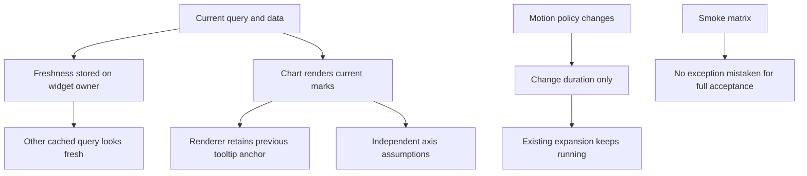
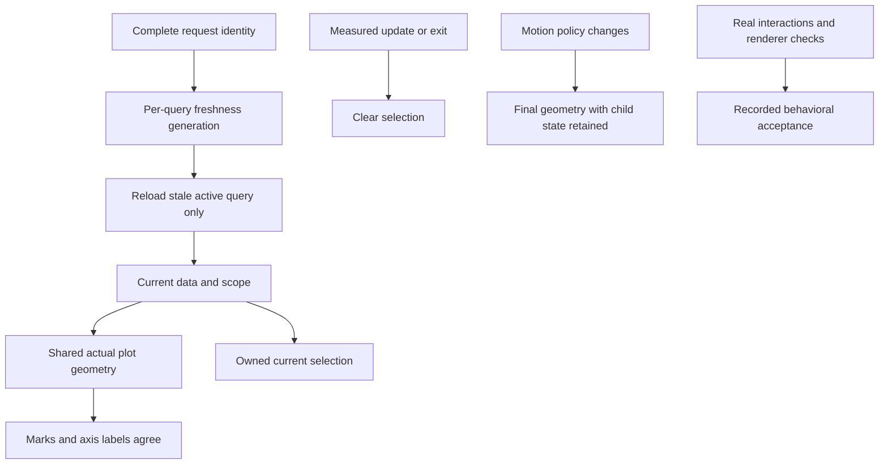
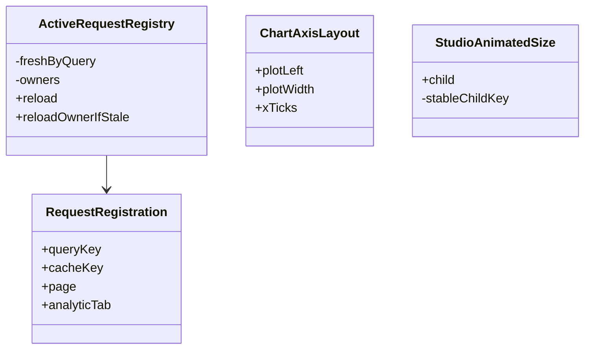

# Analytics Studio Waves 0–6 — Consolidated Fix Implementation Plan

> **For Gemini:** Use `executing-plans`, inline, one task and verified commit at a time. Do not use subagent-driven-development. Read inventory and this entire plan before editing. This supersedes the unfinished closure work in the previous repair plan; it does not repeat repaired implementations.

**Goal:** Repair every currently confirmed Studio issue from baseline/Waves1–6, complete meaningful acceptance, and verify six older baseline fixes at runtime.
**Architecture:** Preserve existing analytics, models and retained page state. Repair table measurement and async precedence first; then settle real motion, share actual chart geometry, own tooltip selection, and mark partial observations. Make refresh freshness query-specific, synchronize tab ownership, repair full names and approved navigation breakpoints, then prove whole-app behavior and preserve historical verification.
**Tech Stack:** Existing Flutter3.47.6/Dart3.13.5/Riverpod2.6.1/fl_chart1.2.0. No new dependency/service.
**Spec:** [consolidated inventory](analytics-studio-waves0-6-bug-inventory.md), [approved UI design](analytics-studio-ui-design.md), Wave1–6 plans, and dated reviews in `../../docs/reviews/`.

## Scope and global constraints

- Pinned reviewed HEAD: `2a90392`, `feature/wave5-analytics-studio`. Check actual checkout before executing. Current ledger/report changes and untracked plans/probes/acceptance file are intentional work; preserve them.
- Inventory accounts for63 IDs: **13 confirmed Studio entries**, **six VERIFY_PENDING baseline fixes**, **one deferred non-UI risk**, **43 terminal records**. Do not rewrite resolved/rejected algorithms.
- Repair IDs:0026,0038,0039,0047,0048,0049,0050,0053,0059,0060,0061,0062,0063. Verify baseline0005/0006/0007/0008/0009/0011. BUG0010 remains separately deferred under earlier local-first security decision; this UI plan does not silently authorize remote/team deployment or invent authentication requirements. IAM remains external owner work.
- Keep statistical oracles, ten-player/evidence gates, four palettes/preferences, six tabs, API schemas, match semantics, data coverage provenance and CSV bytes. No production synthetic fixtures or new query/analysis feature.
- No reset/stash, implicit staging, blanket process kills, package/SDK upgrade, merge or push. Commits stage explicit owned files only. No broad ledger closure from a suite count.
- Refreshed visible data must belong to current server/query. Manual refresh must not start unrelated inactive queries. Preserve same-query loaded widget State, scroll, search and selection.
- Windows observations remain PENDING if unavailable. Widget tests and a build log are not interactive visual sign-off.
- Test known-red cases outside standard discovery until their owning task, then port them to permanent tests before fixing. Do not introduce all future failing regressions into app/test onT0 and claim subsequent full gates pass.

## Current evidence and source of truth

Existing workspace suites: shared65/server271/app319 =655, analyzers clean at this HEAD. Archived Wave2 probes freshly rerun:4pass/5fail. Repair residual probes:1pass/4fail. Full-name probes:0pass/2fail. Consolidation probes:0pass/6fail — bold numeric4themes, missing1024 rail and720 AppBar. These are baseline observations, not fixed expected counts.

Use existing complete sources in appendices and `docs/reviews/` as regression fixtures. Archived line-tooltip probe assumes retained refreshed selection; repaired contract is **clear selection on measured revision**, so its durable port must assert empty indicators instead of `.first.y`. Preserve archived evidence file, and label the deliberate test-contract adaptation rather than changing numeric oracles.

## Review focus

| Failure mode | Required expectation | Task |
|---|---|---|
| Bold fonts/text1.5 affect intrinsic dimensions | Full numeric/header glyphs fit, not merely horizontal scroll | T2 |
| Previous error/data accompanies new-key loading | No previous-scope error/data displayed under current scope | T3 |
| Policy changes during unchanged-target animation | Actual target geometry immediate; child State retained | T4,T9 |
| Sparse unequal-width groups or pointer selection survive refresh | Labels align to actual marks; old tooltip anchors absent | T5–T7 |
| Cached query revisited after refresh, or owner disposed midflight | Per-query freshness and superseded guards, no hidden refetch | T8 |

## Current flow



## Target flow



## Class changes



## Task/file/closure map

All production prefixes are `app/lib/src/`, tests `app/test/` unless explicit.

| Task | Files | IDs and independent commit |
|---|---|---|
| T1 | verification report; no app source |0050/0061 — restore and append history |
| T2 | widgets/studio_table.dart; studio_table_test.dart |0026 — bold measurement |
| T3 | widgets/studio_async_panel.dart; studio_async_panel_test.dart |0047 — loading precedence |
| T4 | new widgets/studio_animated_size.dart; analytic anomaly/churn callers; charts/time_series_chart.dart if interruption fails; owning motion tests |0038 — actual settling |
| T5 | charts/chart_axis_layout.dart, time_series_chart.dart; chart_axis_layout_test.dart |0039 — real plot geometry |
| T6 | charts/time_series_chart.dart; studio_charts_test.dart |0048 — owned tooltip lifecycle |
| T7 | charts/series_visual_style.dart, time_series_chart.dart; studio_charts_test.dart |0049 — partial marks/legend |
| T8 | state/refresh.dart, shell metadata registration; registry/provider/HTTP tests |0053 — per-query freshness |
| T9 | pages/analytic/analytic_page.dart; studio_navigation_test.dart |0059 — tab/provider ownership |
| T10 | pages/funnel_page.dart; funnel_page_test.dart |0062 — full saved names |
| T11A | shell/app_shell.dart; studio_navigation_test.dart |0063 — sidebar/rail/drawer |
| T11B | support/studio_matrix_fixtures.dart, studio_visual_matrix_test.dart, rendered helpers |0060 — real matrix |
| T11C | registry/shell/Funnel HTTP acceptance tests and curated acceptance source |0060 — integration/race behavior |
| T12 | report only unless new reproduced runtime cause |Baseline0005–0009/0011, live acceptance |
| T13 | ledger and cumulative verification |Final evidence-backed closure |

T5–T7 edit the same chart; execute sequentially. T8 precedes T9/T11C. Never invoke a later interface before its producer task passes. Each production task has targeted RED, minimal fix, targeted GREEN, app analyze/full suite, explicit diff review and owned commit.

## T0 — Baseline, ownership and evidence snapshot

**Consumes:** Actual checkout. **Produces:** Base SHA/status and execution log `.cursor/plans/analytics-studio-waves0-6-fix-verification.md`.

- [ ] Read inventory, AGENTS/rules, dated reviews and relevant source. Record actual git status/HEAD and preserve overlapping edits.
- [ ] Record untracked acceptance/probe sources so final counts distinguish workspace from committed checkout. Never stage someone else's files merely because they are untracked.
- [ ] Run analyzers/suites withT13 commands. Run known review probes outside app/test; record their intended behavioral failures. Compile/import failures do not establish bug reproduction.
- [ ] Back up current dirty verification report under ignored `build/all-waves-verification-before-fixes.md`, then executeT1. Do not discard the current Wave6 evidence while restoring history.

## T1 — Preserve cumulative verification history

**Files:** `.cursor/plans/analytics-studio-ui-verification.md`; new cumulative execution log. **Consumes:** Both tracked earlier record and dirty Wave6 report. **Produces:** Append-only dated evidence, covering0050/0061.

- [ ] Compare report to `git show 2a90392:.cursor/plans/analytics-studio-ui-verification.md`. Earlier R1–R4 text contains exact commits, measured red/green results and pending runtime. Preserve it verbatim as a dated historical section.
- [ ] Use this restoration script from root; it preserves both texts and avoids duplicate historical sections:

```python
from pathlib import Path
import subprocess
p = Path('.cursor/plans/analytics-studio-ui-verification.md')
current = p.read_text(encoding='utf-8')
historical = subprocess.run(['git', 'show',
  '2a90392:.cursor/plans/analytics-studio-ui-verification.md'],
  check=True, capture_output=True, text=True, encoding='utf-8').stdout
if historical.strip() not in current:
    p.write_text(historical.rstrip() +
      '\n\n---\n\n# Wave 6 recorded evidence — 2026-10-13\n\n' + current,
      encoding='utf-8', newline='\n')
```

- [ ] Append supported Wave2 record: W2R1 `1e73bb5`, R2 `004fcd7`, R3 `8a6d11c`, R4 `7fc9b15`, R5 `412ebb6`, R6 `e04ea89`, R7 `3b15a24`; test follow-up `8ea1e77`. Review at that head had shared65/server271/app193 =529; reference dated review rather than presenting them as current counts. Historical red order not independently recorded must be labeled NOT RECORDED; do not manufacture it from commits.
- [ ] Correct only new Wave6 claim wording:38 tests established smoke/layout behavior, not full async-race/retry/detail acceptance. Leave actual gate/build/route records dated; preserve all walkthrough PENDING entries. Add this review's failures as dated unresolved evidence.
- [ ] Verify former R1–R4 SHA/measurements still present; Wave2 history and current Wave6 evidence both retained. No altered historical counts. Commit owned report: `docs: preserve Studio verification history and append wave evidence`.

## T2 — Bold text measures what Text actually renders

**Files:** studio_table.dart/test. **Consumes:** DefaultTextStyle, caller style, MediaQuery flags/scaler. **Produces:** Same StudioTextCell/StudioTable API, shared effective style for measurement/rendering.

- [ ] Port Appendix D four font-loaded tests; extend scales1 and1.5. Reproduce numeric width failure before editing; Tremor fresh probe receives150.5px but actual bold paragraph needs155.4038px.
- [ ] Numeric effective style is inherited.merge(caller), then apply actual accessibility weight BEFORE TextPainter. Use identical style in Text and painter:

```dart
final inherited = DefaultTextStyle.of(context).style;
var effectiveStyle = style == null ? inherited : inherited.merge(style);
if (MediaQuery.boldTextOf(context)) {
  effectiveStyle = effectiveStyle.copyWith(fontWeight: FontWeight.bold);
}
```

- [ ] Apply same transformation to headingStyle before calculating heading height and passing headingTextStyle/header Text. Keep textScaler/locale/direction/alignment consistent, full numeric intrinsic width plus existing minimum, and dynamic wrapped heading height. Do not solve by globally making all text bold or expanding every column to arbitrary width.
- [ ] Load local bundled regular/bold fonts (Appendix D) so Ahem cannot hide differing glyph widths. Test w400, w700 and inherited style; normal flag preserves caller weight. Assert complete numeric glyphs and full wrapped headers using existing `studio_text_assertions.dart`. Scroll to final numeric columns; no digits lost.
- [ ] Run studio_table_test, funnel_widgets_test, style tests and app gates. Commit: `fix(ui): measure table text with accessibility bold styling`.

## T3 — Loading wins over previous-scope errors

**Files:** studio_async_panel.dart/test. **Consumes/produces:** Same generic panel API and provenance cache.

- [ ] Port Appendix A new-server previous-error test. Add changed-key sequence: cached serverA value, switch to serverB AsyncLoading.copyWithPrevious(serverA error), then actual serverB success/error. Old text must never render underB.
- [ ] Keep `_hasSuccess` stable-child path unchanged. Only no-cache branch order changes:

```dart
if (_hasSuccess) return _buildCachedContent(context, incoming);
if (incoming.isLoading) {
  return widget.loading ?? const Center(child: CircularProgressIndicator());
}
if (incoming.hasError) {
  return ErrorRetry(error: incoming.error!, onRetry: widget.onRetry);
}
return widget.loading ?? const Center(child: CircularProgressIndicator());
```

- [ ] Do not accept AsyncLoading previous values as current success or weaken changed-key cache reset. Same-key loading/error preserves exact child State; current error with no cache shows Retry; current success shows current data. Custom loader must work too.
- [ ] Run owning panel/provider isolation and app gates. Commit: `fix(ui): prioritize current loading over inherited async errors`.

## T4 — Settle expansion and preserve child State

**Files:** new studio_animated_size.dart; Anomalies/Churn callers; motion tests. **Consumes:** Shared motionDuration/chartAnimationsAllowed. **Produces:** Stateful StudioAnimatedSize with same child/curve/alignment intent, final geometry under disabled/inactive policy.

- [ ] Port Appendix B expansion tests, refined to accept a correct direct-child implementation: capture target child height during active expansion, toggle each policy, then assert final wrapper height and stable TimeSeriesChart State. Both flags fail current RenderAnimatedSize.isAnimating check.
- [ ] Implement this complete wrapper; GlobalKey preserves child State across AnimatedSize/direct parent switches:

```dart
import 'package:flutter/material.dart';
import '../theme/motion_policy.dart';

class StudioAnimatedSize extends StatefulWidget {
  const StudioAnimatedSize({super.key, required this.child,
    this.alignment = Alignment.topCenter, this.curve = Curves.easeInOut});
  final Widget child;
  final AlignmentGeometry alignment;
  final Curve curve;
  @override
  State<StudioAnimatedSize> createState() => _StudioAnimatedSizeState();
}
class _StudioAnimatedSizeState extends State<StudioAnimatedSize> {
  final GlobalKey _contentKey = GlobalKey();
  @override
  Widget build(BuildContext context) {
    final content = KeyedSubtree(key: _contentKey, child: widget.child);
    if (!chartAnimationsAllowed(context)) return content;
    return AnimatedSize(duration: motionDuration(context, MotionKind.expansion),
      alignment: widget.alignment, curve: widget.curve, child: content);
  }
}
```

- [ ] Replace only Anomalies/Churn expansion callers. Give anomaly wrapper stable key `ValueKey('anomaly-expansion:${alert.series}:${alert.day}')`; preserve stable selected alert key. Churn wrapper retains each rule's row identity; do not manufacture rules from ten observations.
- [ ] After policy toggle, actual wrapper height must equal previously measured target child height; no remaining animation. Also assert identical child State, user selection and scroll where applicable. Test reduced motion, accessibleNavigation, inactive TickerMode, and toggling back to normal for a subsequent real expansion.
- [ ] Add actual interrupted geometry guards for shared TimeSeriesChart as well as existing ranked/diverging/Levels/Survival. If TimeSeriesChart's unchanged-target tween persists, include policy in its renderer key `(topology, chartAnimationsAllowed(rendererContext))`, as current specialized charts already do. Keep topology/data update keys stable during ordinary interpolation. Never claim duration0 alone proves settled geometry.
- [ ] Run motion_policy_test, studio_charts_test, analytic fixture tests; app gates. Commit: `fix(ui): finish disabled expansion without discarding child state`.

## T5 — One actual plot geometry for marks and labels

**Files:** chart_axis_layout.dart, time_series_chart.dart, axis tests. **Consumes:** Actual rod groups and measured y reservation. **Produces:** ChartAxisLayout.plotLeft/plotWidth and a pure spaceAround center helper shared by measurement/label placement.

- [ ] Port Appendix A sparse20-series/three-bucket coordinate regression. Fresh failure is nearly59px mismatch. Add line/area source tick alignment, empty/single bucket, missing groups, resize and text1.5 checks.
- [ ] Remove the extra8px subtraction from actual plot-coordinate calculations. Y-label reservation already includes its padding. With right axis hidden and border disabled, actual plotWidth is whole chart width minus reserved left axis; compare to rendered leaf rect as independent oracle. Do not infer plot width from outer Card or label strip.
- [ ] Extend ChartAxisLayout constructor/output with `double plotLeft, plotWidth`. measureChartAxes computes/reserves y labels first; derives actual plotWidth from that reservation; uses it consistently for capacity, collision decisions and projected labels. Keep8px LABEL collision gap, not an extra plot inset. All helper callsites update together.
- [ ] Implement pure helper in chart_axis_layout.dart:

```dart
List<double> spaceAroundCenters(double plotWidth, List<double> groupWidths) {
  if (!plotWidth.isFinite || plotWidth <= 0 ||
      groupWidths.any((w) => !w.isFinite || w < 0)) {
    throw ArgumentError('Invalid bar plot geometry');
  }
  if (groupWidths.isEmpty) return const [];
  final sum = groupWidths.fold<double>(0, (a, b) => a + b);
  if (sum > plotWidth) throw ArgumentError('Bar groups exceed plot width');
  final halfGap = (plotWidth - sum) / (2 * groupWidths.length);
  var x = 0.0;
  return [for (final width in groupWidths) () {
    x += halfGap + width / 2;
    final center = x;
    x += width / 2 + halfGap;
    return center;
  }()];
}
```

- [ ] First axis measurement obtains y reservation/plot width; derive rod width and actual groups, then centers using each group's actual `.width`. Missing groups still exist with width0. Existing rod-width calculation must ensure groups fit; do not clamp a negative gap silently if data exceeds actual available width.
- [ ] Second measureChartAxes call passes normalized `barCenters: centers.map((x) => x / plotWidth).toList()` for collision selection. Its y reservation is identical; no iterative sizing feedback loop. Strip positions use those SAME pixel centers, not equal ordinal centers. Line/area strips use source-domain fractions multiplied by actual plotWidth. Apply necessary edge-fitting to text boxes while keeping source anchors and clear tick identification.
- [ ] Preserve irregular x, true missing bucket slots, finite-domain safeguards and scale/date-key fallback. Do not import fl_chart/src into production. Tests may use pinned `calculateGroupsX` as independent oracle.
- [ ] Existing rendered test compares middle label.center.dx to leafRect.left + targetData.calculateGroupsX(leafRect.width)[1] within0.5px. Repeat at720/1024/1440, scale1/1.5, sparse equal/unequal rods. Assert leaf width agrees with helper plotWidth, not only xTick keys.
- [ ] Run chart_axis_layout_test, chart_models_test, studio_charts_test and app gates. Commit: `fix(ui): align chart axes with actual sparse mark geometry`.

## T6 — Own current tooltip selection

**Files:** time_series_chart.dart and studio_charts_test. **Consumes:** T5 geometry, current source mapping, ChartMotion. **Produces:** Owned selection; same public chart API.

- [ ] Port Appendix A bar selection clear and ADAPTED line selection clear. Bar indicator must empty after10to20; line indicator must also empty, not retain a spot object from10. Re-hover must show20 with actual current source date/series/unit and anchor.
- [ ] Add State fields `(int, int)? _barSelection` and `List<({String id,double x})> _lineSelection`. Store source identities/index pairs only, not a retained response/LineBarSpot holding old geometry.
- [ ] Disable built-in handling: BarTouchData/LineTouchData `handleBuiltInTouches: false`. Own callbacks. On uninterested event, null response/spot, pointer exit/cancel, clear selection. During motion.running, gate touch (`enabled: !motion.running`) so interpolation cannot be mistaken for exact measured values; data table remains readable.
- [ ] Bar callback uses response.spot.touchedBarGroupIndex/touchedRodDataIndex only after validating current group/rod bounds. Builder applies `showingTooltipIndicators` solely to current selected group; other groups empty.
- [ ] Line callback maps each touched bar index through current renderedSeriesIdByBarIndex, stores `(id,x)`, deduplicates boundary segments. Builder reconstructs CURRENT TouchLineBarSpot objects from current lineBarsData/FlSpot indexes:

```dart
final spot = TouchLineBarSpot(bar, barIndex, bar.spots[spotIndex], spotIndex);
```

`bar` is the current LineChartBarData; map/find indexes for current selected source id/x. `LineChartData.showingTooltipIndicators` is empty when selection empty, otherwise `[ShowingTooltipIndicators(currentSpots)]`. Preserve getTooltipItems cardinality and source-format deduplication; it must still return one item/null per touched entry.
- [ ] Clear fields in didUpdateWidget when complete measured input/topology changes; assign directly during widget update, not setState from build. Input signature includes kind/unit/percentage, sorted series identities, source x/value/label/incomplete. Serialize numeric values as strings or use a safe value fingerprint so NaN/Infinity input cannot throw before existing finite-axis error handling. No random plot key or data-revision key that destroys normal interpolation.
- [ ] Exit/cancel touch clears via setState in event callbacks; avoid rebuilding if selection unchanged. Theme/resize alone recomputes current geometry without stale anchors. Retain actual source formatter, sparse rod-index mapping and bounded tooltip width.
- [ ] Tests inspect renderer leaf target data, not only formatter text: select10, update20, indicators empty; hover20 then exact y20/current text; null point/removal clears; pointer exit and FlTapCancelEvent clear; duplicate segment boundary shows one tooltip item; source date/partial/unit retained. Repeat bars/lines/area and reduced-motion renderer context.
- [ ] Run studio_charts_test and chart-axis tests, then app gates. Commit: `fix(ui): clear stale tooltip anchors and own chart touch state`.

## T7 — Partial rods and matching explanation

**Files:** series_visual_style.dart, time_series_chart.dart, chart tests. **Consumes:** Existing source ChartPoint.incomplete and series style registry. **Produces:** Deterministic partial observation style, without changing values.

- [ ] Port Appendix A actual complete/partial rod style regression. Add single-series primary legend expectation; current showLegend excludes that case.
- [ ] Add helper reused by rods and legend:

```dart
SeriesVisualStyle barObservationStyle(SeriesVisualStyle base,
    {required bool incomplete, required Color outline}) {
  if (!incomplete) return base;
  return SeriesVisualStyle(
    color: base.color.withValues(alpha: base.color.a * 0.65),
    lineDash: base.lineDash,
    rodBorder: BorderSide(color: outline.withValues(alpha: outline.a * 0.65), width: 4));
}
```

Existing cycle/reference borders have width1–3. Partial4 plus translucent treatment is deliberately distinct even when a narrow rod's outline consumes much of its fill. Preserve palette RGB identity and apply current motion opacity to border/fill consistently; toY remains exact source value. Do not mark missing/null observations as zero or create a rod for them.
- [ ] Call helper after resolving each actual rod's base style. Add `ValueKey('partial-bar-legend')` whenever any nonnull bar point is incomplete, including primary single series. Matching SeriesSamplePainter uses same helper and clear label `Partial observation — may be incomplete`; bounded wrapping and Semantics distinguish it from reference/cycle outline. Keep normal legend/style slots intact.
- [ ] Compare actual complete/partial style and partial sample; assert width4, real toY unchanged, complete cycle borders unchanged. Test single/multi series, reference plus partial, repeated colors, zero and negative values, all palettes/reduced motion. No change to line incomplete dash or analytics completeness classification.
- [ ] Run studio_charts_test, legend/style tests, app gates. Commit: `fix(ui): distinguish partial bar observations and legend samples`.

## T8 — Cache freshness follows complete query identity

**Files:** refresh.dart, root filter metadata registration in app_shell.dart; active_refresh_test, provider/shell tests. **Consumes:** Existing generation/tickets/superseded contract. **Produces:** Optional cacheKey override and registry-wide per-query freshness that survives widget owner removal.

### Interface and state contract

Extend RequestRegistration with `Object cacheKey`; `register` and ActiveRequestScope accept optional `Object? cacheKey`. Resolve default identity as `(page, analyticTab, queryKey)`. Root shared filter-options owner supplies `cacheKey: ('filter-options', baseUrl)` so moving between pages does not fabricate a different metadata cache. Complete keys contain server URL and all actual request args with value equality; never include mutable Lists/controllers/widget identity.

Replace OwnerEntry.freshGeneration with registry `final Map<Object,int> _freshByQuery = {};`. Preserve owners/registrations/tickets. New NEVER-SEEN cache identity initializes to current generation for its cold watched request; known cache identity must never be reblessed just because a new owner registers or its query changes. Retain freshness records when removing owner; clear them only on registry.dispose. This covers cached provider instances reused after an owner is reconstructed.

Core semantics:

```dart
final identity = cacheKey ?? (page, analyticTab, queryKey);
_freshByQuery.putIfAbsent(identity, () => _generation);
```

runOwner captures snapshot.cacheKey and snapshot.queryKey, and marks ONLY that identity successful at its requested generation if owner still exists with matching current identity/query and result not superseded/errors. Merge max generation, never current global epoch at completion. Tickets coalesce same identity AND requested generation; a new manual generation starts a new request. Preserve `superseded` on key change/removal and aggregated warnings/errors.

`reloadOwnerIfStale` reads `_freshByQuery[entry.registration.cacheKey]`, not a widget-wide scalar. Known comparison-off gen0 remains stale when comparison-on reachesgen1. No global provider-family invalidation returns.

### Scope scheduling and tests

- [ ] Port Appendix B cached Events query case; current1 persists where2 expected even after page reactivation. Observe red before changing registry.
- [ ] In ActiveRequestScope.didUpdateWidget compare resolved OLD/NEW cache identities, re-register latest callback/metadata first, then queue stale check for active identity change. Also retain hidden-to-active scheduling. Post-frame validates mounted/latest page/tab/key; only one queued callback. Resizing/theme/same-key rebuild does not reload. Hidden scope changes do not invoke registry reload until active.
- [ ] Initial active scope registration also queues ONE post-frame freshness check: a brand-new cold identity is already current and no-ops; a recreated owner for a KNOWN stale cached identity reloads. Initial active=true alone must not skip this case. Test destroy/recreate an active owner with stale family data, not just registry unit registration.
- [ ] Root filter metadata uses direct registration rather than ActiveRequestScope. Track its page/tab/server mapping; on first mount or changed mapping after registration, queue one guarded post-frame reloadOwnerIfStale for that owner. Cold/current identities no-op; returning from Data health after its manual refresh reloads stale filter metadata. Mapping unchanged during ordinary manual-refresh setState/resize must not queue extra work. Removal/deactivation before callback cancels it.
- [ ] Keep callback `() => widget.reload()` so queued work sees latest arguments; compare captured identities before freshness update. New owner using a KNOWN old cached identity remains stale. Initial new cold identity is not needlessly refreshed again.
- [ ] Registry unit trace: register off atgen0, register on, manual on atgen1, register off, reloadOwnerIfStale must invoke off callback once. Repeat owner removal/recreation with off identity. New querysuccess cannot mark all previous query identities current.
- [ ] Add same-generation coalescing, new-generation replacement, reverse completion, failure retry, warning-only current payload, disposal and superseded tests. No old ticket clears newer ticket. No false fresh mark from stale request.
- [ ] Production scope/API tests: Events compare off/on/off with changed API counts/days; Parameters keyA/keyB/A with changed distributions; Survival grouping/version queryA/B/A with changed results. Fresh values appear on active key reuse, with exact calls and no hidden analysis fetch. Old URL/Filters completion suppressed; retain current-key child State.
- [ ] Re-run positive retained activation control from Appendix B: one deferred reload, no repeated reentry reload absent new epoch. Metadata callback exactly once per manual action, same cache identity across page mapping.
- [ ] Run active_refresh_test, events provider/handoff, shell and analytic tests; app gates. Commit: `fix(ui): track refresh freshness per cached request identity`.

## T9 — Publish selected tab once when its index changes

**Files:** analytic_page.dart, studio_navigation_test and actual owner tests. **Consumes:** Current TickerProvider lifecycle andT8 activation. **Produces:** Controller/provider/active owners agree during interrupted motion.

- [ ] Port Appendix B interrupted animateTo4 policy test; it currently refreshes hidden Clusters. Test both accessibility flags, both preference directions, and actual Associations request count.
- [ ] Publish unique controller index changes immediately, rather than waiting for indexIsChanging=false. Replace `_handleTabChanged` with:

```dart
void _handleTabChanged() {
  final next = _controller.index.clamp(0, 5);
  if (ref.read(analyticTabIndexProvider) != next) {
    ref.read(analyticTabIndexProvider.notifier).state = next;
  }
}
```

This is one write per changed index, not a write per animation tick. The index already represents the selected target during animateTo. Existing ref.listen sees the same index and does not start a feedback loop. When controller is recreated for policy change, selected provider is already synchronized; keep removal/disposal and targetIndex preservation.
- [ ] Do not perform unconditional provider writes inside didChangeDependencies/build. Controller listener updates come from interaction/navigation changes and compare equality first. External provider changes while transition in progress still control controller; no queued old target overrides them.
- [ ] Assert controller.index==provider index4 AND actual refresh Associations increments once while Clusters unchanged. Test stale target-tab activation, rapid tab0/4/5 changes and external index2 interruption. Preserve six children/tab counts and kept selection/scroll.
- [ ] Run studio_navigation_test, registry/shell tests, app gates. Commit: `fix(ui): keep selected tab and refresh ownership synchronized`.

## T10 — Full saved Funnel names remain distinguishable

**Files:** funnel_page.dart, funnel_page_test. **Consumes:** Same saved definitions and bounded responsive layout. **Produces:** Same selector behavior with full readable names.

- [ ] Port Appendix C selected/menu RenderParagraph tests; current ellipsis hides unique Alpha/Beta suffixes. No-exception or find.text alone is insufficient.
- [ ] Keep bounded320px selector width, `isExpanded: true`, but set `itemHeight: null` to permit variable-height wrapped options. Menu/selected label Text uses softWrap=true, maxLines=null, overflow unset; padding allows full lines. Set a bounded menuMaxHeight so tall options scroll rather than overflow the window. Do not abbreviate primary names.
- [ ] Use selectedItemBuilder when necessary to give selected label an intrinsic full-height container independent of default fixed menu height. Title remains bounded/wrapped; remove misleading ellipsis there only if rendered test proves truncation. Full option names must be identifiable before selection, not just in selected result heading afterward.
- [ ] Test two long same-prefix names and suffixes Alpha/Beta: full paragraph width/height fit, menu scroll exposes complete second name, selecting second yields id2, corresponding result current. No overlap at720/text1.5 and all4themes. Existing delete/edit/save semantics unchanged.
- [ ] Run funnel_page_test, funnel_widgets_test, matrix name cases, app gates. Commit: `fix(ui): wrap full saved funnel names in selector and menu`.

## T11A — Implement approved navigation breakpoints

**Files:** app_shell.dart, studio_navigation_test. **Consumes:** Existing `_items`, selectedPageProvider and PageStage. **Produces:** Approved sidebar/NavigationRail/AppBar-drawer navigation with retained content State.

- [ ] Port Appendix D1024/720 cases; both fail current compact800 sidebar. Add boundaries899/900/1199/1200 and width1440; assert real widget/navigation behavior, not merely no overflow.
- [ ] At width>=1200 retain full sidebar. At900–1199 render NavigationRail using the SAME item-to-AppPage mapping. Below900 use AppBar with current page title, menu tooltip `Open navigation`, and Drawer with full labels/groups. Drawer closes only itself after selection using root ScaffoldState.closeDrawer; do not accidentally pop dialogs/routes. Selection writes selectedPageProvider in every mode.
- [ ] Root Scaffold/LayoutBuilder/Row/content subtree stays structurally stable. Give content Expanded stable `ValueKey('studio-content')` and PageStage stable `ValueKey('studio-page-stage')` so removing/replacing nav siblings cannot remount pages. Prefer one Row with conditional nav children, not separate Scaffolds/body hierarchies per breakpoint. Keep root Scaffold GlobalKey created once for menu control.
- [ ] NavigationRail destinations derive `_items`, labelType selected and full label Tooltip; palette tokens preserved. Drawer scrolls if needed and retains Explore/footer grouping. FilterBar scope/refresh guards unchanged. No footer off-by-one or selected-page reset.
- [ ] User trace: Events search `events-search`, Bars, selected row/detail, vertical/horizontal scroll; navigate Analytic and expand anomaly; resize1440->1024->720, open drawer/select Events, confirm all state unchanged; return Analytic, tab/alert selection intact. Verify identity of existing Stateful page subtree across boundaries. Offstage focus/tickers still inactive.
- [ ] Resize test mounts ONE ProviderScope/host. Update t.view.physicalSize, not a new UniqueKey ProviderScope. Derive test MediaQuery with MediaQuery.of(context).copyWith(textScaler/flags), retaining live root size; a fixed old size or remounted host can hide retention bugs.
- [ ] Repeat all4themes/scales1/1.5, normal/reduced motion; menu accessible via keyboard and full names readable. Run navigation/page-stage/acceptance tests and app gates. Commit: `fix(ui): implement retained sidebar rail and drawer navigation`.

## T11B — Replace smoke-only matrix with rendered interactions

**Files:** studio_visual_matrix_test.dart, support/studio_matrix_fixtures.dart and existing rendered helpers. **Consumes:** T2–T10 fixes andT11A navigation. **Produces:** Meaningful Task16 matrix, no unrequested feature.

- [ ] Keep24 style/width/scale cases, but assert visible content, full paragraph/numeric rendering and selected theme tokens. Do not satisfy them by find.text or takeException only.
- [ ] Actual Events interaction kernel using existing keys:

```dart
container.read(selectedPageProvider.notifier).state = AppPage.events;
await t.pumpAndSettle();
await t.enterText(find.byKey(const ValueKey('events-search')), 'Reward');
await t.pumpAndSettle();
await t.tap(find.text('Bars'));
await t.pumpAndSettle();
final row = find.byKey(ValueKey('event-row-$longIdentifier')).first;
await t.ensureVisible(row);
await t.tap(row);
await t.pumpAndSettle();
expect(find.byKey(const ValueKey('event-detail-panel')), findsOneWidget);
final explore = find.byKey(const ValueKey('explore-parameters-btn'));
await t.ensureVisible(explore);
await t.tap(explore);
await t.pumpAndSettle();
expect(container.read(parameterEventProvider), longIdentifier);
```

Scope finder to actual DataRow hit target if row key identifies a non-hit-testable table wrapper; do not bypass selection by writing selectedEventProvider instead. After return Events, assert search text/chart kind/selected event/scroll position preserved.
- [ ] Replace tautological focus test: focus Events EditableText.focusNode, navigate Retention, verify it loses focus; requestFocus on hidden node fails; Tab/ShiftTab traverse visible/shared controls only. Test offstage tickers using TickerMode actual value in hidden page context.
- [ ] Add complete nonempty Funnel fixture result (helper takes `String label`), instead of empty/basic data hiding flows:

```dart
FunnelResult matrixFunnelResult(String label) => FunnelResult(
  steps: [
    FunnelStepResult(index: 0, event: label, players: 10,
      fromPrevious: null, fromFirst: 1, dropped: null, medianSeconds: null),
    const FunnelStepResult(index: 1, event: 'finish', players: 5,
      fromPrevious: 0.5, fromFirst: 0.5, dropped: 5, medianSeconds: 60),
  ], totalConversion: 0.5, biggestDropIndex: 1,
  segments: [
    FunnelSegmentResult(value: label, totalConversion: 0.5, steps: const [
      FunnelSegmentStepResult(players: 6, fromPrevious: null,
        fromFirst: 1, dropped: null, medianSeconds: null),
      FunnelSegmentStepResult(players: 3, fromPrevious: 0.5,
        fromFirst: 0.5, dropped: 3, medianSeconds: 60),
    ]),
    const FunnelSegmentResult(value: 'Other', totalConversion: 0.5, steps: [
      FunnelSegmentStepResult(players: 4, fromPrevious: null,
        fromFirst: 1, dropped: null, medianSeconds: null),
      FunnelSegmentStepResult(players: 2, fromPrevious: 0.5,
        fromFirst: 0.5, dropped: 2, medianSeconds: 60),
    ]),
  ], trend: const [
    FunnelTrendPoint(start: '2026-09-28', players: [6, 3],
      totalConversion: 0.5, incomplete: false),
    FunnelTrendPoint(start: '2026-10-05', players: [4, 2],
      totalConversion: 0.5, incomplete: true),
  ],
);
```

Counts sum10->5 across segments/trend; no inference is tested here. Definitions have two matching steps. Player fixture uses UID `player_1234567890`, entryTs1000000/lastTs2000000/reached1; timeline fixture ts1500000, event longIdentifier, params `{'key': longIdentifier}`. Override playerEventsProvider too; never let real HTTP400 silently act as accepted timeline data.
- [ ] Nonempty matrix runs all4themes x3widths x2scales. Each case: open Edit dialog, verify full condition/event text and controls; Cancel; show Steps/segment, activate dropped-player list, choose UID, see timeline params; back/close; switch Trend and Week, verify data/partial marker and CSV clipboard exact content. Fixture/provider test validates breakdown/interval args when controls change; it cannot assert engine inference from synthetic presentation data.
- [ ] Use `expectCompleteWrappedText` and `expectCompleteSingleLine`, which measure actual RenderParagraph, not raw Text.text. Scroll/drag each relevant horizontal table to final numeric column; its final full glyph rect must be inside viewport after scroll. Do not disable text scaling, suppress overflow or ellipsize primary names.
- [ ] Expanded-detail resize actually selects Events detail/Anomaly card before changing view width. Theme-motion case actually changes theme and checks current palette. Retry case taps Retry and observes successful recovery. Remove/rewrite misleading test titles; report scope accurately.
- [ ] Run matrix plus table/funnel/chart owning tests, app gates. Commit: `test(ui): verify full rendered Studio interactions across visual matrix`.

## T11C — Real provider/HTTP races and completion acceptance

**Files:** new `app/test/studio_http_acceptance_test.dart`, active_refresh_test/app_shell_test, curated acceptance source. **Consumes:** Current ApiClient MockClient boundary, T8/T9 and Funnel exact owners. **Produces:** Meaningful async/regression coverage for0060.

Never override the production provider whose behavior is under test. Use ApiClient(client: MockClient(...)), controlled response Completers, actual AppShell and decoded request arguments. Keep initial request success distinct from refresh pending/failure. Seed all other required routes; unexpected routes fail the test, not return generic empty JSON that hides a fetch.

| Scenario | Actual requests held/released | Assertions |
|---|---|---|
| Events reversed completion | Actual /events/count current10, previous5 finish either order; /days valid | Total10, previous5, change100%, exact scope; optional previous500 warning only |
| Old URL pending | Separate server-A/B clients; A completes after B current20 | B20 remains; no A data/error relabel; no old-scope success |
| Query cache reuse | Actual compare/key/group/version A/B/A after epoch advance | A fresh new payload, not cached old value; exact calls |
| Parameters | Second /events/param pending then500 while names/keys succeed | No success before/after failure; old same-key rows retained + useful retry |
| Funnel Steps/weekly Trend | Second /funnels/run held; definitions succeed | Pending feedback; correct def/breakdown/interval args;500 blocks success |
| Funnel list | /funnels/players held at visible step/outcome/segment | Correct args/limit100; awaits visible list, errors propagate |
| Funnel timeline | /players/UID/events held, list hidden | Correct fromTs/ toTs/includeTest/limit300; timeline once, hidden list zero |
| Stale activation | Actual retained page/tab leaves/returns after manual epoch | Hidden calls0 until activation; exactly1 deferred reload; canceled activation0 |
| Superseded scope | key/page/tab/filter changes before completion | No stale snackbar or freshness blessing; newer request ticket retained |
| Metadata | Root shared /filters | Exactly1 per manual action, not per panel |

Complete Parameters pending-to-error body for owning test, with imports dart:async/dart:convert/http+testing, ApiClient/providers/navigation/AppShell and test host:

```dart
testWidgets('Parameters refresh awaits actual values and reports 500', (t) async {
  final pending = Completer<http.Response>();
  var valuesCalls = 0, filtersCalls = 0;
  final requests = <http.Request>[];
  final api = ApiClient('http://fixture', client: MockClient((r) async {
    requests.add(r);
    switch (r.url.path) {
      case '/filters':
        filtersCalls++;
        return http.Response(jsonEncode({'platforms': ['ANDROID'], 'versions': ['1.0']}), 200);
      case '/events/names':
        return http.Response(jsonEncode(['event']), 200);
      case '/events/param-keys':
        return http.Response(jsonEncode(['key']), 200);
      case '/events/param':
        valuesCalls++;
        if (valuesCalls == 1) {
          return http.Response(jsonEncode([{'value': 'old', 'count': 12}]), 200);
        }
        return pending.future;
      default:
        throw StateError('Unexpected route ${r.url.path}');
    }
  }));
  addTearDown(api.close);
  addTearDown(() { if (!pending.isCompleted) pending.complete(http.Response('[]', 200)); });
  await pumpStudio(t, const AppShell(), width: 1440, textScale: 1, overrides: [
    apiClientProvider.overrideWithValue(api),
    selectedPageProvider.overrideWith((ref) => AppPage.parameters),
    parameterEventProvider.overrideWith((ref) => 'event'),
    parameterKeyProvider.overrideWith((ref) => 'key'),
  ]);
  expect(find.text('old'), findsOneWidget);
  await t.tap(find.byTooltip('Refresh'));
  await t.pump();
  expect(valuesCalls, 2);
  expect(filtersCalls, 2);
  expect(find.textContaining('Refreshed'), findsNothing);
  pending.complete(http.Response(jsonEncode({'error': 'probe failure'}), 500));
  await t.pumpAndSettle();
  expect(find.text('Could not refresh Parameters'), findsOneWidget);
  expect(find.text('Refreshed Parameters'), findsNothing);
  expect(find.text('old'), findsOneWidget);
  final values = requests.where((r) => r.url.path == '/events/param').toList();
  expect(values.length, 2);
  expect(values.last.url.queryParameters['name'], 'event');
  expect(values.last.url.queryParameters['key'], 'key');
});
```

For Funnel boundary cases, responses must come from model.toJson: GET /funnels -> saved two-step defs, POST /funnels/run -> matrixFunnelResult, POST /funnels/players -> literal one-player result, GET /players/player_1234567890/events -> literal timeline. Decode POST body to assert from/to,def,breakdown,interval,step,outcome,segment,limit. First calls return fixtures; ONLY second targeted displayed request waits on its Completer. Target params are included only when applicable; hidden list must not be requested while timeline shown.

- [ ] Port race/active-owner cases into permanent tests, including per-query owner removal/recreation. Check actual lifecycle via selectedPageProvider/analyticTabIndexProvider, not only directly calling registry methods.
- [ ] Original9 acceptance file currently untracked must be retained in final owned changes, along with new permanent regressions. Resolve duplicate tests without weakening behaviors; do not delete record sources from docs/reviews.
- [ ] Run HTTP/registry/shell tests and app gates. Commit: `test(ui): prove Studio refresh races and exact visible request completion`.

## T12 — Runtime verification for baseline and full UI

**Files:** cumulative verification only unless a new reproduced bug is assigned/fixed with its own regression. **Consumes:** Green T2–T11 gates. **Produces:** Observed PASS/FAIL/PENDING entries; baseline VERIFY_PENDING closures only where runtime criterion is met.

- [ ] Build fresh Windows release and record command exit, HEAD, app.so/exe timestamp/length. Static exe timestamp may remain older when native runner reused; do not equate that with unchanged Dart app.so. Close only this app when its binary is locked, preserving user's interactive work.
- [ ] Inspect current server/config port without printing credentials. Reload only positively identified server if source requires it and no import/pull is running. Use hidden Start-Process, correct cwd/config, separate logs and bounded route probes as Wave6 plan17A–C. No blanket Dart kill or synthetic database import.
- [ ] Read /days for actual available interval. Seven analysis routes must return valid200 payload/reason. Do not call legitimate insufficient sample a failure. Record current listener process/start time rather than assuming an earlier PID is still active.
- [ ] Execute all15 existing Windows walkthrough checks from Wave6 plan17D. Capture actual observations/screenshots with current binary; no inferred PASS from widget tests. Restore incidental user settings after inspecting if changed.

| Baseline ID | Runtime action | PASS criterion |
|---|---|---|
|0005|Hover line/bar tooltip in all4styles|Readable current palette text/background; no overlap|
|0006|Hover DAU/new-users/sessions integer counts|11 displayed as11, never11.0; fractions retain legitimate precision|
|0007|Toggle Test devices on an observed interval with debug events|Metrics change consistently with same filters; default excludes test events|
|0008|Build point-and-click Funnel with two AND conditions|Both persist/run and matching remainsAND; no typed syntax workaround|
|0009|Overview1440 logical width|Six KPI cards fit intended row without clipping/5+1 regression|
|0011|Event with no params/test events hidden, Add condition|Specific empty-param hint and test-device guidance, no unexplained disabled control|

No available real debug/empty-param fixture means PENDING, not manufactured PASS. Automated server/widget regressions remain green but do not substitute for explicitly pending Windows interaction.

- [ ] New runtime failure gets precise repro/log/source and next unused ledger ID before scope expansion. Do not change statistical cutoffs to populate charts. If live tooling unavailable, leave pending with executable manual steps; don't call all waves fully accepted.

## T13 — Full gates, status closure and delivery

**Files:** canonical ledger, cumulative verification, intended permanent tests/plan/docs only when owned. **Consumes:** Independent repair commits and runtime evidence. **Produces:** Reviewable range and accurate bug statuses.

- [ ] Run every owning permanent regression, original9 acceptance, the adapted durable chart cases and additional consolidation probes. Archived line-tooltip retained-selection expectation is superseded by explicit clear-on-update contract; do not use its .first as final green criterion or silently edit history.
- [ ] Run each package command separately; stop after failure:

```powershell
# cwd shared
& 'D:\flutter\bin\cache\dart-sdk\bin\dart.exe' analyze
& 'D:\flutter\bin\cache\dart-sdk\bin\dart.exe' test --reporter expanded
# cwd server
& 'D:\flutter\bin\cache\dart-sdk\bin\dart.exe' analyze
& 'D:\flutter\bin\cache\dart-sdk\bin\dart.exe' test --reporter expanded
# cwd app
& 'D:\flutter\bin\cache\dart-sdk\bin\dart.exe' 'D:\flutter\bin\cache\flutter_tools.snapshot' analyze --no-pub
& 'D:\flutter\bin\cache\dart-sdk\bin\dart.exe' 'D:\flutter\bin\cache\flutter_tools.snapshot' test --no-pub --reporter expanded
# cwd root
git diff --check
git status --short
```

- [ ] Record actual base/head, each task commit, red assertion before fix and green command after, counts/exits and current runtime observations. Never overwrite previous report sections or fabricate missing red history.
- [ ] For each13 confirmed Studio ID, update Evidence/Updated/Resolution/status span only after owning behavior passes.0060 needs actual meaningful matrix/HTTP cases AND intended acceptance sources retained in committed range;655+ tests alone cannot resolve it.0050/0061 need report-history evidence, not widget tests.
- [ ] Baseline six VERIFY_PENDING records close only with stated runtime evidence; otherwise carry their remaining conditions forward. BUG0010 stays separately deferred. Preserve all resolved/rejected records and regression coverage for0012–0020.
- [ ] Check ledger IDs unique and table columns intact, no skipped old open entry. Report new/changed/VERIFY_PENDING IDs. Review final explicit staged files; no git add . or implicit push/merge.
- [ ] Request code review of entire fix range. No all-complete statement while required live checks or confirmed defects remain. User receives plan/inventory, verification and exact reviewable range.

## Implementation handoff and planning limits

Gemini executes this file, not the earlier partial repair plan. Production kernels/interfaces are guidance, not precompiled replacements. Appendices supply complete known-regression sources with fixture imports adjusted for app/test; port one task's cases before its fix and retain additional required HTTP/State/geometry assertions. Math/model oracles stay literal/independent.

Appendix-source validation checks parsing and baseline reproduction only. Fresh analyzer/behavior evidence after each production task remains mandatory. Final live PASS requires observation.

**Planner validation, 2026-10-13:** All63 ledger IDs accounted for;13 confirmed Studio IDs mapped. Fifteen Dart blocks syntax-parsed with statement wrappers. Four complete regression appendices plus the HTTP body compiled/executed against2a90392: **23 cases,6 supporting controls pass,17 known failures reproduced**, no compilation failure. Temporary app/test validation files removed. Ignored log `build/all-waves-plan-probe-baseline.log`. Production kernels have not been implemented or runtime-verified. Known stale identity on owner recreation and direct root metadata activation are explicitly covered byT8 contracts, beyond the simple baseline probes.


## Appendix A ? Chart and async baseline regressions

Durable source destination: `app/test/all_waves_chart_acceptance_test.dart`. Port cases task-by-task into owning existing files or retain this separate file only when all its cases are implemented. Do not call imported fixture main functions. Original archived source: `docs/reviews/2026-10-12-wave2-repair-review-probe_test.dart`.

```dart
import 'package:analytic_app/src/widgets/studio_async_panel.dart';
import 'package:analytic_app/src/widgets/charts/chart_frame.dart';
import 'package:analytic_app/src/widgets/charts/chart_models.dart';
import 'package:analytic_app/src/widgets/charts/ranked_bar_chart.dart';
import 'package:analytic_app/src/widgets/charts/time_series_chart.dart';
import 'package:flutter/material.dart';
import 'package:flutter_riverpod/flutter_riverpod.dart';
import 'package:flutter_test/flutter_test.dart';
import 'package:fl_chart/fl_chart.dart';
import 'package:fl_chart/src/chart/bar_chart/bar_chart_renderer.dart';
import 'package:fl_chart/src/chart/line_chart/line_chart_renderer.dart';
import 'package:fl_chart/src/extensions/bar_chart_data_extension.dart';

Future<void> show(WidgetTester t, Widget child, {bool active = true, bool reduced = true}) =>
  t.pumpWidget(MaterialApp(home: MediaQuery(data: MediaQueryData(disableAnimations: reduced),
    child: Scaffold(body: Align(alignment: Alignment.topLeft, child: SizedBox(width: 320,
      child: TickerMode(enabled: active, child: SingleChildScrollView(child: child))))))));

void main() {
  testWidgets('new-server loading does not display previous-server error', (t) async {
    final value = const AsyncLoading<int>().copyWithPrevious(
      AsyncError<int>(StateError('old server failed'), StackTrace.empty));
    expect(value.isLoading, isTrue);
    expect(value.hasError, isTrue);
    await show(t, StudioAsyncPanel<int>(queryKey: 'new-server', value: value,
      onRetry: () {}, builder: (n) => Text('$n')));
    expect(find.textContaining('old server failed'), findsNothing);
    expect(find.byType(CircularProgressIndicator), findsOneWidget);
  });
  testWidgets('long legend fits supported bounded ChartFrame composition', (t) async {
    await t.pumpWidget(MaterialApp(home: Scaffold(body: SizedBox(width: 320,
      child: ChartFrame(title: 'Long', unit: 'events', child: TimeSeriesChart(
        unit: 'events', series: [ChartSeries(id: 'reference',
          label: List.filled(30, 'long series name').join(' '),
          points: const [ChartPoint(0, 1, label: 'day')])]))))));
    expect(t.takeException(), isNull);
  });
  for (final reduced in [false, true]) {
    testWidgets('mid-animation ${reduced ? 'reduced motion' : 'inactive ticker'} snaps ranked geometry', (t) async {
      Future<void> render(double n, {bool active = true, bool reduce = false}) => show(t,
        RankedBarChart(values: [RankedValue('a', 'A', n), const RankedValue('b', 'B', 20)],
          unit: 'events'), active: active, reduced: reduce);
      double factor() => t.widget<FractionallySizedBox>(find.descendant(
        of: find.byKey(const ValueKey('ranked-bar:a')), matching: find.byType(FractionallySizedBox))).widthFactor!;
      await render(10); await t.pump(const Duration(milliseconds: 401));
      await render(20); await t.pump(const Duration(milliseconds: 100));
      expect(factor(), lessThan(1));
      await render(20, active: reduced, reduce: reduced);
      expect(factor(), 1);
    });
  }
  testWidgets('large axis fallback grows outside plot-only height', (t) async {
    await show(t, TimeSeriesChart(unit: 'events',
      valueFormatter: (n) => List.filled(10, 'exact value $n').join(' '),
      series: const [ChartSeries(id: 'primary', label: 'P', points: [
        ChartPoint(0, 1, label: 'day0'), ChartPoint(1, 2, label: 'day1')])]), reduced: true);
    expect(find.byKey(const ValueKey('chart-scale-key')), findsOneWidget);
    expect(t.takeException(), isNull);
  });
  testWidgets('bar selection clears on measured data revision', (t) async {
    Future<void> render(double n) => show(t, TimeSeriesChart(unit: 'events',
      kind: TimeChartKind.bars, series: [ChartSeries(id: 'primary', label: 'P',
        points: [ChartPoint(0, n, label: 'day')])]), reduced: true);
    await render(10);
    final leaf = t.widget<BarChartLeaf>(find.byType(BarChartLeaf));
    final group = leaf.targetData.barGroups.first;
    final rod = group.barRods.first;
    leaf.targetData.barTouchData.touchCallback!(
      FlTapDownEvent(TapDownDetails(localPosition: const Offset(100, 100))),
      BarTouchResponse(touchLocation: const Offset(100, 100), touchChartCoordinate: const Offset(0, 10),
        spot: BarTouchedSpot(group, 0, rod, 0, null, -1, const FlSpot(0, 10), const Offset(100, 100))));
    await t.pump();
    expect(t.widget<BarChartLeaf>(find.byType(BarChartLeaf)).targetData.barGroups.first.showingTooltipIndicators, [0]);
    await render(20);
    expect(t.widget<BarChartLeaf>(find.byType(BarChartLeaf)).targetData.barGroups.first.showingTooltipIndicators, isEmpty);
  });
  testWidgets('sparse grouped bar date label aligns with actual rod group', (t) async {
    final series = [for (var i = 0; i < 20; i++) ChartSeries(id: 's$i', label: 'S$i',
      points: [ChartPoint(0, 1, label: 'first'),
        ChartPoint(1, i == 0 ? 2 : null, label: 'middle'),
        ChartPoint(2, i == 0 ? 3 : null, label: 'last')])];
    await t.pumpWidget(MaterialApp(home: MediaQuery(data: const MediaQueryData(disableAnimations: true),
      child: Scaffold(body: Align(alignment: Alignment.topLeft, child: SizedBox(width: 720,
        child: SingleChildScrollView(child: TimeSeriesChart(series: series, unit: 'events', kind: TimeChartKind.bars))))))));
    final leafFinder = find.byType(BarChartLeaf);
    final leaf = t.widget<BarChartLeaf>(leafFinder);
    final rect = t.getRect(leafFinder);
    final centers = leaf.targetData.calculateGroupsX(rect.width);
    final label = t.getRect(find.byKey(const ValueKey('chart-x-tick:1.0')));
    expect(label.center.dx, closeTo(rect.left + centers[1], .5));
  });
  testWidgets('partial bar rendering differs from complete measured rod', (t) async {
    await show(t, const TimeSeriesChart(kind: TimeChartKind.bars, unit: 'events', series: [
      ChartSeries(id: 'primary', label: 'P', points: [
        ChartPoint(0, 1, label: 'complete'), ChartPoint(1, 1, label: 'partial', incomplete: true)])]));
    final d = t.widget<BarChart>(find.byType(BarChart)).data;
    final first = d.barGroups[0].barRods.first;
    final second = d.barGroups[1].barRods.first;
    expect((first.color, first.borderSide), isNot((second.color, second.borderSide)));
  });
  testWidgets('line tooltip cannot anchor to previous measured y after refresh', (t) async {
    Future<void> render(double n) => show(t, TimeSeriesChart(unit: 'events',
      series: [ChartSeries(id: 'primary', label: 'P',
        points: [ChartPoint(0, n, label: 'day')])]), reduced: true);
    await render(10);
    final initial = t.widget<LineChartLeaf>(find.byType(LineChartLeaf));
    final bar = initial.targetData.lineBarsData.first;
    initial.targetData.lineTouchData.touchCallback!(
      FlTapDownEvent(TapDownDetails(localPosition: const Offset(100, 100))),
      LineTouchResponse(touchLocation: const Offset(100, 100), touchChartCoordinate: const Offset(0, 10),
        lineBarSpots: [TouchLineBarSpot(bar, 0, bar.spots.first, 0)]));
    await t.pump(); await render(20);
    final current = t.widget<LineChartLeaf>(find.byType(LineChartLeaf)).targetData;
    expect(current.lineBarsData.first.spots.first.y, 20);
    expect(current.showingTooltipIndicators, isEmpty);
  });
}

```


## Appendix B ? Refresh, tab, motion and activation regressions

Durable source destination: `app/test/all_waves_state_acceptance_test.dart`. Port cases task-by-task into owning existing files or retain this separate file only when all its cases are implemented. Do not call imported fixture main functions. Original archived source: `docs/reviews/2026-10-13-wave5-repair-review-probe_test.dart`.

```dart
import 'package:analytic_app/src/api_client.dart';
import 'package:analytic_app/src/pages/analytic/analytic_page.dart';
import 'package:analytic_app/src/pages/analytic/anomalies_tab.dart';
import 'package:analytic_app/src/providers.dart';
import 'package:analytic_app/src/shell/page_stage.dart';
import 'package:analytic_app/src/state/events_explorer.dart';
import 'package:analytic_app/src/state/navigation.dart';
import 'package:analytic_app/src/state/refresh.dart';
import 'package:analytic_app/src/widgets/charts/time_series_chart.dart';
import 'package:analytic_shared/analytic_shared.dart';
import 'package:flutter/material.dart';
import 'package:flutter/rendering.dart';
import 'package:flutter_riverpod/flutter_riverpod.dart';
import 'package:flutter_test/flutter_test.dart';

const f = Filters(from: '2026-10-01', to: '2026-10-04');

class ReviewApi extends ApiClient {
  ReviewApi() : super('http://review-fixture');
  int dataVersion = 1;
  int clusterCalls = 0, associationCalls = 0;
  @override
  Future<List<EventCount>> counts(String from, String to, {String? name,
    String? platform, String? version, bool includeTest = false}) async =>
      [EventCount(day: from, eventName: 'event', count: dataVersion)];
  @override
  Future<List<DayStat>> days() async => [
    for (final day in daysBetween(f.from, f.to))
      DayStat(day: day, rowCount: dataVersion, pulledAt: '2026-10-05T01:00:00Z'),
  ];
  @override
  Future<ClusterResult> clusters(Filters f) async {
    clusterCalls++;
    return const ClusterResult(players: 0, k: 0, silhouette: null,
      features: [], droppedFeatures: [], overall: {}, clusters: [], reason: 'too_few_players');
  }
  @override
  Future<AssociationResult> associations(Filters f) async {
    associationCalls++;
    return const AssociationResult(players: 0, rules: [], reason: 'too_few_players');
  }
  @override
  Future<ChurnResult> churn(Filters f) async => const ChurnResult(
    players: 0, observable: 0, churned: 0, stayed: 0, excluded: 0,
    churnRate: 0, drivers: [], rules: [], reason: 'too_few_players');
  @override
  Future<LevelResult> levels(Filters f) async => const LevelResult(
    players: 0, observable: 0, levels: [], exitEvents: [], transitions: [],
    medianHazard: 0, reason: 'too_few_players');
  @override
  Future<SurvivalResult> survival(Filters f, {String by = 'version'}) async =>
    SurvivalResult(players: 0, by: by, curves: [], logRank: null, reason: 'too_few_players');
  @override
  Future<VersionImpactResult> versionImpact(Filters f, {String? version}) async =>
    const VersionImpactResult(targetVersion: '', targetPlayers: 0, baselineVersion: '',
      baselinePlayers: 0, metrics: [], availableVersions: [], reason: 'too_few_players');
  @override
  Future<AnomalyResult> anomalies(Filters f) async => const AnomalyResult(days: 0, alerts: [], reason: 'short_range');
}

void main() {
  testWidgets('interrupted tab motion keeps visible index and refresh ownership synchronized', (t) async {
    final api = ReviewApi();
    final container = ProviderContainer(overrides: [
      apiClientProvider.overrideWithValue(api),
      selectedPageProvider.overrideWith((ref) => AppPage.analytic),
    ]);
    addTearDown(container.dispose);
    addTearDown(api.close);
    bool reduced = false;
    late StateSetter updateHost;
    await t.pumpWidget(UncontrolledProviderScope(container: container,
      child: MaterialApp(home: StatefulBuilder(builder: (context, update) {
        updateHost = update;
        return MediaQuery(data: MediaQueryData(disableAnimations: reduced),
          child: const Scaffold(body: AnalyticPage()));
      }))));
    await t.pumpAndSettle();
    t.widget<TabBar>(find.byType(TabBar)).controller!.animateTo(4);
    await t.pump(const Duration(milliseconds: 50));
    updateHost(() => reduced = true);
    await t.pumpAndSettle();
    expect(t.widget<TabBar>(find.byType(TabBar)).controller!.index, 4);
    final associationsBefore = api.associationCalls;
    await container.read(activeRequestRegistryProvider).reload(AppPage.analytic,
      analyticTab: container.read(analyticTabIndexProvider));
    await t.pumpAndSettle();
    expect(api.associationCalls, associationsBefore + 1,
      reason: 'refresh must reload visibly selected Associations, not hidden Clusters');
    expect(container.read(analyticTabIndexProvider), 4);
  });

  testWidgets('returning to cached Events query after refresh uses fresh data', (t) async {
    final api = ReviewApi();
    final container = ProviderContainer(overrides: [
      apiClientProvider.overrideWithValue(api),
      selectedPageProvider.overrideWith((ref) => AppPage.events),
    ]);
    addTearDown(container.dispose);
    addTearDown(api.close);
    var compare = false;
    late StateSetter updateHost;
    await t.pumpWidget(UncontrolledProviderScope(container: container,
      child: MaterialApp(home: Scaffold(body: StatefulBuilder(builder: (context, update) {
        updateHost = update;
        return Consumer(builder: (context, ref, child) {
          final q = (filters: f, compare: compare);
          final value = ref.watch(eventsExplorerProvider(q));
          return ActiveRequestScope(page: AppPage.events, queryKey: ('server', q),
            reload: () async {
              await ref.refresh(eventsExplorerProvider(q).future);
              return const RefreshResult();
            }, child: Text('count=${value.valueOrNull?.current.first.count}'));
        });
      })))));
    await t.pumpAndSettle();
    expect(find.text('count=1'), findsOneWidget);
    updateHost(() => compare = true);
    await t.pumpAndSettle();
    api.dataVersion = 2;
    await container.read(activeRequestRegistryProvider).reload(AppPage.events, analyticTab: 0);
    await t.pumpAndSettle();
    expect(find.text('count=2'), findsOneWidget);
    updateHost(() => compare = false);
    await t.pumpAndSettle();
    container.read(selectedPageProvider.notifier).state = AppPage.overview;
    await t.pump();
    container.read(selectedPageProvider.notifier).state = AppPage.events;
    await t.pumpAndSettle();
    expect(container.read(eventsExplorerProvider((filters: f, compare: false)))
      .requireValue.current.first.count, 2,
      reason: 'previously cached comparison-off query predates manual refresh');
  });

  for (final accessibility in [false, true]) {
    testWidgets('anomaly expansion settles midflight for ${accessibility ? 'accessible navigation' : 'reduced motion'}', (t) async {
      const alert = AnomalyAlert(series: 'sessions', day: '2026-10-08', value: 20,
        median: 10, mad: 0, z: 6, message: 'Sessions changed', history: [
          AnomalyAlertPoint(day: '2026-10-06', value: 10),
          AnomalyAlertPoint(day: '2026-10-07', value: 10),
          AnomalyAlertPoint(day: '2026-10-08', value: 20),
        ]);
      var disabled = false;
      late StateSetter updateHost;
      await t.pumpWidget(ProviderScope(overrides: [
        anomaliesProvider.overrideWith((ref, q) async => const AnomalyResult(days: 8, alerts: [alert], reason: null)),
      ], child: MaterialApp(home: StatefulBuilder(builder: (context, update) {
        updateHost = update;
        return MediaQuery(data: MediaQueryData(disableAnimations: disabled && !accessibility,
          accessibleNavigation: disabled && accessibility), child: const Scaffold(body: AnomaliesTab()));
      }))));
      await t.pumpAndSettle();
      await t.tap(find.text('Sessions changed'));
      await t.pump();
      await t.pump(const Duration(milliseconds: 60));
      final animated = find.ancestor(of: find.byType(TimeSeriesChart), matching: find.byType(AnimatedSize)).first;
      expect(t.renderObject<RenderAnimatedSize>(animated).isAnimating, isTrue);
      final targetHeight = t.renderObject<RenderAnimatedSize>(animated).child!.size.height;
      final chartState = t.state(find.byType(TimeSeriesChart));
      updateHost(() => disabled = true);
      await t.pump();
      if (animated.evaluate().isNotEmpty) {
      final render = t.renderObject<RenderAnimatedSize>(animated);
      expect(render.isAnimating, isFalse, reason: 'unchanged target must settle when policy changes');
      expect(render.size.height, targetHeight);
      } else {
        expect(t.getSize(find.byKey(const ValueKey('anomaly-expansion:sessions:2026-10-08'))).height, targetHeight);
      }
      expect(t.state(find.byType(TimeSeriesChart)), same(chartState));
    });
  }

  testWidgets('retained stale owner reloads once on actual page activation', (t) async {
    var a = 0, b = 0;
    final container = ProviderContainer();
    addTearDown(container.dispose);
    await t.pumpWidget(UncontrolledProviderScope(container: container,
      child: MaterialApp(home: Scaffold(body: Consumer(builder: (context, ref, child) {
        return PageStage(index: ref.watch(selectedPageProvider).index, pages: [
          ActiveRequestScope(page: AppPage.overview, queryKey: 'a',
            reload: () async { a++; return const RefreshResult(); }, child: const Text('a')),
          ActiveRequestScope(page: AppPage.retention, queryKey: 'b',
            reload: () async { b++; return const RefreshResult(); }, child: const Text('b')),
        ]);
      })))));
    await t.pumpAndSettle();
    container.read(selectedPageProvider.notifier).state = AppPage.retention;
    await t.pumpAndSettle();
    container.read(selectedPageProvider.notifier).state = AppPage.overview;
    await t.pumpAndSettle();
    await container.read(activeRequestRegistryProvider).reload(AppPage.overview, analyticTab: 0);
    await t.pumpAndSettle();
    expect(a, 1); expect(b, 0);
    container.read(selectedPageProvider.notifier).state = AppPage.retention;
    await t.pumpAndSettle();
    expect(b, 1);
    container.read(selectedPageProvider.notifier).state = AppPage.overview;
    await t.pumpAndSettle();
    container.read(selectedPageProvider.notifier).state = AppPage.retention;
    await t.pumpAndSettle();
    expect(b, 1);
  });
}

```


## Appendix C ? Saved Funnel name regressions

Durable source destination: `app/test/all_waves_funnel_name_acceptance_test.dart`. Port cases task-by-task into owning existing files or retain this separate file only when all its cases are implemented. Do not call imported fixture main functions. Original archived source: `docs/reviews/2026-10-13-wave6-review-probe_test.dart`.

```dart
import 'package:analytic_app/src/pages/funnel_page.dart';
import 'package:analytic_app/src/providers.dart';
import 'package:analytic_shared/analytic_shared.dart';
import 'package:flutter/material.dart';
import 'package:flutter/rendering.dart';
import 'package:flutter_riverpod/flutter_riverpod.dart';
import 'package:flutter_test/flutter_test.dart';
import 'funnel_page_test.dart' as fixture;
import 'support/studio_test_host.dart';

void main() {
  for (final menu in [false, true]) {
    testWidgets('full saved Funnel name readable in ${menu ? 'menu' : 'selected value'}', (t) async {
      final prefix = List.filled(20, 'Reward_request_legendary_completion_').join();
      final alpha = '${prefix}Alpha';
      final beta = '${prefix}Beta';
      await pumpStudio(t, const FunnelPage(), width: 720, textScale: 1.5, overrides: [
        savedFunnelsProvider.overrideWith((ref) async => [
          SavedFunnel(id: 1, name: alpha, windowMinutes: 1440, steps: fixture.steps, updatedAt: 'x'),
          SavedFunnel(id: 2, name: beta, windowMinutes: 1440, steps: fixture.steps, updatedAt: 'x'),
        ]),
        funnelResultProvider.overrideWith((ref, q) async => fixture.result),
      ]);
      expect(t.takeException(), isNull);
      final dropdown = find.byType(DropdownButton<int>);
      if (menu) {
        await t.tap(dropdown);
        await t.pumpAndSettle();
        await t.scrollUntilVisible(find.text(beta), 100, scrollable: find.byType(Scrollable).last);
      }
      final text = menu ? find.text(beta).last : find.descendant(of: dropdown, matching: find.text(alpha)).first;
      final paragraph = t.renderObject<RenderParagraph>(text);
      expect(paragraph.didExceedMaxLines, isFalse,
        reason: 'names differing only in suffix must stay distinguishable');
    });
  }
}

```


## Appendix D ? Bundled bold fonts and navigation regressions

Durable source destination: `app/test/all_waves_layout_acceptance_test.dart`. Port cases task-by-task into owning existing files or retain this separate file only when all its cases are implemented. Do not call imported fixture main functions. Original archived source: `docs/reviews/2026-10-13-all-waves-consolidation-probe_test.dart`.

```dart
import 'package:analytic_app/src/shell/app_shell.dart';
import 'package:analytic_app/src/theme/app_style.dart';
import 'package:analytic_app/src/widgets/studio_table.dart';
import 'package:flutter/material.dart';
import 'package:flutter/services.dart';
import 'package:flutter_test/flutter_test.dart';
import 'support/studio_matrix_fixtures.dart';
import 'support/studio_test_host.dart';
import 'support/studio_text_assertions.dart';

void main() {
  setUpAll(() async {
    for (final entry in {
      'Inter': ['400', '700'], 'Geist': ['400', '700'],
      'Manrope': ['400', '700'], 'ChakraPetch': ['500', '700'],
    }.entries) {
      final loader = FontLoader(entry.key);
      for (final weight in entry.value) {
        loader.addFont(rootBundle.load('assets/fonts/${entry.key}-$weight.ttf'));
      }
      await loader.load();
    }
  });
  for (final style in AppStyle.values) {
    testWidgets('bold numeric paragraph fits ${style.name}', (t) async {
      await pumpStudio(t, Builder(builder: (context) => MediaQuery(
        data: MediaQuery.of(context).copyWith(boldText: true),
        child: const StudioTable(columns: [StudioColumn('Players', width: 80, numeric: true)],
          rows: [StudioRow([StudioTextCell('123456789012', numeric: true,
            style: TextStyle(fontWeight: FontWeight.w400))])]),
      )), style: style, textScale: 1.5);
      expectCompleteSingleLine(t, find.text('123456789012'));
    });
  }
  testWidgets('1024 width uses approved NavigationRail', (t) async {
    await pumpStudio(t, const AppShell(), width: 1024,
      overrides: studioMatrixOverrides());
    expect(find.byType(NavigationRail), findsOneWidget);
  });
  testWidgets('720 width exposes approved menu app bar', (t) async {
    await pumpStudio(t, const AppShell(), width: 720,
      overrides: studioMatrixOverrides());
    expect(find.byType(AppBar), findsOneWidget);
  });
}

```
