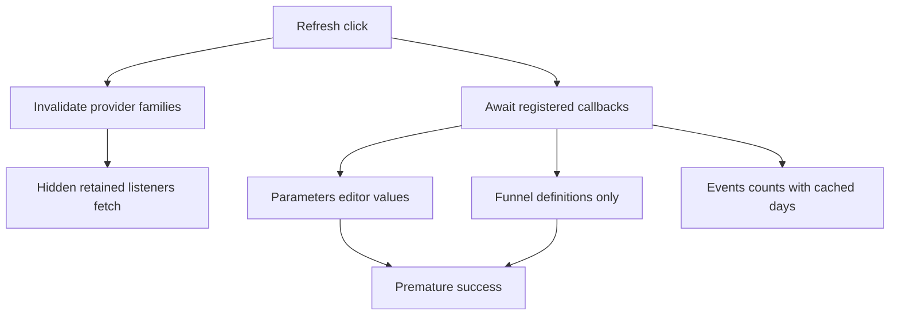
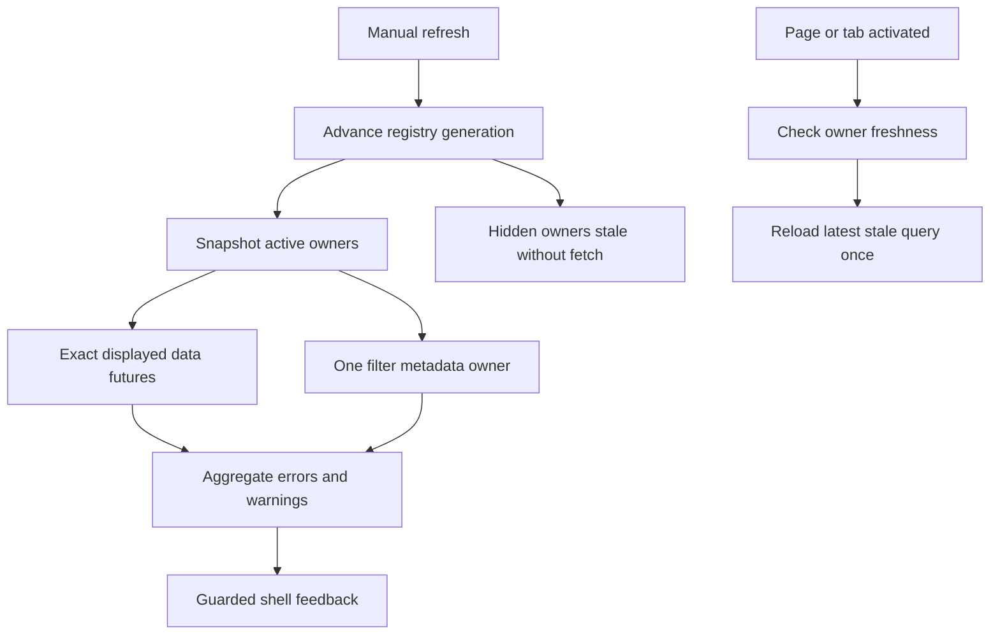
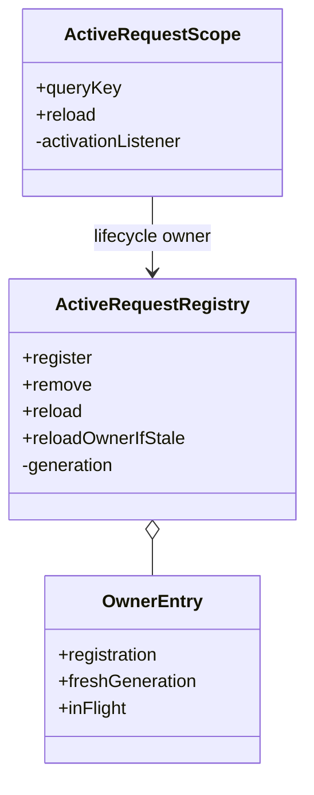

# Analytics Studio Waves 3–5 Repair Implementation Plan

> **For Gemini:** Execute inline with `executing-plans`, one task and verified commit at a time. Do not use subagent-driven-development. Read this complete plan and its review report before editing.

**Goal:** Fix confirmed BUG-0051–0058 plus the full BUG-0038 motion contract, preserving analytics values and persistent UI state.
**Architecture:** Repair focus/ticker lifecycles. Replace global provider invalidation with active-owner reloads and a registry freshness generation for deferred inactive reloads. Events fetches its own fresh coverage metadata; Funnel result/list/timeline each own their exact visible request. Propagate motion policy to actual chart renderers.
**Tech Stack:** Existing Flutter/Dart, Riverpod2.6.1, fl_chart; no new packages.
**Spec:** [review report](../../docs/reviews/2026-10-13-waves3-5-review.md), [approved UI design](analytics-studio-ui-design.md), Waves3–5 implementation plans.

## Global constraints

- Reviewed HEAD: `dc30d40`, branch `feature/wave5-analytics-studio`. Inspect actual checkout first. Existing review report/probes and ledger are dirty/untracked; preserve them. No reset/stash/implicit staging, merge or push.
- Scope: BUG-0051–0058 and BUG-0038, including original ranked/diverging interrupted-tween failures. BUG-0039 and BUG-0047–0050 stay separate; do not mark them resolved from these changes.
- Keep four themes/preferences, six Analytic tabs, filters, sample/evidence gates, API schemas, statistics, step-confidence bounds, funnel matching, raw UID copying and CSV bytes unchanged.
- Test fixtures only. No live import, SQLite/config edit, server restart, SDK/package upgrade or automatic Wave6 runtime execution.
- Callbacks own current server/query. Old completion cannot mark a new query fresh or produce a new-scope success message.
- Keep loaded subtree/state during same-query reload. Silent activation reloads show panel pending/error, not manual-refresh snackbars.
- Red/green must be observed. These source kernels and test bodies were inspected, not claimed to be precompiled replacement files.

## Review focus

| Condition | Required behavior | Task |
|---|---|---|
| Reduced-motion preference changes mid-animation | Safe ticker lifecycle, immediate actual target geometry | 1,6 |
| Focused page becomes hidden | No hidden keyboard focus/traversal | 1 |
| Another page refreshed before returning to retained page | No background fetch; one fresh request on activation | 2 |
| Query/server changes or disposal during reload | Old completion never blesses new query | 2–4 |
| Parameter/funnel visible request is slow or fails | Correct pending/error completion for actual displayed futures | 3,4 |

## Current flow



## Target flow



## Class changes



## Task map

| Task | Production files under app/lib/src | Permanent tests under app/test | Bugs |
|---|---|---|---|
| 1 | pages/analytic/analytic_page.dart, shell/page_stage.dart | studio_navigation_test.dart, page_stage_test.dart | 0051,0052 |
| 2 | state/refresh.dart, shell/app_shell.dart, metadata callbacks in Overview/Retention/Progression | active_refresh_test.dart, app_shell_test.dart | 0058 |
| 3 | state/events_explorer.dart, screens/param_screen.dart | events_explorer_provider_test.dart, events_explorer_screen_test.dart, events_parameter_handoff_test.dart, app_shell_test.dart | 0053,0054 |
| 4 | pages/funnel_page.dart, widgets/funnel_drilldown_panel.dart | funnel_page_test.dart, funnel_drilldown_widgets_test.dart, app_shell_test.dart | 0055 |
| 5 | pages/analytic/survival_tab.dart | analytic_studio_levels_survival_test.dart | 0057 |
| 6 | theme/motion_policy.dart, shell/page_stage.dart, widgets/charts/chart_motion.dart, ranked_bar_chart.dart, diverging_bar_chart.dart; analytic Levels/Survival/Anomalies/Churn callers | motion_policy_test.dart, studio_charts_test.dart, page_stage_test.dart, analytic fixture tests | 0056,0038 |
| 7 | Repair verification report and bug ledger | All package gates and acceptance source | Closure |

Use symbol anchors, not stale line numbers. Do not restructure unrelated modules.

## Task 0 — Pin baseline and regression source

**Consumes:** Checkout/review evidence. **Produces:** Actual baseline SHA/status and observations in `.cursor/plans/analytics-studio-waves3-5-repair-verification.md`.

- [ ] Read AGENTS.md, this plan, review report, BUG-0038 and0051–0058. Record `git status --short --branch`, `git rev-parse HEAD`, `git diff --stat`.
- [ ] If overlapping production files changed after review, reconcile against actual source. Do not reset concurrent work.
- [ ] Run analyzers and existing suites with Task7 commands. Reviewed baseline: shared65/server271/app252 =588. Record actual results; future counts may increase.
- [ ] Save Appendix A as `app/test/analytics_studio_repair_acceptance_test.dart`. It contains complete fixtures and nine regression bodies; copy owning cases into permanent files before each repair. Avoid importing a fixture library's main.
- [ ] Run acceptance file before edits. All9 should reproduce reviewed behavior; compilation failures alone are not bug reproduction. Appendix Events case uses API-level days calls, allowing the repaired provider ownership to change.

## Task 1 — Analytic ticker lifecycle and hidden focus

**Files:** Task map1. **Consumes/produces:** Public AnalyticPage/PageStage unchanged.

- [ ] Add Appendix tests `Analytic opens with reduced motion without ticker exception` and `hidden page cannot retain keyboard focus` to owning files; observe red.
- [ ] Add live-toggle regression in studio_navigation_test using its existing `_FakeApi` fixture:

```dart
bool reduce = false;
late StateSetter setHost;
await tester.pumpWidget(ProviderScope(
  overrides: [apiClientProvider.overrideWithValue(_FakeApi())],
  child: MaterialApp(home: StatefulBuilder(builder: (context, update) {
    setHost = update;
    return MediaQuery(data: MediaQueryData(disableAnimations: reduce),
      child: const Scaffold(body: AnalyticPage()));
  })),
));
await tester.pumpAndSettle();
tester.widget<TabBar>(find.byType(TabBar)).controller!.animateTo(4);
await tester.pump(const Duration(milliseconds: 50));
setHost(() => reduce = true);
await tester.pumpAndSettle();
expect(tester.takeException(), isNull);
expect(tester.widget<TabBar>(find.byType(TabBar)).controller!.index, 4);
setHost(() => reduce = false);
await tester.pumpAndSettle();
expect(tester.takeException(), isNull);
expect(tester.widget<TabBar>(find.byType(TabBar)).controller!.index, 4);
```

- [ ] Replace AnalyticPage's SingleTickerProviderStateMixin with TickerProviderStateMixin. Preserve current controller disposal/listener removal, index clamping and external index synchronization. Compute duration with `motionDuration(context, MotionKind.tab)` so accessibleNavigation works too. Recreate only when duration changes; preserve target index during in-flight transition and maintain only one LIVE controller.
- [ ] In `_PageSlot.build`, wrap the existing TickerMode subtree with `ExcludeFocus(excluding: !widget.isActive, child: ...)`. Retain Offstage, pointer/semantics exclusion, transitions and storage keys. ExcludeFocus has a real existing child, not a replacement empty widget.
- [ ] Focus regression must also call the hidden node's requestFocus after deactivation and verify it cannot become primary; Tab traversal reaches only visible controls. If SDK ExcludeFocus does not relinquish current focus, use a slot-owned FocusScopeNode and deactivate that scope. Never unfocus a common app ancestor. Returning to page preserves text/scroll.
- [ ] Run studio_navigation_test and page_stage_test, existing Analytic tests, then app analyzer/full suite. Commit: `fix(ui): repair analytic ticker lifecycle and hidden page focus`.

## Task 2 — Exact active refresh with deferred inactive freshness

**Files:** Task map2. **Consumes:** Current RefreshResult/navigation and page callbacks. **Produces:** Existing registry API plus `Future<RefreshResult> reloadOwnerIfStale(Object owner)`.

Extend RefreshResult with `final bool superseded;` and constructor default `this.superseded = false`. Its strict succeeded getter also requires `!superseded`. This distinguishes changed request scope from server errors or optional comparison warnings; no inaccurate warning snackbar is needed.

### Required registry semantics

Keep register/remove/reload/dispose signatures. Internally store an entry per stable widget owner, with registration, last successful generation, and optional in-flight ticket. `reload(page, analyticTab: ...)` advances ONE generation per manual action and snapshots matching owners. A hidden owner's stale generation alone starts no request. Settings bypass does not advance data generation.

Implement these private data types alongside existing RequestRegistration typedef:

```dart
class ReloadTicket {
  ReloadTicket({required this.queryKey, required this.generation,
    required this.future});
  final Object queryKey;
  final int generation;
  final Future<RefreshResult> future;
}
class OwnerEntry {
  OwnerEntry(this.registration, this.freshGeneration);
  RequestRegistration registration;
  int freshGeneration;
  ReloadTicket? inFlight;
}
```

Use `_owners` as Map<Object,OwnerEntry>, `_generation` initially0. New registration initializes freshGeneration to current generation because its initial data comes from watched providers. Updating existing registration preserves stale state and replaces metadata/callback every time. Silent retained activation reloads only when stale; first mount does not duplicate its cold watched request.

Implement the run helper with an immutable registration snapshot argument. The actual callback wrapper must invoke current widget.reload synchronously at run start. Capture its query identity before starting it. Use this completion kernel, with `dart:math as math`:

```dart
Future<RefreshResult> runOwner(Object owner, OwnerEntry entry,
    RequestRegistration snapshot, int requestedGeneration) async {
  final key = snapshot.queryKey;
  final existing = entry.inFlight;
  final ticket = existing != null && existing.queryKey == key &&
          existing.generation == requestedGeneration
      ? existing
      : ReloadTicket(queryKey: key, generation: requestedGeneration,
          future: Future<RefreshResult>.sync(snapshot.reload)
            .catchError((Object e) => RefreshResult(errors: [e])));
  entry.inFlight = ticket;
  final result = await ticket.future;
  final current = identical(_owners[owner], entry) &&
      entry.registration.queryKey == key;
  if (current && result.errors.isEmpty && !result.superseded) {
    entry.freshGeneration = math.max(entry.freshGeneration, requestedGeneration);
  }
  if (identical(entry.inFlight, ticket)) entry.inFlight = null;
  return RefreshResult(errors: result.errors, warnings: result.warnings,
    superseded: result.superseded || !current);
}
```

This method belongs inside ActiveRequestRegistry. `reloadOwnerIfStale` captures current generation, returns empty success for missing/fresh owner, otherwise calls runOwner without advancing generation. Two same-owner/key/generation calls join one ticket. A NEW manual generation starts a fresh request even if a prior activation request is pending; do not serve a new refresh from a request started before it. Query changes also create a new ticket; old completion cannot clear it. Warning-only payload counts as fresh, because it has usable current data. Errors leave stale state for retry. Dispose clears owners; pending completions must not reinsert them.

Manual reload snapshots `(owner, entry, registration)` for matching page/tab before any async wait. Start their runs concurrently; flatten errors/warnings and aggregate superseded with any result true. Do not update inactive entries to fresh. Null analyticTab is reserved for deliberately page-wide metadata; all analysis-tab owners retain exact indexes0..5. No selected registrations remains an error for data pages.

### Scope activation and metadata

- [ ] Port Appendix hidden-refetch regression and add exact freshness test:

```dart
final registry = ActiveRequestRegistry();
final active = Object(), hidden = Object();
var a = 0, b = 0;
registry.register(page: AppPage.overview, owner: active, queryKey: 'a',
  reload: () async { a++; return const RefreshResult(); });
registry.register(page: AppPage.retention, owner: hidden, queryKey: 'b',
  reload: () async { b++; return const RefreshResult(); });
await registry.reload(AppPage.overview, analyticTab: 0);
expect(a, 1); expect(b, 0);
await registry.reloadOwnerIfStale(hidden);
expect(b, 1);
await registry.reloadOwnerIfStale(hidden);
expect(b, 1);
```

- [ ] Add Completer-based stale-key test: start stale owner reload for key old; re-register as key new before completion; finish old successfully; reloadOwnerIfStale must call NEW callback. Test disposal-midflight, same-key concurrent coalescing, failure retry, warning-only freshness, and two manual generations finishing in reverse order. Assert explicit call counts and freshness through subsequent reloadOwnerIfStale, not private fields.
- [ ] ActiveRequestScope registration uses `reload: () => widget.reload()` from its State, so latest callback is used. Re-register in every didUpdateWidget, not only when queryKey differs. Store registry instance for dispose, and remove owner before super.dispose.
- [ ] Listen to selectedPageProvider and analyticTabIndexProvider using ref.listen in build. Determine active as matching page AND tab when applicable. Track prior active status; a false-to-true transition queues one post-frame stale-owner check. Post-frame checks mounted/latest-active again and invokes reloadOwnerIfStale. First mount uses cold watched requests. No API/setState/generation mutation in build. Multiple listeners queue at most one activation callback.
- [ ] Latest widget/query must be re-registered before queued reload starts. A queued activation followed by deactivation starts no request. Silent activation failures remain in the actual async panel; no success snackbar.
- [ ] Remove ALL provider-family invalidations from refreshActivePage. It now bypasses Settings, then awaits registry.reload. Do not invalidate daysProvider or eventsExplorerProvider globally as a substitute.
- [ ] Shell registers ONE filter-options metadata owner for pages with enabled global dropdowns, except Data health/Settings. Key includes baseURL; registration tracks selected page/current Analytic tab. Await filterOptionsProvider.future once. Remove duplicate filter-options reload from Overview/Retention/Progression callbacks. Page-specific keys/event names remain page owners.
- [ ] Preserve shell duplicate-click and mounted/server/page feedback guards. Capture current Filters and Analytic tab too: changing them before completion suppresses old-query success. Errors/warnings retain existing messages and Retry semantics.
- [ ] Before any shell feedback, return silently if result.superseded. This also covers same-page event/key/comparison, Funnel mode/breakdown/player changes, and owner disposal; page/filter guards alone do not cover them. Test a pending owner whose key changes before completion: original manual result has superseded=true and no success/warning snackbar.
- [ ] Integration acceptance: mount Overview and Retention, return Overview; refresh causes zero Retention requests. Revisit Retention after that generation: exactly one fresh request. Revisit/resize again without new generation: no duplicate. Repeat with retained Analytic tabs. Assert one filter metadata request per manual click.
- [ ] Run active_refresh_test, app_shell_test, studio_navigation_test; app gates. Commit: `fix(ui): refresh active owners and defer inactive cache reloads`.

### Shared metadata dependency rule

Events currently WATCHES daysProvider. Globally invalidating days would cause hidden Events counts to fetch. Task3 removes this cross-page dependency by calling ApiClient.days within Events' own aggregate request. Data health continues owning daysProvider independently. No hidden query watches the registry generation.

## Task 3 — Fresh Events coverage and exact Parameters completion

**Files:** Task map3. **Consumes:** Task2 freshness/activation. **Produces:** Unchanged EventsPayload/EventsQuery/ParamScreen APIs.

- [ ] Port Appendix Events and Parameters cases; run red.
- [ ] eventsExplorerProvider: keep current/previous count requests and optional previousError handling, but requiredResults uses `api.days()` instead of `ref.watch(daysProvider.future)`. Same api instance/server is used throughout:

```dart
final requiredResults = await Future.wait<Object>([
  load(f),
  api.days(),
]);
```

- [ ] CountsScreen callback still refreshes only exact eventsExplorerProvider(q), and derives warning from payload.previousError. No extra daysProvider/countsProvider refresh. One current-count + one previous-count when comparison enabled + one fresh days API request per action. Counts retain platform/version/includeTest; days remains global storage metadata.
- [ ] ParamScreen committed data future becomes the DISPLAYED provider, not editor-filtered paramValuesProvider:

```dart
if (currentEvent != null && currentEvent.isNotEmpty && currentKey.isNotEmpty) {
  futures.add(ref.refresh(paramProvider((
    filters: f, name: currentEvent, key: currentKey,
  )).future));
}
```

- [ ] Keep current eventNames/key requests; no value request when event/key absent. Histogram retains `(none)` rows. Do not change paramValuesProvider's funnel-editor purpose.
- [ ] Extend actual shell MockClient test: initial success, second displayed values request pending, keys success, no success snackbar; release values500, failure snackbar. Assert one values endpoint request, correct committed event/key/filter. Old event clears key before querying new event.
- [ ] Events test: initial days lacks a date, refreshed days includes it; totals, coverage, average denominator and daily chart use NEW metadata. Required days/current error fails panel; optional previous error retains current data and warning. A refreshed other page followed by retained Events activation invokes fresh aggregate exactly once.
- [ ] Run events_explorer_provider_test, events_explorer_screen_test, events_parameter_handoff_test, app_shell_test; app gates. Commit: `fix(ui): refresh event coverage and await displayed parameter data`.

## Task 4 — Funnel result and visible detail ownership

**Files:** Task map4. **Consumes:** Task2 registry and existing StudioAsyncPanel. **Produces:** Private scopes; public widget/API signatures unchanged.

| Owner | Complete queryKey | Awaited provider |
|---|---|---|
| FunnelPage | baseUrl | savedFunnelsProvider |
| _FunnelResultView | baseUrl,q | funnelResultProvider(q) |
| Visible player-list branch | baseUrl,player-list q | funnelPlayersProvider(q) |
| Visible timeline branch | baseUrl,timeline q | playerEventsProvider(q) |

- [ ] Port Appendix pending-result regression; observe early completion before edits.
- [ ] Convert FunnelPage savedAsync.when to StudioAsyncPanel<List<SavedFunnel>>, queryKey=baseUrl. Retain its full existing saved-definition body. Same-query reload must retain `_FunnelResultView` State and its detail owners; otherwise definitions refresh destroys pending children and their selection.
- [ ] Wrap `_FunnelResultView` OUTSIDE async result branch in ActiveRequestScope using `(baseUrl,q)`. q is current def, Filters, breakdown, and selected interval only in Trend mode. Its reload implementation is:

```dart
reload: () async {
  try {
    await ref.refresh(funnelResultProvider(q).future);
    return const RefreshResult();
  } catch (e) { return RefreshResult(errors: [e]); }
},
```

- [ ] Render result with StudioAsyncPanel<FunnelResult> keyed `(baseUrl,q)` instead of .when. Keep existing result-builder contents/statistics/validation; no fake empty result. onRetry invalidates only funnelResultProvider(q).
- [ ] `_buildPlayerListView`: wrap whole controls/list branch in ActiveRequestScope; exact q keeps def/filter/step/outcome/breakdown/segment/limit100. Reload awaits funnelPlayersProvider(q).future. List async rendering uses StudioAsyncPanel<FunnelPlayersResult> with server/q key.
- [ ] `_buildTimelineView`: wrap whole timeline branch similarly; await playerEventsProvider(q).future. q keeps UID, microsecond from/to, includeTest, limit300. Use StudioAsyncPanel<List<PlayerTimelineEvent>> with server/q key. Do not invent platform/version timeline arguments.
- [ ] Only currently visible list OR timeline owner is mounted. No hidden player-list query while timeline displayed. Panel reset checks include changed def/Filters/breakdown as well as step/segment/outcome; same-query refresh keeps selected player, new scope clears obsolete selection.
- [ ] Parent saved definitions, current result and visible detail futures all join one manual snapshot. Same-key pending presentation retains children so owners do not disappear during awaiting. Old query completion cannot mark new owner fresh.
- [ ] In real shell HTTP tests start from loaded fixture: hold result pending while definitions succeed; no success until result. Repeat Steps and weekly Trend with selected breakdown. Then hold visible player-list pending; repeat with selected timeline pending. Each500 blocks success. Assert exact request args and call counts.
- [ ] Use fixtures in funnel_page_test, funnel_trend_view_test, funnel_segment_widgets_test and funnel_drilldown_widgets_test. Literal fixture numeric oracles and CSV bytes must remain unchanged. Open fixture UID, refresh timeline, verify timeline once and hidden list zero. Closing panel removes detail registration.
- [ ] Run funnel page/widget/segment/trend/drilldown/editor tests, registry/shell tests; app gates. Commit: `fix(ui): await funnel result and visible detail refresh owners`.

## Task 5 — Survival curves match stable legend patterns

**Files:** Task map5. **Consumes:** Existing SeriesStyleRegistry and SeriesVisualStyle. **Produces:** Same statistical data with truthful persistent visual identities.

- [ ] Port Appendix five-group pattern case; observe null dash rather than6,4.
- [ ] Central LineChartBarData sets `dashArray: style.lineDash`, preserving isStepLineChart=true. Lower/upper band bars keep consistent triplet indexes and BetweenBarsData.
- [ ] Make private `_SurvivalChart` Stateful and own `final _registry = SeriesStyleRegistry();`. Before resolving styles call `_registry.registerAll(curves.map((c) => c.group))`; use `_registry.slotFor(c.group)` instead of sorting current-membership rank. Current palette/theme is resolved every build; IDs stay assigned throughout widget lifetime.
- [ ] Five-curve reorder/removal regression asserts the SAME group's actual central color/dash and legend sample stay consistent. New group receives unused slot. Do not reset registry on ordinary data refresh; if query-key clears subtree, a new scoped registry is allowed.
- [ ] Existing bound regression still0.75/0.95 around0.85; tooltip index maps to current curves, not registry slots. Run all4themes at720/text1.5 with long labels.
- [ ] Run analytic_studio_levels_survival_test and analytic_survival_test; app gates. Commit: `fix(ui): match survival curves to stable legend patterns`.

## Task 6 — First-mount and actual-renderer motion policy

**Files:** Task map6. **Consumes:** Existing motionDuration and ChartMotionSnapshot. **Produces:** No public data/API changes; correct policy propagation and unchanged-target settling.

- [ ] Port Appendix first-page opacity and Survival renderer-duration cases. Add original ranked interrupted probes from `docs/reviews/2026-10-12-wave2-repair-review-probe_test.dart` to permanent studio_charts_test. Add matching negative/positive Diverging cases. Observe red before editing.
- [ ] One chart policy helper in motion_policy.dart; ChartMotion and callers use it:

```dart
bool chartAnimationsAllowed(BuildContext context) {
  final media = MediaQuery.maybeOf(context);
  return !(media?.disableAnimations ?? false) &&
      !(media?.accessibleNavigation ?? false) &&
      TickerMode.valuesOf(context).enabled;
}
```

- [ ] PageSlot creates its controller once in initState, but starts entrance in didChangeDependencies after MediaQuery is available. First mount uses motionDuration/navigation; reduced/accessibility/inactive immediately stops and sets value1. Reactivation uses same policy; changing policy mid-motion settles. Preserve slot identity and lazy mounting.
- [ ] Build raw Levels LineChart/BarChart and Survival LineChart through a Builder UNDER ChartMotion. Inside that Builder read snapshot; set actual renderer `duration: ChartMotion.of(rendererContext).geometryDuration`. An outer page build context cannot read its own descendant scope.
- [ ] Renderer key uses a fixed renderer ID plus `chartAnimationsAllowed(rendererContext)`. The key changes when policy changes, resetting an existing implicit tween to actual data; it must NOT change on each animation phase or measured data revision. Distinct IDs for Levels trend/attempts and Survival. Keep full existing chart data, bands, units, legends and tooltip behavior.
- [ ] Ranked/diverging preserve existing OUTER ValueKeys used by tests. Inside each bar, when animations disallowed render direct FractionallySizedBox at target width; otherwise use its normal TweenAnimationBuilder. Alternatively policy-key the inner tween while retaining outer key. Both negative and positive Diverging halves require exact target/sign. Merely changing duration0 on an existing unchanged-target tween is insufficient.
- [ ] Anomalies and Churn AnimatedSize use `motionDuration(context, MotionKind.expansion)` instead of fixed220ms. Both disableAnimations and accessibleNavigation produce zero; normal behavior remains220ms.
- [ ] Interrupted acceptance algorithm, using existing stable bar finder:

```dart
await render(10);
await tester.pump(const Duration(milliseconds: 401));
await render(20);
await tester.pump(const Duration(milliseconds: 100));
expect(widthFactor(), lessThan(1));
await render(20, reduced: true);
expect(widthFactor(), 1);
```

Implement local render/widthFactor helpers using the existing original probe source; SAME target20 is essential. Repeat inactive TickerMode and negative Diverging. Raw renderer policy toggles mid-interpolation also settle to actual target on next pump, not merely report duration0. Add accessibleNavigation equivalents.
- [ ] Run motion_policy_test, studio_charts_test, page_stage_test and analytic fixture tests; app gates. Commit: `fix(ui): settle page and chart motion when policy disables animation`.

## Task 7 — Verification and evidence-backed bug closure

**Files:** `.cursor/plans/analytics-studio-waves3-5-repair-verification.md`, canonical ledger. **Consumes:** Six repair commits. **Produces:** Accurate red/green/gates and bug state transitions.

- [ ] All9 Appendix acceptance cases pass, plus permanent HTTP-boundary/lifecycle/interruption cases. Existing historic review probes remain evidence; don't rewrite their expected behavior to green by weakening it.
- [ ] Run commands individually and stop on failure:

```powershell
# cwd shared
& 'D:\flutter\bin\cache\dart-sdk\bin\dart.exe' analyze
& 'D:\flutter\bin\cache\dart-sdk\bin\dart.exe' test --reporter expanded
# cwd server
& 'D:\flutter\bin\cache\dart-sdk\bin\dart.exe' analyze
& 'D:\flutter\bin\cache\dart-sdk\bin\dart.exe' test --reporter expanded
# cwd app
& 'D:\flutter\bin\cache\dart-sdk\bin\dart.exe' 'D:\flutter\bin\cache\flutter_tools.snapshot' analyze --no-pub
& 'D:\flutter\bin\cache\dart-sdk\bin\dart.exe' 'D:\flutter\bin\cache\flutter_tools.snapshot' test --no-pub --reporter expanded
# cwd repo
git diff --check
```

- [ ] Report actual base/head/task commits, each failing assertion before repair and passing command afterward, counts/exits, unresolved findings and pending Windows checks. Do not invent historical tests or modify numerical oracles to match output.
- [ ] Ledger: transition0051–0058 only after owning acceptance passes. BUG0038 requires BOTH old ranked/diverging interruption and new specialized renderer/expansion tests. Keep Updated/Evidence/Resolution and status span consistent. Preserve all prior records; report IDs changed.
- [ ] No automatic full UI/Windows acceptance while unrelated BUG0039/0047–0050 remain unresolved. No merge/push. Final repair commit range must receive code review.

## Bug acceptance map

| Bug | Required evidence |
|---|---|
| 0051 | Initial reduced motion and live toggles, no assertion, tab retained |
| 0052 | Hidden field loses focus and cannot request/traverse focus |
| 0053 | Counts AND days fresh; inactive Events reload after manual generation |
| 0054 | Displayed paramProvider pending/error governs completion; no editor duplicate |
| 0055 | Steps/Trend/list/timeline exact futures govern completion; CSV/state retained |
| 0056 | First page visit immediate under both accessibility flags |
| 0057 | Fifth curve and legend share dash; identity survives reorder/removal |
| 0058 | Hidden page/tab calls unchanged until activation; one deferred reload |
| 0038 | Renderer duration AND interrupted target geometry; expansion policy |

## Appendix A — Complete nine-probe acceptance source

Save the following complete block as `app/test/analytics_studio_repair_acceptance_test.dart`. Tests complement task-specific HTTP/lifecycle cases; they do not replace existing regressions.

**Planner verification, 2026-10-13:** Appendix compiled and executed against dc30d40 using a temporary app/test file; all nine intended behavior assertions failed, with no compilation failure. Temporary test removed afterward. Ten Dart blocks were syntax-parsed with statement/named-argument wrappers where needed. This checks fixture/syntax usability, not the future production implementation. Ignored baseline log: `build/repair-plan-probe-baseline.log`.

```dart
import 'dart:async';
import 'package:analytic_app/src/api_client.dart';
import 'package:analytic_app/src/pages/analytic/analytic_page.dart';
import 'package:analytic_app/src/pages/analytic/survival_tab.dart';
import 'package:analytic_app/src/pages/funnel_page.dart';
import 'package:analytic_app/src/providers.dart';
import 'package:analytic_app/src/screens/param_screen.dart';
import 'package:analytic_app/src/shell/page_stage.dart';
import 'package:analytic_app/src/state/navigation.dart';
import 'package:analytic_app/src/state/events_explorer.dart';
import 'package:analytic_app/src/state/refresh.dart';
import 'package:analytic_shared/analytic_shared.dart';
import 'package:flutter/material.dart';
import 'package:flutter_riverpod/flutter_riverpod.dart';
import 'package:flutter_test/flutter_test.dart';
import 'package:fl_chart/fl_chart.dart';
import 'funnel_page_test.dart' as funnelFixture;
import 'support/studio_test_host.dart';

const f = Filters(from: '2026-10-01', to: '2026-10-04');
const overview = OverviewData(kpis: Kpis(dau: 10, newUsers: 0, sessions: 0,
  sessionsPerDau: 0, playtimeMinPerDau: 0, uninstalls: 0), previous: null, daily: []);

class CountsApi extends ApiClient {
  CountsApi() : super('http://review-fixture');
  int calls = 0;
  int dayCalls = 0;
  @override
  Future<List<DayStat>> days() async {
    dayCalls++;
    return [DayStat(day: f.from, rowCount: dayCalls, pulledAt: '2026-10-05T01:00:00Z')];
  }
  @override
  Future<List<EventCount>> counts(String from, String to, {String? name,
    String? platform, String? version, bool includeTest = false}) async {
    calls++;
    return [EventCount(day: from, eventName: 'event', count: calls)];
  }
}

void main() {
  Future<void> pumpSurvival(WidgetTester t, {bool reducedMotion = false}) async {
    final result = SurvivalResult(players: 50, by: 'version', curves: [
      for (var i = 0; i < 5; i++) SurvivalCurve(group: 'group$i', players: 10,
        events: 2, censored: 8, medianDays: null, points: const [
          SurvivalPoint(day: 0, survival: 1, ciLower: 1, ciUpper: 1, atRisk: 10, events: 0, censored: 0),
          SurvivalPoint(day: 1, survival: 0.8, ciLower: 0.6, ciUpper: 1, atRisk: 10, events: 2, censored: 0),
        ]),
    ], logRank: null, reason: null);
    await pumpStudio(t, const SurvivalTab(), width: 1440, textScale: 1,
      reducedMotion: reducedMotion, overrides: [
        survivalProvider.overrideWith((ref, q) async => result),
        versionImpactProvider.overrideWith((ref, q) async => const VersionImpactResult(
          targetVersion: '', targetPlayers: 0, baselineVersion: '', baselinePlayers: 0,
          metrics: [], availableVersions: [], reason: 'too_few_players')),
      ]);
  }

  testWidgets('Survival repeated-color curve has rendered dash pattern', (t) async {
    await pumpSurvival(t);
    final chart = t.widget<LineChart>(find.byType(LineChart));
    expect(chart.data.lineBarsData[12].dashArray, [6, 4]);
  });

  testWidgets('Survival actual renderer respects reduced motion', (t) async {
    await pumpSurvival(t, reducedMotion: true);
    final chart = t.widget<LineChart>(find.byType(LineChart));
    expect(chart.duration, Duration.zero);
  });

  testWidgets('hidden page cannot retain keyboard focus', (t) async {
    final focus = FocusNode();
    addTearDown(focus.dispose);
    Future<void> render(int index) => t.pumpWidget(MaterialApp(home: Scaffold(
      body: PageStage(index: index, pages: [TextField(focusNode: focus), const Text('other')]))));
    await render(0);
    focus.requestFocus();
    await t.pump();
    expect(focus.hasFocus, isTrue);
    await render(1);
    await t.pumpAndSettle();
    expect(focus.hasFocus, isFalse, reason: 'hidden page must not keep keyboard input');
  });

  testWidgets('Events refresh also refreshes coverage metadata', (t) async {
    final api = CountsApi();
    addTearDown(api.close);
    late WidgetRef shellRef;
    const q = (filters: f, compare: false);
    await t.pumpWidget(ProviderScope(overrides: [
      apiClientProvider.overrideWithValue(api),
    ], child: MaterialApp(home: Scaffold(body: Consumer(builder: (context, ref, child) {
      shellRef = ref;
      ref.watch(eventsExplorerProvider(q));
      return ActiveRequestScope(page: AppPage.events, queryKey: q,
        reload: () async { await ref.refresh(eventsExplorerProvider(q).future); return const RefreshResult(); },
        child: const Text('events'));
    })))));
    await t.pumpAndSettle();
    expect(api.dayCalls, 1);
    await refreshActivePage(shellRef, AppPage.events, analyticTab: 0);
    await t.pumpAndSettle();
    expect(api.calls, 2);
    expect(api.dayCalls, 2, reason: 'counts refresh must not retain old coverage');
  });

  testWidgets('refresh does not refetch retained hidden page', (t) async {
    var hiddenCalls = 0;
    final container = ProviderContainer(overrides: [
      overviewProvider.overrideWith((ref, q) async => overview),
      retentionProvider.overrideWith((ref, q) async {
        hiddenCalls++;
        return const RetentionData(offsets: [], lastDataDay: null, cohorts: [], average: []);
      }),
    ]);
    addTearDown(container.dispose);
    late WidgetRef shellRef;
    Future<void> render(int index) async {
      await t.pumpWidget(UncontrolledProviderScope(container: container,
        child: MaterialApp(home: Scaffold(body: Consumer(builder: (context, ref, child) {
          shellRef = ref;
          return PageStage(index: index, pages: [
            Consumer(builder: (context, ref, child) {
              ref.watch(overviewProvider(f));
              return ActiveRequestScope(page: AppPage.overview, queryKey: f,
                reload: () async { await ref.refresh(overviewProvider(f).future); return const RefreshResult(); },
                child: const Text('overview'));
            }),
            Consumer(builder: (context, ref, child) {
              ref.watch(retentionProvider(f));
              return const Text('retention');
            }),
          ]);
        })))));
      await t.pumpAndSettle();
    }
    await render(0);
    await render(1);
    await render(0);
    final before = hiddenCalls;
    await refreshActivePage(shellRef, AppPage.overview, analyticTab: 0);
    await t.pumpAndSettle();
    expect(hiddenCalls, before, reason: 'hidden retention must not fetch on Overview refresh');
  });

  testWidgets('Analytic opens with reduced motion without ticker exception', (t) async {
    await t.pumpWidget(const ProviderScope(child: MaterialApp(home: MediaQuery(
      data: MediaQueryData(disableAnimations: true),
      child: Scaffold(body: AnalyticPage())))));
    expect(t.takeException(), isNull);
  });

  testWidgets('first page visit respects reduced motion', (t) async {
    Future<void> render(int index) => t.pumpWidget(MaterialApp(home: MediaQuery(
      data: const MediaQueryData(disableAnimations: true),
      child: Scaffold(body: PageStage(index: index, pages: const [Text('one'), Text('two')])))));
    await render(0);
    await render(1);
    final fade = t.widget<FadeTransition>(find.ancestor(of: find.text('two'), matching: find.byType(FadeTransition)).first);
    expect(fade.opacity.value, 1, reason: 'new page must be immediately visible');
  });

  testWidgets('Parameters refresh waits for visible buckets', (t) async {
    final pending = Completer<List<ParamBucket>>();
    addTearDown(() { if (!pending.isCompleted) pending.complete(const []); });
    var bucketCalls = 0;
    var completed = false;
    await t.pumpWidget(ProviderScope(overrides: [
      eventNamesProvider.overrideWith((ref) async => ['event']),
      parameterEventProvider.overrideWith((ref) => 'event'),
      parameterKeyProvider.overrideWith((ref) => 'key'),
      paramKeysProvider.overrideWith((ref, q) async => ['key']),
      paramValuesProvider.overrideWith((ref, q) async => const []),
      paramProvider.overrideWith((ref, q) async {
        bucketCalls++;
        return bucketCalls == 1 ? const [ParamBucket(value: 'old', count: 1)] : pending.future;
      }),
    ], child: MaterialApp(home: Scaffold(body: Consumer(builder: (context, ref, child) => Column(children: [
      TextButton(onPressed: () async {
        await refreshActivePage(ref, AppPage.parameters, analyticTab: 0);
        completed = true;
      }, child: const Text('probe refresh')),
      const Expanded(child: ParamScreen()),
    ]))))));
    await t.pumpAndSettle();
    await t.tap(find.text('probe refresh'));
    await t.pump();
    await t.pump(const Duration(milliseconds: 50));
    expect(bucketCalls, greaterThan(1));
    expect(completed, isFalse, reason: 'visible bucket request still pending');
  });

  testWidgets('Funnel refresh waits for visible result', (t) async {
    final pending = Completer<FunnelResult>();
    addTearDown(() { if (!pending.isCompleted) pending.complete(funnelFixture.result); });
    var resultCalls = 0;
    var completed = false;
    t.view.physicalSize = const Size(1400, 1000);
    t.view.devicePixelRatio = 1;
    addTearDown(t.view.reset);
    await t.pumpWidget(ProviderScope(overrides: [
      savedFunnelsProvider.overrideWith((ref) async => const [SavedFunnel(id: 1,
        name: 'Onboarding', windowMinutes: 1440, steps: funnelFixture.steps, updatedAt: 'x')]),
      funnelResultProvider.overrideWith((ref, q) async {
        resultCalls++;
        return resultCalls == 1 ? funnelFixture.result : pending.future;
      }),
    ], child: MaterialApp(home: Scaffold(body: Consumer(builder: (context, ref, child) => Column(children: [
      TextButton(onPressed: () async {
        await refreshActivePage(ref, AppPage.funnels, analyticTab: 0);
        completed = true;
      }, child: const Text('probe refresh')),
      const Expanded(child: FunnelPage()),
    ]))))));
    await t.pumpAndSettle();
    await t.tap(find.text('probe refresh'));
    await t.pump();
    await t.pump(const Duration(milliseconds: 50));
    expect(resultCalls, greaterThan(1));
    expect(completed, isFalse, reason: 'visible funnel analysis still pending');
  });
}

```
