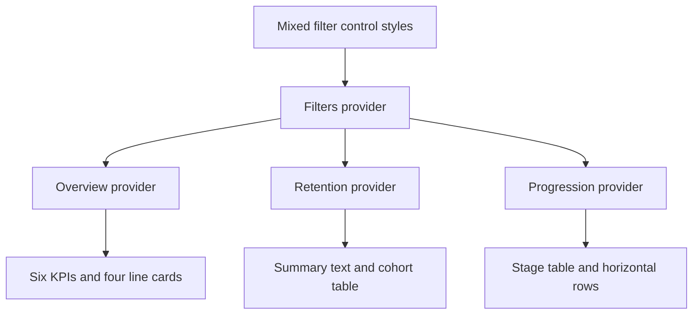
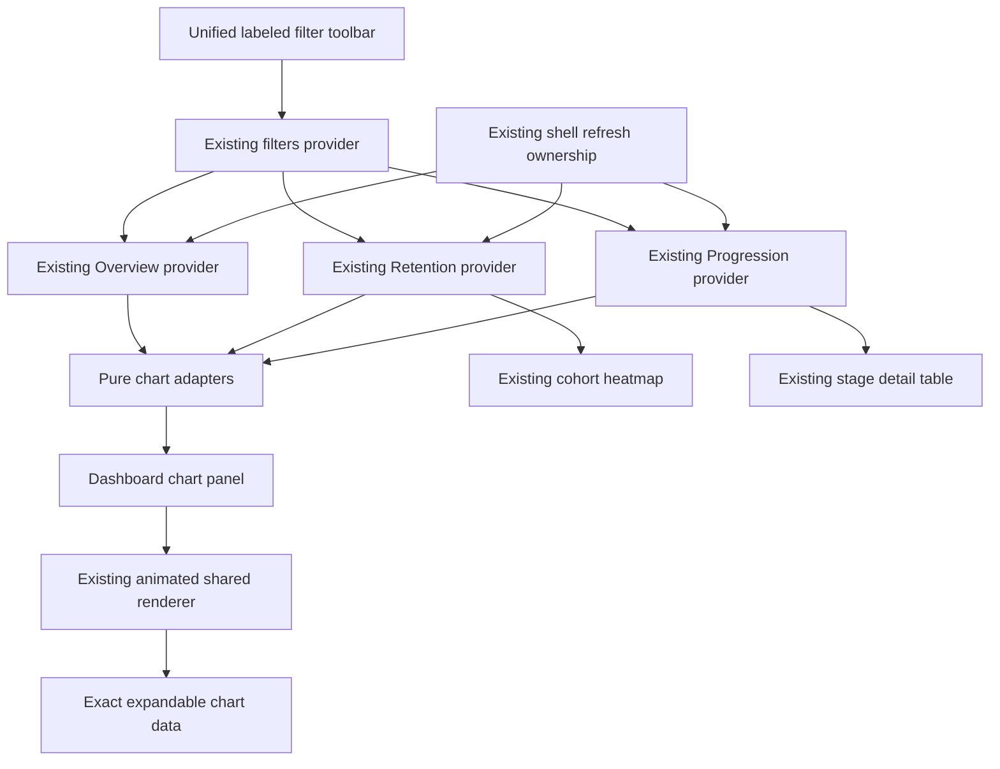
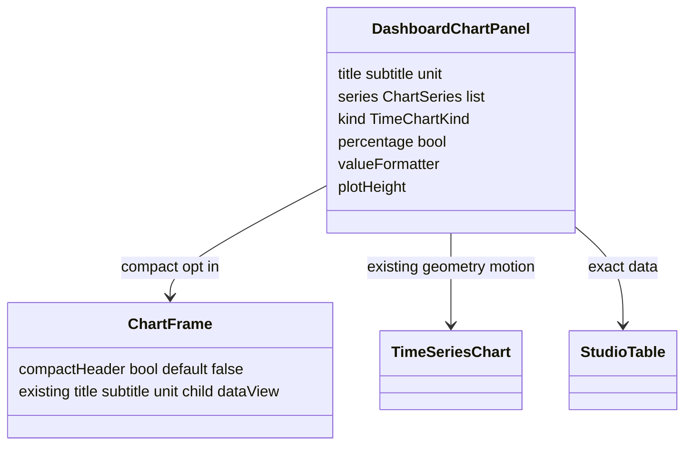

# Overview, Retention, Progression and Filters Implementation Plan

> **For Gemini:** Execute inline, task by task, with `executing-plans`. No agent dispatch and no `subagent-driven-development`. Checkbox completion records execution; verification requires the stated observations. Read the approved design and latest handoff before editing.

**Goal:** Implement the approved chart-first refresh of Overview, Retention, Progression and global filters while preserving Funnel/Analytic styles, metric semantics, request ownership and existing uncommitted repairs.

**Architecture:** Adapt current response models into shared `ChartSeries`, render through existing `TimeSeriesChart`/`ChartFrame`, and retain current providers and active refresh scopes. Add opt-in compact chart headers for these pages. Restyle `FilterBar` in place, retaining its notifier operations and shell ownership. No new backend endpoint, package, cache or motion controller.

**Tech Stack:** Flutter/Dart, Riverpod, pinned fl_chart, existing analytics tokens, Studio layout/table/chart widgets; Windows/PowerShell with SDK `D:\flutter`.

**Spec:** `dashboard-refresh-demo-design.md` — owner approved 2026-10-14. Visual reference `../../work/demos/dashboard-refresh.html`, local preview `http://127.0.0.1:8766/dashboard-refresh.html` when its local server is running. HTML is a visual reference, not production code or a statistical oracle.

## Global constraints and checkout safety

- Inspected branch `feature/wave5-analytics-studio`, HEAD `363aaddfeb5c1d755cee4de19f75fb0cccabb45c`. Reinspect before work. Working tree, not HEAD alone, contains the latest repairs.
- Read `../memory/mem-project-completion-session-handoff.md`, `../memory/mem-project-index.md`, `project-completion-implementation.md`, and the final repair section of `analytics-studio-waves0-6-fix-verification.md`.
- Preserve all current modifications and untracked files. Particularly `app/lib/src/widgets/funnel_trend_view.dart`, `app/test/studio_http_acceptance_test.dart`, `app/test/studio_visual_matrix_test.dart`, `app/test/visible_refresh_contract_test.dart`, `app/test/funnel_export_contract_test.dart`, docs, plans and owner memory edits. Do not reset/stash/discard, blanket-stage, implicitly commit, merge or push.
- All code work remains in the current owner-approved checkout; do not create a clean checkout that omits the uncommitted production/test repairs. If isolation is requested later, explicitly transfer those repairs first.
- Historical verification: shared65/server271/app521 =857 tests, three analyzers clean. This plan-writing session did not rerun them. Establish fresh baseline before edits; final test count may increase.
- Shared graph geometry entrance already exists. Do not rebuild ChartMotion, chart reveal, tab/page transitions or stable refresh identity. Overview already delegates to the animated renderer; this task makes its hierarchy clearer and adds mixed chart types plus page-level evidence.
- All four `AppStyle` palettes, fonts and radii remain. Obtain colours from `Theme.of(context)` and `AnalyticsTokens.of(context)`, not copied HTML hex values. Existing `app_style.dart` and token definitions require no changes.
- Motion: chart entrance400ms, update350ms; existing navigation180ms, tabs200ms, expansion220ms, theme200ms and hover120ms remain. No loop, whole-card scaling, delayed fake loading, new settings, production Replay button or artificial value counting.
- No chart entrance replay on theme/resize/hide/revisit. Reduced motion, accessible navigation and inactive TickerMode immediately settle; restoring policy must not replay. Keep axes derived from full data during reveal.
- Sidebar at1200+, rail900–1199, drawer below900. Page/provider identity persists across shell breakpoint changes. Reuse `StudioGrid` for page-local wrapping, not custom viewport assumptions.
- No changes to server metrics, shared response models, API routes, auth, external IAM, live config, databases or scheduled tasks. Auth BUG-0010 stays DEFERRED; native/platform acceptance remains separate.
- Every chart has readable units, real values, null gaps, theme-safe tooltip and accessible exact-data access. Raw counts remain available in existing tables.
- Approval applies to the proposed visual direction. Demo-only theme picker, motion replay, density toggle, sample player counts, stage click-to-highlight and illustrative filters are not required product features. Theme selection stays in existing Settings. Use comfortable spacing and soft area fill for DAU/sessions by default.

## Review focus

| Input / interruption | Required outcome | Task |
|---|---|---|
| Sparse retention offsets1/3/7/14/30, null middle and immature final offset | Actual elapsed-day x spacing; no fake zero/bridge; existing server weights |2,5|
| Unsorted/noncontiguous stages, zero denominator, negative drop-off | Numeric order; no invented stages; nullable and signed rates preserved |2,6|
| Resize/theme/page revisit during entrance or pending refresh | Stable chart state and axes; correct active request; no replay or old-scope feedback |3,4,7|
| Filter options loading/error with selected values and health storage scope | Selections retained; prohibited controls disabled; date/refresh still usable |1,7|
| All styles,320/720/1024/1440 widths,1/1.5 text, bold numbers/long versions | Wrap/reflow; no clipped controls, headings, glyphs or last table columns |1,3–7|

## Current and target flows







## File ownership and dependencies

| Task | Create | Modify |
|---|---|---|
|1 Filters|`app/test/dashboard_filter_bar_test.dart`|`app/lib/src/widgets/filter_bar.dart`, existing filter/shell interaction tests|
|2 Adapters|`app/lib/src/widgets/dashboard_chart_data.dart`, `app/test/dashboard_chart_data_test.dart`|none|
|3 Panels|`app/lib/src/widgets/dashboard_chart_panel.dart`, `app/test/dashboard_chart_panel_test.dart`|`app/lib/src/widgets/charts/chart_frame.dart` opt-in header only|
|4 Overview|`app/test/dashboard_overview_test.dart`|`app/lib/src/pages/overview_page.dart`|
|5 Retention|`app/test/dashboard_retention_test.dart`|`app/lib/src/pages/retention_page.dart`, `app/test/pages_test.dart` summary expectation|
|6 Progression|`app/test/dashboard_progression_test.dart`|`app/lib/src/pages/progression_page.dart`, `app/test/pages_test.dart` old layout expectations|
|7 Acceptance|`app/test/dashboard_refresh_matrix_test.dart`, `.cursor/plans/dashboard-refresh-verification.md`|existing shell tests only when selector changes; append evidence if owner requests memory update|

Execution:1 →2 →3 →4 →5 →6 →7. Tasks2+3 define interfaces used by all page tasks. Do not broaden work to unrelated chart types. Existing Funnel/Analytic pages remain unchanged; their tests verify shared default compatibility.

## Command contract

Run from the stated package directory; use installed real executable to avoid Flutter batch locks. Each invocation has its own exit/result record.

```powershell
# cwd D:\Projects\AnalyticTracker\app
& 'D:\flutter\bin\cache\dart-sdk\bin\dart.exe' 'D:\flutter\bin\cache\flutter_tools.snapshot' test --no-pub --reporter expanded test/dashboard_filter_bar_test.dart
& 'D:\flutter\bin\cache\dart-sdk\bin\dart.exe' 'D:\flutter\bin\cache\flutter_tools.snapshot' analyze --no-pub
# replace owning test filename exactly for each task
# cwd shared or server
& 'D:\flutter\bin\cache\dart-sdk\bin\dart.exe' analyze
& 'D:\flutter\bin\cache\dart-sdk\bin\dart.exe' test --reporter expanded
```

Use bounded pumps while HTTP completers are held; complete all completers in teardown. Do not pumpAndSettle unresolved networking or terminate unrelated Dart/IDE processes. Reuse `test/support/studio_test_host.dart` (`pumpStudio`) and `studio_text_assertions.dart`. `pumpStudio` creates a fresh ProviderScope: use a retained `ProviderContainer`/stable widget keys for update/revisit tests rather than accidentally remounting them.

Commit labels below describe intended task boundaries. Commit only if owner explicitly authorizes commits; otherwise deliver reviewed task diffs and evidence. If committing, stage exact owned paths/hunks, preserving pre-existing changes even in a shared test file. Never `git add .`.

### Task 1: Unified global filter toolbar

**Files:** modify `app/lib/src/widgets/filter_bar.dart`; create `app/test/dashboard_filter_bar_test.dart`; retain/update `app/test/filter_bar_test.dart`, `app/test/app_shell_test.dart`, `app/test/filters_state_test.dart`.

**Consumes:** existing `FilterBar({required VoidCallback onRefresh, bool storageScope=false, bool refreshing=false})`; `FiltersNotifier.applyPreset/setRange/setPlatform/setVersion/setIncludeTest`; `filterOptionsProvider`.

**Produces:** identical public interface and callbacks. Stable keys `filter-date-range`, `filter-platform`, `filter-version`, `filter-test-devices`; retain `refresh-button`. Visible labels `Date range`, `Platform`, `Version`; values `All platforms`, `All versions`. Exact option values such as `IOS`, `ANDROID`, `1.0.0` remain unchanged.

- [ ] Record branch/HEAD/status and task-owned paths. Run current `filter_bar_test.dart`, `filters_state_test.dart`, `app_shell_test.dart` before edits. Record actual baseline failures separately; do not assume857 still applies.
- [ ] Before first production edit, run current app analyzer and complete app suite with the command contract. Record the actual pre-change total and exit. Shared/server historical totals remain historical until Task7 reruns them.
- [ ] Write tests for visible labeled, bounded controls at320px/text1.5 and active selected `IOS`/long version while `/filters` is held. Add helper using retained `ProviderContainer`, UncontrolledProviderScope and `buildTheme(style)`. Use a finite-height Scaffold with toolbar aligned at top.
- [ ] Include this literal state/interaction regression (imports: shared, providers, FilterBar, Flutter/Riverpod/flutter_test):

```dart
testWidgets('preset preserves selected platform version and test state', (t) async {
  final c = ProviderContainer(overrides: [
    filterOptionsProvider.overrideWith((ref) async => const FilterOptions(
      platforms: ['IOS', 'ANDROID'], versions: ['2.0.0'])),
  ]);
  addTearDown(c.dispose);
  c.read(filtersProvider.notifier).setPlatform('IOS');
  c.read(filtersProvider.notifier).setVersion('2.0.0');
  c.read(filtersProvider.notifier).setIncludeTest(true);
  await t.pumpWidget(UncontrolledProviderScope(container: c,
    child: MaterialApp(home: Scaffold(body: FilterBar(onRefresh: () {})))));
  await t.pumpAndSettle();
  await t.tap(find.byKey(const ValueKey('filter-date-range')));
  await t.pumpAndSettle();
  await t.tap(find.text('Last 7 days').last);
  await t.pumpAndSettle();
  final f = c.read(filtersProvider);
  expect(f.platform, 'IOS');
  expect(f.version, '2.0.0');
  expect(f.includeTest, isTrue);
  expect(DateTime.parse(f.to).difference(DateTime.parse(f.from)).inDays, 6);
});
```

- [ ] Run new file; expected RED for missing keys/labeled treatment, not fabricated behavioral RED for existing correct notifier operations.
- [ ] Add private `_FilterField({required String label, required Widget child})`: Column, crossAxisAlignment.start, theme labelMedium +4px gap, child. Toolbar: opaque themed surface, padding16h/12v, `LayoutBuilder` + `Wrap(spacing:12,runSpacing:12,crossAxisAlignment:WrapCrossAlignment.end)`. On narrow layout constrain each field to available width; no fixed Row forcing refresh out of bounds. Existing shell Divider suffices; avoid duplicate enclosing card/border.
- [ ] Date uses existing `PopupMenuButton<int>` with tooltip `Date range`, menu7/14/30/60/Custom. Style its child like the dropdowns: outline, themed radius, date icon, wrapping range text, chevron; at least44px actionable height. Do not use a fixed-height date child that clips at1.5 scale. Show actual `from → to`, not a stale preset name. Cancellation leaves state unchanged. After `showDateRangePicker` await, guard `context.mounted` before using context; apply picked calendar dates with existing `formatDay` and `setRange`.
- [ ] Replace underline dropdowns with `DropdownButtonFormField<String?>` or styled existing `DropdownButton<String?>`, whichever matches pinned Flutter signatures without deprecation. Prefer existing DropdownButton with `isExpanded:true`, `underline:SizedBox.shrink()` inside InputDecorator. Theme control radius `AnalyticsTokens.radius -4`, min44px; label outside. Include selected value absent from loaded options. `onChanged:null` for storageScope. Do not substitute local selection state or silently clear unknown active values.

```dart
final items = <DropdownMenuItem<String?>>[
  DropdownMenuItem(value: null,
    child: Text(label == 'Platform' ? 'All platforms' : 'All versions')),
  if (value != null && !options.contains(value))
    DropdownMenuItem(value: value, child: Text(value!)),
  for (final option in options.toSet())
    DropdownMenuItem(value: option, child: Text(option)),
];
// Give InputDecorator a minimum height, not a tight height.
// Constrain its width from LayoutBuilder; retain full option in menu/tooltip.
```

- [ ] Keep `FilterChip` for Test devices, selected and enabled semantics, existing tooltip; give its outer field the same alignment/minimum height. Refresh becomes labeled outlined icon action `Refresh`, same tooltip/key, disabled while refreshing; show16px spinner+`Refreshing` and semantics `Refreshing data`. Existing shell owns pending state and real fetch; do not add a fake timer.
- [ ] Verify health storageScope disables platform/version/test while retaining values; date and refresh remain enabled unless refreshing. Preserve existing storage-scope explanation, wrapping onto its own line. Verify leaving health restores controls and values.
- [ ] Verify keyboard Tab/focus/Space/Enter operation, custom picker accept/cancel, filter options error fallback, and click while refreshing produces zero callbacks. Update old `Platform: All` selector to key/`All platforms`; change widget-type assertions only if widget type actually changed. Do not weaken state assertions.
- [ ] Run new+existing owning files and analyzer. Task boundary `feat(filters): unify global date and scope controls`.

### Task 2: Pure source-preserving chart adapters

**Files:** create `app/lib/src/widgets/dashboard_chart_data.dart`, `app/test/dashboard_chart_data_test.dart`.

**Interfaces:** exact exported enums/functions below. No dependency on BuildContext/providers; imports shared models and `charts/chart_models.dart` only.

```dart
enum OverviewMetric { dau, newUsers, sessions, uninstalls }
enum ProgressionMetric { players, winRate, dropOff }
ChartSeries overviewChartSeries(List<DailyMetrics> daily, OverviewMetric metric);
ChartSeries retentionChartSeries(RetentionData data);
double? retentionAt(RetentionData data, int offset);
List<StageRow> orderedStages(List<StageRow> stages);
ChartSeries progressionChartSeries(List<StageRow> stages, ProgressionMetric metric);
String formatDashboardRate(num value) => '${(value * 100).toStringAsFixed(1)}%';
```

- [ ] Write exact fixtures using current constructors. Retention fixture deliberately separates average from unweighted cohort means; tests must assert response average, never a recomputed mean.

```dart
const retention = RetentionData(
  offsets: [1, 3, 7, 14, 30], lastDataDay: '2026-10-14',
  cohorts: [
    RetentionCohort(day: '2026-09-01', size: 2,
      retained: [2, 1, 0, 0, 0]),
    RetentionCohort(day: '2026-10-10', size: 8,
      retained: [2, 2, null, null, null]),
  ], average: [.4, .3, 0, 0, 0],
);
test('retention consumes weighted response with numeric elapsed-day x', () {
  final s = retentionChartSeries(retention);
  expect(s.points.map((p) => p.x), [1.0, 3.0, 7.0, 14.0, 30.0]);
  expect(s.points.map((p) => p.value), [.4, .3, 0.0, 0.0, 0.0]);
  expect(retentionAt(retention, 1), .4);
  expect(retentionAt(retention, 2), isNull);
});
test('signed rates never change sign or get recomputed', () {
  const rows = [
    StageRow(stage: 3, players: 12, starts: 50, completes: 3, fails: 1,
      winRate: .75, attemptsPerClear: 2, dropOff: null),
    StageRow(stage: 1, players: 10, starts: 20, completes: 4, fails: 1,
      winRate: .8, attemptsPerClear: 1.2, dropOff: -.2),
  ];
  final s = progressionChartSeries(rows, ProgressionMetric.dropOff);
  expect(s.points.map((p) => p.x), [1.0, 3.0]);
  expect(s.points.map((p) => p.value), [-.2, null]);
  expect(progressionChartSeries(rows, ProgressionMetric.winRate)
    .points.first.value, .8); // not4/20
  expect(rows.first.stage, 3); // source list not mutated
  expect(formatDashboardRate(-.2), '-20.0%');
});
```

- [ ] Add null interior/final retention fixture, absent D14, unsorted offsets zipped with original average indexes, empty/singleton/zero observations, unordered daily dates with missing calendar day, and noncontiguous stages1/3/10. No interpolation, synthesized stage2, synthetic D0 or null→0 conversion. Run new file to observe missing adapter RED.
- [ ] Implement sorting on copied lists. Overview sort by ISO date; x is UTC calendar-day difference from first sorted day, retaining actual gaps. `DateTime.parse` result converted through `DateTime.utc(year,month,day)` prevents DST elapsed-hour shifts; label full original day. Do not derive daily numbers from KPI averages.
- [ ] Retention sort zipped offset/index records, use `data.average[index]`, label `D$offset`, x=`offset.toDouble()`. `retentionAt` indexes the original offsets and returns null when absent. Valid API supplies aligned arrays; do not fabricate missing values for malformed lengths. Retain shared chart validation behavior rather than swallowing exceptions or inventing data.
- [ ] Stage adapter uses copied numeric sorted rows, x=`stage.toDouble()`, label `Stage ${stage}`; switch returns players.toDouble(), winRate or dropOff. Use `id:'primary'` for each single-series panel so shared renderer doesn't add a duplicate title legend; label descriptive (`Players reaching each stage`, `Weighted retention`, etc.). Each panel has stable widget key, so shared single-series identity remains stable across refreshes.
- [ ] Run unit file, analyzer. Task boundary `feat(dashboard): map current metrics into shared chart series`.

### Task 3: Compact dashboard chart panel with accessible data

**Files:** create `app/lib/src/widgets/dashboard_chart_panel.dart`, `app/test/dashboard_chart_panel_test.dart`; modify `app/lib/src/widgets/charts/chart_frame.dart` only for opt-in header.

**Consumes:** `ChartSeries`/`TimeChartKind`, existing shared renderer and table.

**Produces:**

```dart
class DashboardChartPanel extends StatelessWidget {
  const DashboardChartPanel({super.key,
    required this.title, required this.subtitle, required this.unit,
    required this.series, this.kind = TimeChartKind.line,
    this.percentage = false, this.valueFormatter, this.plotHeight = 240});
  final String title, subtitle, unit;
  final ChartSeries series;
  final TimeChartKind kind;
  final bool percentage;
  final String Function(num)? valueFormatter;
  final double plotHeight;
  // build uses ChartFrame(compactHeader:true), TimeSeriesChart and StudioTable
}
// Add to existing ChartFrame constructor/fields:
// this.compactHeader = false; final bool compactHeader;
```

- [ ] Write header default-compatibility and new panel exact-data tests. `ChartFrame.compactHeader:false` retains existing StudioHeading and old font size. New header uses theme.titleMedium/600, subtitle bodySmall, units bodySmall; chart title must not be headlineMedium. At320/1.5/bold full heading/subtitle/unit wrap with no clipping.
- [ ] Minimal new data interaction test (imports new panel, chart models, chart types, flutter_test/material and pumpStudio):

```dart
testWidgets('exact data distinguishes unavailable from measured zero', (t) async {
  await pumpStudio(t, const DashboardChartPanel(
    title: 'Return rate', subtitle: 'Days since install', unit: 'retained players (%)',
    percentage: true,
    series: ChartSeries(id: 'primary', label: 'Weighted retention', points: [
      ChartPoint(1, .4, label: 'D1'),
      ChartPoint(3, null, label: 'D3'),
      ChartPoint(7, 0, label: 'D7'),
    ])), width: 320, textScale: 1.5, reducedMotion: true);
  await t.tap(find.text('View data'));
  await t.pumpAndSettle();
  expect(find.text('Unavailable'), findsOneWidget);
  expect(find.text('0.0%'), findsOneWidget);
  expect(find.text('40.0%'), findsOneWidget);
  expect(t.takeException(), isNull);
});
```

- [ ] Run owning file; expected RED on absent component/opt-in field. Implement the wrapper, no independent animation/controller. Pass kind/percentage/valueFormatter through; effective formatter is override, else percentage→formatDashboardRate, else fmtCount. Data view is `StudioTable` with `Position`/`Value` headings, point label and formatted value (null `Unavailable`), numeric column. Frame contains one `View data`, keyboard accessible; do not duplicate full-data panel outside frame.

```dart
final String Function(num) formatter = valueFormatter ??
    (percentage ? formatDashboardRate : fmtCount);
return ChartFrame(
  title: title, subtitle: subtitle, unit: unit, compactHeader: true,
  plotHeight: plotHeight,
  dataView: StudioTable(
    columns: const [StudioColumn('Position', width: 140),
      StudioColumn('Value', width: 110, numeric: true)],
    rows: [for (final p in series.points) StudioRow([
      StudioTextCell(p.label),
      StudioTextCell(p.value == null ? 'Unavailable' : formatter(p.value!),
        numeric: true),
    ])],
  ),
  child: TimeSeriesChart(series: [series], kind: kind, unit: unit,
    percentage: percentage, valueFormatter: formatter, plotHeight: plotHeight),
);
```

- [ ] Compact frame header uses Column crossAxisAlignment.start; title/subtitle/unit separate wrapping lines or responsive Wrap,16px padding and16px before plot. Default branch leaves StudioHeading and existing legend/action layout intact. If actions are provided, wrap them within available width. Do not remove Card, change other frame defaults or overlay unit on plot.
- [ ] Render line/area/bars at start/200ms/450ms using existing `LineChart`, `BarChart` and `ChartRevealClip` inspection helpers in `studio_charts_test.dart`. Verify actual clip width/rod `toY`, fixed renderer bounds, pointer disabled while running, current-value hover settled. Percentage data .4 produces40.0%, not0.4% or4000%. Signed rate -.2 uses percentage:false plus custom formatter and survives shared validation.
- [ ] Verify reduced/accessibility/TickerMode flags separately, same-topology update10→20, and stable key after resize/theme/hide/revisit. Do not use `pumpStudio` a second time to claim no-replay: retain same state across the update.
- [ ] Run new panel, `studio_charts_test.dart`, `chart_reveal_test.dart`, `chart_axis_layout_test.dart`, `studio_layout_test.dart`; analyzer. Task boundary `feat(dashboard): add compact shared chart panels and exact data views`.

### Task 4: Overview visual hierarchy and graph mix

**Files:** modify `app/lib/src/pages/overview_page.dart`; create `app/test/dashboard_overview_test.dart`; retain existing page/KPI tests.

**Consumes:** adapters and DashboardChartPanel. **Produces:** same `OverviewPage`/ActiveRequestScope public behavior; stable keys `overview-dau-chart`, `overview-new-users-chart`, `overview-sessions-chart`, `overview-uninstalls-chart`.

- [ ] Add provider-backed test fixture with daily values deliberately different from KPIs, including real zero daily counts. Assert all four panels use exact daily data, six KPI titles/value/delta semantics retained, no conversion of daily counts into cumulative values. Run new file RED on missing panel keys/kinds.
- [ ] Keep the existing `ListView`, heading, no-data banner, six-card6/3/2/1 layout and `KpiCard` calculations. Page padding16, gaps16, shared frame padding16. Do not rename `DAU (avg)` or alter KPI precision/delta rules; defaults already match current theme. Charts below KPIs in StudioGrid(minChildWidth:360,maxColumns:2), reading order DAU/New users/Sessions/Uninstalls.

```dart
DashboardChartPanel(
  key: const ValueKey('overview-dau-chart'),
  title: 'Daily active players', subtitle: 'Daily unique players', unit: 'players',
  kind: TimeChartKind.area,
  series: overviewChartSeries(data.daily, OverviewMetric.dau),
),
DashboardChartPanel(
  key: const ValueKey('overview-new-users-chart'),
  title: 'New users', subtitle: 'Daily first installs', unit: 'players',
  kind: TimeChartKind.bars,
  series: overviewChartSeries(data.daily, OverviewMetric.newUsers),
),
DashboardChartPanel(
  key: const ValueKey('overview-sessions-chart'),
  title: 'Sessions', subtitle: 'Daily session starts', unit: 'sessions',
  kind: TimeChartKind.area,
  series: overviewChartSeries(data.daily, OverviewMetric.sessions),
),
DashboardChartPanel(
  key: const ValueKey('overview-uninstalls-chart'),
  title: 'Uninstalls', subtitle: 'Daily recorded removals', unit: 'removals',
  kind: TimeChartKind.bars,
  series: overviewChartSeries(data.daily, OverviewMetric.uninstalls),
),
```

- [ ] Replace old MetricLineChart imports/usages on this page only. Preserve `(baseUrl,f)` query/reload/StudioAsyncPanel exactly; wrappers add no providers/fetches. No hardcoded partial-day styling without source evidence; keep source zero values visible.
- [ ] Test1440 logical shell width yields six KPI cards on one row using actual rect tops,1024 three+three,720 two/three as available content dictates,320 one/two as minCard permits. At text1.5 and bold, verify full glyphs and no overflows rather than forcing six undersized cards.
- [ ] Page-level motion test samples DAU plot clip and New users bar geometry at0/200/450ms; scrolling lower charts never loops entrance. Refresh-held success/error retains existing behavior and does not create extra overview HTTP calls. Empty daily preserves `No data in this range`, nullable KPI value `— min`, and honest empty chart state.
- [ ] Run new overview, `pages_test.dart`, `dashboard_widgets_test.dart`, `app_shell_test.dart`, existing motion files; analyzer. Task boundary `feat(overview): clarify animated daily activity charts`.

### Task 5: Retention curve, summaries and cohort heatmap

**Files:** modify `app/lib/src/pages/retention_page.dart`; create `app/test/dashboard_retention_test.dart`; update existing summary test in `app/test/pages_test.dart` to assert named summary cards. Keep `retention_table.dart` unchanged unless a reproduced readability issue requires a separately tested minimal edit.

**Consumes:** original RetentionData, retentionAt/retentionChartSeries, DashboardChartPanel. **Produces:** same page/provider scopes; keys `retention-d1`, `retention-d7`, `retention-d14`, `retention-curve`, `retention-cohorts`.

- [ ] Test D1=.4/D7=0/D14=null with mature and immature cohorts, no D0, and original server weighted average. Assert summary40.0%/0.0%/— with label-scoped finders, graph numeric x1/3/7/14/30, null preserved. Null final offset must not become0 or connect a gap. Include all-null averages with nonempty cohorts and missing14 in offsets.
- [ ] Run owning file RED on absent summaries/graph. Keep empty-cohorts message exactly `No installs (first_open) in this range`; keep heading visible in empty/error-compatible content. Use page `ListView` and `StudioHeading(title:'Retention',subtitle:'How often players return after their first install')`.
- [ ] Nonempty content order: three summary `StudioMetric` cards via StudioGrid(minChildWidth:220,maxColumns:3); full-width curve; full-width Card with compact `Install cohorts` title/subtitle and existing RetentionTable. Key each metric; card values sourced only from retentionAt.

```dart
StudioMetric(key: const ValueKey('retention-d1'), title: 'Day 1 retention',
  value: retentionAt(d, 1) == null ? '—' : formatDashboardRate(retentionAt(d, 1)!),
  detail: 'Weighted by observable cohort size'),
StudioMetric(key: const ValueKey('retention-d7'), title: 'Day 7 retention',
  value: retentionAt(d, 7) == null ? '—' : formatDashboardRate(retentionAt(d, 7)!),
  detail: 'Weighted by observable cohort size'),
StudioMetric(key: const ValueKey('retention-d14'), title: 'Day 14 retention',
  value: retentionAt(d, 14) == null ? '—' : formatDashboardRate(retentionAt(d, 14)!),
  detail: 'Only observable cohort days included'),
DashboardChartPanel(key: const ValueKey('retention-curve'),
  title: 'Retention curve', subtitle: 'Weighted average · days since first install',
  unit: 'retained players (%)', kind: TimeChartKind.line, percentage: true,
  valueFormatter: formatDashboardRate, series: retentionChartSeries(d)),
```

- [ ] Add explanation below summaries: `Only observable cohort days are included; unavailable days are not zero.` Show `Data through ${d.lastDataDay}` when nonnull. Do not infer observability from current OS date or selected range, recalculate weighting, relabel blank cohort cells0%, or claim survival probabilities.
- [ ] Keep heatmap original `RetentionTable` columns, weighted-average row, numeric precision and scroll access. Card subtitle explains empty cells: `Blank cells are not yet observable.` Graph/summary1-decimal precision is intentional; existing heatmap retains original rounded formatting. Do not change global fmtPct.
- [ ] Render x spacing test: use renderer plot coordinates for observations D1/D3/D7 under0.5px tolerance, assert distance ratio `(7-3)/(3-1)=2` (not evenly spaced categories). After chart settles inspect one `LineChart` final data; chart primitive test alone is insufficient without page wiring. At320 thin ticks may omit labels; `View data` still exposes all offsets.
- [ ] Verify singleton, measured0 with null gaps, nonmonotonic retention [.4,.5,.3] (do not force decreasing line), all-null chart `No observations available`, and empty cohorts. Test held refresh success/error and URL scope change with retained content and no premature success.
- [ ] Run owning retention, `pages_test.dart`, `dashboard_widgets_test.dart`, shared chart tests and analyzer. Task boundary `feat(retention): add weighted return curve and clean cohort layout`.

### Task 6: Vertical Progression charts and exact stage details

**Files:** modify `app/lib/src/pages/progression_page.dart`; create `app/test/dashboard_progression_test.dart`; update old layout expectations in `pages_test.dart`. Keep StageTable metrics/columns unchanged.

**Consumes:** orderedStages/progressionChartSeries and panel. **Produces:** keys `progression-reach-chart`, `progression-win-rate-chart`, `progression-drop-off-chart`, `progression-stage-details`; no BarRow usages on this page (do not remove BarRow from other users).

- [ ] Write page test with unordered stages1/3/10, custom starts/completes/fails deliberately giving winRate different from completes/starts, signed dropOff -.2, zero players, null winRate and null last dropOff. Assert numeric stage order and exact input counts/rates in both graphs/table. Run owning file RED on absent keys/graph types.
- [ ] Keep existing ActiveRequestScope/reload/StudioAsyncPanel and empty copy `No stage events yet — builds using stg_start/stg_cmp/stg_fail will appear here.` Add `StudioHeading(title:'Progression',subtitle:'Player reach and difficulty, stage by stage')` and retain heading in empty state.
- [ ] Nonempty content order: full-width player reach bars; two metric panels via StudioGrid(minChildWidth:360,maxColumns:2); exact StageTable in Card with `Stage details` compact heading. Same list spacing/padding as Overview/Retention.

```dart
DashboardChartPanel(key: const ValueKey('progression-reach-chart'),
  title: 'Players reaching each stage', subtitle: 'Unique players · stage order preserved',
  unit: 'players', kind: TimeChartKind.bars,
  series: progressionChartSeries(d.stages, ProgressionMetric.players)),
DashboardChartPanel(key: const ValueKey('progression-win-rate-chart'),
  title: 'Win rate', subtitle: 'Completes ÷ (completes + fails)',
  unit: 'win rate (%)', percentage: true, valueFormatter: formatDashboardRate,
  series: progressionChartSeries(d.stages, ProgressionMetric.winRate)),
DashboardChartPanel(key: const ValueKey('progression-drop-off-chart'),
  title: 'Stage drop-off', subtitle: 'Versus the next numbered stage',
  unit: 'drop-off (%)', kind: TimeChartKind.bars,
  percentage: false, valueFormatter: formatDashboardRate,
  series: progressionChartSeries(d.stages, ProgressionMetric.dropOff)),
// StageTable(stages: orderedStages(d.stages)) in the details Card.
```

- [ ] Win-rate axis0..1 becomes0–100% via existing percentage mode. Drop-off deliberately uses percentage:false so shared signed bounds accept negatives; formatter makes axes/tooltips percentages. Zero baseline visible; negative bar below zero with exact -20.0%. Do not clamp or multiply raw fractions by100 before passing formatter. Do not switch negative observations to horizontal bars.
- [ ] Source truth `server/lib/src/metrics_store.dart`: winRate=completes/(completes+fails); attemptsPerClear averages completer start counts; dropOff=1-next numbered stage players/current players, null when current0/final observed stage. With missing stage2 and observed stage3, server may report stage1 dropOff1.0; preserve it. Do not recompute rates based on adjacent rendered rows.
- [ ] Players bars are ordered categorical stages: stage1/3/10 adjacent columns labeled accurately, no invented zero columns. Win-rate line numeric x uses actual stage numbers; title/data view make sparse spacing clear. Shared bar-axis measurement handles category centres; do not guess padding. Count/rate y axes remain separate; no dual-axis overlay.
- [ ] Verify stage details all eight columns and final drop-off reachable by horizontal scroll at320/text1.5; existing rounding and nullable `—` retained. No client synthetic KPI such as overall win rate, hardest stage score or average difficulty.
- [ ] Page-level bar grow at start/200/final, singleton, all-null rate chart, zero count and signed value reveal. Empty response does not call `reduce` on empty list. Refresh uses exactly one progression provider operation.
- [ ] Run new progression, `pages_test.dart`, shared signed-chart/motion tests, analyzer. Task boundary `feat(progression): replace horizontal rows with stage charts`.

### Task 7: Matrix, lifecycle, fresh gates and Gemini delivery

**Files:** create `app/test/dashboard_refresh_matrix_test.dart`, `.cursor/plans/dashboard-refresh-verification.md`. Existing permanent fixtures may be consumed; do not overwrite their literals to make failures disappear.

**Consumes:** implemented pages inside real AppShell/providers. **Produces:** dated evidence identifying HEAD + working-tree changes, actual test counts/exits, observed runtime checks and explicit remaining gates.

- [ ] Matrix all4 themes ×720/1024/1440 ×1/1.5 text; add focused320/1.5/bold cases. Override response providers with nonempty independent fixtures, retain real shell/page navigation/filter notifier. Test each changed page's actual chart kinds, graph/data/null semantics and final table columns. Assert `tester.takeException()==null` and `expectCompleteWrappedText` for full headings/version/rate labels; check rendered rects within allocated cells. Empty-only matrix is insufficient.
- [ ] In real shell navigate Overview→Retention→Progression→Funnels→Analytic→Overview while chart running, change URL/filter while refresh held, and resize across1200/900. Assert only target page active, selected filters stay, no replay upon revisit, correct provider counts, and no old-scope feedback. No changes to selectedPageProvider/tab controller or freshness defaults should be needed.
- [ ] HTTP acceptance uses real ApiClient+MockClient+ProviderContainer: capture exact request URI query for `/overview`, `/retention`, `/progression` on Android/IOS/version/test/date selections, no hidden-page refresh, duplicate clicks coalesce. Hold response success/500, verify spinner and retained/error states, no success before resolution. Reuse complete fixed contracts, not only producer-enumeration assertions.
- [ ] Native keyboard traversal reaches filters, refresh, graph data expansions and details tables. Mouse hover uses current values and readable inverse-surface tooltip. Compare four palettes with Funnel/Analytic controls rather than installing fonts/themes or painting literal demo colours.
- [ ] Run fresh shared analyze/tests, server analyze/tests and app analyze/full suite; record separate exits/counts. No false claim that prior857 proves new code. Run `git diff --check`; inspect final diff including new files. Ensure Funnel partial legend repair and both untracked permanent test files remain intact.

```powershell
# cwd app
& 'D:\flutter\bin\cache\dart-sdk\bin\dart.exe' 'D:\flutter\bin\cache\flutter_tools.snapshot' test --no-pub --reporter expanded
& 'D:\flutter\bin\cache\dart-sdk\bin\dart.exe' 'D:\flutter\bin\cache\flutter_tools.snapshot' analyze --no-pub
& 'D:\flutter\bin\cache\dart-sdk\bin\dart.exe' 'D:\flutter\bin\cache\flutter_tools.snapshot' build windows --release --no-pub
# cwd repo
git diff --check
git status --short
git diff --stat
```

- [ ] Before build inspect running AnalyticTracker executable using current PID/path evidence; if binary locked or owner work active, ask owner to close that identified app. Never kill all Dart processes. Record release executable AND `data/app.so` timestamps/length because executable timestamp alone does not prove new Dart payload.
- [ ] Native checks on current binary: three changed pages plus filters in all styles; resize720/1024/1440; text1.5; sample entrance/mid/final; rapid navigation; OS reduced motion; retention gap/unavailable cells; signed drop-off; hover units; full stage table; filter health disable/restore; pending/error/retry. Record screenshots or owner observations with dimensions/source/date. If native control or relevant real data unavailable, mark PENDING and exact manual action; do not substitute the HTML demo for Flutter acceptance or close old baseline IDs.
- [ ] Report each task's owned paths, red/green or GREEN AT START evidence, actual command exits, changed/new bug IDs and residuals. Source-derived new bugs require current concrete evidence and project ledger lifecycle; cosmetic feature scope itself does not reopen resolved bugs. Preserve historical reports.
- [ ] Suggested task boundary `test(dashboard): verify refreshed pages filters and lifecycle`. Deliver review range/base plus working-tree diff; no implicit commit/push. Mark entire project completion pending while native/auth/IAM/device gates remain.

## Gemini handoff checklist

- [ ] Read design, this plan, handoff and dirty state before editing.
- [ ] Preserve inherited repairs; no fake baseline or historical-report rewrite.
- [ ] Use exact models/interfaces; Retention weights server-owned, stage rates server-owned.
- [ ] All3 pages use shared animated renderer; existing shared defaults preserve Funnel/Analytic.
- [ ] Filters mutate real notifier and shell refresh state; demo-only controls absent.
- [ ] Exact data, nullable values, negative drop-off, keyboard access and full-column readability verified.
- [ ] Task evidence and final fresh gates delivered; native gaps explicitly PENDING.

## Appendix A: Complete adapter implementation kernel

Use this source contract in Task2; tests supply independent expected numbers. Duplicate offsets/stages are not combined or silently averaged: existing chart validation remains authoritative for malformed duplicate x coordinates.

```dart
import 'package:analytic_shared/analytic_shared.dart';
import 'charts/chart_models.dart';

enum OverviewMetric { dau, newUsers, sessions, uninstalls }
enum ProgressionMetric { players, winRate, dropOff }

DateTime _calendarUtc(String day) {
  final d = DateTime.parse(day);
  return DateTime.utc(d.year, d.month, d.day);
}

ChartSeries overviewChartSeries(List<DailyMetrics> daily, OverviewMetric metric) {
  final rows = List<DailyMetrics>.of(daily)
    ..sort((a, b) => a.day.compareTo(b.day));
  final origin = rows.isEmpty ? null : _calendarUtc(rows.first.day);
  final label = switch (metric) {
    OverviewMetric.dau => 'Daily active players',
    OverviewMetric.newUsers => 'New users',
    OverviewMetric.sessions => 'Sessions',
    OverviewMetric.uninstalls => 'Uninstalls',
  };
  return ChartSeries(id: 'primary', label: label, points: [
    for (final d in rows) ChartPoint(
      _calendarUtc(d.day).difference(origin!).inDays.toDouble(),
      switch (metric) {
        OverviewMetric.dau => d.dau.toDouble(),
        OverviewMetric.newUsers => d.newUsers.toDouble(),
        OverviewMetric.sessions => d.sessions.toDouble(),
        OverviewMetric.uninstalls => d.uninstalls.toDouble(),
      }, label: d.day,
    ),
  ]);
}

ChartSeries retentionChartSeries(RetentionData data) {
  final indexed = [
    for (var i = 0; i < data.offsets.length; i++)
      (offset: data.offsets[i], value: data.average[i]),
  ]..sort((a, b) => a.offset.compareTo(b.offset));
  return ChartSeries(id: 'primary', label: 'Weighted retention', points: [
    for (final row in indexed)
      ChartPoint(row.offset.toDouble(), row.value, label: 'D${row.offset}'),
  ]);
}

double? retentionAt(RetentionData data, int offset) {
  final i = data.offsets.indexOf(offset);
  return i < 0 ? null : data.average[i];
}

List<StageRow> orderedStages(List<StageRow> stages) => List<StageRow>.of(stages)
  ..sort((a, b) => a.stage.compareTo(b.stage));

ChartSeries progressionChartSeries(List<StageRow> stages, ProgressionMetric metric) {
  final label = switch (metric) {
    ProgressionMetric.players => 'Players reaching each stage',
    ProgressionMetric.winRate => 'Win rate',
    ProgressionMetric.dropOff => 'Stage drop-off',
  };
  return ChartSeries(id: 'primary', label: label, points: [
    for (final row in orderedStages(stages)) ChartPoint(
      row.stage.toDouble(),
      switch (metric) {
        ProgressionMetric.players => row.players.toDouble(),
        ProgressionMetric.winRate => row.winRate,
        ProgressionMetric.dropOff => row.dropOff,
      }, label: 'Stage ${row.stage}',
    ),
  ]);
}

String formatDashboardRate(num value) => '${(value * 100).toStringAsFixed(1)}%';
```

## Appendix B: Rendered motion regression kernels

These tests belong to Task3's panel test file. Import `fl_chart/fl_chart.dart`, `chart_reveal.dart`, `chart_models.dart`, `time_series_chart.dart`, the new DashboardChartPanel, Flutter/flutter_test and `support/studio_test_host.dart`. Do not weaken them to inspect only animation snapshots.

```dart
testWidgets('panel grows real columns while full y domain stays fixed', (t) async {
  await pumpStudio(t, const DashboardChartPanel(
    title: 'Players', subtitle: 'Stage order', unit: 'players',
    kind: TimeChartKind.bars,
    series: ChartSeries(id: 'primary', label: 'Players', points: [
      ChartPoint(1, 10, label: 'Stage 1'),
      ChartPoint(3, 20, label: 'Stage 3'),
    ])), textScale: 1, settle: false);
  BarChartData data() => t.widget<BarChart>(find.byType(BarChart)).data;
  final maxY = data().maxY;
  expect(data().barGroups.last.barRods.single.toY, closeTo(0, .001));
  await t.pump(const Duration(milliseconds: 200));
  final middle = data().barGroups.last.barRods.single.toY;
  expect(middle, greaterThan(0));
  expect(middle, lessThan(20));
  expect(data().maxY, maxY);
  await t.pump(const Duration(milliseconds: 250));
  expect(data().barGroups.last.barRods.single.toY, 20);
  expect(data().maxY, maxY);
});

testWidgets('panel reveals line plot without shrinking axes', (t) async {
  await pumpStudio(t, const DashboardChartPanel(
    title: 'Return', subtitle: 'Weighted average', unit: 'retained players (%)',
    percentage: true,
    series: ChartSeries(id: 'primary', label: 'Weighted retention', points: [
      ChartPoint(1, .4, label: 'D1'), ChartPoint(7, .2, label: 'D7'),
    ])), textScale: 1, settle: false);
  final clips = find.byWidgetPredicate(
    (w) => w is ClipRect && w.clipper is ChartRevealClip);
  ChartRevealClip clip() => t.widget<ClipRect>(clips).clipper! as ChartRevealClip;
  final initial = clip();
  expect(initial.progress, closeTo(0, .001));
  await t.pump(const Duration(milliseconds: 200));
  expect(clip().progress, greaterThan(0));
  expect(clip().progress, lessThan(1));
  expect(clip().plot, initial.plot);
  await t.pump(const Duration(milliseconds: 250));
  expect(clips, findsNothing);
  final finalChart = t.widget<LineChart>(find.byType(LineChart));
  expect(finalChart.data.minY, 0);
  expect(finalChart.data.maxY, 1);
});
```

## Appendix C: Filter and compact-header implementation kernels

Private wrapper in FilterBar; parent LayoutBuilder supplies a finite width for each field. Use `ConstrainedBox(minHeight:44)` for the interactive control itself; do not give the complete label+control Column a tight height.

```dart
class _FilterField extends StatelessWidget {
  const _FilterField({required this.label, required this.child});
  final String label;
  final Widget child;
  @override
  Widget build(BuildContext context) => Column(
    crossAxisAlignment: CrossAxisAlignment.start,
    mainAxisSize: MainAxisSize.min,
    children: [
      Text(label, style: Theme.of(context).textTheme.labelMedium),
      const SizedBox(height: 4), child,
    ],
  );
}
```

Inside ChartFrame's existing header position, leave original `StudioHeading` branch intact and use this compact branch only when compactHeader is true. `actions` remains a wrapped group below labels, so dense actions cannot steal heading width.

```dart
if (compactHeader)
  Column(crossAxisAlignment: CrossAxisAlignment.start, children: [
    Text(title, style: theme.textTheme.titleMedium),
    if (subtitle != null) ...[
      const SizedBox(height: 4),
      Text(subtitle!, style: theme.textTheme.bodySmall?.copyWith(
        color: theme.colorScheme.onSurfaceVariant)),
    ],
    const SizedBox(height: 4),
    Text(unit, style: theme.textTheme.bodySmall?.copyWith(
      color: theme.colorScheme.onSurfaceVariant)),
    if (actions.isNotEmpty) ...[
      const SizedBox(height: 8),
      Wrap(spacing: 8, runSpacing: 8, children: actions),
    ],
  ])
else
  StudioHeading(title: title, subtitle: subtitle, actions: actions),
```

## Planner self-review

Coverage: filters1, data2, shared panel/header3, Overview4, Retention5, Progression6, final acceptance7. Each review-focus row maps to specific owning tests. Types match inspected current Flutter/shared signatures; `TimeChartKind` is the existing enum. No new chart animation kernel or backend semantic change. Key source correction: win-rate denominator and signed drop-off override the illustrative demo label. Auth and old native acceptance remain separate. Planning produced documentation only; implementation and test/build execution await Gemini.
