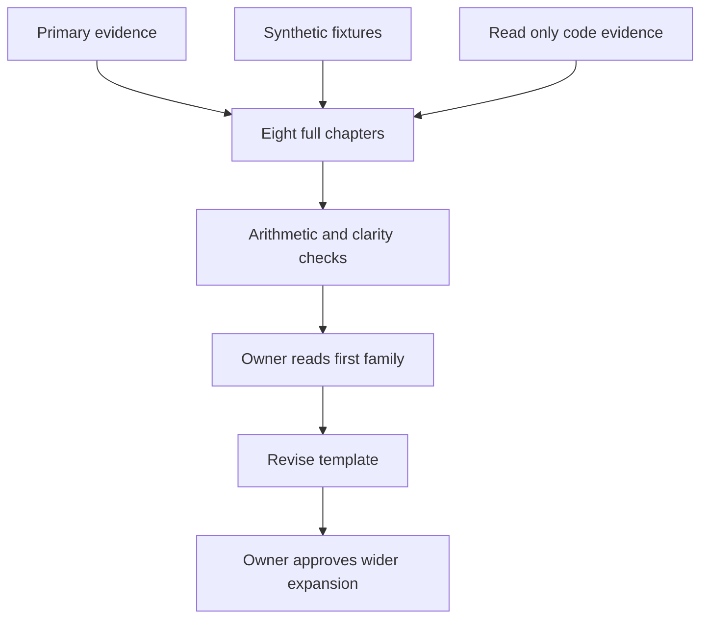

# Descriptive and Exploratory Research Implementation Plan

> **For Gemini:** Use `executing-plans` to implement this research plan inline, task by task. Use checkboxes to report progress. Do not dispatch agents, change the application or begin M09 through M46. Deliver this first family for owner reading and revision before expanding the handbook.

**Goal:** Write eight detailed, teachable Markdown chapters for M01 through M08 so the owner can evaluate explanation depth and clarity before applying an improved format to the other 38 entries.

**Architecture:** Create a partial handbook with shared foundations and eight complete chapters, supported by source, example and verification documents. Each chapter must connect intuition, precise calculation, failure cases and PetVsMonster applicability. Use the fixed examples below as acceptance oracles; verify their arithmetic rather than inventing convenient outputs.

**Tech Stack:** Markdown, Mermaid, official documentation and original methodology sources, read only repository inspection and PowerShell arithmetic. No application packages or new research infrastructure.

**Spec:** User request to implement one family first; `.cursor/plans/game-analytics-46-methods-research-plan.md`, especially its chapter and source contracts; `docs/research/game-player-analytics-research-2026-10-19.md`, entries 01 through 08. This pilot plan takes precedence over the parent plan's M19 pilot and its all-family completion gate.

## Global constraints

- Deliver Markdown only. This is research writing, not feature implementation.
- Scope is exactly M01 through M08. M19 and the remaining families wait for owner feedback.
- Write normal, complete English in documents. Explain terms before abbreviating them.
- Teach a game developer with basic coding knowledge and no assumed statistics background.
- Distinguish general method, vendor-specific definition, our synthetic convention, current code and future recommendation.
- Use direct primary sources for substantive technical claims. Read relevant content during execution; candidate links in this plan are not already verified evidence.
- Mark all example data synthetic. Do not access a live database, cloud account or actual player records for this task.
- Inspect repository source read only for capability claims. File existence is not proof of correctness or production data availability.
- Preserve the survey as an overview. Do not replace it with the handbook or retitle its historical date.
- No app, schema, telemetry, model, dependency, memory, deployment or bug fixing changes belong to this task.
- Do not commit or publish automatically. Do not use broad staging commands.
- Final status is first family ready for owner review, never all 46 methods complete.

## Review focus

1. **Denominator confusion:** player, player day, session, attempt, transaction and visit units must remain distinguishable. Pin with M01, M07 and M08 examples.
2. **Unknown versus zero:** missing coverage and immature follow up must not become failed retention. Pin with M03 and shared calendar.
3. **Ambiguous time boundaries:** UTC days, funnel deadlines, session gaps and RFM cutoffs need explicit equality rules. Pin with M03 through M06.
4. **Unsupported explanations:** segment differences, friction and negative feedback are hypotheses, not causal proof. Pin with M02, M04 and M08 counterexamples.
5. **Fabricated support:** a source, generic JSON field or synthetic example must not be presented as verified PetVsMonster telemetry. Pin with claim ledger, repository evidence matrix and final scope check.

---

## 1 Owner outcome and review gate

The owner wants to learn how each method works and judge whether the detailed treatment is clear enough. The deliverable should help answer: What game question can I answer? Which rows do I need? How is the result calculated? What does it mean? When should I distrust it? Can our current events support it?

This pilot also tests the writing format. Do not write the other families in advance or interpret completion of these chapters as approval of the template. Record proposed improvements after self review, deliver the files and stop. The owner will read, identify confusing or missing material, and approve revisions before the format is propagated.

Aim for roughly 800 to 1,400 words per chapter, with more space for M03, M04 and M07 if needed. Expect about 9,000 to 14,000 words across the main handbook and shared foundations. These are estimates, not quotas. A short but fully worked explanation is better than padding; a bundled method cannot be reduced to unexplained names to meet a limit.

## 2 Files and exact boundaries

| Path | Action | Responsibility |
|---|---|---|
| `docs/research/game-analytics-methods-handbook.md` | Create | Reader facing introduction, foundations, M01 through M08, selection matrix and review questions |
| `docs/research/game-analytics-methods-examples.md` | Create | Exact synthetic fixtures, data dictionary and checked calculations; chapter tables still show enough input to be understandable alone |
| `docs/research/game-analytics-methods-sources.md` | Create | Source register, claim traceability and repository evidence matrix |
| `docs/research/game-analytics-methods-verification.md` | Create | Actual checks, failures, corrections, limits and owner feedback register |
| `docs/research/game-player-analytics-research-2026-10-19.md` | Modify only at end | Add one link identifying the detailed first family as awaiting owner review |
| `.cursor/plans/descriptive-exploratory-research-implementation.md` | Update only completed task checkboxes | Execution progress |

If a listed output already exists when Gemini begins, read it before editing. Preserve unrelated work and stop destructive overwrites; integrate compatible material. Do not create 38 empty future chapter headings. Keep the remaining family names in a short out of scope note, not in the chapter inventory.

### Read only code starting points

| File and symbols to inspect | Relevant evidence |
|---|---|
| `server/lib/src/metrics_store.dart`: `MetricsStore.overview`, `retention`, `_overviewFor`, `_storedDays` | DAU, stored day averaging, sessions, engagement and cohort definitions |
| `server/lib/src/funnel_engine.dart`: `FunnelEngine.paths`, `_walkStrictWithEntry`, `_walkAnyOrderWithEntry` | Entry, ordering, deadlines and reentry behavior |
| `server/lib/src/event_store.dart`: table creation, parameter storage, test filters | Which columns are stored and how coverage and exclusions are represented |
| `shared/lib/src/models.dart`, `dashboard_models.dart`, `funnel_models.dart` | Units and nullability presented through models |

These paths were located during planning. Recheck them at execution time. Inspect called helpers before making exact behavior claims. Do not label the proposed retention convention below as the application's existing behavior without verification. In particular, a maximum stored date alone does not establish complete target-day coverage.

## 3 Document structure and reader experience

Start the handbook with its purpose, pilot status, what the reader should know and a linked contents list. Follow with a short shared foundation explaining event versus player, cohort and opportunity window, UTC calendar day versus rolling 24 hours, observed zero versus unknown, fractions versus percentages, and descriptive versus causal interpretation.

Use `## M01 Metric aggregation and distributions` through `## M08 Spatial and qualitative analysis` as the only method level headings. Use precisely these eleven third level headings in every chapter:

1. `### Question and intuition`
2. `### Inputs and output`
3. `### How it works`
4. `### Worked game example`
5. `### Assumptions and preparation`
6. `### Advantages`
7. `### Disadvantages and failure cases`
8. `### Evaluation`
9. `### Alternatives`
10. `### PetVsMonster fit`
11. `### Sources and confidence`

Under intuition, open with one concrete designer question and explain why the method helps. Under mechanics, include the formula, symbol meanings, ordered calculation and short pseudocode where state or ordering matters. Under examples, show raw or grouped inputs, intermediate steps, exact fraction, rounded value and an interpretation in words. The chapter must remain understandable without opening the example appendix.

Provide at least three distinct advantages, three limitations and two method comparisons per chapter, with conditions rather than generic praise. The evaluation section describes reconciliation, trace inspection, sensitivity or other relevant validation; it must not force machine learning splits or significance tests onto simple accounting. At least one incorrect interpretation must be quoted and corrected per chapter.

Use tables to compare variants and inputs, not to hide full paragraphs in cells. Use Mermaid for pipelines, cohort eligibility decisions, funnel matching and lifecycle precedence. Keep labels short and avoid punctuation forbidden by `.claude/rules/mermaid-diagrams.md`. Narrative should explain assumptions and implications rather than repeat every arrow.

### Current and target writing flow




## 4 Evidence and source contract

Use source IDs S001 onward, claim IDs M01-C01 onward and fixture IDs EX01 onward. Each important definition, formula, vendor behavior and implementation claim must have a supporting link or local path. Several related claims may share a source; avoid repetitive citation clutter while keeping support local.

The source register must contain ID, title, author or organization, direct URL, inspected section, version or date when known, execution date checked, evidence type and limitation. The claim table must contain claim ID, method ID, exact claim, source ID, locator and status. Status is Verified, Qualified or Unverified; only Verified and explicitly Qualified claims may appear as confident explanatory statements.

Prefer one authoritative explanation and a second independent methodology or implementation reference per chapter. This is a search target, not permission to invent citations. If the second source cannot be found, disclose the gap and narrow the claim. Read full relevant source content; search snippets and a previous AI summary are leads only. Primary sources include official manuals, original papers, standards, and the inspected repository itself. Vendor prose supports the vendor's definition, not a universal rule.

Candidate discovery targets, to be searched and verified during execution:

| Chapters | Starting source targets | Verify rather than assume |
|---|---|---|
| M01 and M03 | GameAnalytics Metrics documentation; Google Analytics Help metric definitions; statistical quantile documentation | Active user, day boundary, retention and quantile conventions differ |
| M02 | Amplitude cohort documentation; original or university hosted methodology on Simpson's paradox | Static versus dynamic membership and selection effects |
| M04 | GameAnalytics Funnels; Unity Analytics Funnels; local funnel engine | Entry and window semantics are product specific |
| M05 | Firebase or Google Analytics session and engagement documentation; BigQuery export schema | Background time, IDs and engagement units |
| M06 | Original RFM literature or an author maintained methodological source plus an implementation reference | Scoring thresholds below are our synthetic policy, not a standard |
| M07 | GameAnalytics Resource Events; Roblox economy documentation; official purchase and ad revenue schema docs | Sources and sinks are not real money revenue |
| M08 | Official spatial density or heatmap method documentation and a primary qualitative research methods guide | Exposure normalization and nonrepresentative feedback samples |

For repository claims, include file path, symbol, inspected revision or uncommitted state and what inspection establishes. Generic `params_json` storage establishes capacity to store a field, not that real players actually send it. Where telemetry presence is unknown, write Needs data validation or Needs new telemetry conditionally. No claim of observed data completeness is permitted without data inspection, which is outside this pilot.

## 5 Synthetic example contract

EX01 through EX09 are separate small examples. They are not one internally joined player database. IDs may repeat between fixtures without implying common history. Put this warning in both the examples appendix and handbook. This deliberately narrows the parent plan's proposed universal fixture to prevent accidental joins between inconsistent illustrative populations. Each fixture declares unit, cutoff, coverage, deduplication, keys and rounding.

Display percentages to two decimal places unless exact; retain fractions and unrounded intermediates. Monetary values use integer cents or another exact representation during verification. Quantiles use the specified convention rather than a library default. Do not silently change fixtures to make outputs agree with an incorrect calculation. If a genuine inconsistency is found, document the conflict and corrected arithmetic.

### EX01 Aggregates and distributions for M01

Use a complete two day synthetic observation period:

| UTC day | Active player IDs | Sessions |
|---|---|---|
| 2026-01-01 | P01, P02 | 4 |
| 2026-01-02 | P02, P03, P04, P05 | 4 |

Expected: day DAU values 2 and 4; mean DAU 3; distinct range players 5; player days 6; sessions 8. Sessions per player day is 8/6 = 1.333333. Mean of daily sessions per DAU is (4/2 + 4/4)/2 = 1.5. Sessions per distinct range player is 8/5 = 1.6. Explain that these are three different estimands, not rival calculations of one identical metric.

Separate retries-per-player values: `[0, 0, 1, 1, 2, 20]`. Sum 24, mean 4, median 1. Nearest-rank p90 has rank ceiling of 0.9 times 6, so p90 = 20. Histogram bins 0, 1, 2 through 9, and 10 or more contain 2, 2, 1 and 1 players. Percentile interpolation could produce a different p90; declare this example's convention.

Include an empty cohort case: a rate with denominator zero is undefined or unavailable, not automatically zero. Separately explain an observed day with no active users has DAU zero. Add sensitivity to one outlier without deleting legitimate players by default.

### EX02 Simpson reversal for M02

This is a separate 200 player aggregate table. Outcome is completing a specified tutorial within the same eligible observation window. Easy and hard are preexisting scenario strata, not strata chosen after the outcome.

| Stratum | Android complete / eligible | iOS complete / eligible |
|---|---|---|
| Easy | 8 / 10 | 63 / 90 |
| Hard | 18 / 90 | 1 / 10 |

Expected: Android has 80 percent versus 70 percent within easy and 20 percent versus 10 percent within hard, yet aggregate Android is 26/100 = 26 percent and iOS is 64/100 = 64 percent. Equal 50/50 stratum weighting gives Android 50 percent and iOS 40 percent. Explain traffic composition and why even standardization does not prove platform causes better completion.

Add separate definitions of install cohort, property segment and behavior-defined cohort. Freeze behavioral membership at a stated cutoff when comparing later outcomes; selecting purchasers using their future activity changes the question and can bias comparisons. Do not describe this illustrative standardized comparison as a treatment effect.

### EX03 Coverage and exact day retention for M03

Cutoff is the end of 2026-01-10 UTC. Coverage is complete for January 1 through 10 except January 5, which is unavailable. January 6 is imported and observed zero. Every player has a trusted synthetic first_open on the listed first day. Activity sets use January day numbers.

| Player | First day | Observed active days |
|---|---|---|
| P01 | 1 | 1, 2, 4, 8 |
| P02 | 1 | 1, 3, 9 |
| P03 | 1 | 1 |
| P04 | 2 | 2, 3, 9 |
| P05 | 2 | 2, 4 |
| P06 | 3 | 3, 4, 10 |
| P07 | 3 | 3 |
| P08 | 4 | 4 |
| P09 | 7 | 7, 8 |
| P10 | 8 | 8, 10 |
| P11 | 9 | 9, 10 |
| P12 | 10 | 10 |

For this synthetic example only, exact DN eligibility requires trusted first day, target day at or before cutoff and complete target-day coverage. Thus D1 eligible players are P01 through P07 and P09 through P11: 10 total. Retained are P01, P04, P06, P09 and P11: 5/10 = 50 percent. P08 is unknown because target day 5 is missing; P12 is immature because target day 11 is in the future. D7 eligible players are P01 through P07; retained are P01, P04 and P06: 3/7 = 42.857143 percent.

Explain why missing day 5 does not itself invalidate these known exact target-day results under this declared synthetic convention, while it would invalidate complete-window absence claims spanning day 5. Do not claim this convention is universal or identical to current application code. Show eligible counts by install cohort and compute the weighted pooled result, not an unweighted mean of cohort percentages.

DAU on January 10 is 4; unique observed users across the ten day range are 12. The fraction 4/12 is a day-to-ten-day active ratio, not DAU/MAU. A complete trailing 30 day or calendar month MAU cannot be established from this partial history. Explain both possible MAU window definitions and choose neither silently.

### EX04 Retention variants for M03

Use a separate fully observed synthetic cohort of four players through relative day 7:

| Player | Active relative days |
|---|---|
| A | 0, 1, 7 |
| B | 0, 3 |
| C | 0 |
| D | 0, 7 |

Expected: exact D1 = 1/4 = 25 percent; exact D7 = 2/4 = 50 percent; bounded rolling return on any day 1 through 7 = 3/4 = 75 percent; bracket return on any day 1 through 3 = 2/4 = 50 percent. State bounds and inclusivity. Do not call this a lifetime unbounded rolling rate. Discuss how different mature follow up horizons change rolling comparisons.

### EX05 Funnel paths for M04

Steps A, B, C denote synthetic tutorial actions. Offsets are minutes from the first A. Entry is the first A only, conversion deadline is entry plus 10 minutes inclusive, intervening events are allowed and each player counts once. Strict ordered matching requires later event sequence positions for B and then C; unordered completion requires all steps after entry, with B and C allowed in either order. Ignore preentry events. Fixtures have no equal timestamps; explain that real ties require a deterministic event order policy.

| Player | Timestamped actions |
|---|---|
| P01 | A0, B2, C5 |
| P02 | A0, C1, B2 |
| P03 | A0, B2, A20, B21, C22 |
| P04 | B-1, A0, C2 |
| P05 | A0, B10, C11 |
| P06 | A0, B4, C10 |

Expected strict counts: A = 6; ordered A then B = 5; full A then B then C = 2, namely P01 and P06. Overall conversion 2/6 = 33.333333 percent; final conditional conversion 2/5 = 40 percent. Unordered full completion = 3/6 = 50 percent, adding P02. P03's second A does not restart this first-entry policy; P04's B before entry cannot count; P05's B at minute 10 counts, but C11 does not. These distinguish ordering, entry and inclusive deadlines.

For strict converters, A to C times are 5 and 10 minutes, median 7.5. State that this timing excludes nonconverters and is therefore selected. Explain separately how an explicitly defined reentry policy could convert P03 and change the unit or player path policy. Do not silently revise the primary example. Define ordered subsequence versus consecutive event matching; they are not synonymous.

### EX06 Sessions for M05

One synthetic player's foreground event offsets are minutes `[0, 10, 40, 71]`. One background-only event occurs at minute 90. Inferred sessions split when the gap between eligible foreground events is strictly greater than 30 minutes. A gap exactly 30 stays in the session. Ignore background-only events for this sessionization example.

Expected inferred groups: `[0, 10, 40]` and `[71]`. Event-span durations are 40 and 0 minutes; total span is 40, not measured active time. If the source explicitly assigns all four events to a single session ID, that is one explicit session with observed span 71; explain that explicit and inferred policies can disagree and neither is a universal truth. Single-event zero span is not proof of zero attention.

Use a separate, explicitly incremental engagement sample of 60,000 and 120,000 milliseconds: total engagement 180,000 ms = 3 minutes. The field's actual production semantics must be verified before summing it. Distinguish start-to-start spacing, previous-end-to-next-start gap, event span and active duration. Treat a missing end as unknown end rather than fabricate a session-end timestamp.

### EX07 RFM and lifecycle for M06

Synthetic cutoff 2026-01-11 00:00 UTC. Recency is calendar day difference between last active UTC date and cutoff date. Frequency is observed session count within January 1 through 10 inclusive. Monetary value is known net USD spend in that same window. These thresholds are illustrative policy choices:

- Recency score: 3 for R at most 2 days; 2 for 2 less than R at most 6; 1 for R greater than 6.
- Frequency score: 3 for F at least 4; 2 for F from 2 through 3; 1 for F from 0 through 1.
- Monetary score: 1 for M = 0; 2 for 0 less than M at most 10 dollars; 3 for M greater than 10. Negative or unknown net spend gets a separately described policy, not a silent placement in these bins.

| Player | First date in January | Last date in January | Sessions F | Net USD M |
|---|---|---|---|---|
| P01 | 1 | 10 | 5 | 0 |
| P02 | 1 | 7 | 2 | 5 |
| P03 | 1 | 1 | 1 | 20 |
| P04 | 10 | 10 | 1 | 0 |

Expected R values 1, 4, 10, 1; RFM codes 331, 222, 113, 311 respectively. Treat codes as categorical tuples, not meaningful arithmetic numbers. Lifecycle precedence: New if age at most 2 days; otherwise Dormant if R at least 7; otherwise Cooling if R at least 3; otherwise Regular. Expected labels Regular, Cooling, Dormant, New. This rule is deliberately separate from RFM and should be shown as a decision diagram.

Explain fixed bins versus quantile bins, ties, sparse payers and install-age opportunity. Unknown spending is not zero spending. A recency-frequency-progression variant must be named differently and must not claim actual monetary value. Lifecycle labels are heuristics, not psychological types or verified churn predictions.

### EX08 Economy and revenue for M07

Separate two ledgers: virtual currency units and real USD cents. Opening coin balance is 100. Unique virtual transactions are V1 earn 50, V2 spend 30, V3 spend 20; the raw export contains V3 twice with identical transaction ID and contents. Deduplicate by transaction ID for this synthetic fixture. Expected source units 50, sink units 50, closing balance 100. If a duplicate ID has conflicting contents, flag a conflict instead of selecting a row arbitrarily. Different currencies require separate balances.

Real money daily fixture has four active players: P01 through P04. T1 is P01 purchase 400 cents; T2 is P02 purchase 600 cents; R1 is a distinct full refund of T2 for minus 600 cents. T1 appears twice in raw input. P03 and P04 have no purchases. A separately reconciled ad revenue total is 50 cents for the day. Deduplicate T1; do not delete R1 as a duplicate of T2.

Expected gross IAP revenue 1,000 cents, refunds 600, net IAP 400. Gross purchasing players 2; net positive spend players 1. Gross payer conversion 2/4 = 50 percent. Net IAP per gross purchasing player is 400/2 = 200 cents; gross IAP per gross purchaser is 1,000/2 = 500 cents. These are differently defined metrics. Total net attributed IAP plus ad revenue is 450 cents; daily revenue per active player is 450/4 = 112.5 cents or 1.125 dollars before display rounding. Declare how cents are represented when division creates fractional cents.

Use explicit names for gross versus net, player versus purchaser and transaction versus reward. Do not label raw shop visits revenue. Explain ad offer, impression, reward and revenue as different events. State whether fees, taxes and exchange rates are included; the synthetic ledger excludes them and is not a profit statement. A refund may be booked on refund date or restated to purchase date under different report policies; choose refund date here.

### EX09 Spatial and qualitative evidence for M08

Spatial fixture uses independent visit episodes with at most one death per episode:

| Area | Eligible visits | Visits ending in death |
|---|---|---|
| A | 1,000 | 20 |
| B | 100 | 8 |

Expected death-per-visit rates A = 2 percent and B = 8 percent. A has more deaths, B has four times the observed rate. Do not infer a causal area effect without accounting for player ability and encounter exposure. If visits may contain repeated deaths, counts measure deaths per visit rather than a probability and must be relabeled. Compare per visit, per player and per minute denominators and boundary or map resolution choices.

Separate qualitative fixture: C1 says the upgrade button is hard to find; C2 says the shop button is unclear; C3 says level 5 is difficult; C4 says level 5 is difficult and the upgrade button is hard to find; C5 says combat is enjoyable. Synthetic coding rules: UI clarity for C1, C2 and C4; Difficulty for C3 and C4; Positive experience for C5. Expected counts 3/5, 2/5 and 1/5. Multi-label totals exceed 100 percent without error. These five selected comments do not establish population prevalence. Present coding rules, disagreements and how another reader could reproduce the assignments. Discuss playtests and sampled recordings without claiming current collection exists.

## 6 Chapter specific acceptance requirements

| Chapter | Must explain beyond the example | Alternatives to compare | Mandatory incorrect claim to correct |
|---|---|---|---|
| M01 | Counts versus distinct users; mean, median, percentile and histogram; weighted rates; zero denominators; counting cost versus exact deduplication | Distribution view versus single KPI; player weighted versus event weighted summary | Adding daily unique users gives distinct users for the range |
| M02 | Property, install and behavior membership; equal age windows; composition, sparse cells and selection | Rule cohorts versus clustering; stratification versus pooled aggregation | Better aggregate platform rate proves platform quality |
| M03 | Exact, bounded rolling and bracket retention; cohort weights; UTC versus elapsed time; DAU over MAU | Exact retention versus survival; stickiness versus cohort return | Missing or immature D7 means a player did not return |
| M04 | Ordered versus unordered; window; first entry versus reentry; repetition, optional steps, exclusions and timing | Funnel versus path exploration; player conversion versus attempt conversion | A tutorial funnel drop proves the step caused churn |
| M05 | Explicit sessions, inferred inactivity, foreground time, active time, return frequency and missing ends | Session count versus playtime; gap inference versus explicit session IDs | Event span equals measured gameplay attention |
| M06 | RFM scores, quantiles versus fixed cuts, lifecycle precedence, install age and nonmonetary substitutes | Rules versus clustering; retrospective lifecycle versus churn prediction | A high three digit RFM code is inherently a better player |
| M07 | Virtual versus real currency; balances; gross versus net; payers; ads; refunds, IDs, currency and time policies | Accounting ledger versus event counts; revenue decomposition versus LTV forecasting | More currency earned means more real money revenue |
| M08 | Exposure normalized maps, repeated events, qualitative coding, playtests, recordings and sampling | Spatial rates versus raw heatmap; qualitative investigation versus quantitative prevalence | Most deaths or comments identify the most prevalent player problem |

Advantages and limitations must be specific to each method. Describe computation qualitatively at a declared scale, such as one million events aggregated to ten thousand players. Do not invent measured runtimes or vendor internals. Define readiness separately for confirmed basic support and optional submethods; one family can include both usable aggregates and unverified monetary fields.

## 7 Ordered implementation tasks

Each task produces a reviewable document unit. The source checking and authoring steps repeat for each named variant as required; they are work slices, not permission to compress an entire chapter into one vague action. Use evidence based editorial checks instead of application test suites. No Flutter build is required for Markdown research.

### Task 1 Establish files and foundations

**Files:** Create all four new research documents from section 2. Read parent plan and survey. **Consumes:** This plan's contracts. **Produces:** Reader foundations, fixtures EX01–EX09, evidence schema and check register.

- [x] Inspect existing output paths and record initial repository revision and dirty state; preserve unrelated files.
- [x] Read project rules governing docs and Mermaid, plus the parent plan's source contract.
- [x] Write the handbook opening, linked eight chapter contents and scope note saying first family awaiting owner review.
- [x] Write foundations with explicit examples of event, player, player day, session, attempt, transaction and visit units.
- [x] Copy EX01 through EX09 into the examples document, including boundary rules and separate-population warning; label them synthetic.
- [x] Create source and claim tables and verification entries for EX01 through EX09 with status Not yet checked.
- [x] Verify every fixture has a unit and time policy, and that shared definitions do not override explicitly different example conventions.

**Acceptance:** Four meaningful foundation documents; no empty future chapters claimed complete; fixtures match this plan. No experiment assignment table is needed in this family.

### Task 2 Write M01 Metric aggregation and distributions

**Files:** Modify handbook, examples, sources and verification. **Consumes:** EX01 and chapter contract. **Produces:** Complete M01 and checked aggregation oracle.

- [x] Read authoritative definitions for unique users, aggregation, quantiles and ratio weighting; log exact claims and definitions.
- [x] Draft all eleven chapter sections, starting with the designer question of whether engagement changed for typical players.
- [x] Show EX01's three different sessions ratios and explain the estimand in plain words immediately after each formula.
- [x] Calculate the retry distribution, nearest-rank p90 and histogram; explain outlier sensitivity and percentile alternatives.
- [x] Add a zero denominator example, an observed-zero example and the incorrect distinct-user sum claim with its correction.
- [x] Inspect `MetricsStore.overview` and `_overviewFor` plus called helpers, then contrast actual code definitions with synthetic ones without changing code.
- [x] Independently calculate EX01 results and record actual checked values, source gaps and readiness classification.

**Acceptance:** Exact values 3, 5, 6, 8, 8/6, 1.5, 1.6, mean 4, median 1 and p90 20 are accounted for; no unexplained change in denominator.

### Task 3 Write M02 Segmentation and cohort analysis

**Files:** Modify four research documents. **Consumes:** EX02. **Produces:** Complete M02 and verified reversal example.

- [x] Verify sources for cohort membership and Simpson's paradox; distinguish platform properties from time-dependent behavior.
- [x] Draft input contracts for install cohorts, static property segments and behavioral cohorts.
- [x] Calculate EX02 within-stratum, pooled and equally standardized rates, naming the comparison population each time.
- [x] Explain equal player age, traffic composition, future membership selection and sparse groups using concrete game cases.
- [x] Add rule-cohort versus clustering and pooled versus stratified comparisons; reject causal platform claims.
- [x] Inspect existing filter and cohort logic read only; record observed capabilities and unknown telemetry, then check the chapter against section 6.

**Acceptance:** Android can outperform in both strata yet lose in aggregate; reader can explain why. No claim that standardization removes every confounder.

### Task 4 Write M03 Retention and stickiness

**Files:** Modify four research documents. **Consumes:** EX03 and EX04. **Produces:** Complete M03, eligibility diagram and two verified examples.

- [x] Read source definitions for each retention variant and active-user window; record vendor differences rather than imposing one universal term.
- [x] Draft exact, bounded rolling and bracket formulas, symbol meanings and comparable follow up rules.
- [x] Enumerate EX03 eligibility player by player, including separate missing coverage and immature reasons.
- [x] Show 5/10 D1 and 3/7 D7 with cohort weighted aggregation; show why 4/12 is not a supported monthly stickiness estimate.
- [x] Calculate all four EX04 rates and contrast a one-day return with any return in a stated interval.
- [x] Draw a coverage and maturity decision diagram and explain calendar days versus elapsed 24 hour windows.
- [x] Inspect `MetricsStore.retention` and called day or test helpers; document any difference between current code and the example convention as a limitation, not a code fix.
- [x] Verify no paragraph treats unobservable cells as nonreturns or turns retention into survival probability.

**Acceptance:** Exact outputs and excluded IDs match EX03; EX04 reports 25, 50, 75 and 50 percent with explicit bounds. Current code and recommended measurement are labeled separately.

### Task 5 Write M04 Funnel and conversion analysis

**Files:** Modify four research documents. **Consumes:** EX05. **Produces:** Complete M04, path illustration and verified matching trace.

- [x] Read official funnel definitions and inspect local entry, strict, unordered and deadline code paths.
- [x] Draft pseudocode for the EX05 policy, naming entry, cursor, inclusive deadline and final per-player count.
- [x] Trace every player through strict and unordered matching; show counts 6, 5, 2 and unordered completion 3.
- [x] Explain overall 2/6, conditional 2/5 and median converter time 7.5 minutes; state selection in timing.
- [x] Compare first entry with a separately labeled reentry policy and ordered subsequence with consecutive matching.
- [x] Discuss skip routes, optional or excluded actions and incomplete observation without adding unsupported counts to the primary fixture.
- [x] Record which local engine behavior was directly verified and check that the narrative never turns a drop into a causal churn explanation.

**Acceptance:** P02, P03, P04, P05 and P06 each teach the intended distinct boundary. P03 is not silently restarted and B10 is not excluded under the example policy.

### Task 6 Write M05 Session analysis and engagement frequency

**Files:** Modify four research documents. **Consumes:** EX06. **Produces:** Complete M05 and checked units and session groups.

- [x] Verify official session and engagement field definitions and any units quoted from the export schema.
- [x] Draft explicit-ID versus inferred sessions, including eligible event filter, threshold equality, background events and missing ends.
- [x] Trace EX06 grouping, compare explicit-ID span and inferred spans, then convert incremental engagement to three minutes.
- [x] Explain distinct notions of duration and return gaps; add the single-event attention counterexample.
- [x] Inspect current session and engagement aggregation to identify what it measures, without assuming an explicit session model exists.
- [x] Verify the chapter labels inference and measured engagement separately and logs every unconfirmed field in the fit assessment.

**Acceptance:** Gap 30 stays together, gap 31 splits; background90 is excluded under declared policy; observed span is never presented as measured active time.

### Task 7 Write M06 RFM scoring and lifecycle groups

**Files:** Modify four research documents. **Consumes:** EX07. **Produces:** Complete M06 and deterministic scoring and lifecycle table.

- [x] Research RFM mechanics and source-backed limitations; label the particular bins and lifecycle rules as synthetic choices.
- [x] Draft a reproducible binning procedure with exact cutoff and tie behavior; distinguish known zero from unknown money.
- [x] Compute the four RFM tuples and lifecycle labels using explicit rule precedence.
- [x] Show a lifecycle decision diagram and explain install-age opportunity, quantile ties and sparse spending.
- [x] Compare RFM, nonmonetary progression substitution, clustering and actual predictive churn as different tools.
- [x] Check telemetry availability from source only and classify unsupported monetary use separately from recency-frequency capability.

**Acceptance:** Codes 331, 222, 113 and 311 match inputs; New takes precedence for P04; no scoring rule is attributed to the game or a vendor without evidence.

### Task 8 Write M07 Economy and monetization accounting

**Files:** Modify four research documents. **Consumes:** EX08. **Produces:** Complete M07 and reconciled virtual and real money ledgers.

- [x] Verify authoritative resource, transaction, refund and advertising schema definitions relevant to the claims.
- [x] Draft separate source-sink and revenue pipelines, including transaction key, deduplication, conflict handling and sign convention.
- [x] Show virtual opening plus sources minus sinks equals closing, retaining V3 only once.
- [x] Show gross IAP, refunds, net IAP, purchasing populations, ad revenue and daily active denominator with exact cents.
- [x] Explain refund booking, exchange rates, fees and taxes; state the synthetic exclusions without implying profit.
- [x] Discuss offer, impression, reward and paid revenue as distinct quantities, including incomplete data reconciliation.
- [x] Verify that no store capability claim is based solely on generic JSON columns or fictional example fields.

**Acceptance:** Closing coins 100, net IAP 400 cents and net IAP plus ads 450 cents reconcile; payer definitions and the 112.5 cent daily per-active result are explicit.

### Task 9 Write M08 Spatial and qualitative analysis

**Files:** Modify four research documents. **Consumes:** EX09. **Produces:** Complete M08, normalized map explanation and reproducible comment coding.

- [x] Verify primary references for exposure-normalized spatial summaries and qualitative coding or playtest methods.
- [x] Draft coordinate and visit input contracts, aggregation steps, map resolution and denominator choices.
- [x] Calculate A and B rates and correct the raw-death hotspot interpretation without claiming significance or causation.
- [x] Show the five synthetic comments, coding instructions, allowed multiple labels and counts, including the selected-sample limitation.
- [x] Explain how a playtest or recording can generate a hypothesis and how telemetry can then measure a clearly defined pattern.
- [x] State that spatial, recording and feedback collection requires separate confirmed telemetry or data sources; do not assert present availability.

**Acceptance:** B has four times A's observed per-visit rate; multi-label percentages can exceed 100; feedback counts are not population prevalence.

### Task 10 Integrate, verify and prepare owner review

**Files:** Modify four research documents, add one survey link and update this plan's completed checkboxes.

**Consumes:** Eight chapters and their evidence. **Produces:** Consistent pilot, honest verification report and review prompts.

- [x] Build an eight-row selection matrix: question, unit, output, required data, strength, key limitation and readiness, with links to chapters.
- [x] Read the handbook in order; reconcile terminology, rounding, variants and cross references without rewriting examples to conceal errors.
- [x] Run structural and arithmetic checks in section 8, recording command, actual output, date and any corrections in verification.
- [x] Inspect each citation against its exact claim; record inaccessible sources and narrow statements or mark uncertainty.
- [x] Check Markdown anchors, local links and Mermaid in an available renderer; distinguish actual rendering from static syntax review.
- [x] Add a survey link labeled detailed first family awaiting owner review and confirm no M09–M46 research was written.
- [x] End the handbook with the owner questions in section 9 and verification with a feedback register whose initial status is Awaiting owner review.
- [x] Report changed paths, chapter coverage, numerical checks and known limits, then stop before other families or format propagation.

**Acceptance:** M01–M08 are complete and internally checked, but editorial format remains a pilot. No claim of user approval or all-method completion.

## 8 Verification commands and independent checks

### Structural check

Run from repository root. This is a writing completeness check, not proof of scientific quality. Headings in code examples must not imitate method-level headings and inflate the count.

```powershell
$pilotPath = 'docs/research/game-analytics-methods-handbook.md'
$pilotText = Get-Content -LiteralPath $pilotPath -Raw -Encoding UTF8
$chapters = [regex]::Matches($pilotText, '(?m)^## M(\d{2})\s+(.+)$')
$actual = @($chapters | ForEach-Object { $_.Groups[1].Value })
$expected = @(1..8 | ForEach-Object { '{0:D2}' -f $_ })
if ($actual.Count -ne 8) { throw 'Expected exactly eight method chapters' }
if (@($actual | Sort-Object -Unique).Count -ne 8) { throw 'Duplicate method IDs' }
if (Compare-Object $expected $actual) { throw 'Expected only M01 through M08' }
$sections = @('Question and intuition', 'Inputs and output', 'How it works',
  'Worked game example', 'Assumptions and preparation', 'Advantages',
  'Disadvantages and failure cases', 'Evaluation', 'Alternatives',
  'PetVsMonster fit', 'Sources and confidence')
for ($chapterIndex = 0; $chapterIndex -lt $chapters.Count; $chapterIndex++) {
  $startOffset = $chapters[$chapterIndex].Index
  $endOffset = $pilotText.Length
  if ($chapterIndex + 1 -lt $chapters.Count) {
    $endOffset = $chapters[$chapterIndex + 1].Index
  }
  $body = $pilotText.Substring($startOffset, $endOffset - $startOffset)
  foreach ($section in $sections) {
    $pattern = '(?m)^### ' + [regex]::Escape($section) + '\s*$'
    if ($body -notmatch $pattern) { throw "M$($actual[$chapterIndex]) missing $section" }
  }
}
'PASS: M01-M08 and 88 required section headings'
```

Before drafting this must fail or find a missing file. At delivery it must pass. Also manually verify substantive section bodies; empty headings do not count as research.

### Arithmetic spot check

Run these direct calculations, then independently verify player membership and event traces in EX03 through EX07. The constants check formulas only; the membership and ordering audit is necessary to catch incorrect denominators.

```powershell
function Assert-Close([string]$label, [double]$actual, [double]$expected) {
  if ([math]::Abs($actual - $expected) -gt 0.000001) {
    throw "$label expected $expected but got $actual"
  }
  "$label = $actual"
}
$retries = @(0, 0, 1, 1, 2, 20)
Assert-Close 'EX01 mean retries' (($retries | Measure-Object -Average).Average) 4
Assert-Close 'EX01 median retries' (($retries[2] + $retries[3]) / 2.0) 1
$p90Index = [int][math]::Ceiling(0.9 * $retries.Count) - 1
Assert-Close 'EX01 nearest rank p90' $retries[$p90Index] 20
Assert-Close 'EX01 sessions per player day' (8.0 / 6) (4.0 / 3)
Assert-Close 'EX01 mean daily ratio' ((4.0/2 + 4.0/4)/2) 1.5
Assert-Close 'EX01 sessions per distinct player' (8.0/5) 1.6
Assert-Close 'EX02 Android pooled' ((8.0+18)/100) 0.26
Assert-Close 'EX02 iOS pooled' ((63.0+1)/100) 0.64
Assert-Close 'EX02 Android standardized' (0.5*(8.0/10)+0.5*(18.0/90)) 0.5
Assert-Close 'EX02 iOS standardized' (0.5*(63.0/90)+0.5*(1.0/10)) 0.4
Assert-Close 'EX03 D1' (5.0/10) 0.5
Assert-Close 'EX03 D7' (3.0/7) 0.428571428571
Assert-Close 'EX05 overall' (2.0/6) 0.333333333333
Assert-Close 'EX05 conditional' (2.0/5) 0.4
Assert-Close 'EX05 unordered' (3.0/6) 0.5
Assert-Close 'EX05 converter median minutes' ((5.0+10)/2) 7.5
Assert-Close 'EX06 engagement minutes' ((60000.0+120000)/60000) 3
Assert-Close 'EX08 coin balance' (100+50-30-20) 100
Assert-Close 'EX08 net IAP cents' (400+600-600) 400
Assert-Close 'EX08 net plus ad per active cents' ((400.0+50)/4) 112.5
Assert-Close 'EX09 A death rate' (20.0/1000) 0.02
Assert-Close 'EX09 B death rate' (8.0/100) 0.08
Assert-Close 'EX09 rate ratio' ((8.0/100)/(20.0/1000)) 4
```

### Required manual oracle register

| Fixture | Must record beyond arithmetic expressions |
|---|---|
| EX01 | Union of player sets, separate player-day total, histogram bins and denominator-zero wording |
| EX02 | Both within-stratum inequalities, reversed pooled inequality and the chosen common weights |
| EX03 | Eligible and retained IDs for D1 and D7; P08 missing versus P12 immature; no supported MAU |
| EX04 | Explicit membership for all four variant rates |
| EX05 | Six per-player strict traces, unordered completers, B10 and C10 inclusivity, P03 no restart |
| EX06 | Two inferred groups, one explicitly assigned group, background exclusion and units |
| EX07 | Cutoff-derived recencies, four score tuples and four lifecycle labels with precedence |
| EX08 | Deduplicated IDs, refund kept, gross and net payer populations and currency separation |
| EX09 | Visit episode definition and comment-by-theme multi-label matrix |

### Editorial and scope checks

```powershell
rg -n '^## M\d{2} ' docs/research/game-analytics-methods-handbook.md
rg -n -g 'game-analytics-methods-*.md' 'TBD|TODO|fill in details|implement later' docs/research
git diff --check
git status --short
```

Expected: eight method headings; no unresolved placeholders; no whitespace errors; only allowed changes from section 2. Directly read new untracked files because `git diff` does not include their contents. Do not report source link availability or diagram rendering as passed unless actually checked. Do not run app suites for this documentation-only change.

## 9 Owner review and propagation contract

End the handbook with these prompts and an empty feedback register in verification. The empty register is explicitly awaiting a future owner response, not an unfinished research claim.

1. Can you explain each method back in your own words after reading its intuition and example?
2. Are formulas and notation too dense, too light or appropriately introduced?
3. Do you want more step by step calculation, game scenarios, diagrams or implementation pseudocode?
4. Are advantages, limitations and comparisons specific enough to help choose a method?
5. Does PetVsMonster fit clearly distinguish current capability, unknown data and proposed instrumentation?
6. Is the main chapter readable alone, or does it force too much switching to appendices?
7. Which chapter is the best model for the other families, and which is least clear?

Feedback register columns: method or shared section; owner concern; example or paragraph; proposed revision; accepted action; status. Do not fill owner opinions yourself.

After owner feedback, revise this family first. Only after the owner approves the revised style should the parent plan be updated with the agreed template and remaining research resumed. Neither Gemini nor the coordinator should mark parent Tasks 2 or 3 wholly complete merely because this pilot overlaps some of their work; record exact overlap and deferred M19 separately if later updating that plan.

## 10 Gemini handoff message

Copy this brief when starting the external Gemini execution:

> Execute `.cursor/plans/descriptive-exploratory-research-implementation.md` as a documentation-only pilot. Read its parent plan and survey for context, but this pilot's M01–M08 scope and owner review gate take precedence. Produce the four research documents, one survey link and checked progress in this plan. Use the fixed EX01–EX09 fixtures and expected results, direct primary sources, and read only code inspection. Explain each method fully in normal English, with all eleven chapter sections. Do not change app code or access live data. Do not start other families, add speculative model implementations, commit, publish or dispatch agents. Verify arithmetic, eligibility, traces, citations and links, record limitations, and stop for owner review. Report actual checked evidence rather than expected results copied as if executed.

## 11 Plan self review

- Scope traceability: all eight requested entries have one dedicated authoring task and an explicit acceptance case.
- Contract consistency: all four artifact paths, eleven section headings, nine fixture IDs and eight method IDs are defined before use.
- Edge cases: duplicates, rates with zero denominators, missing days, immature cohorts, ordering, exact deadlines, exact session gaps, RFM precedence, refunds and multi-label coding have explicit oracles.
- Scientific limits: numerical correctness is separate from inference, data availability and source validity.
- Review boundary: the user reads one completed family before any broader template rollout.
