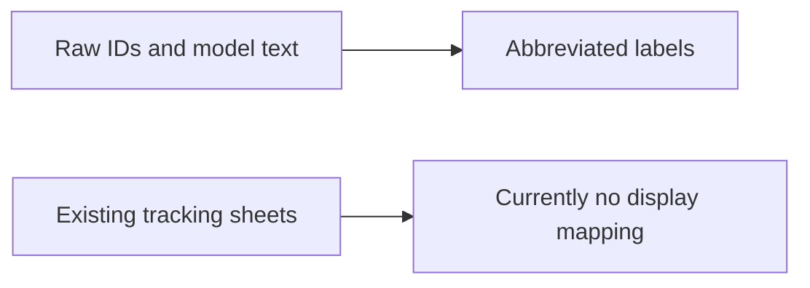
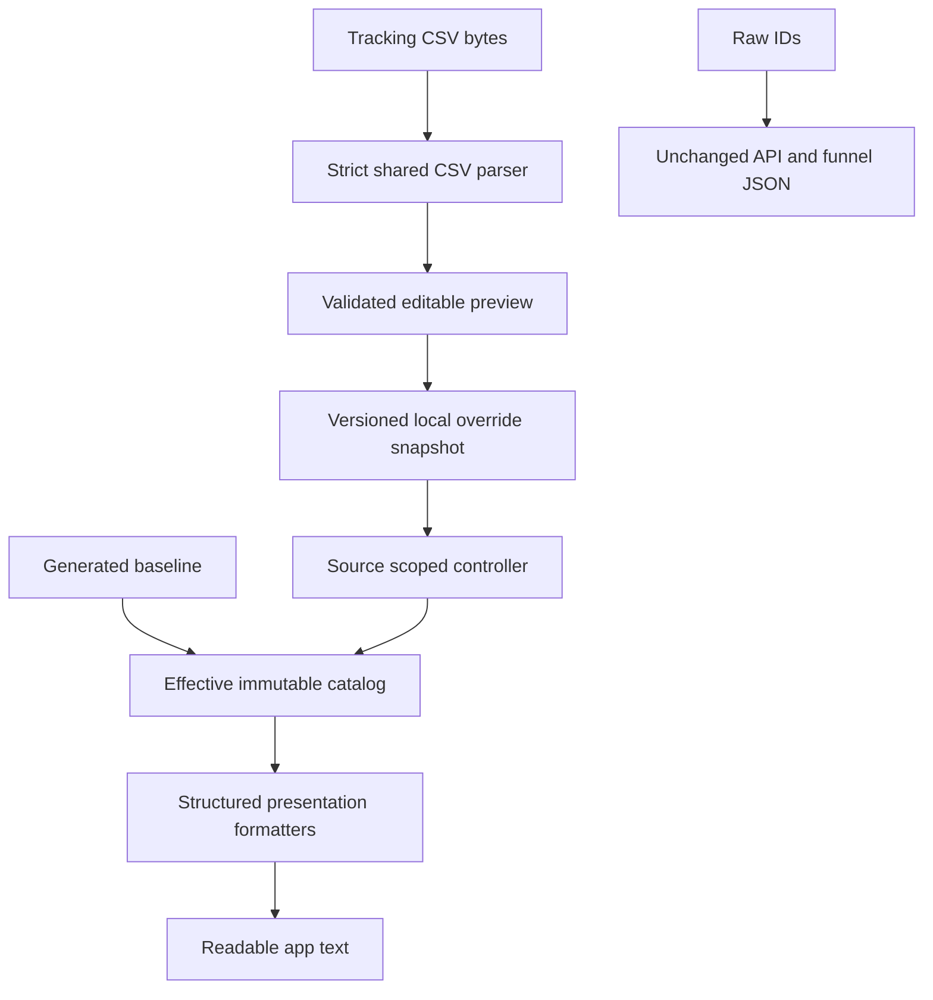
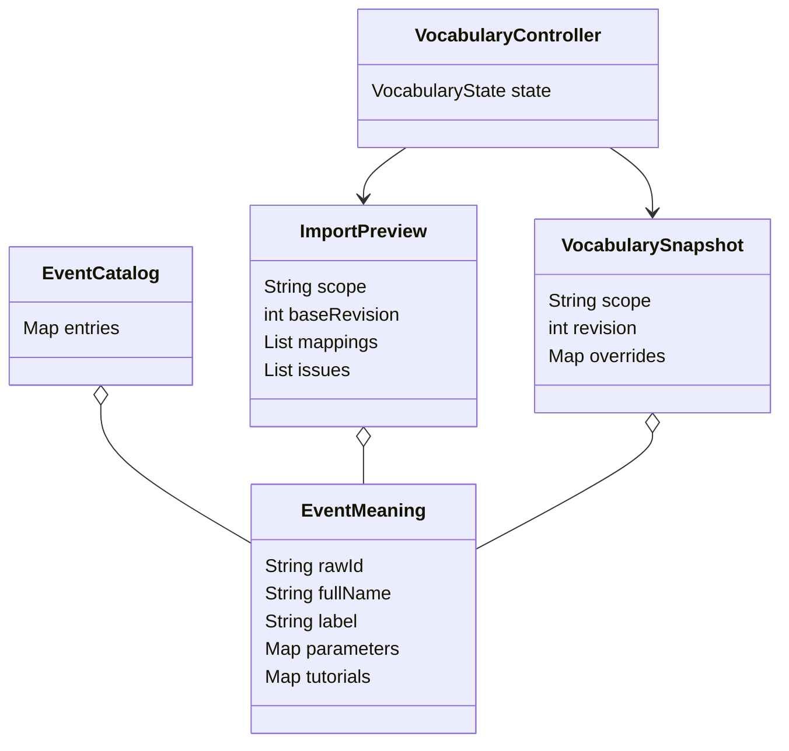

# Importable Event Vocabulary Implementation Plan

> **For agentic workers:** REQUIRED SUB-SKILL: Use `executing-plans`, inline, task-by-task. Gemini implements; no subagent dispatch by default. Steps use checkboxes. Read design and master before editing.

**Goal:** Give every event explanation readable wording and allow Settings CSV imports to update it immediately and persist across restarts.

**Architecture:** Pure immutable catalog and strict CSV reader feed both a build-time generator and a runtime preview. A source-scoped Riverpod controller persists accepted override snapshots before publishing them; presentation consumers observe catalog revisions independently of analytics requests and chart geometry.

**Tech Stack:** Dart/Flutter, Riverpod 2.6.1, existing SharedPreferences; pin file_selector 1.1.0 and file_saver 0.7.0. Implement the small strict CSV state machine below instead of depending on a permissive decoder. Baseline generation uses Dart so runtime and generator share the same parser.

**Spec:** [filter-controls-and-event-language-design.md](filter-controls-and-event-language-design.md). Commands and inherited work safeguards: [master](filter-controls-and-event-language-implementation.md).

## Global Constraints

- English primary labels; exact CSV full name and raw ID in secondary disclosure.
- Maximum selected bytes `5 * 1024 * 1024`, maximum parsed data records `10000` per batch.
- Exact IDs and parameter values retain case; trim surrounding CSV mapping-cell whitespace only.
- Merge explicit records; blank cells never delete mappings; source scopes never share overrides implicitly.
- No analytics request, model/wire change, count merge, filter reset or geometry replay from a vocabulary revision.
- Local device/browser persistence; explicit reimport, no watched folder or team upload.
- UTF-8 BOM, multiline quoted fields, preamble sheets and all three supplied CSVs supported.
- No automatic translation or guessed meanings for unfamiliar abbreviations.

## Review Focus

1. Stale load/save/preview versus changed Server URL must not leak catalogs: B4 transaction tests.
2. Changed full names versus missing/blank description must not retain false meanings: B2 normalization tests.
3. Repeated tutorial rows and `id` with different event meanings must not overwrite each other: B2/B3 tests.
4. Identical readable labels must not merge raw event counts or redirect callbacks: B6 tests.
5. Label-only rebuilds must not refetch retained pages or reset chart motion: B6/B7 sampled integration tests.

## Files and boundaries

| Create or modify | Responsibility |
|---|---|
| Create app/lib/src/presentation/event_catalog.dart | Immutable model, lookup, fallback, matching |
| Create app/lib/src/presentation/strict_csv.dart | Strict quoted CSV records with logical row numbers |
| Create app/lib/src/presentation/event_catalog_import.dart | Batch validation and preview normalization |
| Create app/lib/src/presentation/event_catalog_data.dart | Generated baseline map and source provenance |
| Create app/tool/generate_event_catalog.dart | Pure Dart generator reusing import path |
| Create csv/event-labels.json | Reviewed English labels/descriptions and tutorial titles |
| Create app/lib/src/state/event_vocabulary_repository.dart | Versioned local serialized snapshots |
| Create app/lib/src/state/event_vocabulary.dart | Scope family controller and effective provider |
| Create app/lib/src/widgets/event_vocabulary_settings.dart | Settings status and file-action host |
| Create app/lib/src/widgets/event_vocabulary_preview.dart | Editable validated changes and Apply |
| Create app/lib/src/services/vocabulary_files.dart | Injectable selection and template saving |
| Create app/lib/src/presentation/funnel_language.dart | Structured funnel prose |
| Create app/lib/src/presentation/analysis_language.dart | Event features, association/churn/anomaly wording |
| Modify app/lib/src/screens/settings_screen.dart | Insert vocabulary section |
| Modify app/pubspec.yaml and root pubspec.lock | File picker/saver dependencies |
| Modify event_picker.dart, event_detail_panel.dart, screens/counts_screen.dart, screens/param_screen.dart | Event/parameter wording and alias search |
| Modify widgets/funnel_editor.dart, funnel_chart.dart, funnel_step_table.dart, funnel_trend_view.dart, funnel_drilldown_panel.dart, pages/funnel_page.dart | Funnel display formatting only |
| Modify pages/analytic/clusters_tab.dart, churn_tab.dart, levels_tab.dart, associations_tab.dart, anomalies_tab.dart | Structured analytic explanations |
| Modify pages/progression_page.dart | Readable stage-event empty-state prose |
| Modify widgets/charts/ranked_bar_chart.dart and any label-sensitive renderer identified in B7 | Separate geometry from presentation revisions |
| Create app/test/event_catalog_test.dart, strict_csv_test.dart, event_catalog_import_test.dart, event_catalog_baseline_test.dart | Pure model/parser and baseline contracts |
| Create app/test/event_vocabulary_state_test.dart, event_vocabulary_settings_test.dart, event_language_integration_test.dart, funnel_language_test.dart, analysis_language_test.dart | State, UI, structured wording and literal request gates |

Source filenames without an explicit root in this table begin `app/lib/src/`. Tests use existing support/studio_test_host.dart and support/studio_text_assertions.dart where useful. Re-read exact source before patching; proposed APIs below are new contracts, not existing methods.

Interface blocks list proposed signatures, not complete compilable class bodies. Concrete kernels still need constructors/codecs and must pass the app analyzer.

## Data flow





### Task B1: Define catalog lookup and immutable records



**Interfaces produced:** All named parameters below are required except fields with defaults. JSON codecs must round-trip all fields. Constructors defensively freeze nested lists/maps.

```dart
class CatalogSource {
  const CatalogSource({required this.fileName, required this.record});
  final String fileName;
  final int record; // 1-based logical CSV record, including preamble.
}
class ParameterMeaning {
  const ParameterMeaning({required this.fullName, required this.label,
    this.description});
  final String fullName;
  final String label;
  final String? description;
  Map<String, dynamic> toJson();
  factory ParameterMeaning.fromJson(Map<String, dynamic> json);
}
class TutorialMeaning {
  const TutorialMeaning({required this.id, required this.label,
    required this.content});
  final String id;
  final String label;
  final String content;
  Map<String, dynamic> toJson();
  factory TutorialMeaning.fromJson(Map<String, dynamic> json);
}
class EventMeaning {
  EventMeaning({required this.rawId, required this.fullName,
    required this.label, this.description,
    Map<String, ParameterMeaning> parameters = const {},
    Map<String, TutorialMeaning> tutorials = const {},
    List<CatalogSource> sources = const [], String? modeBTemplate});
  final String rawId, fullName, label;
  final String? description, modeBTemplate;
  final Map<String, ParameterMeaning> parameters;
  final Map<String, TutorialMeaning> tutorials;
  final List<CatalogSource> sources;
  Map<String, dynamic> toJson();
  factory EventMeaning.fromJson(Map<String, dynamic> json);
}
class EventCatalog {
  EventCatalog(Map<String, EventMeaning> entries);
  final Map<String, EventMeaning> entries; // keyed by exact raw ID.
  String eventLabel(String rawId);
  EventMeaning? meaning(String rawId);
  String parameterLabel(String rawEventId, String rawKey);
  String featureLabel(String feature); // ev:<rawId> is event-derived.
  bool matchesSearch(String rawId, String query);
  EventCatalog overlay(Map<String, EventMeaning> overrides);
}
```

- [ ] **Step 1: Write failing pure tests with explicit fixtures.** Add helper in event_catalog_test.dart:

```dart
EventMeaning event(String id, String full, String label,
    {String? description, Map<String, ParameterMeaning> parameters = const {}}) =>
  EventMeaning(rawId: id, fullName: full, label: label,
    description: description, parameters: parameters);

test('contextual id and unknown values remain distinct', () {
  final c = EventCatalog({
    'skl_pick': event('skl_pick', 'skill_pick', 'Skill selected', parameters: {
      'id': const ParameterMeaning(fullName: 'skill_id', label: 'Skill ID')}),
    'trn_use': event('trn_use', 'terrain_use', 'Terrain used', parameters: {
      'id': const ParameterMeaning(fullName: 'terrain_id', label: 'Terrain ID')}),
  });
  expect(c.parameterLabel('skl_pick', 'id'), 'Skill ID');
  expect(c.parameterLabel('trn_use', 'id'), 'Terrain ID');
  expect(c.parameterLabel('custom_event', 'id'), 'id');
  expect(c.eventLabel('custom_event'), 'custom_event');
  expect(c.matchesSearch('skl_pick', 'skill_pick'), isTrue);
  expect(c.matchesSearch('skl_pick', 'SKL_PICK'), isTrue);
  expect(c.featureLabel('ev:skl_pick'), 'Skill selected');
});
```

Add tests that external map mutation cannot mutate catalog; labels collide without merging entries; raw IDs are case-sensitive; JSON round-trip preserves Vietnamese/newline text and rejects malformed types. Search trims query and is case-insensitive over raw ID/full name/label only; an empty query matches everything.
- [ ] **Step 2: Run** Flutter test `test/event_catalog_test.dart` from app. New APIs absent should fail; record exact outcome.
- [ ] **Step 3: Implement** lookup kernels and codecs with strict field validation:

```dart
String eventLabel(String rawId) => meaning(rawId)?.label ?? rawId;
String parameterLabel(String rawEventId, String rawKey) =>
    meaning(rawEventId)?.parameters[rawKey]?.label ?? rawKey;
String featureLabel(String feature) => feature.startsWith('ev:')
    ? eventLabel(feature.substring(3)) : feature;
EventCatalog overlay(Map<String, EventMeaning> overrides) =>
    EventCatalog({...entries, ...overrides});
```

Preserve builtin non-event feature labels already in app; move their current mapping into analysis_language.dart in B7 instead of inventing meanings in EventCatalog. `meaning` exact raw-ID lookup takes precedence over Mode B matches. Resolve Mode B using B2's restricted patterns; unknown or multiply matching patterns return null. Full-name aliases may resolve only when they identify exactly one record; never overwrite a true raw-ID entry with a full-name alias.
- [ ] **Step 4: Run** focused test and app analyzer. Add literal unknown fallback and immutability expectations before calling this deliverable complete.
- [ ] **Step 5: Commit** only catalog source and pure tests: `feat: define event presentation vocabulary`.

### Task B2: Strict CSV parser and merge preview

**Consumes:** EventCatalog, EventMeaning and nested records from B1.
**Produces:**

```dart
const maxVocabularyBytes = 5 * 1024 * 1024;
const maxVocabularyRecords = 10000;
class VocabularyFile {
  VocabularyFile(this.name, this.bytes);
  final String name;
  final Uint8List bytes;
}
class CsvRecord {
  const CsvRecord(this.number, this.cells);
  final int number;
  final List<String> cells;
}
List<CsvRecord> parseStrictCsv(String text);
enum IssueSeverity { warning, error }
class ImportIssue {
  const ImportIssue({required this.fileName, required this.record,
    required this.severity, required this.message});
  final String fileName, message;
  final int record;
  final IssueSeverity severity;
}
enum MappingChange { added, changed, unchanged }
class PreviewMapping {
  const PreviewMapping({required this.meaning, required this.change,
    required this.needsLabelReview});
  final EventMeaning meaning;
  final MappingChange change;
  final bool needsLabelReview;
}
class ImportPreview {
  ImportPreview({required this.scope, required this.baseRevision,
    required this.mappings, required this.issues, required this.fileNames});
  final String scope;
  final int baseRevision;
  final List<PreviewMapping> mappings;
  final List<ImportIssue> issues;
  final List<String> fileNames;
  Map<String, dynamic> toJson();
  factory ImportPreview.fromJson(Map<String, dynamic> json);
  bool get canApply;
  ImportPreview edit(String rawId, {required String label,
    required String? description});
  Map<String, EventMeaning> get replacements;
}
ImportPreview previewVocabulary({required List<VocabularyFile> files,
  required EventCatalog current, required String scope,
  required int baseRevision});
```

- [ ] **Step 1: Add failing parser/import tests.** The following fixture covers BOM/preamble/quoted commas/newlines; headers and required cells are matched after trimming, not case-folded.

```dart
VocabularyFile csvFile(String name, String content) =>
    VocabularyFile(name, Uint8List.fromList(utf8.encode(content)));

test('new full name clears stale description and leaves other records', () {
  final current = EventCatalog({
    'sup_buy': EventMeaning(rawId: 'sup_buy', fullName: 'support_buy',
      label: 'Support item purchased', description: 'Old meaning'),
    'pet_buy': EventMeaning(rawId: 'pet_buy', fullName: 'pet_buy',
      label: 'Pet purchased'),
  });
  final p = previewVocabulary(files: [csvFile('new.csv',
    '\uFEFFnotes,,,\r\nEvent,Abbreviated Event,Display Name,Description\r\n'
    'support_item_refund,sup_buy,"Support refunded, successfully","Returned\nitem"\r\n')],
    current: current, scope: 'fixture', baseRevision: 4);
  expect(p.canApply, isTrue);
  expect(p.replacements['sup_buy']!.label, 'Support refunded, successfully');
  expect(p.replacements['sup_buy']!.description, 'Returned\nitem');
  final changed = previewVocabulary(files: [csvFile('minimal.csv',
    'Event,Abbreviated Event\nstage_refund,sup_buy\n')],
    current: current, scope: 'fixture', baseRevision: 4);
  expect(changed.replacements['sup_buy']!.description, isNull);
  expect(current.overlay(changed.replacements).eventLabel('pet_buy'), 'Pet purchased');
});
```

Strict parser tests: `"unterminated`, `a"b,c`, `"a"x,c` must throw FormatException with record number; `"a""b",c` becomes `a"b`; CRLF/LF/CR, final empty cell, empty trailing record and embedded newline are handled exactly. Invalid UTF-8 bytes `[0xc3,0x28]` block preview. Two files with same raw alias and different full names block Apply regardless of order. Blank required fields block except recognized annotations. Add the exact 5 MiB/10000 boundaries and one beyond each; limits count all nonempty post-header records including skipped annotations, not distinct events. A blank mapping line is ignored and cannot be used to delete.

- [ ] **Step 2: Run** `test/strict_csv_test.dart test/event_catalog_import_test.dart`. Capture genuine red before implementation.
- [ ] **Step 3: Implement strict state machine and normalization.** Use the transitions below rather than splitting on commas or physical lines:

| State | Character | Action |
|---|---|---|
| fieldStart | quote | Enter quoted |
| fieldStart or unquoted | comma | Emit cell, fieldStart |
| fieldStart or unquoted | CR/LF | Emit cell and record, coalesce CRLF |
| unquoted | quote | Error: quote inside unquoted field |
| quoted | quote | Enter afterQuote |
| quoted | other | Append verbatim, including line breaks |
| afterQuote | quote | Append quote, return quoted |
| afterQuote | comma or CR/LF | Emit field/record |
| afterQuote | any other | Error: character after closing quote |
| EOF | quoted | Error: unterminated quoted field |
| EOF | other | Emit remaining record if any |

Keep parser pure Dart (`dart:convert`, `dart:typed_data`); strip one leading BOM after UTF-8 decode. Decode with `allowMalformed: false`. Report logical record numbers consistently. Find first record containing unique required header cells; reject duplicate header names. Allow short records padded with empty cells because supplied annotation rows vary in length; reject nonempty cells beyond the header width. Keep metadata newlines and Unicode intact. Ignore whitespace-only records. Recognize note Event cells starting `(bỏ)` or `(gộp` with empty abbreviated ID as skipped warnings; do not broadly ignore every missing ID.

Normalize precedence per field:

```text
explicit nonempty Display Name -> that label
else fullName unchanged -> current label
else -> conservative underscore/camel-case words, mark needsLabelReview
explicit nonempty Description -> that description
else explicit blank Description column -> null
else fullName unchanged -> existing description
else -> nonempty Trigger Logic description, or null
```

For missing parameters/tutorial/template metadata: preserve only when fullName is unchanged. Parse `Parameter Abbreviation Map` by lines `full -> raw`, yielding event-scoped raw keys; conflicting raw keys block. Do not infer a generic `id`. Content/Trigger Logic are provenance; runtime does not translate Vietnamese. Any uncertain English display label can be edited in preview. `edit` trims label, rejects blank labels, allows null descriptions, preserves raw ID/fullName/source/parameter metadata and reruns conflicts.

Tutorial records have same tutorial/tut alias and a unique `id: Tut_N` or `id: Tut_opt_N` in Parameter; merge their Content keyed by ID when common parameter mappings and template agree. Conflicting Content for the same tutorial ID is blocking. Exact duplicates dedupe but append provenance. Annotation rows stay in issues/report; batch files with no usable mapping are blocking even if another file is valid.

Mode B implementation scope: support the CSV's stage/wave forms and `tut_{id}_{step}` through an allowlisted token grammar, never arbitrary regex from files. Compile literals with RegExp.escape and anchor both ends. `stage`, `wave` are positive decimal integers; `id` in tutorial is `Tut_(?:opt_)?[1-9][0-9]*`; tutorial `step` is start/end/abort. Other placeholder templates remain stored as provenance with an unsupported-pattern warning and raw-name fallback. Reject two supported templates whose token languages overlap: tokenize on underscores while treating tutorial ID as one logical token; compare every position, with integer/literal and finite-step/literal intersections; compatible every-position templates overlap. Duplicates for the same meaning are allowed, overlaps for different meanings block. This deliberately bounded initial coverage satisfies optional template support without guessing arbitrary IDs. Resolve `stg_3_start` as “Stage started — Stage 3”, `stg_3_fail_wa_2` as “Stage failed — Stage 3, Wave 2”, `tut_Tut_1_end` as the reviewed tutorial title with “ended”. Capture context separately; preserve the raw event as API identity.

`Not supported; Mode A`, `None` and blank template cells mean no template. Malformed braces or repeated placeholders block import; unsupported well-formed patterns remain provenance warnings. Add optional tutorial-ID and exact-ID-precedence fixtures.

Do semantic comparisons on normalized record JSON excluding provenance timestamps/order, so identical reimport is Unchanged. Preserve current imported overrides not mentioned in replacements. `canApply` requires at least one mapping, no errors and all edited labels nonempty.

- [ ] **Step 4: Run** parser/import/model tests plus analyze. Add the duplicate tutorial, contextual id, changed-name optional-field and supported-pattern overlap cases before accepting.
- [ ] **Step 5: Commit** parser/import source and tests: `feat: validate tracking CSV vocabulary imports`.

### Task B3: Generate complete reviewed baseline with parser parity

**Consumes:** B1/B2 pure import APIs. **Produces:** `EventCatalog bundledEventCatalog` in event_catalog_data.dart and deterministic coverage report.

- [ ] **Step 1: Write baseline fixture tests.** Tests read actual three CSV files from `../csv/` using dart:io (tests/tool only). Expect 30/24/33 nonempty Event rows including annotations; all 24 tutorial rows retained under the tutorial entry; zero unexplained dropped usable rows. Assert stage_start -> “Stage started”, sup_buy -> “Support item purchased”, ftu_stg_start -> “Stage started in first play session”, event-scoped id meaning, minutes unit on stage completion and source filenames. Parse all three in one batch; the bundle cannot hide conflicts.

```dart
test('reviewed baseline labels preserve first-session and units', () {
  expect(bundledEventCatalog.eventLabel('stg_start'), 'Stage started');
  expect(bundledEventCatalog.eventLabel('ftu_stg_start'),
      'Stage started in first play session');
  expect(bundledEventCatalog.parameterLabel('stg_cmp', 'time_min'),
      'Play time in minutes');
  expect(bundledEventCatalog.meaning('tut')!.tutorials.length, 24);
});
```

- [ ] **Step 2: Run** `test/event_catalog_baseline_test.dart`; absent bundle fails.
- [ ] **Step 3: Create reviewed overrides and generator.** `csv/event-labels.json` schema:

```json
{
  "schemaVersion": 1,
  "events": {
    "stg_start": {"label": "Stage started", "description": "A player starts a stage."},
    "stg_cmp": {"label": "Stage completed", "description": "A player wins a stage; play time is accumulated foreground minutes up to the first win."},
    "sup_buy": {"label": "Support item purchased", "description": "A player purchases a support item during a stage."},
    "ftu_stg_start": {"label": "Stage started in first play session", "description": "Stage start tracked during the first play session only."}
  },
  "parameterLabels": {"stg_cmp": {"time_min": "Play time in minutes"}},
  "tutorials": {}
}
```

The snippet establishes schema, not a complete baseline. Fill `events` for every supported raw ID using the CSV's documented meaning, including daily gift/shop, upgrades, trader activity, FTU and tutorial. Read every Content and Trigger Logic cell before authoring English meanings; do not expand `ftu` generically as new-user lifetime. Tutorial override keys are `Tut_N` or `Tut_opt_N` and values contain `label`; derive titles only from their actual Content. Preserve source Vietnamese Content separately. Actual tutorial IDs are Tut_1 through Tut_20 and Tut_opt_1 through Tut_opt_4. Tut_17/Tut_18/Tut_19/Tut_20/Tut_opt_4 have a note saying content still needs documenting: retain their ID as label and show "Tutorial meaning not yet documented." Do not manufacture titles. Add tests for optional tutorial IDs and all five undocumented-content fallbacks.

Use `app/tool/generate_event_catalog.dart`, importing `../lib/src/presentation/event_catalog_import.dart`. Read filenames explicitly, not arbitrary directory files (event-labels.json is not CSV). Validate with empty current catalog, then apply reviewed JSON field overrides and generate a Dart `const String bundledCatalogJson` using jsonEncode on the complete snapshot, escaping Dart string syntax through a valid generated literal. Export `final bundledEventCatalog = EventCatalog(decodedEntries)` through the strict codecs. Sort keys/provenance deterministically. No dependency on current working timestamp. Write UTF-8 without BOM and include generated-file header.

Generate `.cursor/plans/event-vocabulary-baseline-coverage.md` listing every logical source row, raw ID, tutorial ID or skipped reason, reviewed label and pattern support. Generator exits nonzero on conflicts, invalid overrides, missing reviewed labels for valid baseline IDs or unexplained usable rows. A `--check` mode computes output and compares bytes without writing.

From app run:

```powershell
& 'D:\flutter\bin\cache\dart-sdk\bin\dart.exe' run tool/generate_event_catalog.dart
& 'D:\flutter\bin\cache\dart-sdk\bin\dart.exe' run tool/generate_event_catalog.dart --check
```

This replaces the design's tentative Python generator with one Dart generator using the runtime parser, eliminating duplicated normalization. Update the design file's generator path and decision explicitly.

Use these primary labels. FTU variants add “in first play session” to their matching ordinary label, except ftu_open_app is “First app open”. The actual raw aliases come from each CSV row, not from mechanically prefixing normal IDs. Preserve source full names independently.

| Raw ID | Primary label |
|---|---|
| open_app | App opened |
| stg_start | Stage started |
| pet_buy | Pet purchased |
| sup_buy | Support item purchased |
| skl_pick | Skill selected |
| trn_use | Terrain used |
| cp | Interrupted stage checkpoint |
| stg_cmp | Stage completed |
| stg_fail | Stage failed |
| login_day | Login day reached |
| pet_asc | Pet ascended |
| x2_speed_on | Double speed enabled |
| rr_trd | Trader pets rerolled |
| ms_claim | Milestone reward claimed |
| cst_fail | Consecutive failures |
| cst_fail_wa | Consecutive wave failures |
| cst_fail_heat | Failure streak intensity |
| gacha | Gacha draw |
| gacha_feeling | Post-gacha behavior category |
| cst_win | Consecutive wins |
| dg_rwd | Daily gift reward claimed |
| ds_rwd | Daily shop reward claimed |
| ds_buy | Daily shop item purchased |
| ds_rr | Daily shop rerolled |
| pet_upg | Pet upgraded |
| hero_upg | Hero upgraded |
| item_upg | Item upgraded |
| trd_use | Board occupancy category |
| tut | Tutorial |
| ftu_tp | Play time milestone in first play session |
| ftu_lock | Trader offer locked in first play session |
| ftu_trd_bonus | Trader bonus category in first play session |
| ftu_trd_spend | Food spending category in first play session |

The R/B/S source describes measured occupancy/bonus/spend categories, not generic trader clicks. gacha_feeling is inferred behavior classification, not self-reported sentiment. The complete CSV rows remain authoritative for precise trigger descriptions and parameter units.

- [ ] **Step 4: Run** baseline/model/import tests; generator `--check` twice; compare complete normalized runtime results to bundle after applying reviewed overrides. Assert no non-deterministic timestamp or line-ending differences.
- [ ] **Step 5: Commit** owned CSV inputs, reviewed labels, tool, generated source, tests and coverage report explicitly: `feat: bundle reviewed PetVsMonster event meanings`.

### Task B4: Persist snapshots and publish scope-safe vocabulary state

**Consumes:** B1 catalog, B2 previews, B3 bundled catalog. **Produces:**

```dart
String vocabularyScope(String serverUrl);
class VocabularySnapshot {
  VocabularySnapshot({required this.scope, required this.revision,
    required this.overrides, required this.importedAt,
    required this.fileNames});
  final String scope;
  final int revision;
  final Map<String, EventMeaning> overrides;
  final DateTime? importedAt; // UTC
  final List<String> fileNames;
  Map<String, dynamic> toJson(); // schemaVersion: 1
  factory VocabularySnapshot.fromJson(Map<String, dynamic> json);
}
abstract interface class VocabularyRepository {
  Future<String?> read(String scope);
  Future<bool> write(String scope, String encodedSnapshot);
}
class VocabularyState {
  VocabularyState({required this.snapshot, required this.ready,
    required this.saving, this.warning});
  final VocabularySnapshot snapshot;
  final bool ready, saving;
  final String? warning;
}
enum ApplyResult { applied, stale, failed, busy }
// FamilyNotifier<VocabularyState, String>, non-autoDispose family.
class VocabularyController extends FamilyNotifier<VocabularyState, String> {
  VocabularyState build(String scope);
  Future<ApplyResult> apply(ImportPreview preview);
  Future<ApplyResult> restoreDefaults({required int expectedRevision});
}
// repositoryProvider: Provider<VocabularyRepository>
// vocabularyProvider: NotifierProvider.family<..., VocabularyState, String>
// currentVocabularyScopeProvider: Provider<String>, watches baseUrlProvider
// effectiveVocabularyProvider: Provider<EventCatalog>, watches current family
```

- [ ] **Step 1: Write failing transactional state tests.** A fake repository stores strings and uses Completer barriers:

```dart
class MemoryVocabularyRepository implements VocabularyRepository {
  final data = <String, String>{};
  Completer<bool>? writeGate;
  bool fail = false;
  @override
  Future<String?> read(String scope) async => data[scope];
  @override
  Future<bool> write(String scope, String value) async {
    final ok = writeGate == null ? !fail : await writeGate!.future;
    if (ok) data[scope] = value;
    return ok;
  }
}
```

Tests create ProviderContainer overriding repositoryProvider and baseUrlProvider, listen to vocabularyProvider(scope) until ready, then call actual `apply`. Pin no active change before write succeeds, failure keeps old revision, restart new container loads saved names, unrelated overrides survive merge, Restore defaults persists an empty override snapshot. Corrupt/unknown schema/incorrect scope bytes produce baseline plus warning and remain byte-for-byte stored. During held A load switch to B; complete A last: effective catalog still B. During held A save switch to B; complete save: B never receives A labels. Concurrent Apply returns busy; stale baseRevision or wrong preview scope returns stale without writing. Import revision 0 then another import invalidates an old preview.

- [ ] **Step 2: Run** `test/event_vocabulary_state_test.dart`. Record failing actual contracts.
- [ ] **Step 3: Implement repository and controller.** Repository preference key is `eventVocabulary.v1.` plus base64Url.encode(utf8.encode(scope)); store one complete JSON snapshot per scope using setString, checking returned bool. Restore defaults writes a valid empty snapshot instead of remove so revision remains monotonic. Validate schema/record limits/IDs/nested field types and scope on every load; do not accept arbitrary deserialized maps as trusted records.

Before writes, enforce at most 10000 cumulative override records and a 20 MiB encoded snapshot cap. Exceeding either keeps active state unchanged and reports the exact limit. Include both tests: successive imports can grow beyond per-batch limits. Source filenames are the sorted union of provenance in current overrides; last import time describes the latest batch.

Scope normalization: `Uri.parse(trimmedUrl)`, require http/https and host, lower-case scheme/host, remove default port and trailing slash from path, retain other path case; reject query/fragment for vocabulary scope to prevent collisions. If current URL has query/fragment already accepted by existing Settings, use a scope containing its full normalized URL rather than silently dropping them; show that scope. Keep localhost, 127.0.0.1 and LAN IP distinct. Prefix with `petvsmonster|`. Add tests for default port, trailing slash, base paths, query/fragment distinctions and host casing.

Family build starts with bundled catalog overlay empty snapshot, `ready=false`; schedules async load with lifecycle token and `ref.onDispose` guard. Consumers can render baseline while loading, but Import/Restore stay disabled until ready. Use state warning for read failure. Do not re-create the family's controller on analytics refresh.

Apply transaction kernel:

```text
Reject if disposed/not ready or saving
Reject if preview cannot apply, scope mismatch, current URL scope mismatch,
  or baseRevision differs from current revision
Capture current snapshot and operation token; mark saving
Build next overrides from old overrides plus preview.replacements
Encode next complete snapshot with revision old+1 and UTC import time
Await repository.write for captured scope
If false/exception: preserve old snapshot; clear saving; expose save error
If disposed: do not touch state
If success: update captured family's snapshot
Return stale if active URL scope changed; never touch new family's state
Otherwise return applied and clear saving
```

A completed durable save for A remains valid for A even if owner switched to B while awaiting it; do not call it failure or roll back another scope. Its old UI must not show global success in B. Publish effective provider only from the currently selected family. `effectiveVocabularyProvider` overlays bundled catalog with active snapshot; no ref.invalidate of data providers. Keep all fields immutable and finish busy cleanup on every branch.

When corrupt storage exists, applying replacement or Restore defaults from preview is an explicit owner action replacing it; startup alone never overwrites. Serialize one write per controller; source family is not autoDispose, but guard disposal for tests/app teardown. Inject clock through a Provider<DateTime Function()> returning DateTime.now().toUtc() for deterministic tests.

- [ ] **Step 4: Run** state tests plus pure tests/analyzer. Inspect fake repository payload, not only provider values; prove no write on stale/invalid previews and true reload across containers.
- [ ] **Step 5: Commit** repository/controller/tests: `feat: persist scope-safe local event vocabulary`.

### Task B5: Settings selection, editable preview and template download

**Consumes:** B2 preview and B4 state. **Produces:**

```dart
abstract interface class VocabularyFiles {
  Future<List<VocabularyFile>> pickCsvFiles(); // [] means canceled.
  Future<String?> saveTemplate(Uint8List bytes); // null means canceled.
}
// vocabularyFilesProvider: Provider<VocabularyFiles>
// EventVocabularySettings extends ConsumerStatefulWidget
// EventVocabularyPreview extends StatefulWidget; constructor:
// ({Key? key, required ImportPreview preview,
//   required Future<ApplyResult> Function(ImportPreview) onApply})
```

- [ ] **Step 1: Add failing widget tests using injected files/repository.** Use fake files returning csvFile('names.csv', `Event,Abbreviated Event,Display Name,Description\nstage_refund,stg_refund,Stage refunded,A stage purchase was refunded.\n`). Pump Settings with ProviderScope. Tap key vocabulary-import; preview shows Added and exact name/raw ID; edit label; tap vocabulary-apply; assert storage payload and effective catalog. Invalid two-file conflicts show filename/record and disable Apply. Canceled picker shows no preview/save. Hold save and assert Apply/import/restore disabled, then reject save and keep prior active catalog. Stale URL during preview disables Apply or returns stale with clear re-preview action.

Add two-column input test: derived label shown and editable; change field and Apply persists new wording. Restore dialog shows overridden count, scope and fallback example; cancellation keeps overrides; acceptance saves empty snapshot. Template fake captures exact bytes and contains the four headers and one example; cancellation and errors do not claim Saved.
- [ ] **Step 2: Run** `test/event_vocabulary_settings_test.dart` and record red.
- [ ] **Step 3: Add dependencies and file adapter.** Pin in app/pubspec.yaml:

```yaml
  file_selector: 1.1.0
  file_saver: 0.7.0
```

Resolve with Flutter pub get. Use file_selector.openFiles with an XTypeGroup containing extensions `csv`, MIME `text/csv` and `text/plain`, uniform type identifier `public.comma-separated-values-text` for iOS. Request lengths first; reject total beyond 5 MiB before reading bytes, then verify actual read lengths. Don't trust filename suffix instead of contents. All UI imports are bytes; no dart:io in shared app import/controller code.

Save template through `FileSaver.instance.saveAs(name: 'event-vocabulary-template', bytes: bytes, fileExtension: 'csv', mimeType: MimeType.custom, customMimeType: 'text/csv')`, inspecting actual pinned return signature and cancellation behavior. For Web use supported byte-download path if saveAs cancellation is not meaningful; report “Download requested”, not an unverifiable disk save. No gallery/storage permissions are needed for byte import. Package platform registrants/lock changes must be reviewed; no unrelated generated churn.

Template bytes are UTF-8 BOM plus CRLF, exactly:

```csv
Event,Abbreviated Event,Display Name,Description
stage_refund,stg_refund,Stage refunded,A stage purchase was refunded.
```

The template is an example, not automatically imported. Include a Copy template action as convenience but keep downloadable template requirement. Test bytes, not merely button visibility.

UI states: loading, ready, selecting/parsing, preview, applying, saved/error. Snapshot scope/revision before selection; check them after file selection and parsing so changed server URLs cannot accidentally normalize against a different catalog. Parse with Flutter `compute` using a top-level worker that accepts serializable filenames/bytes/current catalog JSON/scope/revision and returns preview JSON. On Web compute still uses the main event loop: display progress, cap sizes and measure worst-bound input before claiming responsiveness. Never call provider APIs in a worker. Keep user editing and parser result models immutable.

Preview is a scrollable dialog/full-screen sheet at narrow widths, with Raw tracking ID, Full name, Readable label, Meaning, Status columns/cards. Provide label and meaning fields per record; default list view creates editors lazily and disposes controllers. Display source warnings outside mapping rows, errors with filename/record. Disable Apply while validation fails or save is pending. Render 10000-row preview with lazy ListView, not a giant DataTable. Never treat a filename or imported field as rich HTML.

Insert EventVocabularySettings beneath Appearance before Server in existing Settings ListView. Display exact current scope, imported override count, source filenames, last successful UTC timestamp formatted locally, warning, and “Saved on this device or browser profile. Reimport after editing your CSV.” Restore defaults changes only the active scope. No automatic API refresh follows Apply.

- [ ] **Step 4: Run** widget/state tests, analyzer, Windows and Web builds after dependency resolution. File picker unit tests use injectable adapter; actual native picker and browser download are separate walkthrough gates.
- [ ] **Step 5: Commit** Settings widgets/service/dependency files/tests: `feat: import and preview event vocabulary in settings`.

### Task B6: Events and Parameters wording, search and raw-ID handoff

**Consumes:** effectiveVocabularyProvider and existing raw providers. **Produces:** readable labels on EventPicker, Events table/ranking/detail and Parameters; raw callback signatures unchanged.

- [ ] **Step 1: Add integration tests with real ApiClient/MockClient.** Extend existing events_parameter_handoff_test.dart host into event_language_integration_test.dart. Use two current events `sup_buy` count 7 and `custom_support` count 3, both label “Support item purchased”; descriptions differ. Search “support_buy”, “SUP_BUY” and readable label; raw IDs remain separate keys and counts. Select sup_buy, open detail and Explore parameters; actual URL `/events/param` has `name=sup_buy`, `key=stg`, preserved date/platform/version/includeTest. Parameter chip label Stage must still send raw stg.

```dart
// MockClient branch for actual parameter query:
if (request.url.path == '/events/param') {
  recorded.add(request.url.queryParameters);
  return http.Response(jsonEncode([{'value': '3', 'count': 7}]), 200);
}
// After UI actions:
expect(recorded.single['name'], 'sup_buy');
expect(recorded.single['key'], 'stg');
```

Use the actual existing endpoint path/key names from api_client.dart; verify fixture against source before running. Do not switch to a mocked provider assertion that bypasses HTTP. Capture route counts, selectedEventProvider/parameterEventProvider/parameterKeyProvider, filters and detail raw ID before import. Apply edited labels while page is retained; after pump the label changes and those values/route counts remain unchanged. Import new mapping for an event absent from `/events/names`: picker does not gain fabricated selectable event.

- [ ] **Step 2: Run** integration and existing `events_explorer_screen_test.dart`, `events_parameter_handoff_test.dart`. Existing raw text assertions may need intentional replacement after new failing cases are established.
- [ ] **Step 3: Integrate presentation only.** In counts_screen build use `final vocabulary = ref.watch(effectiveVocabularyProvider);` and search via matchesSearch. For chart create `RankedValue(r.name, vocabulary.eventLabel(r.name), r.current, detail: raw/meaning disclosure)`; IDs and selected row keys remain raw. Table event cell label can wrap and expose raw ID in tooltip/details. Detail heading uses label; add full name, raw tracking ID and meaning or “Meaning unavailable for this event.” Keep Explore parameters callback `event.name`.

EventPicker becomes ConsumerStatefulWidget if route dismissal is needed. Add a vocabulary-aware popup helper owning its exact PopupMenuRoute: record the route in `NavigatorObserver` or use explicit `showMenu` and capture the resulting route via a dedicated observer. On revision change remove only that owned active route with `Navigator.removeRoute(route)`; never `Navigator.pop(context)` on an unspecified route. Retain raw menu values and full accessible label/raw-ID disclosure. Funnel menus in B7 reuse this helper. Null All requires a wrapper as in Controls A1.

In Parameters retain editor raw-key values and notifier state; only chips/field labels use vocabulary.parameterLabel(currentEvent,k). Custom keys remain enterable and raw values remain visible. Do not rename controller contents holding raw query keys. Event/parameter tooltips show raw code; empty-state natural prose does not replace arbitrary errors by substrings.

Before label revisions can pass the no-replay test, fix label-sensitive RankedBarChart revision in B7's renderer kernel (this small renderer edit may be delivered here). Test both settled and in-progress chart samples: changing label must not restart controller or change phase/progress; active motion may continue naturally.

- [ ] **Step 4: Run** integration plus Events/Parameters related suites and state tests. Assert literal requests, two separate counts, alias search, unknown fallback, and retained-page label updates. A displayed tooltip alone does not prove callback identity.
- [ ] **Step 5: Commit** owned UI/helper/renderer/test hunks: `feat: show readable event names in explorer and parameters`.

### Task B7: Structured Funnel and Analytic prose without animation replay

**Consumes:** EventCatalog and existing analytic_shared models. **Produces:** app-local formatters, leaving shared model getters and JSON untouched:

```dart
String matcherLanguage(StepMatcher matcher, EventCatalog catalog);
String stepLanguage({required String event, required List<ParamFilter> params,
  required List<StepMatcher> alternatives, required List<StepMatcher> exclude,
  required EventCatalog catalog});
String resultEventsLanguage(FunnelStepResult step, EventCatalog catalog);
String definitionLanguage(FunnelDef def, EventCatalog catalog);
String associationLanguage(AssociationRule rule, EventCatalog catalog);
String churnLanguage(ChurnRule rule, EventCatalog catalog);
String anomalyLanguage(AnomalyAlert alert, EventCatalog catalog);
```

- [ ] **Step 1: Write failing structured-format tests.** Build a catalog with stg_start -> Stage started, stg_fail -> Stage failed and stg -> Stage. Pin exact full sentence, not substring presence:

```dart
final step = FunnelStepDef(event: 'stg_start',
  params: [const ParamFilter('stg', '3')],
  alternatives: [const StepMatcher(event: 'stg_fail')],
  exclude: [const StepMatcher(event: 'tut',
    params: [ParamFilter('step', 'abort')])]);
expect(stepLanguage(event: step.event, params: step.params,
  alternatives: step.alternatives, exclude: step.exclude, catalog: catalog),
  'Stage started where Stage is 3 or Stage failed (unless Tutorial where Step is abort first)');
expect(FunnelStepDef.fromJson(step.toJson()), step);
```

Fixture catalog must explicitly include tut -> Tutorial and its parameter step -> Step. Add every FilterOp including isIn and numeric comparisons, nested alternatives/exclusions with their own contextual id, literal user parameter values resembling abbreviations, and unknown events. Values such as `stg_start` inside a freeform parameter value must remain unchanged.

For associations use raw antecedent/consequent plus lift/support; positive and negative exact sentences preserve ratio precision and support; no replacement inside supplied sentence. Churn tests reconstruct conditions from `feature/op/threshold` and churnRate/lift, preserving `<=`/`>` and threshold formatting. Anomaly tests use alert.series/day/value/median/z; event series `ev:...` gets vocabulary label, built-in DAU/session labels keep their existing meaning; unknown series remains raw.

Add renderer test: settle RankedBarChart with RankedValue('sup_buy','Old',7), then same ID/value with New label and detail. Inspect ChartMotion snapshot at 0/100ms: phase settled and running false. Repeat mid-entrance: progress continues rather than returning to zero. A real value change 7->9 still triggers update; ID change still triggers topology. Add corresponding test for any other renderer whose revision includes display text.

- [ ] **Step 2: Run** `test/funnel_language_test.dart test/analysis_language_test.dart test/event_language_integration_test.dart` plus targeted chart tests. Record failing old raw-label/replay behavior.
- [ ] **Step 3: Implement structured formatters and integrate consumers.** Kernel for funnel prose:

```dart
String matcherLanguage(StepMatcher m, EventCatalog c) {
  final name = c.eventLabel(m.event);
  if (m.params.isEmpty) return name;
  final conditions = m.params.map((p) {
    final value = p.op == FilterOp.isIn ? p.values.join(', ') : p.value ?? '';
    return '${c.parameterLabel(m.event, p.key)} ${p.op.label} $value';
  }).join(' and ');
  return '$name where $conditions';
}
String stepLanguage({required String event, required List<ParamFilter> params,
  required List<StepMatcher> alternatives, required List<StepMatcher> exclude,
  required EventCatalog catalog}) {
  final parts = [StepMatcher(event: event, params: params), ...alternatives];
  final text = parts.map((m) => matcherLanguage(m, catalog)).join(' or ');
  if (exclude.isEmpty) return text;
  final exclusions = exclude.map((m) => matcherLanguage(m, catalog)).join(' or ');
  return '$text (unless $exclusions first)';
}
```

DefinitionLanguage joins formatted def.steps with the existing arrow; resultEventsLanguage joins formatted event and alternative labels with “or”. In funnel_editor swap only display labels/previews/validation presentation, keeping `_draft`, EventPicker choices, matcher params and user-entered funnel name raw. Translate validation errors at the app validation site from structured field context; keep an explicit technical error disclosure for unsupported server errors, never global substring substitution.

Use formatter for every `.text`, `.eventsLabel`, `.filterLabel`, `funnelSummary` display site in funnel_chart, step_table, trend_view, drilldown_panel and funnel_page. CSV/export schemas stay raw; display-data tables may use labels but clipboard machine export stays exact current columns/JSON. Tooltip descriptions must still contain statistical partial-bucket explanations from inherited repairs.

Analytic integration:

| Consumer | Exact action |
|---|---|
| clusters_tab | Replace local featureName stripping ev: with catalog.featureLabel for heatmap, raw means headers and cluster explanations; keys/result feature lookup stay raw |
| churn_tab | Same feature labels in ranks/table; reconstruct rule prose from conditions instead of rule.text; keep rule key raw/structured identity |
| levels_tab | Label eventName in final action table, preserve count/ordering/raw keys |
| associations_tab | Format ranked labels from structured antecedent/consequent; replace rule.sentence display with associationLanguage |
| anomalies_tab | Format event series title, chart series label and explanation from structured alert fields; raw series remains selected key and unit lookup input |
| progression_page | Replace short-ID sentence with “No stage events yet. Stage starts, completions and failures will appear here.” |

Association language kernel matches server statistical semantics: lift >= 1 uses lift.toStringAsFixed(1) more likely; lift in 0..1 uses reciprocal.toStringAsFixed(1) less likely. Guard zero/nonfinite lift with neutral “No finite lift estimate” rather than infinity; retain support and confidence elsewhere. Churn prose uses `IF` plus condition labels/op/threshold and `THEN churn rate ...`; keep exact structured thresholds and source stats, not an invented causal claim. Unknown operators display verbatim. Anomaly prose states observed value versus median on date with z-score; does not invent cause from alert.message.

Renderer kernel: `RankedBarChart` currently computes `${v.id}:${v.value}:${v.label}` for dataRevision. Replace geometry signature with raw ID/value pairs only, using structured list equality or collision-resistant jsonEncode of pairs; keep topology IDs. Presentation labels/details still render from current values. Audit TimeSeriesChart, DivergingBarChart, FeatureHeatmap and ChartFrame for label-sensitive revisions. When separating revisions, include actual numeric mark/style topology in geometry signature, keep tooltips fresh without replay, and retain existing hover-reset-on-data-change behavior. Do not key an entire chart or frame by vocabulary revision. Stable frame data scroll survives relabeling.

- [ ] **Step 4: Run** all Funnel/Analytic related tests, original exact clipboard/export tests, chart lifecycle tests and new integration tests. Capture literal runFunnel request JSON before/after vocabulary changes and verify equality; sorted chart raw IDs and metric totals stay identical. Inspect actual rendered paragraphs for long labels, scale 1.5, 320px and bold; an ellipsis requires complete tooltip/disclosure.
- [ ] **Step 5: Commit** owned formatters/UI/renderer/tests: `feat: explain funnels and analytics with event vocabulary`.

### Task B8: End-to-end import acceptance and complete text inventory

**Consumes:** all B tasks. **Produces:** `.cursor/plans/filter-controls-and-event-language-verification.md`, user import documentation and coverage evidence.

- [ ] **Step 1: Add final regression test combining real import and retained view.** Use Settings file adapter with actual three source CSV bytes, apply preview, then minimal CSV rename for sup_buy. Keep Events/Funnel/Analytic retained in AppShell. Prove readable search/table/tooltip/summary updates, literal `/events/param` and funnel JSON unchanged, active query call counts unchanged, chart reveal samples unchanged, expanded data scroll retained, and startup from new ProviderContainer reloads saved override. Test an open owned event menu during revision: only that menu dismisses; underlying details/page survive.

Minimal incremental fixture:

```csv
Event,Abbreviated Event,Display Name,Description
support_buy,sup_buy,Support item bought,A player buys support during a stage.
new_reward,new_rwd,New reward collected,A player collects the new reward.
```

Absent new_rwd from server event names must stay absent from picker until a later server response supplies it. Existing FTU/tutorial overrides survive this one-sheet import. Server scope B and its storage remain unchanged.

- [ ] **Step 2: Run** the complete new integration tests before final acceptance. If behavior already green, record regression PASS rather than claiming a new red cycle.
- [ ] **Step 3: Produce source coverage inventory and usage documentation.** Search with:

```powershell
rg -n 'eventName|\.event|eventsLabel|funnelSummary|\.sentence|rule\.text|alert\.message|ev:|stg_start|stg_cmp|stg_fail' app/lib/src --glob '*.dart'
```

In verification document classify each rendered location as readable formatter, explicit technical disclosure, raw user text, or machine identity. Record nonrendered providers/model lookups separately. Every remaining explanatory raw abbreviation needs a documented reason or fix; searching alone is not acceptance. Add `docs/event-vocabulary-import.md` with Mermaid import flow, exact accepted headers, optional English fields, merge/reimport instructions, local scope rules, limits, template download, unknown events, and Restore defaults. Update design generator path and status accurately.

- [ ] **Step 4: Run release gates once final changes settle.** From shared/server run dart analyze and dart test separately. From app run dart analyze and complete Flutter test; run baseline generator --check. Run Windows release and Web release builds after plugin changes. Record exact exit codes and totals, not historical 942 as a required fixed count. Run `git diff --check`. Re-run failed/fixed scope only, then final required gates; do not repeatedly run full suite without changed risk.

Native walkthrough checklist: import all three files, edit one label, Apply, visit retained pages, search both aliases, restart executable, import minimal update, cancel picker, malformed CSV preview, restore defaults, hover/focus Date range. Windows screenshots must show rounded hover and readable details; Web must exercise actual file selection and template download. Android/iOS need actual device/platform runs before claiming PASS; lack of device/build tools remains PENDING and is not hidden by unit tests. Use owner launch or supported automation; do not kill unrelated processes or build unsupported native helpers.

- [ ] **Step 5: Review exact diff and commit owned final artifacts.** Commit `test: verify vocabulary import persistence and app-wide wording`. Update bug ledger statuses only with matching evidence. Report task commits, automated gates and pending native/platform acceptance separately. No implicit merge/push and no claim that whole cross-platform project is complete.

## Final requirement-to-task map

| Design acceptance | Task |
|---|---|
| Consistent filter shapes and rounded hover | Controls A1/A2 |
| Width/text/keyboard/date disclosure | Controls A2, B5/B7 |
| All CSV rows and edge cases | B2/B3 |
| Contextual parameter meaning and FTU/tutorial semantics | B1/B2/B3 |
| Natural app explanations and search | B6/B7 |
| Raw IDs, wire schema and counts preserved | B6/B7/B8 |
| Live import, restart persistence, merge | B4/B5/B8 |
| Cancel/errors/corruption/scope race/defaults | B2/B4/B5 |
| No refetch or geometry replay | B6/B7/B8 |
| Native and platform acceptance | Controls A2, B8 |

## Self-review and handoff

All proposed methods above have an owning task and consuming task. File operations are injectable; strict parser and generator share normalization; persisted transactions have stale-scope tests. Full reviewed label content is sourced from actual CSV rows during B3, not fabricated during planning. No product code was written in the planning session. Gemini must run red/green tests, analyze local pinned plugin APIs, complete source coverage and report native evidence accurately.
