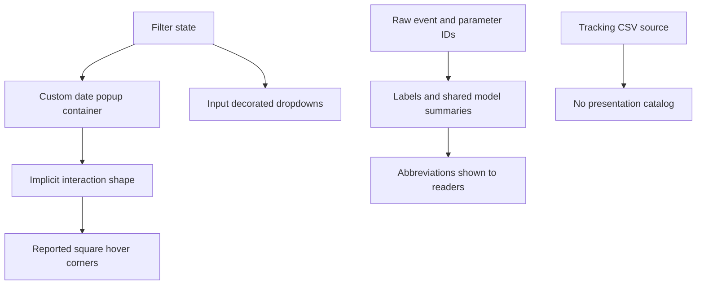
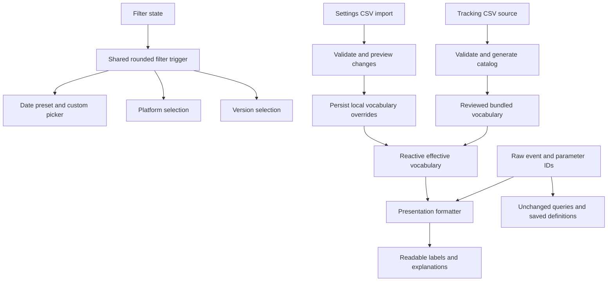
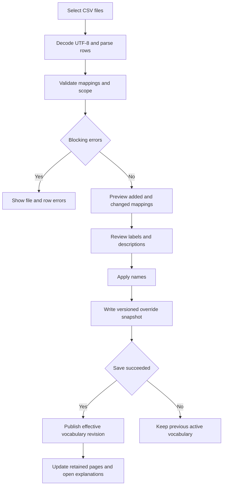

# Filter controls and readable event language

Date: 2026-10-14. Status: proposed design for owner review. No implementation authorized by this document.

## Intent and scope

Make Platform and Version look and behave visually like Date range, fix the square hover feedback on the rounded Date range trigger, and make event-related explanations understandable through the supplied PetVsMonster tracking CSVs. Preserve filter behavior and analytics definitions.

This combines bounded filter polish with a new runtime vocabulary import subsystem. The owner explicitly requested a written design first and then requested adding Settings CSV import. This document is the design artifact, not a detailed execution plan. Product source is untouched.

Assumption: primary UI language remains English. Use natural English labels derived from full event names and documented meanings; preserve Vietnamese source descriptions faithfully in catalog provenance. Do not paste long tracking specifications into every label.

## Evidence and confidence

| Observation | Source | Confidence |
|---|---|---|
| Date range is a PopupMenuButton with a custom bordered Container; Platform and Version are InputDecorator plus DropdownButton | app/lib/src/widgets/filter_bar.dart | Confirmed source difference |
| Date trigger Container has a radius, but PopupMenuButton has no explicit matching trigger radius or clipped Material boundary | Same file | Plausible cause of reported square hover; native rendering still needs reproduction |
| Raw names appear directly in event picker, event table, detail panel and level event table | event_picker.dart, counts_screen.dart, event_detail_panel.dart, pages/analytic/levels_tab.dart | Confirmed |
| Funnel summaries and labels are raw shared-model text | shared/lib/src/funnel_models.dart and widgets/funnel*.dart | Confirmed |
| Progression empty state mentions stg_start/stg_cmp/stg_fail | app/lib/src/pages/progression_page.dart | Confirmed |
| Three CSVs contain full names, abbreviated names, parameter maps, content, trigger descriptions and optional Mode B templates | csv/Pet vs Monster tracking - Events.csv, Tutorial.csv, FTU.csv | Parsed with UTF-8 CSV reader |

CSV inventory: Events has 30 nonempty Event rows, Tutorial 24, FTU 33. These are source rows, not counts of distinct supported events. Tutorial repeats tutorial/tut with different tutorial IDs; Events and FTU include retired/merged note rows without abbreviated event IDs.

## Recommended approach and alternatives

| Approach | Benefit | Cost or risk | Decision |
|---|---|---|---|
| Shared rounded filter trigger plus bundled catalog and Settings CSV overrides | Consistent interaction shape; offline labels; new mappings apply without rebuilding | Requires import validation, persistence and integration inventory | Recommended |
| Restyle three controls independently and replace strings locally | Small initial edits | Shape and vocabulary drift; incomplete explanatory coverage | Reject |
| Load CSV from an absolute disk path at runtime or rename stored event IDs | Immediate local CSV access | Fails on Web/mobile; changes query identity and saved funnels | Reject |

## Current flow

## Target flow

## 1. Matching filter buttons

Use the current Date range visual treatment as the baseline for all three controls. Introduce one internal filter-trigger component used by the date and option menus, with the same token-derived radius, outline color, padding, minimum height of 44 logical pixels, typography, trailing chevron and interaction states. Retain the visible labels above each control.

Date range retains its calendar icon; Platform and Version use plain value text and the same chevron. Widths need not be identical: date text requires more space. Match normal-state height and alignment; permit height growth for wrapped text and large text scaling. Preserve toolbar wrapping.

Prefer PopupMenuButton-based option menus using the shared trigger instead of input decoration. Preserve null as All platforms/All versions, deduplicated options, unknown selected values, full menu disclosure, selected-value tooltip, and bounded scrollable menus. Long selected versions may ellipsize only with full accessible and tooltip disclosure. Date values stay fully readable through wrapping.

Retain stable keys filter-date-range, filter-platform, filter-version. Storage scope disables Platform/Version and retains its explanatory hint. Disabled controls cannot open menus or mutate state. Preserve existing notifier calls, refresh behavior and date picker cancellation semantics.

## 2. Rounded hover, focus and press feedback

The same RoundedRectangleBorder must govern the visible outline, interaction overlay and local Material surface. Configure the trigger interaction radius explicitly and clip ink to that rounded surface where necessary. Popup menu shape is a separate property and must not be mistaken for the trigger hover fix.

Use a subtle theme-based hover fill rather than a new rectangular elevation effect. Focus and pressed feedback follow the same rounded geometry. A focus outline may extend outside the border, but must retain rounded corners. Do not clip the popup menu, tooltip or date-picker overlay.

Reproduce the owner's hover symptom in Windows before finalizing the implementation. Distinguish hover ink from tooltip or menu shadow: source suggests an ink-boundary mismatch, but this design does not claim native root-cause confirmation.

## 3. Event vocabulary and natural explanations

Add an app presentation catalog with raw aliases, CSV full name, readable English label, concise documented meaning, event-scoped parameter names, tutorial metadata, source reference and optional Mode B pattern. Generate a committed Dart baseline from the supplied CSVs and reviewed labels. Add runtime CSV parsing for Settings imports; read selected file bytes through a cross-platform picker, never an absolute project path. Imported mappings overlay the baseline and update labels without rebuilding.

The generation tool must use UTF-8 with optional BOM, real CSV parsing, quoted multiline fields, and header detection because Tutorial and FTU contain preamble rows. Reject conflicting alias definitions and produce a coverage report. Skip retired/merged note rows with no usable event ID; preserve them in the report. Merge repeated tutorial rows by tutorial ID, rather than overwriting the tutorial event record.

CSV Event is the source full name, not automatically natural language. For example, FTU contains ftu_stg_start and several legacy full names contain placeholders or punctuation. Explicit reviewed labels resolve these cases; do not globally replace stg, id or other substrings in arbitrary text.

| Raw event or context | Source full name | Primary readable wording |
|---|---|---|
| stg_start | stage_start | Stage started |
| stg_cmp | stage_complete | Stage completed |
| sup_buy | support_buy | Support item purchased |
| skl_pick | skill_pick | Skill selected |
| tut | tutorial | Tutorial |
| ftu_stg_start | ftu_stg_start | Stage started in first play session |
| ftu_sup_buy | ftu_support_buy | Support item purchased in first play session |
| dg_rwd | DailyGift_reward with placeholders | Daily gift reward claimed |
| stg on stage events | stage | Stage |
| id on skl_pick | skill_id | Skill ID |
| id on trn_use | terrain_id | Terrain ID |
| id on pet_asc | pet_id | Pet ID |
| time_min on stg_cmp | time | Play time in minutes |

FTU wording must reflect the CSV's first-session rule, not imply all future sessions for new players. Tutorial details may use the CSV Content for an available tutorial ID; do not invent step titles when no mapping exists. Keep actual parameter values and identifiers intact unless the CSV explicitly supplies a value meaning. Preserve units from Content even where the full parameter name is generic, such as time.

Recognize exact raw aliases first. Mode B templates may be supported only by anchored, validated pattern matchers that retain extracted stage/wave/ID context; ambiguous matches must fall back to the raw name. Unknown events and parameters remain visible with their raw IDs and neutral unknown-meaning text in details. Never silently omit them or invent meanings.

Primary labels use readable language. Details/tooltips provide the CSV full name, raw tracking ID and concise meaning for traceability. Distinct raw events with the same readable label stay separate rows, with raw IDs available to disambiguate. Search accepts readable labels, full names and raw IDs. Selection, chart keys, sorting tie-breaks and API calls retain raw identity.

## Coverage across the app

| Surface | Planned presentation changes |
|---|---|
| Settings | Event vocabulary import, preview, persisted overrides, status and restore defaults |
| EventPicker and Events explorer | Readable menu entries, ranked chart labels, table labels, search aliases, detail headings and meaning |
| Parameters | Event label, contextual parameter chips and field labels; raw values retained in callbacks |
| Funnel editor | Readable event choices, parameter names, previews, exclusions, alternatives and validation explanations |
| Funnel results | Chart labels, tooltip text, step table, trend labels, drilldown timeline and parameter explanations |
| Analytic page | Level event table and all event-specific insights, explanatory captions and tooltips found in final inventory |
| Overview, Retention, Progression | Any explanatory or empty-state event references, including the current Progression short-ID sentence |
| Data view, copy and exports | Human-facing explanatory labels use catalog; machine data columns keep raw IDs and existing schemas |

Add app-local structured funnel formatters instead of changing shared-model wire text or performing replacements on already composed strings. Preserve operators, alternatives, exclusions, ordering, numeric thresholds and values. Example: a step for stg_start with stg equal to 3 becomes “Stage started where Stage is 3”; its saved event remains stg_start and its parameter key remains stg.

Implementation must inventory every rendered event-related explanation, including errors and generated summaries, and record the disposition. Technical raw-ID disclosures are explicit; explanatory prose must not require decoding an abbreviation. User-authored funnel names remain user text.

## 4. Settings CSV import and live updates

Add an **Event vocabulary** section to Settings. Show the active source scope, number of imported mappings, last successful import time and source filenames. Explain that these names are saved on this device or browser profile; other team members import separately. No server upload or team synchronization is included.

Provide **Import CSV** and **Restore defaults**. Import supports one or several files together so Events, Tutorial and FTU can be validated as a single batch. Users updating one sheet need not reimport the others. File selection cancellation changes nothing.

### Supported inputs and readable labels

Accept the existing tracking-sheet schema with required `Event` and `Abbreviated Event` headers and optional existing metadata columns. Also accept a minimal two-column CSV using those same headers. `Event` is the full name; `Abbreviated Event` is the exact raw tracking ID. Accept optional `Display Name` and `Description` columns for deliberately written human language. Offer a small downloadable sample template with these four columns.

Prefer explicit `Display Name` and `Description` when supplied. For known unchanged full names, retain reviewed baseline labels and meanings. When the full name changes, do not keep a stale baseline label: derive a conservative readable label from the new full name and show it in preview. For unfamiliar names, split underscores and ordinary word boundaries without guessing undocumented acronym meanings. Let the user edit the preview label and description before applying; this handles new events whose CSV full name still contains abbreviations. Empty descriptions remain unavailable rather than invented. Missing optional fields preserve existing metadata only when the full name is unchanged; otherwise clear potentially stale meanings and report this in preview.

### Import transaction

Preview columns: raw tracking ID, full name, readable label, meaning and Added/Changed/Unchanged status. Show skipped retired rows, merged tutorial rows and any uncertain derived labels. Validation errors identify filename and logical CSV record number. Block Apply for malformed CSV, invalid UTF-8, missing headers, blank required mapping cells, conflicting duplicate aliases or ambiguous patterns. Exact duplicate records may be deduplicated; distinct tutorial IDs may merge. Recognized retired/merged annotation rows remain warnings rather than blank-ID errors. A file with no usable mappings cannot be applied.

Default import behavior is **merge**: replace complete records for IDs explicitly present in the accepted batch; retain unrelated imported records and baseline entries. Within one batch, conflicting definitions block the operation rather than allowing file order to win. Blank cells never delete mappings. Restore defaults removes imported overrides for the active scope and returns to the bundled catalog, with a clear preview of what will change.

Bound imports at 5 MiB total selected bytes and 10,000 parsed data records, showing a clear limit error. Parse away from rendering work where platform support permits; show progress and prevent concurrent Apply operations. Snapshot the vocabulary revision and scope when preview opens. If another operation or Server URL change makes the preview stale, require a new preview before applying.

### Persistence and reactive state

Persist a versioned serialized override snapshot through a dedicated local repository; current app already uses SharedPreferences for local settings. Store source metadata and the normalized catalog, not a required disk path. Verify persistence success before publishing the new active revision. On save failure keep the prior active catalog and report failure. Load saved overrides on startup; invalid or unsupported snapshots fall back to the bundled catalog with a Settings warning and must not silently overwrite the saved bytes.

Scope storage by PetVsMonster plus normalized configured Server URL, since the app has no current game selector. Clearly show that scope in Settings. A URL switch loads its own overrides, preventing accidental reuse for another source; aliases such as localhost and LAN IP remain separate scopes until an explicit source identity exists.

All event presentation consumers watch an effective vocabulary provider. Apply and Restore defaults publish a fresh immutable catalog revision; retained pages, menus on their next opening, detail panels, search results and derived summaries update. Handle an already open menu by dismissing it on revision change so stale choices are not presented. Label changes do not invalidate analytics providers, issue data requests, reset chart motion, or change selected raw events, filters, totals or saved funnels.

New catalog entries supply meaning for events once those raw IDs arrive from the server; importing a mapping alone does not create analytics events, add counts or change available server event choices. Import is explicit: editing an external CSV does not auto-update the app until it is imported again.

## Proposed boundaries and files

| Boundary | Files |
|---|---|
| Shared control surface | app/lib/src/widgets/filter_bar.dart; optional filter_trigger.dart |
| CSV generation and reviewed labels | New app/tool/generate_event_catalog.dart and csv/event-labels.json; generator shares the runtime Dart parser to avoid normalization drift |
| Pure presentation vocabulary | New app/lib/src/presentation/event_catalog.dart and generated event_catalog_data.dart |
| Runtime CSV validation | New app/lib/src/presentation/event_catalog_import.dart; cross-platform CSV parser and file picker dependencies selected during implementation planning |
| Persistence and publication | New app/lib/src/state/event_vocabulary.dart and local vocabulary repository |
| Import and preview UI | app/lib/src/screens/settings_screen.dart plus dedicated event_vocabulary_settings.dart |
| Structured funnel wording | New app/lib/src/presentation/funnel_language.dart |
| Presentation consumers | Files named in coverage table, discovered through a final rendered-text inventory |

Each catalog snapshot is immutable and does not own network requests or analytics computations. A dedicated vocabulary state provider owns local loading, import transactions and revision publication. Source scoping prevents later data sources from accidentally inheriting these meanings. Build-time and runtime import paths must share normalization rules, backed by parity fixtures.

## Acceptance and verification

1. All three filters share normal-state shape, padding, chevron placement and height across Tremor, Shadcn, Midnight and Material. Verify normal, hover, focus, pressed and disabled states.
2. Actual rendered hover pixels follow rounded corners; verify a Windows screenshot or walkthrough and a targeted rendering regression. Widget existence alone cannot establish this.
3. Check 320, 720, 1024 and 1440 widths, text scales 1.0 and 1.5, and bold text. Preserve readable dates, long-version disclosure, menu scrolling, keyboard activation, Escape, focus return and disabled storage scope.
4. Catalog fixtures cover all valid rows, tutorial merging, retired rows, multiline UTF-8 descriptions, ambiguous aliases, event-scoped id, FTU semantics, unknown events and representative Mode B templates.
5. Integration tests prove readable text while literal API event and parameter arguments stay raw; saved funnel round trips, chart IDs and totals remain unchanged. Duplicate readable labels must not merge event counts.
6. Search by full name and raw abbreviation finds the same event. Expanded chart data, tooltip meanings, funnel alternatives and exclusions retain exact statistics and conditions.
7. Existing relevant filter, dashboard, Events, Parameters, Funnel and Analytic suites plus analyzers pass. Native visual sign-off is reported separately from automated checks.
8. Import the actual three supplied CSVs together, then a minimal CSV adding a new alias and updating an existing full name. Preview correctly reports changes; Apply refreshes visible wording immediately; restart retains it without rebuilding. Importing one sheet preserves mappings from the other two.
9. Test cancel, malformed input, preambles, BOM, quoted newlines, conflicts, empty imports, import limits, save failure, corrupt saved snapshots, stale previews, scope switches and Restore defaults. Failed operations leave the active vocabulary unchanged.
10. Confirm literal API arguments, analytics request counts, selected event IDs, chart animation state and saved funnel JSON are unchanged after import. Verify file selection/import on Windows and separately on Web/mobile before claiming those platform gates pass.

## Suggested delivery order after design review

First unify filter triggers and verify hover shape. Then establish baseline catalog and matching runtime parser contracts, followed by persisted reactive vocabulary and Settings import preview. Integrate Events and Parameters, followed by structured Funnel wording and remaining analytics explanations. Finish with import/restart verification, the app-wide coverage inventory and native visual verification.

Open assumption for owner correction: English readable labels are primary; CSV full names and raw IDs appear in secondary details. This is the recommended interpretation of natural-language explanations, rather than simply expanding underscores.
