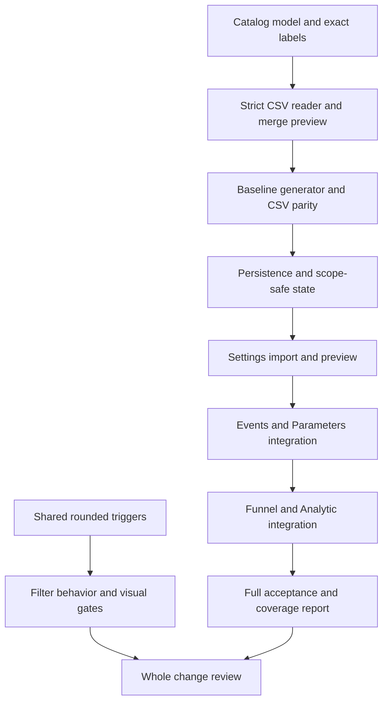

# Filter Controls and Event Language Implementation Plan

> **For agentic workers:** REQUIRED SUB-SKILL: Use `executing-plans` to implement task-by-task, inline. The owner selected Gemini as implementer. Do not invoke subagent-driven-development or dispatch agents by default. Track checkbox steps in the two component plans.

**Goal:** Match rounded filter controls and let the owner import event-name CSVs in Settings to update readable explanations immediately.

**Architecture:** Two independently testable delivery tracks: filter trigger polish and runtime event vocabulary. The vocabulary track supplies an immutable bundled catalog, strict CSV import, transactional local overrides and reactive presentation formatting while retaining all raw analytics identities.

**Tech Stack:** Existing Flutter/Dart workspace, Riverpod 2.6.1, SharedPreferences, fl_chart; file_selector 1.1.0 and file_saver 0.7.0 for vocabulary file operations. A pure Dart strict CSV reader is shared by the runtime importer and baseline generator.

**Spec:** [filter-controls-and-event-language-design.md](filter-controls-and-event-language-design.md).

## Global Constraints

- Primary UI language remains English.
- Minimum height of 44 logical pixels for filter triggers; preserve growth and wrapping.
- Preserve null as All platforms/All versions, deduplicated options, unknown selected values, full menu disclosure, selected-value tooltip, and bounded scrollable menus.
- Retain stable keys filter-date-range, filter-platform, filter-version.
- Bound imports at 5 MiB total selected bytes and 10,000 parsed data records.
- Default import behavior is merge. Blank cells never delete mappings.
- Save locally on this device or browser profile; no server upload or team synchronization.
- Scope storage by PetVsMonster plus normalized configured Server URL.
- Label changes do not invalidate analytics providers, issue data requests, reset chart motion, or change selected raw events, filters, totals or saved funnels.
- Import is explicit: editing an external CSV does not auto-update the app until it is imported again.
- Distinct raw IDs remain distinct even when display labels match.
- Product work occurs only when the owner hands this plan to the implementer; this planning session changes documentation only.

## Review Focus

1. Selecting All must invoke the nullable notifier; popup dismissal must not masquerade as All. Pinned by Controls Task A1.
2. A CSV full name change must discard stale meaning but preserve unrelated mappings. Pinned by Vocabulary Tasks B2/B4.
3. URL changes while loading or saving must never publish the old scope into the new one. Pinned by Vocabulary Task B4.
4. A label-only revision must update retained views without replaying geometry or refetching data. Pinned by Vocabulary Tasks B6/B7.
5. Free-text server explanations must not be blindly string-replaced; use structured event/condition fields. Pinned by Vocabulary Task B7.

## Plan decomposition and execution order

The design covers two independent subsystems. Execute these separate component plans rather than mixing every change into one commit:

| Track | Plan | Deliverable |
|---|---|---|
| A | [filter-controls-implementation.md](filter-controls-implementation.md) | Matching date/platform/version buttons with rounded feedback |
| B | [event-vocabulary-implementation.md](event-vocabulary-implementation.md) | CSV imports, persisted vocabulary and complete human-facing integration |



## Current repository and preflight

Current planning-time status: modified `.cursor/memory/mem-known-bugs-index.md`, untracked design and `csv/`. Historical memory reports 942 passing tests; do not treat that as fresh evidence or assume current branch/HEAD. Source and tests already include dashboard refresh repairs. Do not discard them.

- [ ] Read `AGENTS.md`, `.claude/rules/`, design and both component plans. Read current dashboard handoff and verification section 6 for inherited contracts.
- [ ] Run `git status --short`, `git branch --show-current`, `git rev-parse HEAD`. Record ownership of dirty files. Use exact path/hunk staging; no blanket add/reset/stash, implicit merge or push.
- [ ] Verify SDK with `Test-Path 'D:\flutter\bin\cache\dart-sdk\bin\dart.exe'` and `Test-Path 'D:\flutter\bin\cache\flutter_tools.snapshot'`. If different, locate actual SDK and record it.

Use PowerShell commands from package working directories:

```powershell
# Working directory: app
& 'D:\flutter\bin\cache\dart-sdk\bin\dart.exe' 'D:\flutter\bin\cache\flutter_tools.snapshot' test --no-pub test/filter_bar_test.dart
& 'D:\flutter\bin\cache\dart-sdk\bin\dart.exe' analyze
# Working directory: shared or server
& 'D:\flutter\bin\cache\dart-sdk\bin\dart.exe' test
```

Dependency resolution is a real gate: run Flutter `pub get` from app after dependency edits; commit workspace `pubspec.lock` changes explicitly. Do not change Riverpod or unrelated package constraints. A lockfile resolution failure is evidence to report and resolve, not a reason to silently omit import functionality.

## Delivery report contract

Create `.cursor/plans/filter-controls-and-event-language-verification.md` during execution. Include task commit IDs, exact commands/exit codes, red/green failures, source coverage inventory, catalog row dispositions, literal request assertions, template-save behavior, native screenshot paths and per-platform status. Never substitute widget presence or a release build for native hover acceptance. Record BUG-0070/0071/0072 evidence/status in the bug ledger without deleting IDs. Scope-specific new findings get new IDs.

No staging or committing of somebody else's changes. Frequent commits in component plans apply only to owned implementation hunks and tests after the corresponding gates pass.

## Dependency sources checked during planning

[file_selector publisher documentation](https://pub.dev/packages/file_selector) documents multi-file selection and platform-specific type filters. [file_saver publisher documentation](https://pub.dev/packages/file_saver) documents byte saving and Web download. Pin the versions above; resolve and analyze against the actual local SDK before implementation proceeds. The plans use a strict reader instead of a permissive parser so malformed imports cannot silently produce mappings.

## Planning self-review

The component tasks cover all ten design acceptance items. Controls source evidence is inspected; native hover cause remains pending reproduction. Runtime import APIs below are proposed contracts, not existing source. Planning performs no product tests/build and claims no runtime PASS. Gemini must run the actual fixtures and gates.
