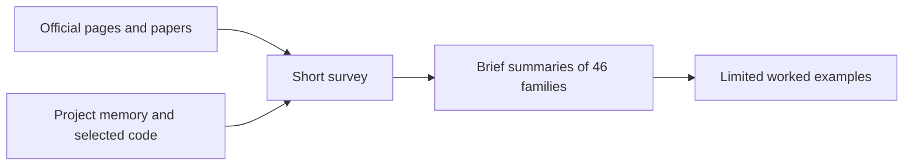
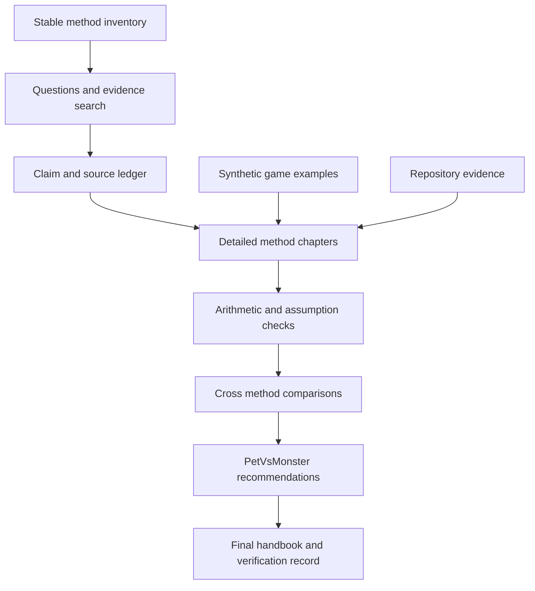

# Game Analytics 46 Methods Research Implementation Plan

> **For agentic workers:** Use `executing-plans` to execute this document task by task, inline by default. Steps use checkboxes. Project instructions override the generic subagent workflow. This is a research and writing plan, not an application implementation plan.

**Goal:** Produce a detailed Markdown reference explaining all 46 method entries in the existing survey, with defensible sources, worked game examples, advantages, disadvantages and suitability for PetVsMonster.

**Architecture:** Keep the existing survey as the overview and create one linked handbook containing 46 consistently structured chapters. Maintain a separate source and claim ledger plus a compact verification record so readers can distinguish established methods, vendor claims, hypothetical examples and observations about our code. Research and review one family at a time, with the first three chapters establishing the editorial standard.

**Tech Stack:** Markdown, Mermaid, official documentation and original papers, repository inspection, PowerShell arithmetic and link checks. Use existing numerical tools if available for examples; introduce no application dependencies.

**Spec:** User request in this conversation and the design brief in sections 1 through 8 below. Baseline inventory: `docs/research/game-player-analytics-research-2026-10-19.md`. The inventory is a scope reference, not a substitute for reading primary sources.

**Current execution scope:** The owner subsequently requested M01 through M08 as the first complete family for reading and feedback. Follow [Descriptive and exploratory pilot implementation](descriptive-exploratory-research-implementation.md) before this plan's broader execution sequence. Its first-family review gate supersedes the M01, M04 and M19 pilot proposed here; M19 and the other families remain deferred until the owner approves the revised format.

## Global constraints

- Final deliverables are Markdown files. The user explicitly corrected the earlier Word request.
- Cover all 46 existing entries with stable IDs M01 through M46. Entries are method families, not a claim that there are exactly 46 individual algorithms.
- Explain every named submethod in each entry; do not collapse different assumptions into one generic paragraph.
- Write full, readable English in the handbook. Caveman style applies to conversation, not the research artifact.
- Research only; do not change app behavior, instrumentation, dependencies or existing statistical implementations.
- Use primary sources for technical statements. Browse again during execution for current vendor capabilities and changing documentation.
- Label all invented examples as synthetic. Make no claim about actual PetVsMonster outcomes without authorized analysis and traceable data.
- Default execution is inline. Do not spawn agents unless the user explicitly requests delegation.
- Save planning artifacts in `.cursor/plans/`; save research artifacts in `docs/research/`.
- Do not automatically commit or publish. Keep any eventual commits limited to explicit research file paths.

## Review focus

1. Partial coverage, late data and immature cohorts must produce unknown or excluded outcomes rather than fabricated zero activity. Owned by Tasks 1, 2 and 7.
2. Repeated players, sessions and attempts must preserve the correct unit of analysis and resampling. Owned by Tasks 1, 3 and 7.
3. Feature windows, outcomes and evaluation splits must prevent future leakage and distinguish retrospective explanation from future prediction. Owned by Tasks 2 and 6.
4. Observational associations, model explanations and version differences must never be described as established causes. Owned by Tasks 4, 9 and 10.
5. Bundled families and sparse evidence must receive explicit submethod coverage and uncertainty; source quantity must not substitute for evidence quality. Owned by every family task and final verification.

---

## 1 Design brief and scope

The reader is a game developer building an analytics dashboard and learning which techniques are useful. The handbook should support three reading levels: plain language intuition, a worked numerical explanation, and implementation and evaluation guidance. Assume basic programming literacy, but introduce statistical notation before using it.

The existing survey is approximately 6,500 words and introduces 46 families. The next artifact should be a research handbook, not simply a longer list. Every chapter must answer what the method does, how it works, what data it needs, when it fails, how to judge it and whether it fits our game today.

Target roughly 600 to 1,000 words for a narrow entry and 1,000 to 1,800 for a bundled family when needed. Expect approximately 40,000 to 65,000 words including foundations and comparisons. These are planning estimates, not quotas: complete examples and accurate distinctions take priority over length. Avoid repeating foundational explanations in every chapter; link to the shared section and explain the method specific consequence.

Out of scope: production model training, a deployed AI service, pricing recommendations, private vendor internals, a complete software implementation for every method, or claims that the full scientific literature has been exhausted. Pseudocode and short reproducible calculations are in scope. A conceptually useful but currently unsupported technique still receives a full chapter and a clear missing data assessment.

## 2 Format decision

| Approach | Benefit | Cost | Decision |
|---|---|---|---|
| Expand the existing survey in place | One familiar path | Destroys its value as a short overview | Preserve overview instead |
| One detailed handbook with support ledgers | One main reading artifact, stable cross links, consistent terminology | Large Markdown file | Recommended |
| Forty six separate method documents | Easy to edit individually | Navigation and duplication overhead for one reader | Reserve for a later user requested split |

The handbook will have a linked contents list, shared foundations, 46 chapters grouped into the existing nine families, a decision matrix, a PetVsMonster roadmap, glossary and bibliography. Vendor analysis should be expanded in a separate handbook section without pretending every platform implements every method.

## 3 Current and target research flow

### Current



### Target



This changes the documentation workflow only. It proposes no change to the application's data pipeline.

## 4 File responsibilities

| File | Action during execution | Responsibility |
|---|---|---|
| `docs/research/game-player-analytics-research-2026-10-19.md` | Modify after handbook completion | Preserve survey, add link to detailed handbook |
| `docs/research/game-analytics-methods-handbook.md` | Create | Full reader facing research and worked examples |
| `docs/research/game-analytics-methods-sources.md` | Create | Source register, claim traceability, search gaps and vendor evidence |
| `docs/research/game-analytics-methods-verification.md` | Create | Scope coverage, arithmetic checks, link checks and remaining limits |
| `.cursor/plans/game-analytics-46-methods-research-plan.md` | Update checkboxes as work progresses | Design, execution order and acceptance contract |

Read project code to verify implementation claims; do not modify it. Start with `server/lib/src/analysis/`, `server/lib/src/event_store.dart` if present, and shared analysis models; locate actual paths using `rg --files` rather than assuming remembered locations.

## 5 Required chapter contract

Each chapter uses a heading such as `## M19 Logistic regression`. Its first occurrence establishes the stable anchor used by the contents and comparison matrix. Each chapter contains these sections in this order:

| Section | Required substance |
|---|---|
| Question and intuition | One concrete game decision, plain language explanation, descriptive or predictive or causal classification |
| Inputs and output | Analysis unit, field names, time windows, eligibility, minimum information, exact form of result |
| How it works | Ordered steps, key formula, symbol definitions and relevant variants |
| Worked game example | Small synthetic input table, intermediate steps, numerical result and a correct interpretation |
| Assumptions and preparation | Scaling, missingness, dependence, censoring, distribution and identity assumptions as relevant |
| Advantages | What the method does well and under which conditions |
| Disadvantages and failure cases | Where it misleads, operational costs and at least one concrete misleading example |
| Evaluation | Appropriate baseline, metric, split or statistical diagnostic and acceptance reasoning |
| Alternatives | At least two nearby methods and the conditions favoring them |
| PetVsMonster fit | Current evidence, missing fields, expected output, resource cost and readiness classification |
| Sources and confidence | Claim level links, evidence type, date checked and unresolved uncertainty |

For bundled entries, add a submethod comparison table and explain each submethod's mechanics and assumptions. A method can share the chapter's main example only when that example actually distinguishes its result from neighboring variants. Do not require meaningless p values for descriptive summaries or a train and test split for accounting identities.

Readiness labels: **Usable with current events**, **Needs data validation**, **Needs new telemetry**, **Needs experiment data**, or **Research only for now**. Labels must be supported by repository or data evidence; if current fields have not been checked, use Needs data validation. Cost labels are qualitative and must state the assumed scale, such as 10,000 player snapshots or 1 million events, rather than invent a benchmark.

## 6 Source and claim protocol

Use a stable source key such as S001 and a claim key such as M19-C01. The ledger columns are Claim ID, precise claim, method ID, source key, direct URL and section, evidence type, checked date, limitation, verification status. Source records also include author or organization, title, publication or version date when available, and whether full relevant content was inspected.

Seek at least one authoritative explanation and one additional original paper, implementation reference or game relevant validation source per method family. Reuse strong sources across chapters where valid. If a second credible source is unavailable, disclose the gap and narrow the claim; do not manufacture support to meet a count. Each distinctly named submethod needs direct support somewhere in the chapter, even if from the same comprehensive source.

Read the section supporting the claim, not only a search snippet. Prefer official product docs for capabilities, library docs for exact behavior, and original papers for algorithm mechanics. Record disagreement and assumptions. Do not label a vendor's proprietary algorithm unless it is explicitly documented. Treat vendor case studies as selected reports, not independent proof of general effectiveness.

Attach citations to the claim they support using readable Markdown links. Keep paraphrases original, quotations short and source derived text within applicable source limits. A long bibliography does not authorize copying or close paraphrasing. Recheck the earlier survey's sources rather than inheriting their reliability automatically.

## 7 Shared examples and technical conventions

Create one small synthetic data appendix with linked tables for players, sessions, attempts, events, currency transactions and experiment assignment. Use IDs P01 through P12 and arbitrary synthetic timestamps. Give each table a primary key, row count, schema and explicit inclusion rules. Larger illustrative populations such as 100 players must be labeled separate aggregate examples, not silently derived from the 12 player fixture.

Include at least these deliberately contrasting cases: one player with repeated level failures, one unresolved attempt, one returning player after an inactivity gap, one player with immature follow up, one missing import day, and one zero revenue player. Record UTC day boundaries and distinguish observed zeros from unavailable dates. Experimental examples use independent assignment records and declared exposure; do not reuse observational labels as if randomized.

Use fractions before rounding. State whether SD is sample or population, whether intervals are confidence or credible intervals, and whether outcome rates are player weighted or attempt weighted. Show percentage point differences separately from relative percent changes. A synthetic answer can be checked by direct enumeration without implying meaningful statistical power in 12 players.

For formulas too large for a small example, show one transparent calculation plus pseudocode for the general algorithm. Explain initialization, stopping rules and edge cases. Library output, if used, must state package version and seed, and must agree with an independently checked small result. Do not paste a production training pipeline into every chapter.

## 8 Complete method coverage map

The required coverage below preserves the survey IDs. Each row specifies an example and a failure case the chapter must explain; these form the acceptance cases for the writing work.

| ID | Chapter and required variants | Worked example and required failure case |
|---|---|---|
| M01 | Metric aggregation, unique counts, weighted rates, quantiles and distributions | Compute DAU and retries with repeat users; expose mean versus median and ratio of totals versus mean of ratios |
| M02 | Property segments, install cohorts and behavioral cohorts | Compare platforms at equal player age; demonstrate Simpson's paradox with unequal traffic mix |
| M03 | Exact day, rolling and bracket retention plus stickiness | Enumerate D1 and D7 eligibility; show why immature users are unknown and DAU over MAU is not retention |
| M04 | Ordered and unordered funnels, windows, entry and reentry | Walk tutorial events with repeats and skipped steps; contrast conditional and total conversion |
| M05 | Explicit and gap inferred sessions, active duration and return gaps | Sessionize a timestamp list; show background events and missing end effects |
| M06 | RFM bins, lifecycle states and nonmonetary alternatives | Assign scores from recency and frequency; contrast veteran exposure with new player opportunity |
| M07 | Sources, sinks, balances, payer metrics, ad and IAP revenue | Reconcile a currency ledger and payer conversion; include refund or duplicate transaction |
| M08 | Spatial heatmaps, exposure normalization, playtests and feedback coding | Compare deaths per visit across map cells; distinguish raw hotspot counts and sampled qualitative evidence |
| M09 | Wilson intervals, percentile bootstrap, clustered resampling | Compute a proportion interval and a player bootstrap step; expose false precision from resampling events |
| M10 | Welch t, Mann Whitney, Fisher exact, chi square and effect sizes | Compare two synthetic groups; distinguish distribution tests, mean differences and practical significance |
| M11 | Benjamini Hochberg, familywise alternatives and hierarchical shrinkage | Apply a correction to a small p value list; explain dependence assumptions and overshrinkage |
| M12 | Pearson, Spearman, linear regression and adjustment | Compute association with a confounder; demonstrate why adjustment is not automatically causal |
| M13 | Beta binomial updating, priors and expected loss | Update successes and failures; compare two priors and distinguish posterior probability from a p value |
| M14 | K means, K means plus plus, scaling, K selection and stability | Perform one assignment and center update; show an outlier and unequal feature scales |
| M15 | Agglomerative clustering, linkage and dendrogram cuts | Merge a small distance set using two linkages; show different groupings and quadratic scale concerns |
| M16 | DBSCAN and HDBSCAN | Label core, border and noise points; explain differing densities and high dimensional distances |
| M17 | Gaussian mixtures, EM, covariance and soft membership | Calculate component responsibilities for a point; contrast ambiguous membership with hard assignment |
| M18 | PCA, t SNE and UMAP | Show a PCA projection and explain nonlinear neighborhood objectives; reject visual islands as cluster proof |
| M19 | Logistic regression, regularization, interactions and thresholds | Calculate a logit probability; explain class imbalance, calibration and feature window leakage |
| M20 | CART classification and regression, Gini, depth and pruning | Calculate one split and leaf rate; show overfitting from a tiny leaf |
| M21 | Random forest, bagging, gradient boosting and histogram variants | Contrast averaging trees with one boosting update; explain correlated features and tuning leakage |
| M22 | K nearest neighbors, SVM margins, kernels and probability conversion | Classify a nearby player and explain a margin; show sensitivity to scale and scoring cost |
| M23 | MLP, RNN or LSTM and Transformer sequence models | Compare identical event counts in different orders; show temporal masks, padding and future leakage |
| M24 | Cohort LTV, two part models, BG NBD, Gamma Gamma, ad and IAP value | Compute a finite horizon value and two part expectation; state spend independence and noncontractual purchase assumptions |
| M25 | Permutation importance, SHAP, reliability plots, sigmoid and isotonic calibration | Explain one score and a calibration bin; show correlated feature ambiguity and noncausal attribution |
| M26 | Kaplan Meier, Greenwood uncertainty and log rank | Calculate survival with ties and censoring; explain grace periods and nonindependent censoring |
| M27 | Cox proportional hazards, AFT and survival forests | Interpret hazard ratio versus time ratio; discuss proportional hazards checks and return after churn |
| M28 | Attempt versus player completion, Beta smoothing and ability difficulty models | Compare repeated attempts with unique completers; include unresolved starts and survivor selection |
| M29 | Monte Carlo progression simulation, economy scenarios and sensitivity | Simulate a short progression under declared parameters; show how misspecified assumptions reverse a recommendation |
| M30 | Path exploration, sequence compression and process conformance | Build traces with a retry loop; show how case boundaries change the apparent flow |
| M31 | Markov chains, absorbing states and hidden Markov models | Calculate a transition row and one next state distribution; separate latent states and observed events |
| M32 | Support, confidence, lift, Apriori and FP Growth | Enumerate a small action basket; show high lift with low support and no temporal ordering |
| M33 | Sequential patterns, PrefixSpan and gap constraints | Enumerate ordered subsequences; distinguish frequent behavior from long session opportunity bias |
| M34 | Degree, centrality, community detection and social exposure | Analyze a small interaction graph; distinguish centrality from causal influence and explain interference |
| M35 | Median MAD, z scores, EWMA and CUSUM | Calculate a robust deviation and an accumulating shift; handle zero MAD and sparse conversion denominators |
| M36 | STL decomposition, residual alerts and change point detection | Decompose a weekday pattern conceptually and locate a shift; distinguish release coincidence from root cause |
| M37 | Seasonal naive, ETS, ARIMA and lagged regression | Forecast a tiny series with a baseline; explain rolling origins, horizon matching and structural breaks |
| M38 | Isolation Forest, LOF, autoencoders and deterministic abuse rules | Contrast global rarity and local density; show legitimate unusual players and false accusations |
| M39 | Randomized A B tests, intention to treat, exposure, power and guardrails | Compute absolute and relative uplift; explain sample ratio mismatch, peeking and clustered assignment |
| M40 | Difference in differences, regression discontinuity, matching and IPW | Calculate a two by two DiD; explain parallel trends, positivity and unmeasured confounding |
| M41 | Treatment effect heterogeneity, two model uplift and causal forests | Contrast risk targeting with incremental treatment benefit; explain unobservable individual counterfactuals |
| M42 | Content and collaborative recommendation, matrix factorization, UCB, Thompson sampling and contextual bandits | Rank simple choices then show exploration; require logged propensities and delayed outcome caveats |
| M43 | MDPs, returns, Q learning, policy methods and offline RL | Calculate a two step discounted return and Q update; explain reward hacking and unsupported logged actions |
| M44 | Feedback coding, sentiment, embeddings, clustering and topic models | Group synthetic comments with contrasting sentiment; show selection bias and multilingual evaluation |
| M45 | Tool grounded LLM analysis, retrieval, query validation and reporting | Trace a question to a computed result and cited narrative; reject invented numbers and instructions inside imported text |
| M46 | Candidate generation, ranking, deduplication and evidence grounded insight evaluation | Rank two changes using a declared heuristic; show multiple comparison risk and why ranking is not significance |

## 9 Execution tasks

These are documentation tasks. Acceptance checks replace software TDD; do not invent unit tests that merely search for headings and call that scientific verification. Each listed action should be a short work slice. Repeat source reading and chapter drafting per individual submethod as needed; do not treat a whole family as a five minute task.

### Task 1 Establish foundations and evidence contracts

**Files:** Create handbook, source ledger and verification record at the exact paths in section 4.

**Consumes:** Existing survey and this plan. **Produces:** Stable contents, M01 through M46 register, shared terminology, synthetic schemas and claim keys used by all later tasks.

- [ ] Read the survey's 46 headings and record an exact ID to title mapping in verification.
- [ ] Draft the handbook opening, reading guide, glossary conventions and linked family contents.
- [ ] Define the synthetic tables from section 7, including the six contrasting cases and expected eligibility decisions.
- [ ] Record baseline source candidates from the survey in the ledger as unverified until their relevant pages are read.
- [ ] Verify that a missing day, immature cohort and unresolved attempt are three distinct states in every fixture and definition.

**Acceptance:** A reader can identify every planned chapter, the data unit and the source status without assuming all source URLs have already been verified. No empty chapter bodies are represented as completed research.

### Task 2 Calibrate depth with three pilot chapters

**Files:** Modify handbook, sources and verification.

**Consumes:** Task 1 contracts. **Produces:** Complete M01, M04 and M19 chapters demonstrating descriptive, path and predictive treatments.

- [ ] Read primary sources for aggregation, funnel semantics and logistic regression; record claim keys and section links.
- [ ] Draft M01 using duplicate players and player versus event weighted averages.
- [ ] Draft M04 using repeated tutorial steps, a skipped step and a fixed window.
- [ ] Draft M19 with a numerical probability calculation and a feature cutoff before the label window.
- [ ] Recalculate each example independently and review all eleven required sections from section 5.
- [ ] Record gaps and refine the shared chapter contract before expanding the remaining families.

**Acceptance:** Three complete, readable chapters; correct arithmetic; no prediction claim from an in sample rule; no confusion between funnel step and overall denominators. These chapters establish the quality baseline without requiring a separate user approval for every later chapter.

### Task 3 Complete descriptive and exploratory methods

**Files:** Modify handbook, sources and verification. **Consumes:** Tasks 1 and 2. **Produces:** M02, M03 and M05 through M08, with M01 and M04 integrated.

- [ ] Verify sources for cohort, retention, sessions, RFM, economy, spatial and qualitative methods.
- [ ] Draft each of the six remaining chapters using its exact coverage row in section 8.
- [ ] Calculate a Simpson's paradox example and a retention eligibility example independently.
- [ ] Reconcile currency balances and distinguish player, session, attempt and transaction denominators.
- [ ] Check the family comparison for methods requiring positions, purchases or qualitative data not confirmed in our store.

**Acceptance:** M01 through M08 complete, each with an input contract, example, alternatives and evidence based fit classification.

### Task 4 Complete statistical inference methods

**Files:** Modify handbook, sources and verification. **Consumes:** Task 1 fixture conventions. **Produces:** M09 through M13 and shared uncertainty vocabulary.

- [ ] Read original or authoritative references for each named test, interval, correction and Bayesian update.
- [ ] Draft M09 and M10, including player level resampling and the proper interpretation of each test.
- [ ] Draft M11 with a sorted p value calculation and distinguish correction from shrinkage.
- [ ] Draft M12 and M13 with a confounder example and sensitivity to two priors.
- [ ] Verify interval language, dependence assumptions and all absolute versus relative differences.

**Acceptance:** No unsupported causal interpretation, no p value described as probability the null is true, and no bootstrap claimed to repair bias or missing observations.

### Task 5 Complete clustering and representation methods

**Files:** Modify handbook, sources and verification. **Consumes:** Task 1 definitions. **Produces:** M14 through M18.

- [ ] Read direct references for each named clustering and embedding variant.
- [ ] Draft M14 and M15 with center updates and contrasting linkage merges.
- [ ] Draft M16 and M17 with density labels and probabilistic membership calculations.
- [ ] Draft M18 with a PCA calculation and separate t SNE and UMAP objective explanations.
- [ ] Check stability evaluation, feature scaling, qualitative costs and the prohibition on interpreting plots as proof of player types.

**Acceptance:** Hard versus soft grouping, density versus distance, and representation versus clustering are distinct and each named variant has direct evidence.

### Task 6 Complete prediction and player value methods

**Files:** Modify handbook, sources and verification. **Consumes:** M19 pilot and shared time windows. **Produces:** M20 through M25, integrated with M19.

- [ ] Verify tree, ensemble, neighbor, SVM, neural, LTV, explanation and calibration sources.
- [ ] Draft M20 through M22 with a tree split, forest versus boosting distinction, and distance or margin examples.
- [ ] Draft M23 with event order, time handling and future masking, without implying a Transformer is automatically superior.
- [ ] Draft M24 with finite horizon net value and separate treatment of zero spend, purchase activity and spend amount.
- [ ] Draft M25 with reliability bins and clear separation of model attribution and causal explanation.
- [ ] Walk a chronological split example and ensure all preprocessing and calibration fit only on permitted data.

**Acceptance:** Every predictive claim names scoring time, later outcome and an appropriate baseline. No universal minimum sample size or fabricated model performance is reported.

### Task 7 Complete survival and progression methods

**Files:** Modify handbook, sources and verification. **Consumes:** Fixture eligibility, uncertainty conventions. **Produces:** M26 through M29.

- [ ] Read sources for Kaplan Meier, log rank, Cox, AFT, survival forests, difficulty models and simulation.
- [ ] Draft M26 and M27 with censoring, tied events, inactivity grace periods and a returning player.
- [ ] Draft M28 with independent player completion and attempt outcome calculations, including unresolved starts.
- [ ] Draft M29 with declared transition assumptions, a scenario comparison and sensitivity analysis.
- [ ] Compare relevant statements with current survival and levels code, recording exact file and symbol evidence.

**Acceptance:** Survival is not relabeled exact day retention; a start is not silently equated with a resolved attempt; observed player selection is disclosed.

### Task 8 Complete paths associations and networks

**Files:** Modify handbook, sources and verification. **Consumes:** Stable events and session conventions. **Produces:** M30 through M34.

- [ ] Verify sources for process mining, Markov and hidden state models, Apriori, FP Growth, PrefixSpan and graph measures.
- [ ] Draft M30 and M31 from a shared small trace while separating observed transitions from latent states.
- [ ] Draft M32 and M33 using the same actions in basket and sequence form to demonstrate the information difference.
- [ ] Draft M34 using a small explicit interaction graph and explain treatment interference.
- [ ] Recalculate row normalized transitions, support, confidence and lift; inspect low support and unequal exposure cases.

**Acceptance:** Co occurrence, order, transition probabilities and causal influence remain separate concepts. Network requirements are not inferred from ordinary per player events.

### Task 9 Complete monitoring and forecasting methods

**Files:** Modify handbook, sources and verification. **Consumes:** Coverage and time conventions. **Produces:** M35 through M38.

- [ ] Read primary references for robust thresholds, EWMA, CUSUM, STL, change points, forecasting and outlier models.
- [ ] Draft M35 with a zero MAD case and different treatment of counts and rates.
- [ ] Draft M36 and M37 with weekday effects, a seasonal naive baseline and rolling origin evaluation.
- [ ] Draft M38 with a legitimate rare player and explicitly uncertain fraud interpretation.
- [ ] Audit release narratives to ensure they distinguish temporal coincidence, statistical anomaly and causal explanation.

**Acceptance:** Missing dates are not interpolated without disclosure; forecast horizons and training windows are explicit; anomalies do not become accusations or proven root causes.

### Task 10 Complete experiments and decision methods

**Files:** Modify handbook, sources and verification. **Consumes:** Inference and predictive vocabulary. **Produces:** M39 through M43.

- [ ] Read authoritative sources for randomized design and every named causal, uplift, recommendation, bandit and RL variant.
- [ ] Draft M39 and M40 with an experiment estimate and a two by two difference in differences calculation.
- [ ] Draft M41 contrasting high predicted churn with high incremental treatment benefit.
- [ ] Draft M42 separating content recommendation, collaborative models and adaptive action selection.
- [ ] Draft M43 with a small discounted return and Q learning calculation, plus offline support and reward failure cases.
- [ ] Review assignment, exposure, positivity, parallel trends and interference assumptions against each claimed conclusion.

**Acceptance:** Historical version comparisons are not mislabeled randomized evidence; personalization benefits are not promised without treatment evaluation.

### Task 11 Complete text and AI insight methods

**Files:** Modify handbook, sources and verification. **Consumes:** Numerical evidence contracts and previous method chapters. **Produces:** M44 through M46.

- [ ] Verify sources for text classification, embeddings, topics, tool grounded analysis and insight evaluation.
- [ ] Draft M44 with human coding comparison, contradictory sentiment and multilingual limitations.
- [ ] Draft M45 tracing a synthetic question through a permitted query to a numeric result and a source linked explanation.
- [ ] Draft M46 with an explicitly proposed ranking heuristic, duplicate candidate handling and false discovery caveats.
- [ ] Test the narrative examples against an invented number, an unsupported causal claim and an instruction embedded in an event label; record the expected rejection or qualified wording.

**Acceptance:** LLM prose is not used as the numerical authority. Proposed ranking policy is labeled our design judgment rather than an established optimal algorithm.

### Task 12 Add platform comparison and project synthesis

**Files:** Modify handbook, source ledger and verification; add handbook link to existing survey.

**Consumes:** Completed M01 through M46 and current vendor evidence. **Produces:** Decision matrix and staged project recommendations.

- [ ] Recheck official sources for GameAnalytics, Unity Analytics, Amplitude, Firebase or GA4, Mixpanel and Roblox.
- [ ] Build a compact platform matrix for documented workflows, relevant input data, export or investigation capabilities, limitations and evidence date; omit unverified entitlements and internals.
- [ ] Inspect local algorithm entry points and data schemas with `rg`; record implemented versus proposed capabilities with exact symbols and source paths.
- [ ] Build a 46 row selection matrix containing question, data needs, output, readiness, interpretability, cost assumptions and major risk.
- [ ] Write a phased PetVsMonster recommendation that connects each proposed improvement to a decision and a validation gate.
- [ ] Add a short cross link in the survey without replacing its original scope or historical date.

**Acceptance:** Existing capability claims are traceable to inspected code, implementation existence is not treated as correctness evidence, and future recommendations do not quietly expand into app changes.

### Task 13 Verify and deliver the complete research

**Files:** Review all four research files; update verification and plan checkboxes.

**Consumes:** Entire handbook, source and claim ledger. **Produces:** Reviewed Markdown deliverables and candid remaining limitations.

- [ ] Check exactly 46 unique M headings, all eleven chapter sections and all variants from section 8.
- [ ] Independently recompute every displayed small numerical result; record inputs, formula, expected output and actual checked output in verification.
- [ ] Review each causal, predictive and vendor capability statement against a direct source or narrow its wording.
- [ ] Validate internal anchors, relative file links, bibliography references and Mermaid syntax in an available Markdown viewer; record any unavailable visual verification explicitly.
- [ ] Read chapters consecutively for consistent notation, manageable repetition and understandable explanations.
- [ ] Check the working diff includes only the approved research artifacts and this plan; deliver the handbook link with its scope and material limitations.

**Acceptance:** Every method has substantive content and a checked worked example or an explicitly justified conceptual demonstration. No missing evidence is hidden by a completed checkbox. No claim that all links or diagrams passed may be made if those checks could not run.

## 10 Mechanical checks to use during execution

Run from the repository root. These inspect structure; they do not replace scientific or editorial review.

```powershell
$handbookPath = 'docs/research/game-analytics-methods-handbook.md'
$handbookText = Get-Content -LiteralPath $handbookPath -Raw -Encoding UTF8
$methodMatches = [regex]::Matches($handbookText, '(?m)^## M(\d{2})\s+(.+)$')
$actualIds = @($methodMatches | ForEach-Object { $_.Groups[1].Value })
$expectedIds = @(1..46 | ForEach-Object { '{0:D2}' -f $_ })
if ($actualIds.Count -ne 46) { throw 'Expected exactly 46 method chapters' }
if (@($actualIds | Sort-Object -Unique).Count -ne 46) { throw 'Duplicate method IDs' }
if (Compare-Object $expectedIds $actualIds) { throw 'Method ID coverage mismatch' }
$requiredSections = @(
  'Question and intuition', 'Inputs and output', 'How it works',
  'Worked game example', 'Assumptions and preparation', 'Advantages',
  'Disadvantages and failure cases', 'Evaluation', 'Alternatives',
  'PetVsMonster fit', 'Sources and confidence'
)
for ($chapterIndex = 0; $chapterIndex -lt $methodMatches.Count; $chapterIndex++) {
  $startOffset = $methodMatches[$chapterIndex].Index
  $endOffset = $handbookText.Length
  if ($chapterIndex + 1 -lt $methodMatches.Count) {
    $endOffset = $methodMatches[$chapterIndex + 1].Index
  }
  $chapterText = $handbookText.Substring($startOffset, $endOffset - $startOffset)
  foreach ($sectionName in $requiredSections) {
    $sectionPattern = '(?m)^### ' + [regex]::Escape($sectionName) + '\s*$'
    if ($chapterText -notmatch $sectionPattern) {
      throw "M$($actualIds[$chapterIndex]) missing section $sectionName"
    }
  }
}
'PASS: 46 unique method IDs and required section headings'
```

Expected before the handbook is written: missing file or incomplete coverage. Expected at final delivery: the exact PASS line. Manual review must still reject empty, duplicated or inaccurate section bodies even if the structural check passes.

```powershell
rg -n '^## M\d{2} ' docs/research/game-analytics-methods-handbook.md
rg -n 'TBD|TODO|fill in details|implement later' docs/research/game-analytics-methods-*.md
git diff --check
git status --short
```

Expected: 46 method headings; no unresolved placeholder phrases; no whitespace errors; only intended research changes. Some draft files may be untracked, so inspect them directly as well as reading `git diff`.

## 11 Self review of this plan

- Coverage: all 46 inventory entries map to section 8 and Tasks 2 through 11; platforms and project recommendations map to Task 12.
- Interfaces: stable method IDs, source keys, claim keys, file paths, readiness labels and chapter sections are defined before any task consumes them.
- Review risks: coverage, dependence, leakage, causality and bundled methods each have explicit task acceptance checks.
- Scope: planning only in this turn. No research expansion, code change, training run or experiment launch is claimed.
- Execution: inline remains the project default; no agent or reviewer dispatch is implied by this plan.

## 12 Review and handoff

User review should resolve whether the proposed depth and one handbook format match the intended reading experience. Inline execution is recommended because consistent definitions and shared examples matter across all families. A request to execute this plan can use that existing project default; delegation remains optional only when explicitly requested.

The writing-plans skill requests review before execution. This handoff ends after the concrete plan exists; it does not require approval merely to inspect or revise the plan itself.
