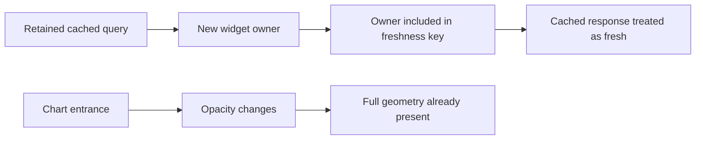
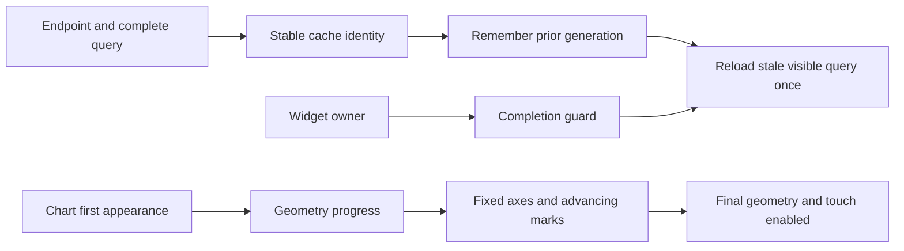
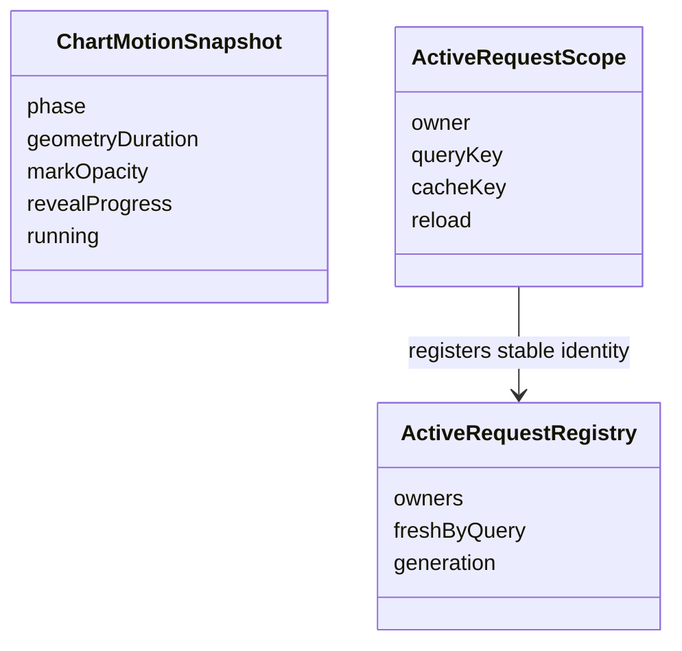

# AnalyticTracker Remaining Work Implementation Plan

> **For Gemini:** Execute inline, task by task, using `executing-plans`. Project rules prohibit `subagent-driven-development`; no agent dispatch is requested. Read this file and its linked specs before editing. Checkbox steps are execution tracking, not evidence that work has passed.

**Goal:** Finish remaining dashboard defects, graph and page motion, acceptance coverage, Windows delivery evidence, and documented team/deployment prerequisites without losing existing functions or overstating completion.

**Architecture:** Keep Flutter/Riverpod presentation, Dart shelf HTTP/MCP, SQLite storage, and server statistical kernels. Separate widget-owner lifecycle from stable cached-request identity. Give chart entrance a geometry progress channel while preserving full-data domains and existing update transitions. Confirm already committed repairs before changing them.

**Tech Stack:** Flutter/Dart, flutter_riverpod, fl_chart, shelf, SQLite, BigQuery daily export, dart_mcp, package:http. Retain pinned dependencies; no framework rewrite.

**Spec:** `analytics-studio-ui-design.md` sections 5–9; `analytics-studio-waves0-6-fix-implementation.md` contracts and regression appendices; `analytics-studio-ui-wave6-implementation.md` Task17; `mcp-server-design.md` section7; `../../docs/run-local.md`. Canonical status: `../memory/mem-known-bugs-index.md`. Latest review: `../../docs/reviews/2026-10-13-completed-repair-review.md`.

## Global Constraints

- Planning anchor: `feature/wave5-analytics-studio`, HEAD `3bd2787dddb2822338dc5d60e86a2d3aa1d0ac96`, inspected 2026-10-14. Reinspect checkout before execution. Do not reset, stash, stage, or discard owner/Gemini work automatically.
- Existing dirty files are memory documents; untracked files include handoff, final review, and diagnostic probe. Preserve all of them. Historical reviews are immutable evidence.
- Navigation: sidebar at 1200+, rail at 900–1199, drawer below900. Retain page element identity across breakpoints.
- Existing approved motion: navigation180ms, tabs200ms, expansion220ms, chart entrance400ms, chart updates350ms, theme200ms, hover120ms.
- Chart first appearance: reveal line/bar/area once, no loop. Reduced motion or inactive `TickerMode`: immediate final state. Hide/revisit, theme, resize, sorting and tooltip changes must not replay chart entrance.
- Preserve four palettes, all existing pages, six Analytic tabs, all24 MCP tools, weekly_insights prompt, importer and funnel modes.
- Preserve statistical oracles, ten-player support rules, player-level bootstrap and current model meanings. Valid insufficient-sample reasons are successful responses, not bugs.
- No synthetic imports into owner's database. Test fixtures use isolated stores/HTTP mocks. IAM permissions and device availability are external prerequisites, never invented PASS.
- Completion has two explicit gates: Windows dashboard accepted; team/cross-platform operation accepted. A remaining external gate prevents claiming the entire cross-platform team project complete.
- Task commits contain only task-owned paths. No `git add .`, implicit merge or push. Report exact base/head and commands.

## Review Focus

| Input or interruption | Expected behavior | Owning task |
|---|---|---|
| Cached A, then B, refresh elsewhere, recreate A owner | A reloads once using stable identity; unrelated endpoint cannot bless A |2|
| Gap, negative bar, singleton, step curve, partial data during reveal | Fixed axes, no fake gap bridge, correct baseline, final geometry exact |3–4|
| Rapid page/tab change plus live reduced motion | Visible target, navigation provider and refresh ownership agree; retained state/focus safe |5|
| Held visible detail request followed by error/server change | No premature success; old completion cannot update new scope feedback |6|
| Large/bold text plus CSV/partial marker | Full glyphs and columns, literal CSV bytes, actual partial mark, not merely date text |1,7|

## Current and Target Flows







## Complete Open Ledger Inventory

All17 non-resolved/non-rejected records at anchor are covered. A CONFIRMED row can contain stale historical wording: source and relevant fresh evidence decide whether repair or reconciliation is needed.

| ID | Actual remaining action | Task |
|---|---|---|
|0005|Runtime tooltip contrast in all four styles|8|
|0006|Runtime integer formatting|8|
|0007|Runtime Test devices toggle against observed debug data|8|
|0008|Runtime two-condition AND Funnel editor/persistence/run|8|
|0009|Runtime1440 six-KPI row|8|
|0010|Explicit local-only boundary and optional authenticated team delivery|10–11|
|0011|Runtime empty-parameter hint|8|
|0026|Confirm committed bold numeric measurement and final-column rendering|1|
|0038|Implement missing geometry reveal; confirm expansion interruption repair|3–5|
|0039|Confirm committed axis alignment and complete ranked names|1|
|0047|Confirm loading wins over prior-scope errors|1|
|0048|Confirm old tooltip selections clear on revision|1,4|
|0049|Confirm actual partial rod styles and legend treatment|1,7|
|0050|Preserve/restore Wave2 evidence and add accurate current record|9|
|0053|Fix recreated scope freshness and maintain endpoint separation|2|
|0060|Complete exact lifecycle/HTTP/rendered acceptance|2,5–7|
|0061|Confirm historical report restoration, then append new evidence|9|

Resolved0033–0037,0051–0052,0054–0059,0062–0064 and server0012–0020 remain regression constraints. Do not reopen solely because an obsolete archived assertion fails. In particular old tooltip probes require retained selection, whereas approved repair clears selection on measured revision.

## File Structure and Execution Order

| Task | Files and responsibility |
|---|---|
|1|Existing `app/test/studio_table_test.dart`, `studio_async_panel_test.dart`, `studio_charts_test.dart`, `chart_axis_layout_test.dart`; confirm prior fixes using real renderer/font evidence|
|2|`app/lib/src/state/refresh.dart`, page/screen/shell request registrations, `active_refresh_test.dart`, `refresh_endpoint_identity_test.dart`; stable freshness|
|3|`app/lib/src/widgets/charts/chart_motion.dart`; create `chart_reveal.dart`, `app/test/chart_reveal_test.dart`; entrance lifecycle and geometry kernels|
|4|`time_series_chart.dart`, `ranked_bar_chart.dart`, `diverging_bar_chart.dart`, `app/lib/src/pages/analytic/{levels_tab,survival_tab}.dart`; connect reveal to actual marks|
|5|`app/lib/src/shell/page_stage.dart`, `app/lib/src/pages/analytic/analytic_page.dart`, `app/lib/src/widgets/studio_animated_size.dart`; tests in `studio_navigation_test.dart`, `page_stage_test.dart`, `studio_charts_test.dart`|
|6|`app/test/studio_http_acceptance_test.dart`, existing provider/scope fixtures; real API ownership and completion|
|7|`app/test/studio_visual_matrix_test.dart`, support fixtures; exact export and rendered interactions|
|8|Current Windows build and recorded15 walkthroughs, report only unless a reproduced bug is assigned|
|9|Ledger, cumulative/historical verification documents and handoff; evidence and closure|
|10|`docs/run-local.md`, server pull tooling/config examples; automation and platform prerequisite checklist|
|11|Separate team-readiness work package: API auth, app/MCP token transport and team runtime checks|

Dependencies: 1 before2; 3 before4; 2+4 before5–7; 5–7 before8; 8 before9. Task10 can document external prerequisites without waiting for runtime; Task11 is separate deployment gate. Do not repeat the old cumulative T1–T11 production implementation unless Task1 proves a remaining failure.

## Command Contract

Run commands separately from stated directory; record each exit. Use installed real executables to avoid Windows batch bootstrap locks.

```powershell
# cwd app; replace test path with the exact owning file named in each task
& 'D:\flutter\bin\cache\dart-sdk\bin\dart.exe' 'D:\flutter\bin\cache\flutter_tools.snapshot' test --no-pub --reporter expanded test/studio_charts_test.dart
& 'D:\flutter\bin\cache\dart-sdk\bin\dart.exe' 'D:\flutter\bin\cache\flutter_tools.snapshot' analyze --no-pub
# cwd shared or server
& 'D:\flutter\bin\cache\dart-sdk\bin\dart.exe' analyze
& 'D:\flutter\bin\cache\dart-sdk\bin\dart.exe' test --reporter expanded
```

Use bounded `pump` while a deliberate HTTP completer is held. Do not `pumpAndSettle` unresolved network/animation activity. Complete every completer in teardown. If a runner stalls, inspect its output, elapsed time and specific process tree; never kill all Dart or IDE processes or copy historical PIDs.

### Task 1: Reconcile Existing Repairs Against Current Behavior

**Files:** tests listed in file map; production owners `studio_table.dart`, `studio_async_panel.dart`, `charts/time_series_chart.dart`, `charts/chart_axis_layout.dart`. Source of complete independent fixtures: old cumulative plan Appendices A/D and dated review probes.

**Interfaces:** Consume existing widget APIs and renderer measurement helpers. Produce evidence rows for0026/0039/0047/0048/0049, not new widget APIs.

- [ ] Record `git status --short --branch`, `git rev-parse HEAD`, `git diff --stat`; list owner artifacts separately from own work.
- [ ] Read old cumulative Tasks2–7 and their COMPLETE regression code. Run existing owning tests before making edits. Port missing cases only, keeping original oracles and bundled regular/bold fonts. Existing green behavior must be recorded GREEN AT START, not fabricated RED.
- [ ] Add/retain new-server previous-error case using `AsyncLoading.copyWithPrevious(AsyncError(...))`; new query must show loading, never old error. Same-query failed refresh keeps prior successful data with error/retry state.
- [ ] Measure actual sparse group centers and selected-series rod centers against rendered date labels within0.5 logical pixel; use two series plus missing bucket, width320, scale1.5. A calculation-only test is insufficient.
- [ ] Check numeric `RenderParagraph` and wrapped headings at width320/720, text1.5, bold on, all styles; scroll final columns. `didExceedMaxLines` false and paragraph within its cell are required.
- [ ] Activate line and bar tooltips, change measured values10 to20 with same topology: indicators become empty immediately; exit/cancel clears them. Mouse re-entry selects current20. Preserve chart key.
- [ ] Equal complete/partial bar values must produce different actual rod border/opacity/pattern and corresponding legend sample; no artificial zero bucket.
- [ ] If a case fails, use old task's literal implementation kernel, minimal owning change, RED then GREEN. Run owning file, analyzer and full app suite after production edits. If all pass, make evidence-only commit with exact source/command references; defer ledger closure to9.

### Task 2: Stable Request Identity Across Owner Recreation

**Files:** `app/lib/src/state/refresh.dart`; existing registrations in pages, screens, `shell/app_shell.dart`, `widgets/funnel_drilldown_panel.dart`; `app/test/active_refresh_test.dart`, `refresh_endpoint_identity_test.dart`. Complete integration reproducer: `docs/reviews/2026-10-13-completed-repair-review-probe_test.dart`.

**Interfaces:** Keep `register`, `remove`, `reload`, `reloadOwnerIfStale`, `RefreshResult` signatures. `cacheKey` denotes cached request, owner denotes live registration. Both registry and scope must resolve identity identically.

- [ ] Port default-identity stale-remount repro into permanent discovery with production Events provider and retained ProviderContainer; expected count2, stable-control count2. Keep diagnostic history unchanged.
- [ ] Add this registry regression inside existing main:

```dart
test('removed cached query remains stale for replacement owner', () async {
  final r = ActiveRequestRegistry();
  final a = Object(), other = Object(), replacement = Object();
  var calls = 0;
  Future<RefreshResult> load() async {
    calls++;
    return const RefreshResult();
  }
  r.register(page: AppPage.events, owner: a,
    queryKey: ('events', 'server', 'A'), reload: load);
  r.remove(a);
  r.register(page: AppPage.overview, owner: other,
    queryKey: ('overview', 'server'),
    reload: () async => const RefreshResult());
  await r.reload(AppPage.overview, analyticTab: 0);
  r.register(page: AppPage.events, owner: replacement,
    queryKey: ('events', 'server', 'A'), reload: load);
  await r.reloadOwnerIfStale(replacement);
  await r.reloadOwnerIfStale(replacement);
  expect(calls, 1);
});
```

- [ ] Run `active_refresh_test.dart`; expected regression RED because current default includes owner.
- [ ] Implement default registry identity `cacheKey ?? (page, analyticTab, queryKey)` matching `_resolvedCacheKey`. Preserve `_freshByQuery` across `remove`; clear on registry disposal. Keep `identical(_owners[owner], entry)` and query/cache completion guards, generation monotonicity, coalescing and error behavior.
- [ ] Audit every request owner. Distinct endpoint requests get explicit stable tags. Survival/Version Impact and shared filter-options keys stay. Tag Funnel definitions/run/players/timeline and Parameters keys/distribution explicitly, including baseUrl and complete typed query. Never use only a page name or a list's object identity.
- [ ] Rewrite endpoint test to use `cacheKey: ('survival', query)` and `cacheKey: ('versionImpact', query)`; successful Survival cannot mark failed impact fresh. Different owners alone no longer distinguish endpoints.
- [ ] Add actual cached A/B/A provider reuse; fresh initial unseen query must not double-fetch; known stale query reloads once. Dispose scope while retaining container/cache, refresh unrelated page, recreate: count1 becomes2. Queue stale activation then remove/switch query before frame: zero requests for canceled identity. Old completion after owner replacement returns superseded and cannot mark replacement fresh.
- [ ] Run active refresh, endpoint identity, Events provider and HTTP tests; app analyzer/full suite. Commit only owning paths: `fix(refresh): retain stable cached request freshness across scope recreation`.

### Task 3: Geometry Reveal Kernel and Motion Lifecycle

**Files:** modify `app/lib/src/widgets/charts/chart_motion.dart`; create `app/lib/src/widgets/charts/chart_reveal.dart`, `app/test/chart_reveal_test.dart`; extend `studio_charts_test.dart`.

**Interfaces:** Add `final double revealProgress` to `ChartMotionSnapshot`, default1 in all settled/fallback/update/topology snapshots. Entrance progress uses eased controller value0..1. Keep `geometryDuration`, `markOpacity`, `running`, phases and400/350 timings. Kernel:

```dart
double revealValue(double baseline, double target, double progress) =>
    baseline + (target - baseline) * progress.clamp(0.0, 1.0);
```

Line draw uses a plot-only clip, not modified metric values. Create this clipper in `chart_reveal.dart` with `import 'package:flutter/rendering.dart';`:

```dart
class ChartRevealClip extends CustomClipper<Rect> {
  const ChartRevealClip({required this.progress, required this.plot});
  final double progress;
  final Rect plot;
  @override
  Rect getClip(Size size) => Rect.fromLTRB(
    plot.left, plot.top,
    plot.left + plot.width * progress.clamp(0.0, 1.0), plot.bottom);
  @override
  bool shouldReclip(ChartRevealClip oldClipper) =>
    oldClipper.progress != progress || oldClipper.plot != plot;
}
```

Labels/grid/frame stay outside clip; pointer disabled during reveal. Use a Stack: static axes/grid chart with transparent marks plus foreground chart with identical fixed bounds/layout, clipped to the SAME measured plot rectangle. Foreground retains identical title reserved sizes and label layout callbacks but paints their content transparent; setting titles.show=false would shift geometry and is prohibited. Hide foreground grid/border and exclude its semantics. Do not clip complete frame or duplicate legends. The foreground shares original values, step shape, missing segments and area configuration. Derive plot rectangle from existing renderer `chartVirtualRect`/axis measurement helpers, not guessed padding.

- [ ] Add exact kernel RED tests with imports for `chart_reveal.dart`:

```dart
test('growth preserves signed baseline and final target', () {
  expect(revealValue(0, 10, 0), 0);
  expect(revealValue(0, 10, .5), 5);
  expect(revealValue(0, -8, .5), -4);
  expect(revealValue(2, 10, .5), 6);
  expect(revealValue(0, 10, 1), 10);
});
```

- [ ] Add plot clip tests for Rect.fromLTWH(44,12,200,100): progress0 width0; .5 left44/right144;1 right244. Negative/above1 progress clamps. Empty plot yields empty clip. Add widget test to capture snapshot0, intermediate, final with bounded pumps; current snapshot has no progress and fails compilation until interface producer added, then run behavioral RED before wiring geometry.
- [ ] Add snapshot field and controller handling. Entrance400ms progresses geometry; opacity may remain1 to avoid hiding draw. Same-topology updates retain350ms geometry transition, revealProgress1. Topology replacement keeps existing350ms fade with final geometry rather than replaying first entrance.
- [ ] Live reduced-motion, accessibleNavigation, or inactive ticker consumes entrance and sets final1, running false, zero geometryDuration. Restoring policy/visibility does not replay. Theme/resize no restart. Do not run setState recursively from controller status during build; listener lifecycle must be safe on disposal.
- [ ] When data arrives/changes before entrance completes, use newest data immediately with fixed newest bounds; continue entrance once or snap on policy change. Never show stale tooltip. Document this tested contract.
- [ ] Run new kernel plus motion/studio chart tests, analyzer. Commit `feat(charts): expose one-time geometry reveal progress`.

### Task 4: Connect Reveal to Every Approved Chart Variant

**Files:** chart renderers and Levels/Survival files from map; `app/test/studio_charts_test.dart`, `analytic_studio_levels_survival_test.dart`.

**Interfaces:** Consume Task3 snapshot/kernel. No statistical/provider changes. Bounds/domain/slot identities computed from FULL data for every frame. Keep complete data accessible through table and semantics.

- [ ] Write actual renderer tests at entrance start,200ms,450ms for time-series line/area/bars, ranked and diverging bars, raw Levels bars/lines and Survival central curves/CI. Test singleton, missing bucket, partial bucket, negative diverging value, percentage domain0..1 and fifth repeated-color series.
- [ ] For bars use `revealValue(fromY, targetY, motion.revealProgress)` only on rendered rod target; domain uses original targets. Ranked/diverging width target multiplied by revealProgress during entrance; entrance geometry animation duration0 because progress drives frames. Settled update uses existing350ms tween. No whole-card ScaleTransition.
- [ ] Use Task3 plot-only clip for line and area marks including Survival confidence bands. Preserve gaps, step discontinuities, dash patterns and singleton dots. Ensure static and foreground layers use identical plot geometry; one semantic representation and one touch layer only. At progress1 remove extra static layer if needed without remounting stateful chart selection owner.
- [ ] Raw Levels and Survival `ChartMotion` children consume geometry progress; switching datasets must not recreate controllers by value-based keys. Heatmap retains its approved emphasis/opacity behavior, no invented line draw; Funnel's legacy metrics adapter must be inspected because it feeds time-series charts.
- [ ] Assert start bars zero, midpoint strictly between baseline/target, final original target; rendered plot clip width strictly increases while axes positions remain within0.5px. Assert update10→20 is interpolating over350ms with revealProgress1. Do not prove draw using only `FadeTransition.opacity` or snapshot fields.
- [ ] Add actual pointer interaction blocked during running and enabled settled. Fresh hover after update anchors at current value. Hide midway then restore: final geometry, zero restart. All four palettes preserve actual partial and repeated-series mark styles.
- [ ] Run chart/Levels/Survival tests plus app analyzer/full suite. Commit `feat(charts): draw lines and grow bars on first appearance`.

### Task 5: Page, Tab, and Expansion Interruption Acceptance

**Files:** page_stage/analytic_page/studio_animated_size and existing navigation/chart tests.

**Interfaces:** Preserve selectedPageProvider, analyticTabIndexProvider, PageStorageKey identities and200ms TabController coordination. Current StudioAnimatedSize already bypasses AnimatedSize when motion forbidden; retain its GlobalKey child identity.

- [ ] Port original BUG0056/0059 and expansion interruption probes as permanent tests. Current repairs may pass immediately: record GREEN AT START. Do not reinstall old AnimatedSize duration0-only workaround.
- [ ] First shell page immediately visible; incoming visited/unvisited page reaches opacity1/offset0 within180ms. Reduced motion first page and later page start at1/zero, without extra frame animation.
- [ ] Test A→B→C→A with50ms pumps: only A interactive/semantic/focusable; retained search, selected rows, scroll and provider call count unchanged except required stale activation. Hidden controllers settle rather than run catch-up on reentry.
- [ ] Test analytic animateTo4,50ms, toggle each reduced-motion flag separately: controller index4, provider4, Associations visible, active refresh hits Associations exactly once and no previous tab. Test4→5 interruption and URL/filter changes while pending; no multiple-ticker exception or stale feedback.
- [ ] Test expansion in Churn and Anomalies: toggle open,60ms, set each flag; render size immediately equals child's final size, no RenderAnimatedSize.isAnimating. Child editor/focus state retained. Repeat expanded child changes while reduced; restore policy causes no replay. Also hide during expansion with TickerMode false.
- [ ] Production changes only for reproduced failing cases. Use existing motion policy durations and current controller listener synchronization; do not remount page/provider trees to achieve animation. Run navigation, page_stage, chart tests, analyzer/full app suite. Commit `test(motion): prove page tab and expansion interruption contracts` (use fix prefix only if production changed).

### Task 6: Exact Production HTTP and Provider Completion

**Files:** `app/test/studio_http_acceptance_test.dart`; production owners only when new failing acceptance proves defect.

**Interfaces:** Real ApiClient + MockClient + real ProviderContainer/AppShell; retain typed queries and existing fixture JSON. Never override the producer with serialized fake awaits to simulate a race.

- [ ] For displayed Funnel players list, hold second `/funnels/players` response after initial successful detail open; refresh spinner remains, no success toast until it completes. Success renders revised list. Repeat HTTP500: failure feedback, old list marked retained, no success. Repeat independently for displayed `/players/events` timeline. Close detail while pending: old result cannot report success on new visible scope.
- [ ] Capture every request URI/method/body. Weekly Trend `/funnels/run` POST carries `def`, flattened `from`/`to`/optional `platform`/`version`/`test`, `interval: 'week'`, and `breakdown` JSON. This endpoint has NO segment argument in current ApiClient; do not invent one. Segment selection is represented in returned segmented Trend data; exact `segment` belongs to `/funnels/players`, together with `step`, `outcome`, `limit`, `def`, filters and optional `breakdown`. Assert complete decoded body equality against independent fixture literals, not the captured request or production body builder. Hold response so completion belongs to visible Trend request; changing interval while pending supersedes old result.
- [ ] Extend Events reverse-order test: current10, previous5, change100%, exact current/previous from/to ranges and scope label. Hold each count response in both orders; current label cannot borrow previous coverage. Assert exact missing/partial warning content from explicit `/days` fixture.
- [ ] Cover server A→B while A refresh held, then A completes success/error: B owns displayed data and feedback; no A toast. Filters/query change while held yields superseded result. Reuse Task2 production A/B/A and remount scenarios at provider/HTTP boundary; assert literal call counts before/after frames.
- [ ] Use held MockClient pattern, already available imports/classes:

```dart
final pending = Completer<http.Response>();
addTearDown(() {
  if (!pending.isCompleted) pending.complete(http.Response('[]', 200));
});
// Route handler returns pending.future only for the exact second visible request.
// While held, use bounded pump; resolve before pumpAndSettle.
await t.pump(const Duration(milliseconds: 50));
expect(find.textContaining('Refreshed'), findsNothing);
pending.complete(http.Response(jsonEncode({'error': 'held failure'}), 500));
await t.pumpAndSettle();
expect(find.textContaining('Refreshed'), findsNothing);
```

- [ ] Add exact failure message assertions using existing shell page copy; assert visible stale content and actual request count. Do not let generic absence of success be the only assertion.
- [ ] Run HTTP and original repair acceptance tests, active refresh tests, analyzer/full suite. Commit `test(refresh): complete visible request HTTP lifecycle acceptance`.

### Task 7: Literal CSV and Rendered Matrix Acceptance

**Files:** `app/test/studio_visual_matrix_test.dart`, `support/studio_matrix_fixtures.dart`, existing text assertions; FunnelTrendView only if acceptance reveals defect.

**Interfaces:** Keep fixture players[6,3]/[4,2], conversion0.5, partial second bucket; all4 styles × widths720/1024/1440 × scales1/1.5. No changing fixture to dodge narrow layout.

- [ ] Replace contains-only export checks with full literal bytes. Current `shared/lib/src/csv.dart` uses CRLF between rows and NO terminal newline. Exact expected for current matrix fixture is:

```dart
expect(clipboard?.text,
  'Start,Step 1,Step 2,Total conversion,Incomplete\r\n'
  '2026-09-28,6,3,50%,false\r\n'
  '2026-10-05,4,2,50%,true');
```

- [ ] Retain CSV unit regression for CRLF/no terminal newline; add quoted comma, doubled quote and embedded newline cells where missing. Never build expected CSV by calling production serializer or normalize away bytes.
- [ ] Inspect actual partial marker widget and its plot geometry/style for second bucket; assert marker/legend visible and different from complete first bucket. A date string alone is not marker evidence.
- [ ] Keep full long-name selector/menu, Edit, AND parameter, Segment, players, timeline, Trend/Week, Copy CSV, Retry and last-column interactions. Hit-test control centers after scrolling their owning Scrollable; ensureVisible with offscreen target is not proof. Use bounded scroll steps and fail with diagnostic rect, not endless pump loops.
- [ ] Add rendered graph entrance observations separately from reduced-motion matrix (Task4). Matrix otherwise snaps animation for stable layout; it cannot substitute for motion tests.
- [ ] Run full matrix to completion, HTTP acceptance, analyzer/full suite. Commit `test(studio): assert exact CSV and actual partial markers`.

### Task 8: Fresh Windows Runtime and Baseline Verification

**Files:** append `.cursor/plans/analytics-studio-waves0-6-fix-verification.md`; evidence images under `docs/reviews/` with dated, descriptive filenames. No production edits without owning reproduced bug.

- [ ] Build current binary from app:

```powershell
& 'D:\flutter\bin\cache\dart-sdk\bin\dart.exe' 'D:\flutter\bin\cache\flutter_tools.snapshot' build windows --release --no-pub
```

- [ ] Record command exit/head, executable and app.so path/timestamp/length. Native executable timestamp may be older than changed Dart app.so. Identify current server listener by current process evidence; inspect `/days`, available range and seven analysis routes. No blanket process kill/restart or imports.
- [ ] Execute all15 Wave6 Task17D walkthrough rows using fresh binary. Include four themes,720/1024/1440 widths, text1/1.5, mouse hover, keyboard traversal, resizing, wheel scroll, empty/error/retry states, data refresh and legitimate insufficient sample.
- [ ] Add motion walkthrough: capture entrance start/mid/end or short video showing line draw/bar grow; page180ms, tab200ms coordinated transition; navigate rapidly during animation; change OS reduced motion while running; verify immediate final geometry and correct active refresh.
- [ ] Verify0005/0006 tooltip contrast and integer counts in all styles;0009 six KPI row at1440 logical pixels;0008 editor two AND parameters save/reload/run;0007 debug on/off observed numeric difference;0011 chosen event with no params shows specific hint and test-device guidance.
- [ ] For each observation record fixture/source, dimensions, flags, expected/actual, screenshot and head. Missing native automation, unavailable debug data or missing device is PENDING with exact manual action, never PASS inferred from widgets. Runtime failures receive next unused BUG ID and owning regression before repair.
- [ ] Commit runtime report only after recorded observations; unavailable steps stay unchecked with reason and owner prerequisite.

### Task 9: Evidence, Ledger and Final Dashboard Delivery

**Files:** ledger, both verification files, memory index/handoff, current review artifacts when deliberately owned.

- [ ] Preserve previous R1–R4/Wave2/Wave6 report sections. Compare historical report with Git history; append dated current record. Old task RED evidence unavailable means NOT RECORDED, never reconstructed from commit titles. This closes0050/0061 only when actual history and current task evidence are present.
- [ ] Run shared analyze/test; server analyze/test; app analyze/full test; `git diff --check`. Record separate exits and actual counts. Historical733 is not current proof.
- [ ] Reconcile every inventory row: owning tests/commit + runtime criterion + residual.0038 closes only after actual reveal AND interruption acceptance;0053 stable remount and endpoint separation;0060 exact HTTP/lifecycle/matrix coverage. Baseline VERIFY_PENDING closes only after Task8 real observation. Resolved regression records remain preserved.
- [ ] Validate unique IDs and10-column ledger schema; no skipped old open IDs. Amend0064 resolution text to describe stable endpoint identity rather than now-removed owner identity.
- [ ] Read full final diff against approved spec; provide explicit review range and unresolved/external gates. User's Gemini execution method is already selected; no request to choose subagent execution. Obtain final independent review through owner's requested review workflow when available, without pretending a review was delivered.
- [ ] Commit task-owned evidence with `docs: reconcile remaining dashboard acceptance and bug evidence`. Update memory START HERE with actual reviewed head/status and pointer to this plan, without claiming unavailable checks passed.

### Task 10: Data Automation and Platform Completion Prerequisites

**Files:** `docs/run-local.md`, `server/config.example.json`, `server/tools/register-pull-task.ps1`, `server/tools/pull.cmd`, `server/test/pull_test.dart` if a proven defect requires repair. Do not modify live config, secrets, firewall or scheduled task merely to prepare a plan.

**Interfaces:** Keep existing pull config, exit0 success/1 partial/2 config-auth abort, recent-day replacement and import dry-run behavior. External IAM operator supplies access; existing script remains scheduling interface.

- [ ] Inventory current config without displaying secrets, current scheduled-task presence/status and last pull log. Treat memory's403 as historical until fresh diagnostic. Read script before executing; document actual task name and trigger09:00.
- [ ] Owner/cloud operator supplies dedicated BigQuery Data Viewer + BigQuery Job User access and correct dataset/location; diagnose with read-only SELECT1 and daily-table listing. If denied, document exact error/redacted principal and manual export fallback. No service-account key copied into tracked artifacts.
- [ ] After access exists, run current pull against approved real interval, verify row replacement/no duplicates and recent late-event re-pull using isolated tests before real mutation. Daily task registration is explicit deployment action after concrete script/config review, preserving previous task if replacing.
- [ ] Record backup/restore drill against COPY of SQLite database, never production destructive restore. Preserve WAL/SHM consistency using stopped writer or SQLite backup API.
- [ ] Define platform matrix: Windows release accepted in8; Web build and authenticated CORS runtime; Android device release build and LAN connectivity; iOS requires macOS/Xcode/signing/device. Execute available builds; unavailable platforms retain exact prerequisite and PENDING. Do not declare iOS complete from a Windows Flutter analyzer.
- [ ] Append actual route/tool contract inventory and release steps to run-local; new external failures get ledger entries only when observed. Commit `docs(delivery): record data automation and platform readiness gates`.

### Task 11: Authenticated Team Operation — Separate Deployment Gate

BUG0010 was explicitly deferred for single-PC use. This plan includes concrete work to finish team readiness, but execution of this package requires review of this proposed token/session policy; do not silently override prior owner deferral. Dashboard Tasks1–9 can complete independently. Until this gate passes, serve loopback only and do not claim LAN/team readiness.

**Files:** create `server/lib/src/api_auth.dart`, `server/test/api_auth_test.dart`; modify `server/bin/server.dart`, `server/lib/src/api.dart`, `server/bin/mcp.dart`, `server/lib/src/mcp_tools.dart`; modify `app/lib/src/api_client.dart`, `app/lib/src/providers.dart`, `app/lib/src/screens/settings_screen.dart`; create client/token transport tests and update run-local/config examples. Export helper only if needed through `server/lib/analytic_server.dart`.

**Proposed interfaces:** `Middleware requireApiToken(String token)`; `buildHandler(EventStore store, {String? apiToken})`; `ApiClient(String baseUrl, {http.Client? client, String? apiToken})`; `AnalyticTools(String baseUrl, http.Client client, {String? apiToken})`. Server/MCP token from `ANALYTICTRACKER_API_TOKEN` environment, never command line or logged. App session-only token through `StateProvider<String?> apiTokenProvider`; masked Settings field, no SharedPreferences persistence or extra storage dependency. Clearing token/restarting app requires entry again. Token changes recreate/close ApiClient and reset refresh/cache provenance; do not retain another credential's data under unchanged URL identity.

- [ ] Write shelf middleware test using a local handler counter: missing/wrong token returns JSON401, zero handler invocations; exact header `authorization: Bearer <token>` passes; OPTIONS preflight bypasses auth but exposes no data. Token never in response/error/log. Local config blank token means loopback binding, configured token enables explicit LAN operation.
- [ ] Implement middleware:

```dart
Middleware requireApiToken(String token) => (inner) => (request) async {
  if (request.method == 'OPTIONS') return inner(request);
  if (request.headers['authorization'] != 'Bearer $token') {
    return Response(401, body: '{"error":"Unauthorized"}',
      headers: {'content-type': 'application/json'});
  }
  return inner(request);
};
```

- [ ] Keep CORS outermost; append authorization to allowed request headers; rejected401 receives CORS headers. Reject nonblank malformed token configuration rather than accidentally falling back to public LAN. Server binds loopback when token absent. Tokens are opaque high-entropy generated outside logs; no default shared token committed.
- [ ] Add optional token to all ApiClient method headers including GET/DELETE; MCP sets on `http.Request` before `_http.send`. Keep content-type and existing errors/timeouts. Test GET/POST/PUT/DELETE via MockClient and all24 MCP tool registration remains intact. Missing/wrong token surfaces Unauthorized, no repeated silent retry or success toast.
- [ ] Settings provides masked session token entry, Save/Clear, no echo in snackbar. Credential change closes old client, resets cache ownership and suppresses pending old-credential feedback. Include explicit auth generation in stable request/provenance identities or recreate ProviderScope cache boundary WITHOUT remounting merely for page animation.
- [ ] Test unauthorized import/save/delete never mutates isolated EventStore; correct token permits approved operations. Test Web OPTIONS and actual authorized request; local-only default still supports local dashboard/MCP.
- [ ] Run server/app gates and authenticated loopback runtime, then explicit authorized LAN/device checks. Bearer token does not encrypt transport: team use across untrusted network requires HTTPS proxy/VPN provisioned by operator; leave that external gate visible.
- [ ] Commit `feat(auth): protect team API and carry session tokens through app and MCP`. Change0010 DEFERRED only when owner accepts this package and actual owning/runtime evidence satisfies team deployment boundary.

## Completion Checklist and Gemini Handoff

- [ ] All17 open IDs mapped to observed closure or explicit external/deferred gate; no stale-status batch closure.
- [ ] All existing functions remain covered: Overview/Retention/Progression/Funnels/Events/Parameters/Data health/Settings, six Analytic tabs, filters, saved funnels, drilldown/timeline, CSV/import/pull,24 MCP tools and prompt.
- [ ] Graph reveals visible geometry; page/tab/expansion transitions verified under interruption and reduced motion.
- [ ] Current binary matches recorded head; complete HTTP/rendered acceptance and gates recorded; full final review range supplied.
- [ ] If external checks remain, delivery wording is precisely Windows dashboard accepted with named remaining deployment checks, not whole project complete.

Execute Tasks1–9 first, preserving already-correct repairs. Task10 documents and validates available data/platform prerequisites. Review Task11 token/session proposal before enabling team access. Send each task's commit, exact red/green or GREEN AT START evidence, and residuals. Never use suite counts alone to close a behavioral requirement.

## Planner Self-Review

- Coverage: all17 currently open ledger IDs mapped; resolved motion/server fixes retained as regression constraints; data/IAM/platform/auth gates explicitly included.
- Source reconciliation: StudioAnimatedSize currently bypasses forbidden motion; Analytic controller publishes target index; these are confirmation work, whereas ChartMotion lacks geometry reveal and registry identity includes owner.
- Interface consistency: existing refresh methods retained; revealProgress produced in3 and consumed in4; proposed auth interfaces confined to separately reviewed team package.
- Evidence limits: no tests, build, UI walkthrough, IAM change, deployment or production implementation performed while writing this plan. Prior733 tests are historical evidence only.
