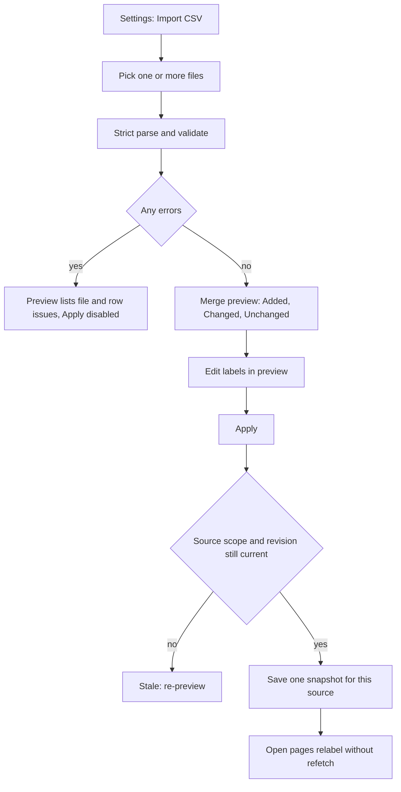

# Event vocabulary import

Readable event names are a local, display-only layer. Raw tracking IDs, API requests, counts, funnel JSON and exports never change.

## Flow

## Accepted CSV

| Header | Required | Meaning |
|---|---|---|
| `Event` | yes | Full event name, used for search |
| `Abbreviated Event` | yes | Raw tracking ID sent by the game |
| `Display Name` | no | English label shown in the app |
| `Description` | no | English meaning shown in event details |
| `Optional Mode B Template` | no | Contextual ID pattern such as `stg_{stage}`; unsupported patterns fall back to the raw ID with a warning |

Rules:
- Headers are matched after trimming, case-sensitive. A leading BOM and preamble rows before the header are tolerated.
- Quoted commas and newlines are supported.
- Blank `Event` or `Abbreviated Event` rows are rejected. Rows marked retired or merged are skipped with a warning.
- Limits: 5 MB total per import, 10,000 records.

## Merge and reimport

- Importing is additive: records you do not mention keep their current meaning, including FTU and tutorial entries.
- A later file or row for the same raw ID replaces that ID only. Conflicting duplicates inside one batch are errors.
- Omitted optional columns keep the previous value; present columns replace it.
- Import several files at once to check them against each other before anything is saved.

## Local scope

Each data source (server URL) keeps its own snapshot in local app storage. Importing for one source never changes another. The app does not upload vocabulary anywhere.

## Template, unknown events, restore

- **Download template** (Web: browser download, desktop: save dialog) or **Copy template** gives a ready header row and example.
- Events without a meaning show their raw ID unchanged. Search matches the raw ID, abbreviation, full name and label.
- **Restore defaults** (confirmed) writes an empty snapshot, returning to the bundled PetVsMonster meanings.

## Bundled baseline

`csv/event-labels.json` holds reviewed labels for the 60 aliases and 24 tutorial IDs in the three source CSVs. Regenerate with `dart run tool/generate_event_catalog.dart` from `app/`; `--check` verifies the generated source is current. Coverage: `.cursor/plans/event-vocabulary-baseline-coverage.md`.
