# Game Analytics Methods Handbook: Descriptive and Exploratory Analytics

**Family 1: Descriptive and Exploratory Research (Pilot Edition: M01–M08)**  
*Document Version:* 1.1.0-pilot  
*Date:* 19 October 2026  
*Status:* First Family Awaiting Owner Review  

---

## Handbook Purpose and Pilot Scope

This handbook provides a rigorous, teachable reference on player data analysis methods for game developers and analytics engineers. It bridges the gap between high-level metric definitions and practical, reproducible calculation.

### Pilot Status Note

This document is an active **pilot release** covering exclusively **Family 1: Descriptive and Exploratory Analytics (Methods M01 through M08)**. It serves as an editorial and technical template for the game team to review before subsequent families (M09 through M46, including statistical inference, machine learning, survival, paths, forecasting, causal inference and AI reporting) are developed. 

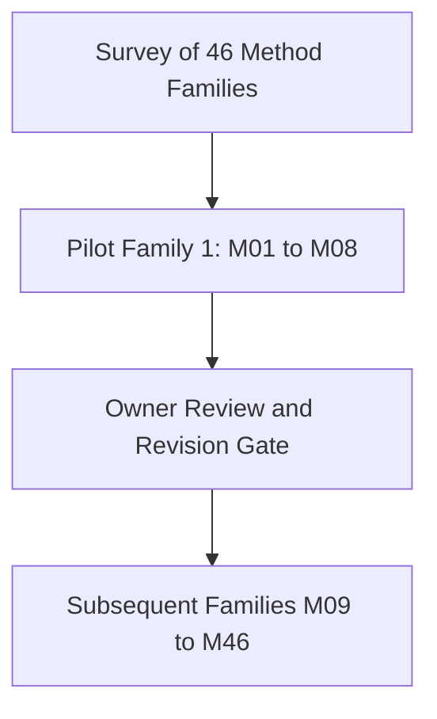

> **Out of Scope for This Pilot:** Methods M09 through M46 remain deferred pending owner review and approval of the pilot format. No empty headings or placeholder chapters are included for future families.

### What the Reader Should Know

- **Target Audience:** Game designers, programmers, and production analysts with basic coding literacy. No advanced background in formal probability or mathematical statistics is assumed.
- **Tone and Style:** Concepts are introduced from the perspective of concrete game design decisions. Mathematical notation is introduced explicitly before use.
- **Distinctions:** Throughout this handbook, general methodological definitions are strictly separated from vendor-specific conventions (e.g., Firebase, Amplitude, GameAnalytics), project synthetic conventions, current code behavior, and future recommendations.
- **Companion Documents:**
  - [Examples Appendix](game-analytics-methods-examples.md): Houses verified synthetic fixtures EX01 through EX09 and numerical oracles.
  - [Sources Register](game-analytics-methods-sources.md): Traces all technical claims to authoritative primary literature or vendor specifications.
  - [Verification Register](game-analytics-methods-verification.md): Logs reproduction commands, structural audits, known limitations, and owner review feedback.

---

## Table of Contents

- [Shared Foundations](#shared-foundations)
  - [Units of Analysis and Denominators](#units-of-analysis-and-denominators)
  - [Time Windows: UTC Calendar Day versus Rolling 24 Hours](#time-windows-utc-calendar-day-versus-rolling-24-hours)
  - [Cohorts and Opportunity Windows](#cohorts-and-opportunity-windows)
  - [Observed Zero versus Missing Coverage](#observed-zero-versus-missing-coverage)
  - [Fractions, Percentages, and Rounding](#fractions-percentages-and-rounding)
  - [Descriptive versus Causal Interpretations](#descriptive-versus-causal-interpretations)
- **Family 1: Descriptive and Exploratory Methods**
  - [M01 Metric Aggregation and Distributions](#m01-metric-aggregation-and-distributions)
  - [M02 Segmentation and Cohort Analysis](#m02-segmentation-and-cohort-analysis)
  - [M03 Retention and Stickiness](#m03-retention-and-stickiness)
  - [M04 Funnel and Conversion Analysis](#m04-funnel-and-conversion-analysis)
  - [M05 Session Analysis and Engagement Frequency](#m05-session-analysis-and-engagement-frequency)
  - [M06 RFM Scoring and Lifecycle Groups](#m06-rfm-scoring-and-lifecycle-groups)
  - [M07 Economy and Monetization Accounting](#m07-economy-and-monetization-accounting)
  - [M08 Spatial and Qualitative Analysis](#m08-spatial-and-qualitative-analysis)
- [Method Selection Matrix](#method-selection-matrix)
- [Owner Review Prompts](#owner-review-prompts)

---

## Shared Foundations

Before analyzing game data, developers must establish unambiguous accounting rules. Small confusions in denominators or time boundaries routinely produce wildly misleading metrics.

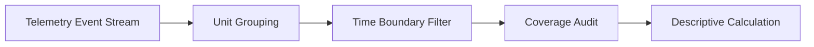

### Units of Analysis and Denominators

Counts and sums measure volume; medians and quantiles describe a distribution. Rates and averages additionally require a clearly defined denominator. Mixing analysis units changes the question being answered. The primary units used in game analytics are:

| Unit of Analysis | Concrete Definition | PetVsMonster Example | Why Mixing Fails |
|---|---|---|---|
| **Event** | An individual timestamped telemetry record emitted by the client or server. | A single `monster_killed` event at `14:02:05`. | 100 kills could be 100 players killing 1 monster, or 1 player killing 100. |
| **Player (User)** | A distinct tracked identity over an observation window; one pseudonymous ID need not equal one human. | Player ID `P01`. | Summing daily unique players across 7 days double-counts players active on multiple days. |
| **Player-Day** | A unique player active on a specific calendar day (a user-date tuple). | Player `P01` active on `2026-01-01`. | Normalizes daily volume without discarding cross-day persistence. |
| **Session** | A bounded continuous period of play, delimited by explicit start/end markers or inactivity timeouts. | Session `S101` lasting from `14:00` to `14:25`. | One player can log 5 sessions in a day; session averages do not represent player averages. |
| **Attempt (Match / Run)** | A single gameplay cycle with a distinct start, progression, and terminal outcome (win, loss, quit). | Battle against Boss in Wave 3. | Win rate must be wins divided by total attempts, not wins divided by players. |
| **Transaction** | A discrete record representing the transfer, grant, consumption, or purchase of currency/items. | Purchase of 500 Gold Coins for $4.99. | Gross transactions include duplicates and refunded operations. |
| **Visit** | An entry into a spatial zone, level boundary, or UI screen. | Entering the `ShopScreen` or entering `Dungeon_Cave_01`. | High visits to a trap room may reflect looping or backtracking, not unique player curiosity. |

### Time Windows: UTC Calendar Day versus Rolling 24 Hours

Time boundaries determine which events fall into daily metrics:

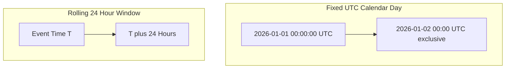

- **UTC Calendar Day:** Fixed from `00:00:00 UTC` inclusive to the next midnight exclusive. All players worldwide are grouped into the same calendar partition.
  - *Advantage:* Aligns cleanly with backend daily ETL runs, database partitions, and financial settlement.
  - *Limitation:* A single evening gaming session spanning midnight UTC is split into two calendar days.
- **Rolling 24-Hour Window:** Measured relative to a specific event or local time (e.g., from `T` to `T + 24 hours`).
  - *Advantage:* Captures continuous player experience and onboarding cycles accurately.
  - *Limitation:* Expensive to calculate across millions of players because each player has an independent time coordinate.

*Rule for this Handbook:* Unless explicitly stated otherwise (as in onboarding funnels or session gap models), all daily aggregates assume fixed **UTC Calendar Days**.

### Cohorts and Opportunity Windows

A **cohort** is a group of players sharing a common, timestamped milestone within a designated starting window (e.g., installing the game on January 1).

An **opportunity window** is the elapsed duration during which a cohort has had the opportunity to perform a target action. Comparing two cohorts with unequal opportunity windows creates artificial differences:
- A player who installed 30 days ago has had 30 days of opportunity to complete Level 10.
- A player who installed 2 days ago has had only 48 hours of opportunity.
- Reporting "Level 10 completion rate" across all registered users without fixing the opportunity window penalizes recent marketing bursts.

### Observed Zero versus Missing Coverage

A critical failure mode in telemetry analysis is treating unobserved data as non-engagement:

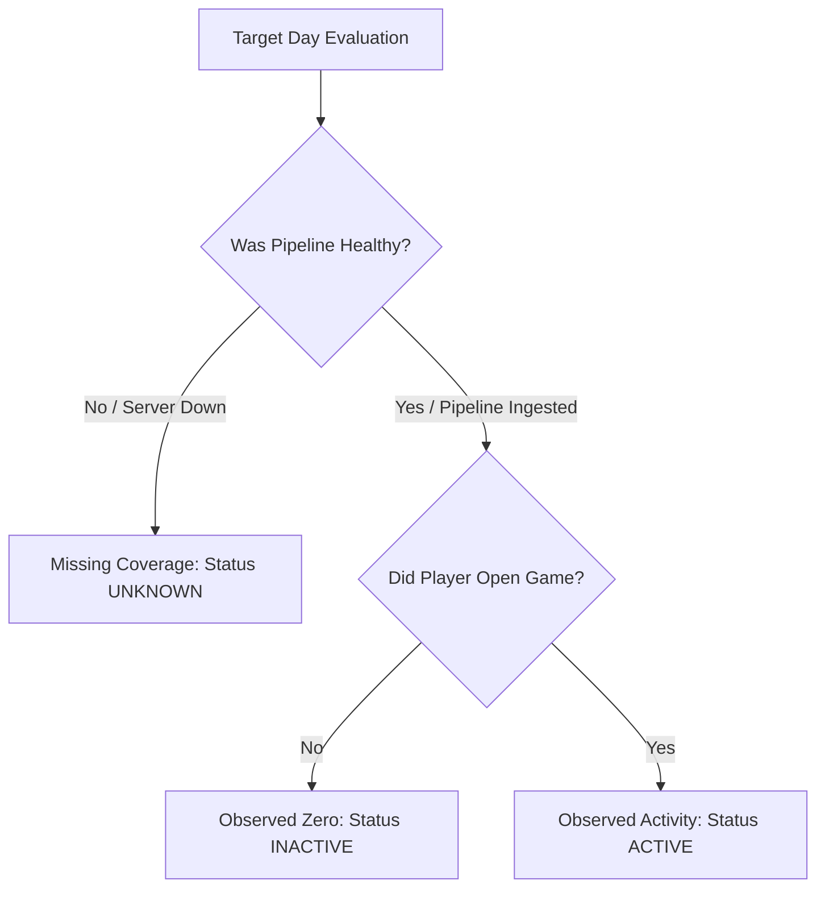

- **Observed Zero:** The telemetry pipeline was fully operational, events were ingested from the player base, but player `P` emitted 0 events on day `D`. No qualifying activity was observed for tracked identity `P` under those collection assumptions; this is not independent proof that the human did not play.
- **Missing Coverage (Unknown):** Telemetry ingestion failed, server logs were lost, or the target day has not yet occurred (immature cohort). The state of player `P` is **unknown**.
- *Consequence:* Imputing missing days as zeros artificially depresses retention, lifetime value, and engagement metrics.

### Fractions, Percentages, and Rounding

To ensure scientific reproducibility:
1. Retain exact rational fractions (e.g., $8/6$, $2/5$, $3/7$) during all intermediate arithmetic steps.
2. Present percentages formatted to two decimal places (e.g., $42.86\%$) unless exact integers.
3. Express currency in integer smallest units (cents) during internal calculation to eliminate floating-point representation drift, converting to dollars/decimals only at display.

### Descriptive versus Causal Interpretations

All methods in this pilot family (M01 through M08) are **descriptive and exploratory**:
- They summarize **what happened** in the observed sample.
- They do **not** prove **why it happened** or **what would happen if the game were modified**.
- *Example:* If players who buy the Frost Sword have a $75\%$ retention rate compared to $25\%$ for non-buyers, descriptive analysis establishes the correlation. It does **not** prove that granting everyone the Frost Sword will triple retention (a classic selection bias: highly engaged players are simply more willing to spend money).

---

## M01 Metric aggregation and distributions

### Question and intuition

> **Core Designer Question:** *"Did our latest game update increase player engagement for typical players, or did it merely push a handful of hardcore grinders to inflate our overall session counts?"*

When game teams look at a single high-level dashboard metric—such as total daily sessions or average playtime—they often mistake bulk activity for broad player enthusiasm. Total metrics aggregate all events into a single number, hiding the shape of player behavior. If 100 players log 1 session each (100 total sessions), the player base experience is completely different from a situation where 2 players log 50 sessions each while 98 players abandon the game immediately.

Metric aggregation and distribution analysis solves this by breaking summary numbers down into distinct units of analysis (events, players, sessions, and player-days) and displaying the spread of activity using medians, percentiles, and histograms. It allows designers to evaluate what the "typical" player experiences versus what extreme outliers contribute.

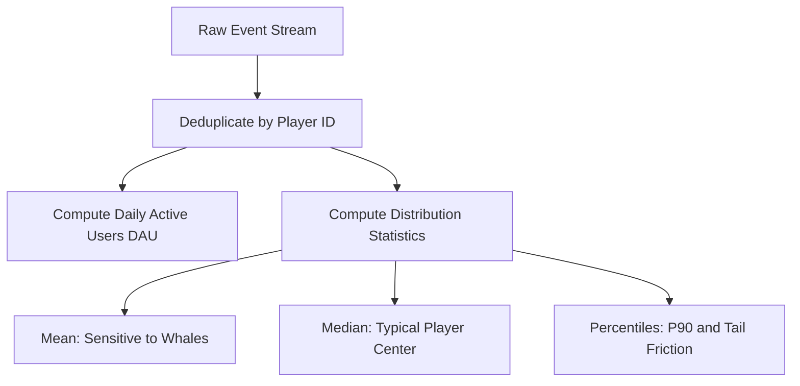

---

### Inputs and output

| Specification Dimension | Detail |
|---|---|
| **Input Telemetry** | Raw client or server events with verified fields: `user_pseudo_id` (string), `event_name` (string), `day` (UTC date `YYYY-MM-DD`), and `ts_micros` (integer). |
| **Analysis Unit** | Player (`user_pseudo_id`), Player-Day (`(user_pseudo_id, day)`), and Session (`session_id` or session start count). |
| **Observation Window** | Defined UTC calendar range $[D_{\text{start}}, D_{\text{end}}]$. |
| **Output Metrics** | Daily Active Users (DAU), Mean DAU, Window Unique Players, Total Player-Days, Total Sessions, Sessions per Player-Day, Mean of Daily Sessions/DAU, Sessions per Unique Player, Mean, Median, and Nearest-Rank Percentiles ($P_{50}, P_{90}$). |

---

### How it works

The aggregation pipeline converts individual event timestamps into discrete player-level metrics through three mathematical stages:

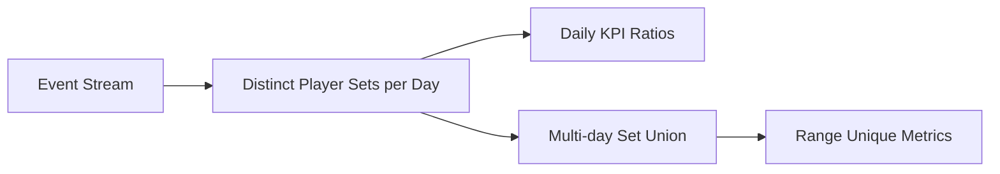

#### 1. Daily Active Users (DAU) and Set Aggregation
For each calendar day $d \in \{1 \dots D\}$, let $U_d$ denote the set of all unique player IDs observed emitting at least one valid gameplay event:
$$\text{DAU}_d = |U_d|$$
The mean DAU over an observation window of $D$ days is:
$$\overline{\text{DAU}} = \frac{1}{D} \sum_{d=1}^D \text{DAU}_d$$
However, the total unique players across the entire multi-day window is the cardinality of the **set union**, not the sum:
$$\text{Unique Players}_{\text{window}} = \left| \bigcup_{d=1}^D U_d \right|$$
Because returning players appear in multiple sets $U_d$, $\text{Unique Players}_{\text{window}} \le \sum_{d=1}^D \text{DAU}_d$. The sum $\sum \text{DAU}_d$ equals the total number of **Player-Days**.

#### 2. Ratio Metrics: Understanding the Estimand
When calculating an average rate across multiple days (e.g., sessions per user), three mathematically distinct estimands exist:
1. **Sessions per Player-Day:** Total observed sessions divided by total player-days:
   $$\text{Rate}_{\text{player-day}} = \frac{\sum_{d=1}^D S_d}{\sum_{d=1}^D \text{DAU}_d}$$
2. **Mean of Daily Ratios:** The unweighted arithmetic average of each day's internal ratio:
   $$\text{Rate}_{\text{mean-daily}} = \frac{1}{D} \sum_{d=1}^D \left( \frac{S_d}{\text{DAU}_d} \right)$$
3. **Sessions per Distinct Range Player:** Total observed sessions divided by the deduplicated player population:
   $$\text{Rate}_{\text{distinct}} = \frac{\sum_{d=1}^D S_d}{\left| \bigcup_{d=1}^D U_d \right|}$$

#### 3. Quantiles and Percentiles: The Nearest-Rank Method
Given a sample of $N$ numerical observations sorted in ascending order $x_{(1)} \le x_{(2)} \le \dots \le x_{(N)}$, the $P$-th percentile ($0 < P \le 1$) under the standard **nearest-rank convention** (Hyndman and Fan Type 1) is located at ordinal index $k$:
$$k = \lceil P \times N \rceil$$
$$x_P = x_{(k)}$$
- *Median ($P = 0.50$):* For even $N$, the nearest-rank convention selects rank $N/2$, whereas standard sample median takes the average of $x_{(N/2)}$ and $x_{(N/2 + 1)}$.
- *Percentile Interpolation Alternative:* Popular packages (like Python `numpy` or R default Type 7) compute fractional positions $h = (N - 1)P + 1$ and interpolate linearly between adjacent ranks. In game analytics, nearest-rank is preferred when tracking discrete integer milestones (e.g., retries or boss wave reached) to avoid creating fractional milestones that never actually occurred in the game.

#### 4. Zero Denominators versus Observed Zeros
- **Empty Cohort (Undefined):** If a cohort or filter has $0$ active players, any rate requiring division by players ($S / 0$) is mathematically **undefined** ($\text{NaN}$ or null). It must never be silently reported as $0.0\%$, which implies players were present but performed zero actions.
- **Observed Zero DAU:** If the game servers were fully operational on day $d$ and zero events were ingested, $\text{DAU}_d = 0$ is an observed numerical measurement.

---

### Worked game example

We evaluate synthetic fixture **EX01** representing two consecutive UTC calendar days of game activity, plus a sample of boss fight retries.

#### Part 1: Two-Day Activity Table

| UTC Day | Active Player IDs | Session Count $S_d$ | Daily DAU $|U_d|$ |
|---|---|---|---|
| `2026-01-01` | `P01`, `P02` | 4 | 2 |
| `2026-01-02` | `P02`, `P03`, `P04`, `P05` | 4 | 4 |

#### Step-by-Step Intermediate Calculations:
1. **Daily DAU:** $\text{DAU}_1 = 2$, $\text{DAU}_2 = 4$.
2. **Mean DAU:** $(2 + 4) / 2 = 3.0$.
3. **Deduplicated Players:** $U_1 \cup U_2 = \{P01, P02\} \cup \{P02, P03, P04, P05\} = \{P01, P02, P03, P04, P05\}$. Exactly $5$ distinct players.
4. **Total Player-Days:** $2 + 4 = 6$ player-days.
5. **Total Sessions:** $4 + 4 = 8$ sessions.

#### Evaluating the Three Ratio Estimands:
- **Ratio 1: Sessions per Player-Day:**
  $$\frac{8}{6} = \frac{4}{3} \approx 1.333333 \quad (1.33)$$
  *Plain Language Meaning:* On an average active player-day, an active user engaged in $1.33$ sessions.
- **Ratio 2: Mean of Daily Ratios:**
  $$\frac{1}{2} \left( \frac{4}{2} + \frac{4}{4} \right) = \frac{2.0 + 1.0}{2} = 1.50$$
  *Plain Language Meaning:* Across the observed days, the average daily intensity was $1.50$ sessions per user. Day 1 (a smaller, high-intensity day) receives equal weight to Day 2.
- **Ratio 3: Sessions per Distinct Range Player:**
  $$\frac{8}{5} = 1.60$$
  *Plain Language Meaning:* Over the entire two-day window, each unique person who logged into the game generated an average of $1.60$ sessions.

#### Part 2: Retry Distribution and Skew
A sample of $N = 6$ players attempting a challenging boss encounter record the following number of retries:
$$X = [0, 0, 1, 1, 2, 20]$$
- **Sum of Retries:** $0 + 0 + 1 + 1 + 2 + 20 = 24$.
- **Arithmetic Mean:** $24 / 6 = 4.0$ retries.
- **Median:** With $N = 6$ (even), the central two ranks are rank 3 (value 1) and rank 4 (value 1). Median is $(1 + 1) / 2 = 1.0$.
- **Nearest-Rank 90th Percentile ($P_{90}$):**
  $$k = \lceil 0.90 \times 6 \rceil = \lceil 5.4 \rceil = 6$$
  The 6th sorted observation is $x_{(6)} = 20$. Thus, $P_{90} = 20$.
- **Histogram Bins:**
  - Bin `[0]`: 2 players ($33.33\%$)
  - Bin `[1]`: 2 players ($33.33\%$)
  - Bin `[2..9]`: 1 player ($16.67\%$)
  - Bin `[10+]`: 1 player ($16.67\%$)

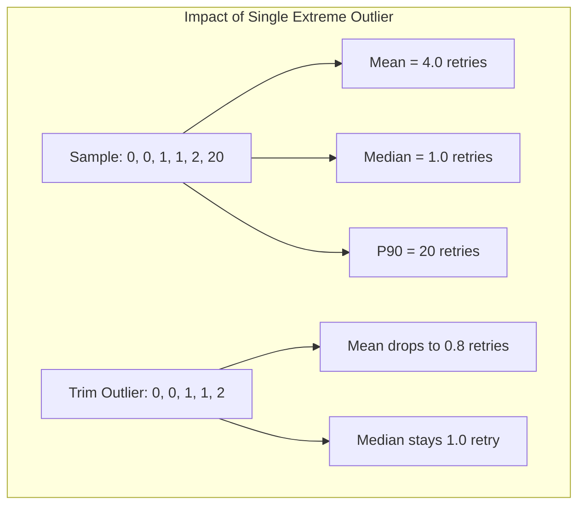

*Interpretation:* If designers inspect only the mean ($4.0$), they conclude players generally struggle and retry 4 times before winning. In reality, $67\%$ of players retry $\le 1$ time; the mean is heavily distorted by a single player retrying 20 times. The median ($1.0$) reflects the typical experience, while $P_{90} = 20$ flags extreme friction in the tail.

---

### Assumptions and preparation

1. **Entity Identification:** Requires a consistent client pseudonymous ID (`user_pseudo_id`) or server account ID. If players reinstall the app and receive a new ID, unique player counts will be inflated.
2. **Clock alignment:** Convert timestamps to the chosen reporting day and document clock correction. Client clocks may be wrong, while server receipt time can lag offline play; choose a trusted event-time policy and retain arrival-time information for diagnostics.
3. **Debug Telemetry Exclusion:** Test devices, QA runs, and automated bots must be filtered out using parameter flags (e.g., `debug_event = 1`) prior to running aggregation.

---

### Advantages

1. **Robust Central Tendency:** Pairing medians with means immediately exposes positive skewness caused by "whales" or hyper-engaged players.
2. **Deterministic Computational Simplicity:** Metric aggregation requires straightforward SQL groupings (`COUNT(DISTINCT ...)`, `GROUP BY`), making it computationally efficient and auditable.
3. **Clear Boundary Accounting:** Distinguishing player-days from distinct unique users prevents arithmetic double-counting in multi-day operational reports.

---

### Disadvantages and failure cases

1. **Sensitivity of Means to Tail Extremes:** A single compromised client or bot logging 10,000 events will distort mean playtime or attempts across the entire studio dashboard.
2. **Loss of Sequence and Timing:** Aggregations compress time into a single bucket. They cannot tell whether sessions happened consecutively or 12 hours apart.
3. **Misleading Rates from Small Sample Sizes:** In low-traffic cohorts (e.g., 2 players), rates swing wildly ($0\%$ to $50\%$ to $100\%$) based on the actions of a single individual.

#### Common mistake

> **Incorrect Claim:** *"Our Day 1 DAU was 2 and Day 2 DAU was 4. Therefore, we had $2 + 4 = 6$ total players playing our game over these two days."*
>
> **Technical Correction:** Adding daily unique users sums **Player-Days**, not distinct players. If tracked player `P02` logged in on both Day 1 and Day 2, they represent 2 player-days but only 1 distinct tracked identity. By set theory:
> $$|U_1 \cup U_2| = |U_1| + |U_2| - |U_1 \cap U_2| = 2 + 4 - 1 = 5$$
> Adding DAUs counts each identity once per active day. The excess over range-unique identities is repeated player-days, not the number of sessions or visits.

---

### Evaluation

- **Outlier sensitivity audit:** Compare the mean, median, tail quantiles and a declared trimmed mean. Treat differences as prompts to inspect the data, not as a universal pass threshold. Report legitimate extreme players separately instead of automatically deleting them. A six-player sample may have no observations removed under a percentage trimming rule, so state the rounding convention.

---

### Alternatives

| Method Alternative | Core Distinction | When to Prefer Over M01 Aggregates |
|---|---|---|
| **Distribution View (Histograms / Boxplots)** | Retains the entire frequency curve across discrete bins rather than collapsing data into 1 or 2 summary parameters. | Prefer when investigating gameplay difficulty balance, weapon damage distribution, or level completion times. |
| **Player-Weighted vs Event-Weighted Summary** | Player-weighted computes the metric per player first, then averages across players; event-weighted pools all events directly. | Prefer player-weighted when measuring human experience; prefer event-weighted when measuring server infrastructure load. |

---

### PetVsMonster fit

**Readiness:** Usable with current events for implemented counts; Needs data validation for proposed session-duration and retry distributions. [MetricsStore](../../server/lib/src/metrics_store.dart) computes mean DAU over stored days and sessionsPerDau as total sessions divided by summed daily DAU. This is sessions per player-day, not the mean of daily ratios. Validate eligible duration fields before proposing medians or p90. An aggregation over one million events and ten thousand identities may require scans, grouping and distinct sets; this is a qualitative cost assessment, not a benchmark.

---

### Sources and confidence

[GameAnalytics metric definitions](https://docs.gameanalytics.com/events-metrics-and-filtering/metrics/) support its active-user and revenue conventions. [Hyndman and Fan author record](https://fpp.robjhyndman.com/publications/quantiles/) establishes that sample quantile conventions differ; EX01 explicitly defines nearest rank. Ratio distinctions follow from the shown arithmetic and [local aggregation code](../../server/lib/src/metrics_store.dart).

**Evidence limits:** Example arithmetic is checked separately from empirical validity. See the [claim register](game-analytics-methods-sources.md) and [repair verification](game-analytics-methods-verification.md). This remains a pilot awaiting owner review.

---

## M02 Segmentation and cohort analysis

### Question and intuition

> **Core Designer Question:** *"Does our game perform worse on Android than iOS, or is platform performance confounded by different marketing channels and player difficulty mixes?"*

When a game studio analyzes its player base as a single undifferentiated pool, the resulting metrics represent an average across fundamentally different groups. A high-spending cohort from a tier-1 organic launch behaves differently from a low-intent user acquired through an incentivized video ad. Similarly, players on low-end hardware encounter different performance hurdles than players on flagship devices.

Segmentation and cohort analysis separates the player population into mutually exclusive or behaviorally distinct groups. 
- An **acquisition cohort** tracks players who installed the game during the same calendar window, making player age comparable; acquisition mix and other differences can still confound changes.
- A **property segment** categorizes players by stable attributes (e.g., operating system, device tier, geographic territory).
- A **behavioral cohort** groups players who took a specific in-game action within a frozen observation window (e.g., players who joined a guild within 48 hours of installing).

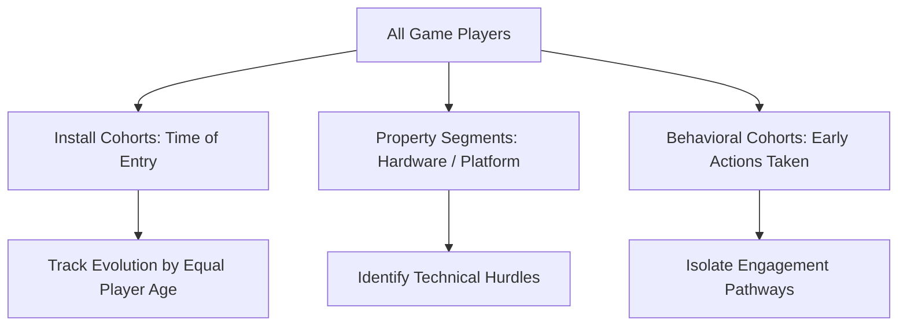

---

### Inputs and output

| Specification Dimension | Detail |
|---|---|
| **Input Telemetry** | Player profile attributes (`platform`, `app_version`, `geo_country`) and timestamped event records (`event_name = 'first_open'` for install cohorts; gameplay action events for behavioral cohorts). |
| **Analysis Unit** | Player (`user_pseudo_id`) evaluated at a standardized post-install elapsed horizon (e.g., exactly 24 hours post-install). |
| **Observation Window** | Equalized opportunity window across all compared subjects. |
| **Output Metrics** | Cohort sample sizes, Subgroup completion/conversion rates, Stratum-specific odds, Pooled aggregate rates, Standardized rates under equal reference weights. |

---

### How it works

  > **Future-defined membership:** Selecting players who purchase by day 30 and then comparing their earlier D1 activity describes a retrospectively selected group. It cannot be used as information available for a day-1 prediction or as proof that purchasing causes retention. A player can open on day 0, skip day 1 and purchase on day 30, so future purchase does not guarantee D1 retention. A purchase might also occur on day 0. This is selection or temporal leakage; immortal-time bias applies only under an analysis design that actually creates guaranteed event-free time.

#### 2. The Mechanics of Simpson's Paradox
When evaluating a binary outcome $Y \in \{0, 1\}$ (e.g., tutorial completion) across groups $X \in \{A, B\}$ (e.g., Android vs iOS), a confounding variable $Z \in \{1 \dots K\}$ (e.g., scenario difficulty) can distort the pooled comparison.

Let $n_{x, z}$ denote the eligible players in group $x$ within stratum $z$, and $y_{x, z}$ denote the number of successful completions. The stratum-specific rate is:
$$R_{x, z} = \frac{y_{x, z}}{n_{x, z}}$$
The pooled aggregate rate across all strata is:
$$R_x = \frac{\sum_{z=1}^K y_{x, z}}{\sum_{z=1}^K n_{x, z}} = \sum_{z=1}^K w_{x, z} R_{x, z}$$
where $w_{x, z} = \frac{n_{x, z}}{\sum_{j=1}^K n_{x, j}}$ is the proportion of group $x$ traffic directed into stratum $z$.

**The Reversal Condition:** If group $A$ is systematically routed into a much more difficult stratum than group $B$ ($w_{A, \text{hard}} \gg w_{B, \text{hard}}$), group $A$ can have a strictly higher success rate within every individual stratum:
$$R_{A, z} > R_{B, z} \quad \forall z$$
yet appear strictly worse in the pooled aggregate:
$$R_A < R_B$$

#### 3. Stratum Standardization (Direct Adjustment)
To eliminate composition bias caused by unequal traffic routing across strata $z \in \{1 \dots K\}$, analysts compute a standardized rate $R_x^{\text{std}}$ using a fixed reference weighting distribution $W_z$ (where $\sum W_z = 1$):
$$R_x^{\text{std}} = \sum_{z=1}^K W_z R_{x, z}$$
Under equal 50/50 weighting across two strata ($W_1 = 0.50, W_2 = 0.50$):
$$R_x^{\text{std}} = 0.50 \cdot R_{x, 1} + 0.50 \cdot R_{x, 2}$$

---

### Worked game example

We evaluate synthetic fixture **EX02**, representing 200 distinct players evaluated on completing a required onboarding tutorial within 24 hours of installation. Players are partitioned by platform (Android vs iOS) and stratified by scenario difficulty (Easy vs Hard).

#### Stratified Outcome Matrix (EX02)

| Scenario Stratum | Android Complete / Eligible | Android Success Rate | iOS Complete / Eligible | iOS Success Rate |
|---|---|---|---|---|
| **Easy** | $8 / 10$ | **$80.00\%$** | $63 / 90$ | **$70.00\%$** |
| **Hard** | $18 / 90$ | **$20.00\%$** | $1 / 10$ | **$10.00\%$** |
| **Pooled Aggregate** | **$26 / 100$** | **$26.00\%$** | **$64 / 100$** | **$64.00\%$** |

#### Step-by-Step Mathematical Evaluation:
1. **Within Easy Stratum:**
   - Android: $8 / 10 = 0.80$ ($80.00\%$)
   - iOS: $63 / 90 = 0.70$ ($70.00\%$)
   - *Result:* Android outperforms iOS by 10 percentage points ($80\% > 70\%$).
2. **Within Hard Stratum:**
   - Android: $18 / 90 = 0.20$ ($20.00\%$)
   - iOS: $1 / 10 = 0.10$ ($10.00\%$)
   - *Result:* Android outperforms iOS by 10 percentage points ($20\% > 10\%$).
3. **Pooled Aggregate Calculation:**
   - Android Total: $(8 + 18) / (10 + 90) = 26 / 100 = 0.26$ ($26.00\%$)
   - iOS Total: $(63 + 1) / (90 + 10) = 64 / 100 = 0.64$ ($64.00\%$)
   - *Result:* The aggregate appears to show iOS massively outperforming Android ($64\% \text{ vs } 26\%$), a complete reversal of the reality inside every scenario.

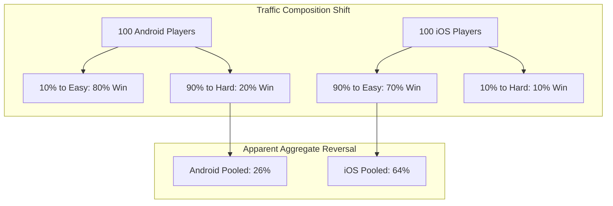

#### 4. Applying 50/50 Direct Standardization:
Using equal weights $W_{\text{easy}} = 0.50$ and $W_{\text{hard}} = 0.50$:
- **Standardized Android Rate:**
  $$R_{\text{Android}}^{\text{std}} = 0.50 \times \left(\frac{8}{10}\right) + 0.50 \times \left(\frac{18}{90}\right) = 0.50(0.80) + 0.50(0.20) = 0.40 + 0.10 = 0.50 \quad (50.00\%)$$
- **Standardized iOS Rate:**
  $$R_{\text{iOS}}^{\text{std}} = 0.50 \times \left(\frac{63}{90}\right) + 0.50 \times \left(\frac{1}{10}\right) = 0.50(0.70) + 0.50(0.10) = 0.35 + 0.05 = 0.40 \quad (40.00\%)$$

*Interpretation:* The apparent superiority of iOS in the raw data was purely an artifact of traffic routing: $90\%$ of iOS players were assigned to the Easy scenario, while $90\%$ of Android players were assigned to the Hard scenario. When adjusted to an equal scenario distribution, Android's consistent 10-point advantage across both difficulties is correctly revealed ($50.00\% \text{ vs } 40.00\%$).

---

### Assumptions and preparation

1. **Equalized Opportunity Windows:** All players compared must be observed over the exact same duration relative to their starting milestone (e.g., exactly 24 hours after install). Comparing Day 1 players to Day 14 players produces false cohort gaps.
2. **Pre-Outcome Stratification:** Confounding strata (such as difficulty level or device tier) must be determined prior to or independent of the outcome. Conditioning on variables affected by the outcome introduces collider bias.
3. **Sufficient Sample per Stratum:** Stratification subdivides data. If a cell contains very few players (e.g., 10 players), sample variance is high and rates become unstable.

---

### Advantages

1. **Visibility into composition differences:** Prevents studios from misallocating engineering effort based on spurious aggregate metric shifts.
2. **Focused investigation:** Splitting performance by device model, OS version or acquisition source identifies observed differences worth investigating; it does not establish a root cause.
3. **Temporal Stability:** Cohort-based tracking allows designers to observe whether balance adjustments improve newer cohorts without being masked by existing veteran habits.

---

### Disadvantages and failure cases

1. **Sparse Subgroup Cell Collapse:** When segmenting simultaneously by OS version, country, acquisition channel, and device tier, individual cells quickly shrink to zero or single digits.
2. **Arbitrary Segment Boundaries:** Hand-crafted behavioral rules (e.g., "Whale = spent over $50") create artificial cliffs where a player spending $49.99 is categorized completely differently from one spending $50.01.
3. **Over-Standardization Fallacy:** Standardizing across known variables adjusts only for observed confounders. It does not control for unobserved factors (e.g., player gaming skill or network latency).

#### Common mistake

> **Incorrect Claim:** *"Our pooled dashboard shows iOS tutorial completion is $64\%$ while Android is $26\%$. This proves the Android client has serious usability bugs that cause players to fail."*
>
> **Technical Correction:** This claim mistakes an observational aggregate correlation for a causal platform defect. As demonstrated in EX02, if marketing or level-generation algorithms steer Android traffic into harder content, Android completion will drop in aggregate even if the Android app runs better and has higher completion than iOS in every individual level. Holding scenario difficulty constant addresses that measured composition difference, but causal attribution needs additional assumptions or a valid randomized design.

---

### Evaluation

- **Stratum Monotonicity Check:** Before trusting any aggregate comparison between two player groups, cross-tabulate the metric across major known covariates (e.g., platform, territory, acquisition source). If the subgroup differences disagree in sign with the aggregate difference, Simpson's paradox is present.
- **Cell Balance Diagnostic:** Calculate the traffic allocation fractions across strata ($w_{x, z}$). If groups have heavily skewed allocations (such as $90/10$ vs $10/90$ in EX02), aggregate comparisons must be rejected in favor of stratified or standardized reporting.

---

### Alternatives

| Method Alternative | Core Distinction | When to Prefer Over M02 Cohorts |
|---|---|---|
| **Rule-Based Cohorts vs Unsupervised Clustering (M14, future chapter)** | Rule cohorts use deterministic designer criteria (e.g., Level $\ge 5$); clustering (k-means) discovers groupings mathematically from multi-dimensional feature space. | Prefer rule cohorts for operational and reporting clarity; prefer clustering when exploratory patterns in player behavior are unknown. |
| **Stratified Analysis vs Pooled Aggregation** | Pooled combines all rows into one global fraction; stratified computes separate fractions per subgroup. | Prefer stratified results for comparable subgroup questions; retain pooled results when the question is total observed impact, and state reference weights for standardized results. |

---

### PetVsMonster fit

**Readiness:** Usable with current events for platform/version filtering; Needs data validation for acquisition, location or difficulty tags. [Filters](../../shared/lib/src/filters.dart) and [MetricsStore](../../server/lib/src/metrics_store.dart) establish current filter capabilities. If valid scenario parameters exist in JSON, extraction and grouping can support the comparison without requiring a new table. Indexes or summaries are optional optimizations after profiling. Group counts can be modest, but the initial scan still depends on event volume.

---

### Sources and confidence

[Amplitude cohort documentation](https://amplitude.com/docs/analytics/define-cohort) explains reusable behavior and property groups. EX02 itself demonstrates the reversal and the stated standardization policy. This arithmetic does not establish a causal platform effect; source S004 is retained as historical reading, not claimed as a newly inspected full paper.

**Evidence limits:** Example arithmetic is checked separately from empirical validity. See the [claim register](game-analytics-methods-sources.md) and [repair verification](game-analytics-methods-verification.md). This remains a pilot awaiting owner review.

---

## M03 Retention and stickiness

### Question and intuition

> **Core Designer Question:** *"Are players who download PetVsMonster returning to the game on Day 1 and Day 7, and is our daily active player base sticky or merely sustained by a constant influx of new installs?"*

Retention is the single most critical health metric for free-to-play and live-service games. Acquiring players is expensive; if players abandon the game immediately after their first session, no amount of marketing or monetization design can make the game sustainable. 

However, "retention" is not a single uniform calculation. Different analytics platforms and studios define retention in distinct ways:
- **Classic (Exact-Day) Retention:** Did the player open the game on the exact calendar day $N$ days after install?
- **On-or-after return:** Did the player return on day N or later, up to a declared observation horizon?
- **Bounded cumulative return:** Did the player return at least once during days 1 through N? This is the convention used in EX04.
- **Bracket (Windowed) Retention:** Did the player return at any time within a multi-day span (e.g., between Days 1 and 3)?
- **Stickiness (DAU/MAU):** What fraction of monthly active users log in on any given day?

Each variation answers a different design question. Exact-Day retention evaluates daily habitual play. On-or-after return allows later returns; its meaning depends on the follow-up horizon. Stickiness measures overall engagement density. Failing to declare the exact variant or mishandling missing calendar days produces severely distorted metrics.

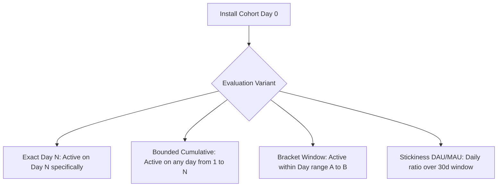

---

### Inputs and output

| Specification Dimension | Detail |
|---|---|
| **Input Telemetry** | Verified install milestone events (`event_name = 'first_open'`), subsequent gameplay event timestamps, player IDs (`user_pseudo_id`), and ingestion calendar status (`pulled_days`). |
| **Analysis Unit** | Player (`user_pseudo_id`) grouped into install date cohorts ($C_F$). |
| **Observation Window** | Multi-day UTC calendar observation window ending at a declared evaluation cutoff $D_{\text{cutoff}}$. |
| **Output Metrics** | Cohort size, Eligible cohort count, Retained player count, Exact Retention Percentage ($D_1, D_3, D_7, D_{14}, D_{30}$), Bounded Cumulative Retention, Bracket Retention, and Daily Stickiness Ratio ($\text{DAU} / \text{MAU}$). |

---

### How it works

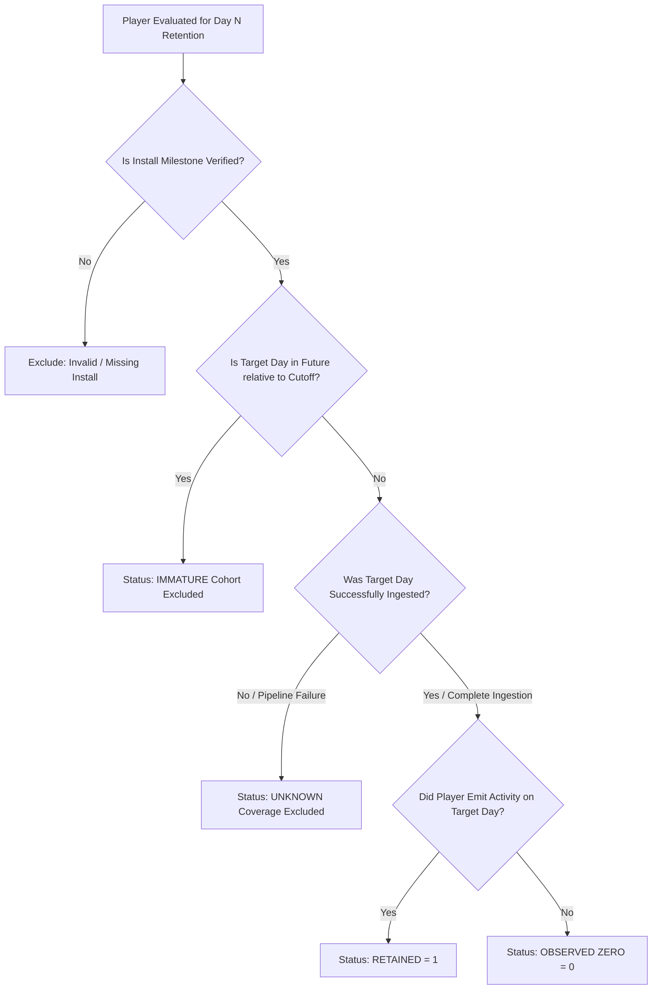

#### 1. Exact-Day Retention ($DN$)
Let $F(u)$ denote the UTC calendar date when player $u$ first opened the game (Install Day, relative Day 0). The player's exact Day $N$ target date is:
$$\text{TargetDate}(u, N) = F(u) + N \text{ days}$$

A player $u$ is **eligible** for exact Day $N$ calculation if and only if:
1. $F(u) + N \le D_{\text{cutoff}}$ (The cohort has reached full chronological maturity).
2. Telemetry coverage for calendar day $F(u) + N$ is verified complete.

Let $E_N$ denote the set of eligible players for Day $N$, and let $A_d$ denote the set of players active on calendar day $d$. The exact Day $N$ retention rate is:
$$\text{Retention}_{\text{exact}}(N) = \frac{\left| \{ u \in E_N \mid u \in A_{F(u) + N} \} \right|}{|E_N|}$$

#### 2. Return on or after and bounded cumulative return
These are different questions. [Amplitude's on-or-after definition](https://amplitude.com/docs/analytics/charts/retention-analysis/faq) looks for a return on day N or later. To make a comparison reproducible here, choose a common last follow-up day H and evaluate the interval [N,H]. In contrast, EX04's **bounded cumulative return** asks for any return in [1,N]. The earlier draft called that bounded cumulative return; this edition uses the more explicit name.

Let C(d) mean that UTC day d has verified complete coverage. Define interval eligibility separately from exact-day eligibility:
$$E_{a,b} = \{u : F(u)\text{ is trusted},\ F(u)+b\le D_{\text{cutoff}},\ C(F(u)+k)\text{ for every }k\in[a,b]\}.$$
This handbook uses a conservative complete-window denominator: all players in an install cohort whose interval has any missing day are excluded from that interval estimate, even if some have a recorded positive return. Report their excluded count. This avoids mixing observed positives with unobservable negatives. It is an explicit research convention, not a claim about a vendor's exact implementation.

The common interval formula is:
$$R(a,b)=\frac{|\{u\in E_{a,b}: u\text{ is active on at least one day }F(u)+k,\ k\in[a,b]\}|}{|E_{a,b}|}.$$
On-or-after return with horizon H is R(N,H); bounded cumulative return is R(1,N). With the **same eligible population and complete coverage**, return on exact day N is a subset of return in either interval containing N. Do not compare the rates as a mathematical invariant if their denominators differ.

**Missing-interior-day counterexample:** A player opens on day 0, has no recorded return, day 3 is missing and day 7 is complete. Exact D7 can be observed zero. Return anywhere in [1,7] is unknown, so this player is excluded from the interval estimate. Checking day 7 alone would wrongly classify the missing-window outcome as no return.

#### 3. Bracket return
Bracket return is the same interval formula R(a,b) with explicit endpoints, such as R(1,3). It uses E_{a,b}, not an endpoint-only cohort. A zero eligible denominator is unavailable, not zero percent. Common follow-up windows and coverage rules are necessary before comparing install dates.

#### 4. Pooled Weighted Aggregation versus Unweighted Means
When aggregating retention across multiple install cohorts $c \in \{1 \dots M\}$ with cohort sizes $n_c$ and retained counts $r_c$, the overall retention rate must be calculated as a **weighted pooled fraction**:
$$\text{Retention}_{\text{pooled}} = \frac{\sum_{c=1}^M r_c}{\sum_{c=1}^M n_c}$$
For a player-weighted pooled question, do not substitute an equal-cohort average:
$$\frac{1}{M} \sum_{c=1}^M \left(\frac{r_c}{n_c}\right) \text{ generally differs from } \text{Retention}_{\text{pooled}}$$
An unweighted average erroneously gives a small cohort of 2 players the exact same statistical weight as a massive marketing cohort of 10,000 players.

#### 5. Stickiness and monthly active users

$$\text{Stickiness}_t = \frac{\text{DAU}_t}{\text{MAU}_t}$$

Here $\text{DAU}_t$ is active users on UTC day t. Choose either rolling MAU over [t−29,t] or calendar-month unique users, and label the choice. A one-day ratio of 20 percent says that one fifth of that defined monthly population was active on that date. It does **not** establish six active days per person. A zero monthly denominator makes the ratio unavailable.

For a **fixed** population of monthly unique users and a complete 30-day month, average active days per monthly user equals $\sum_{d=1}^{30}\text{DAU}_d/\text{MAU}_{\text{month}}$. For example, 100 monthly users with DAU 20 today could have no activity on most other dates or nearly all users active on many other dates; today's 20/100 alone cannot distinguish those histories. [GameAnalytics defines both calendar and rolling MAU](https://docs.gameanalytics.com/events-metrics-and-filtering/metrics/).

---

### Worked game example

#### Part 1: EX03 Exact-Day Retention under Partial Ingestion Coverage

**Scenario Parameters:**
- Evaluation cutoff date: End of `2026-01-10` UTC.
- Ingestion Status:
  - Days 1–4 and 7–10: Fully operational ($100\%$ ingested).
  - Day 5: **Missing / Ingestion failure** (telemetry lost; data unavailable).
  - Day 6: Fully operational; **Observed zero** active players.
- 12 synthetic players (`P01` to `P12`) installed across Days 1 through 10.

#### Player-by-Player Eligibility and Return Trace

| Player | Install Day $F$ | Observed Active Days | D1 Target ($F+1$) | D1 Status & Reason | D7 Target ($F+7$) | D7 Status & Reason |
|---|---|---|---|---|---|---|
| **P01** | Day 1 | 1, 2, 4, 8 | Day 2 | **Retained** (Active Day 2) | Day 8 | **Retained** (Active Day 8) |
| **P02** | Day 1 | 1, 3, 9 | Day 2 | Not Retained (Inactive) | Day 8 | Not Retained (Inactive) |
| **P03** | Day 1 | 1 | Day 2 | Not Retained (Inactive) | Day 8 | Not Retained (Inactive) |
| **P04** | Day 2 | 2, 3, 9 | Day 3 | **Retained** (Active Day 3) | Day 9 | **Retained** (Active Day 9) |
| **P05** | Day 2 | 2, 4 | Day 3 | Not Retained (Inactive) | Day 9 | Not Retained (Inactive) |
| **P06** | Day 3 | 3, 4, 10 | Day 4 | **Retained** (Active Day 4) | Day 10 | **Retained** (Active Day 10) |
| **P07** | Day 3 | 3 | Day 4 | Not Retained (Inactive) | Day 10 | Not Retained (Inactive) |
| **P08** | Day 4 | 4 | Day 5 | **EXCLUDED (Day 5 Missing)** | Day 11 | **EXCLUDED (Day 11 Immature)** |
| **P09** | Day 7 | 7, 8 | Day 8 | **Retained** (Active Day 8) | Day 14 | **EXCLUDED (Day 14 Immature)** |
| **P10** | Day 8 | 8, 10 | Day 9 | Not Retained (Inactive) | Day 15 | **EXCLUDED (Day 15 Immature)** |
| **P11** | Day 9 | 9, 10 | Day 10 | **Retained** (Active Day 10) | Day 16 | **EXCLUDED (Day 16 Immature)** |
| **P12** | Day 10 | 10 | Day 11 | **EXCLUDED (Day 11 Immature)**| Day 17 | **EXCLUDED (Day 17 Immature)** |

#### Intermediate Cohort Accounting:
1. **Day 1 Retention ($D_1$):**
   - *Eligible Players:* `P01`, `P02`, `P03`, `P04`, `P05`, `P06`, `P07`, `P09`, `P10`, `P11` (Total = $10$).
   - *Excluded Players:* `P08` (target Day 5 is missing telemetry; cannot know if active) and `P12` (target Day 11 is in the future; immature).
   - *Retained Players:* `P01`, `P04`, `P06`, `P09`, `P11` (Total = $5$).
   - **Exact D1 Retention Rate:**
     $$\text{D1 Rate} = \frac{5}{10} = 0.50 \quad (50.00\%)$$
2. **Day 7 Retention ($D_7$):**
   - *Eligible Cohorts:* Only players installed on Days 1, 2, and 3 have target Day 7 dates $\le \text{Day 10}$.
     - Cohort Day 1 (target Day 8): `P01` (retained), `P02` (no), `P03` (no) $\rightarrow 1/3$.
     - Cohort Day 2 (target Day 9): `P04` (retained), `P05` (no) $\rightarrow 1/2$.
     - Cohort Day 3 (target Day 10): `P06` (retained), `P07` (no) $\rightarrow 1/2$.
   - *Eligible Total:* $\{P01 \dots P07\}$ ($7$ players).
   - *Retained Total:* $\{P01, P04, P06\}$ ($3$ players).
   - **Exact D7 Retention Rate (Weighted Pooled):**
     $$\text{D7 Rate} = \frac{1 + 1 + 1}{3 + 2 + 2} = \frac{3}{7} \approx 0.42857143 \quad (42.86\%)$$
     *(Contrast with unweighted mean: $(1/3 + 1/2 + 1/2)/3 = 1.3333/3 \approx 44.44\%$, which answers an equal-cohort rather than a pooled-player question).*
3. **Stickiness Analysis on Day 10:**
   - Active users on Day 10: $\{P06, P10, P11, P12\} \rightarrow \text{DAU} = 4$.
   - Distinct active players across the entire 10-day history: $\{P01 \dots P12\} \rightarrow 12$ unique players.
   - The ratio $4 / 12 \approx 33.33\%$ is a **10-day active ratio**, **not** DAU/MAU. A trailing 30-day MAU needs that complete history; calendar-month MAU needs a separately declared month and maturity policy. Neither complete window is available here.

---

#### Part 2: EX04 Retention Variants in a Fully Observed Cohort

A cohort of 4 players (`A`, `B`, `C`, `D`) installed on Day 0 and observed fully through Day 7:

| Player | Active Relative Calendar Days |
|---|---|
| **A** | 0, 1, 7 |
| **B** | 0, 3 |
| **C** | 0 |
| **D** | 0, 7 |

#### Calculating the Four Variants:
1. **Exact Day 1 ($D_1$):** Active on Day 1 specifically $\rightarrow \{A\}$.
   $$\text{Rate} = \frac{1}{4} = 0.25 \quad (25.00\%)$$
2. **Exact Day 7 ($D_7$):** Active on Day 7 specifically $\rightarrow \{A, D\}$.
   $$\text{Rate} = \frac{2}{4} = 0.50 \quad (50.00\%)$$
3. **Bounded Cumulative Return $[1 \dots 7]$:** Active on any day in range $[1, 7] \rightarrow \{A, B, D\}$.
   $$\text{Rate} = \frac{3}{4} = 0.75 \quad (75.00\%)$$
4. **Bracket Return $[1 \dots 3]$:** Active on any day in range $[1, 3] \rightarrow \{A, B\}$.
   $$\text{Rate} = \frac{2}{4} = 0.50 \quad (50.00\%)$$

*Takeaway:* Exact $D_1$ is $25\%$, while bounded cumulative retention through Day 7 is $75\%$. Player `B` did not play on Day 1, but returned on Day 3. If the studio reports rolling retention as "D1 retention", they inflate their perceived onboarding health threefold.

---

### Assumptions and preparation

1. **Accurate First-Open Attribution:** Requires that `first_open` is reliably logged on client start. If a client reinstalls or clears app storage, they will be erroneously assigned a new install date.
2. **Strict Time Zone Consistency:** Install date and return dates must both use UTC boundaries. Mixing client-local install dates with UTC return dates introduces a $\pm 1$ day phase shift, erroneously shifting Day 1 returns into Day 0 or Day 2.
3. **Pipeline Ingestion Completeness:** Target dates must be audited against backend ingestion status before evaluating returns.

---

### Advantages

1. **Direct Measure of Game Longevity:** Tracks actual player return habits over time, providing direct feedback on content exhaustion and difficulty spikes.
2. **Cohort Comparability:** Normalizes for marketing burst volume by tracking performance relative to install age ($F + N$).
3. **Diagnostic Precision:** Contrasting exact-day retention against bracket retention reveals whether players have churned permanently or simply transitioned to an alternate-day play cadence.

---

### Disadvantages and failure cases

1. **Sensitivity to Immature Data:** Querying Day 7 retention on a cohort that installed 4 days ago will report $0\%$ retention if unhandled, creating artificial drop-offs in dashboard charts.
2. **Pipeline Drop Vulnerability:** A single day of failed telemetry ingestion drops exact retention for all cohorts whose target day fell on that date.
3. **Survival Conflation Fallacy:** Retention is not survival probability. In games, players regularly take breaks and return weeks later (resurrection); time-to-first-inactivity survival can still be defined, but it is not the same as permanent departure; recurrent returns need a separately specified model.

#### Common mistake

> **Incorrect Claim:** *"Our Day 7 retention for the January 8 cohort is $0\%$ because zero players logged in on Day 15. The game is failing to retain them."*
>
> **Technical Correction:** If today is January 10, Day 15 has not occurred yet. This cohort is **immature**. Treating unelapsed future days as churn falsifies retention. The metric must be marked **null / unobservable**, and excluded from multi-cohort averages until Day 15 has elapsed and been ingested.

---

### Evaluation

- **Maturity Audit:** For every cohort $C_F$ and target offset $N$, assert:
  $$F + N \le D_{\text{latest\_ingested}}$$
  Any cell failing this condition must display as blank or pending, never zero.
- **Coverage Join Audit:** Verify that target dates exist in the `pulled_days` table. If a target date is missing from `pulled_days`, flag the cell as **Unknown Coverage** rather than Inactive.

---

### Alternatives

| Method Alternative | Core Distinction | When to Prefer Over M03 Retention |
|---|---|---|
| **Survival Analysis (Kaplan-Meier / Cox, M26–M27, future chapters)** | Models time to a specified event while handling right-censored observations; Kaplan-Meier estimates survival, while Cox models a hazard relationship. | Prefer when modeling permanent subscriber churn or uninstalls where return is impossible or negligible. |
| **Stickiness (DAU/MAU)** | Measures cross-sectional aggregate engagement intensity across all historical users rather than longitudinal cohort decay. | Prefer for assessing overall game community vitality and daily engagement frequency. |

---

### PetVsMonster fit

**Readiness:** Needs data validation for complete coverage and MAU history; implemented exact-day retention exists. [MetricsStore.retention](../../server/lib/src/metrics_store.dart) uses earliest first_open and offsets 1,3,7,14,30. Its _observable condition compares the target with MAX(day) in pulled_days rather than checking each target date. BUG-0083 records this unchanged application gap. The interval coverage policy described here is a research recommendation, not current behavior. Confirm history and collection rules before interpreting return as absence; aggregating daily activity requires per-player date sets or equivalent queries.

---

### Sources and confidence

[Amplitude retention FAQ](https://amplitude.com/docs/analytics/charts/retention-analysis/faq) supports on-or-after return and maturity distinctions. [GameAnalytics metrics](https://docs.gameanalytics.com/events-metrics-and-filtering/metrics/) documents exact-day return and its MAU windows. Complete-window eligibility here is our declared conservative policy, not a vendor claim. [Current retention code](../../server/lib/src/metrics_store.dart) still has the separately logged coverage limitation.

**Evidence limits:** Example arithmetic is checked separately from empirical validity. See the [claim register](game-analytics-methods-sources.md) and [repair verification](game-analytics-methods-verification.md). This remains a pilot awaiting owner review.

---

## M04 Funnel and conversion analysis

### Question and intuition

> **Core Designer Question:** *"Where in our introductory tutorial sequence do new players drop off, and how long does it take successful players to complete all required steps?"*

A game's onboarding sequence or progression loop is typically conceived as a linear series of milestones: create a character, complete the movement tutorial, win the first battle, and open the victory chest. In reality, player behavior is messy: players open settings, get distracted, explore non-linear paths, backtrack, or close the app mid-sequence.

Funnel analysis models player progression through a predefined sequence of critical milestones (steps). By computing the proportion of players who successfully advance from each step to the next, funnels expose points of acute friction (drop-offs) and quantify elapsed time between actions. 

However, funnel metrics depend heavily on the underlying matching engine's rules:
- **Strict Ordered Subsequence:** Steps must occur at later positions in a declared deterministic event order, but arbitrary events may intervene. In the local engine, sorting by timestamp and row ID permits distinct ordered rows with equal timestamps.
- **Consecutive Event Matching:** Step $B$ must immediately follow step $A$ with zero intervening events.
- **Unordered (Set-Based) Completion:** All target actions must occur within the window, but the internal sequence order is unrestricted.
- **Entry Policy:** Does the funnel window begin only on the player's first attempt, or can a player re-enter and restart the timer on subsequent attempts?

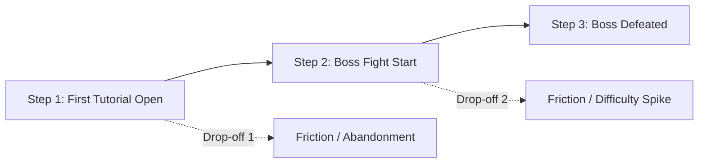

---

### Inputs and output

| Specification Dimension | Detail |
|---|---|
| **Input Telemetry** | Ordered event stream per player: `user_pseudo_id` (string), `event_name` (string), `ts_micros` (integer), and optional parameter filters inside `params_json`. |
| **Analysis Unit** | Player path or Attempt path evaluated against a defined step sequence $[S_1, S_2 \dots S_K]$. |
| **Observation Window** | Finite conversion window $\Delta T$ (e.g., $10\text{ minutes}$, $1\text{ hour}$, $24\text{ hours}$) initiated at step 1 entry timestamp $t_{\text{entry}}$. |
| **Output Metrics** | Step entry counts, Step progression counts, Overall conversion rate ($S_K / S_1$), Conditional step-to-step conversion rate ($S_k / S_{k-1}$), Step drop counts, and Converter elapsed duration percentiles (median elapsed time). |

---

### How it works

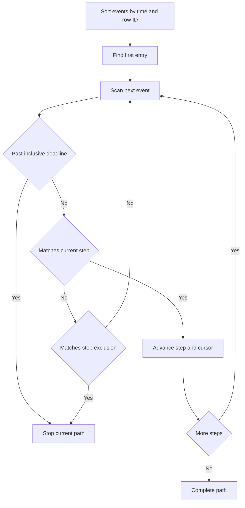

#### 1. Formal Matching Pseudocode (Strict Ordered Subsequence Policy)

```text
function WalkStrictWithEntry(events, steps, windowDuration):
    # 1. Locate first entry matching step 1
    pos = FindFirstIndex(events, e => MatchesStep(e, steps[1]))
    if pos < 0:
        return null # Player never entered funnel
    
    entryEvent = events[pos]
    entryTs = entryEvent.timestamp
    matchedTimestamps = [entryTs]
    deadline = null if windowDuration is null else entryTs + windowDuration
    
    # 2. Iterate through subsequent required steps
    for k = 2 to steps.length:
        foundIndex = -1
        for j = pos + 1 to events.length - 1:
            e = events[j]
            # Strictly greater comparison makes the exact boundary minute inclusive
            if windowDuration is not null and e.timestamp > deadline:
                break # Window expired; cannot advance further
            
            if MatchesStep(e, steps[k]):
                foundIndex = j
                break
                
            if HasExclusion(e, steps[k]):
                return (matchedTimestamps, entryEvent) # Abandon on excluded action
        
        if foundIndex < 0:
            return (matchedTimestamps, entryEvent) # Dropped at step k
            
        pos = foundIndex
        matchedTimestamps.append(events[pos].timestamp)
        
    return (matchedTimestamps, entryEvent) # Completed all steps
```

#### 2. Conversion Rates and Timing Metrics
- **Overall Conversion Rate:**
  $$\text{Conversion}_{\text{overall}} = \frac{\text{Players Completing Step } K}{\text{Players Entering Step } 1} = \frac{N_K}{N_1}$$
- **Conditional (Step-to-Step) Conversion Rate:**
  $$\text{Conversion}_{\text{conditional}}(k - 1 \to k) = \frac{N_k}{N_{k-1}}$$
- **Elapsed Duration of Converters:**  
  For each player $u$ who converts fully, the completion duration is $\tau(u) = t_{\text{step } K}(u) - t_{\text{step } 1}(u)$. The median duration is:
  $$\text{Median Elapsed Time} = \text{median}(\{ \tau(u) \mid u \text{ reached step } K \})$$
  > [!IMPORTANT]
  > **Converter Selection Bias:** Elapsed time percentiles describe **only those players who successfully completed the funnel**. Players who struggle, get stuck, or abandon the game never generate an end timestamp $t_{\text{step } K}$ and are excluded from the timing calculation.

#### 3. Ordered Subsequence versus Consecutive Event Matching
- **Subsequence (Standard):** If step 1 is `tutorial_start` and step 2 is `boss_fight`, a player who opens `inventory`, adjusts `audio_settings`, and chats with an NPC before triggering `boss_fight` **successfully converts**.
- **Consecutive:** Requires that the very next telemetry record emitted by the client after `tutorial_start` must be `boss_fight`. Background telemetry and unrelated UI actions can prevent consecutive matching; how often depends on the actual event stream.

---

### Worked game example

We evaluate synthetic fixture **EX05** against a three-step onboarding funnel:
- **Funnel Definition:** Step A $\to$ Step B $\to$ Step C.
- **Conversion Window:** $10\text{ minutes}$ inclusive ($[t_A, t_A + 10]$).
- **Policy:** First occurrence of A is entry. Intervening events allowed. Pre-entry events ignored.

#### Player Telemetry Action Streams (Offsets in Minutes from First A)

| Player | Telemetry Stream | Strict Sequence Trace | Unordered Trace |
|---|---|---|---|
| **P01** | `A0, B2, C5` | A at 0, B at 2 ($2 \le 10$), C at 5 ($5 \le 10$). **Converts.** | Completes $\{A, B, C\} \le 10$. **Converts.** |
| **P02** | `A0, C1, B2` | A at 0, C at 1 (out of sequence; C searched after B), B at 2. Drops at C. | Completes $\{A, B, C\} \le 10$. **Converts.** |
| **P03** | `A0, B2, A20, B21, C22` | Entry at A0, B at 2. Window expires at 10. A20 does not restart timer. Drops at C. | Window expires at 10. Drops at C. |
| **P04** | `B-1, A0, C2` | B-1 is pre-entry (ignored). A at 0, C at 2. B never happens after A. Drops at B. | Pre-entry B ignored. Drops at B. |
| **P05** | `A0, B10, C11` | A at 0, B at 10 (boundary, $10 \le 10$, matches). C at 11 ($11 > 10$, expired). Drops at C. | C at 11 ($11 > 10$, expired). Drops at C. |
| **P06** | `A0, B4, C10` | A at 0, B at 4 ($4 \le 10$), C at 10 (boundary, $10 \le 10$, matches). **Converts.** | Completes $\{A, B, C\} \le 10$. **Converts.** |

#### Trace Breakdown and Boundary Audits:
1. **P02 (Step Ordering):** In strict matching, after matching A0 at index 0, the engine searches forward for Step B. It finds B2 at minute 2. It then searches forward from index 2 for Step C, but no C occurs after minute 2. Under unordered matching, P02 satisfies all three steps within 2 minutes and converts.
2. **P03 (First Entry Policy vs Re-entry):** Under a strict first-entry policy, P03's window is $[0, 10]$. Events at minutes 20, 21, and 22 occur outside this window. Under an alternate **re-entry policy** (where each A initiates a new attempt), attempt 2 (`A20, B21, C22`) would convert in 2 minutes.
3. **P04 (Pre-entry Isolation):** Action `B-1` occurred before the player entered the funnel. Pre-entry events cannot satisfy downstream steps.
4. **P05 & P06 (Inclusive Deadline Check):** The deadline is $0 + 10 = 10\text{ minutes}$.
   - For P05, B at minute 10 is $\le 10$ and validly matches Step 2; C at minute 11 is $> 10$ and fails.
   - For P06, C at minute 10 is $\le 10$ and validly matches Step 3.

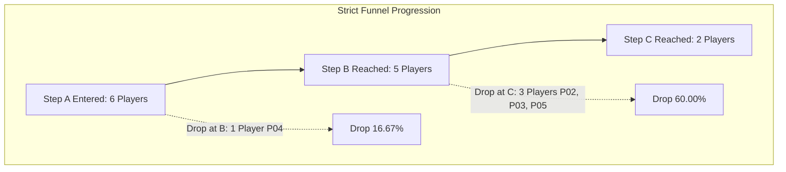

#### Final Numerical Output Oracles:
- **Step A Entered ($N_1$):** $6$ players ($P01 \dots P06$).
- **Step B Reached ($N_2$):** $5$ players ($P01, P02, P03, P05, P06$).
- **Step C Reached ($N_3$):** $2$ players ($P01, P06$).
- **Overall Conversion Rate:**
  $$\frac{N_3}{N_1} = \frac{2}{6} = \frac{1}{3} \approx 0.33333333 \quad (33.33\%)$$
- **Conditional Conversion Rate (Step 2 to 3):**
  $$\frac{N_3}{N_2} = \frac{2}{5} = 0.40 \quad (40.00\%)$$
- **Unordered Full Completion:**
  $$\{P01, P02, P06\} \rightarrow \frac{3}{6} = 0.50 \quad (50.00\%)$$
- **Converter Elapsed Times (A to C):**
  - P01: $5 - 0 = 5.0\text{ minutes}$.
  - P06: $10 - 0 = 10.0\text{ minutes}$.
  - **Median Converter Elapsed Time:** $(5.0 + 10.0) / 2 = 7.5\text{ minutes}$.

---

**Tied timestamps and exclusions:** Three distinct rows A, B and C at timestamp 0 with row IDs 1, 2 and 3 satisfy the local ordered policy. A strict-time policy would reject that trace and must be named separately. For A0, skip1, B2 with skip excluded while waiting for B, the local engine stops at skip1; it does not ignore the exclusion because skip is not a matching B. If one row matches both the target and exclusion, the inspected code gives the target match priority.

### Assumptions and preparation

1. **Deterministic Tie-Breaking:** In high-frequency telemetry, two distinct events can share the exact same microsecond timestamp. The ingestion pipeline must break ties deterministically (e.g., using auto-incrementing database row `id` as a secondary sort key).
2. **Window Selection:** Conversion windows must reflect reasonable human gameplay cycles. A 5-minute window on a 15-minute tutorial causes artificial drop-offs; a 30-day window muddles onboarding analysis with long-term retention.
3. **Step Exclusions:** Exclusions (e.g., "drop if player visits `skip_tutorial`") must be explicitly declared to prevent alternate paths from contaminating the core funnel.

---

### Advantages

1. **Actionable Friction Pinpointing:** Shows the step boundary with the largest observed non-advancement; it does not establish the cause.
2. **Dual Perspective (Conversion + Speed):** Pairing completion percentages with median elapsed time identifies steps that players complete but take an agonizingly long time to finish.
3. **Segmentation Friendly:** Funnels can be sliced by device tier, country, or acquisition source to identify demographic-specific hurdles.

---

### Disadvantages and failure cases

1. **Inability to Capture Non-Linear Exploration:** Funnels enforce a rigid linear mental model. In open-world or sandboxed games, players take valid alternate routes that linear funnels mislabel as abandonment.
2. **Survivor Bias in Duration:** Tracking only converter completion times blinds the team to the duration spent by players who dropped out in frustration.
3. **Window Expiration Artifacts:** Players who pause to eat dinner mid-tutorial are marked as "dropped" if the window is short, even if they return and complete the tutorial later.

#### Common mistake

> **Incorrect Claim:** *"Our onboarding funnel shows a $60\%$ drop between Step B and Step C. This proves that Step B is causing $60\%$ of our players to churn from the game."*
>
> **Technical Correction:** A funnel drop records **non-advancement within the designated path and window**; it does **not** prove player churn. As seen in EX05, player `P02` completed Step C before Step B (out of order), while player `P05` completed Step C one minute after the deadline. Those actions show why the defined funnel can miss a completion, but the fixture does not establish either player's later churn status. Conflating funnel drop-off with churn leads to misguided design overhauls.

---

### Evaluation

- **Strict versus Unordered Gap Analysis:** Run the funnel under both strict sequential and unordered set rules. A higher unordered rate (EX05: 50 percent versus 33.33 percent) shows that event order affects this calculation. Inspect traces before attributing it to menu discovery or a design problem; no significance test was performed on this six-player illustration.
- **Window Sensitivity Diagnostic:** Test conversion rates across expanding window options ($1\text{ hour}$, $1\text{ day}$, $7\text{ days}$). A rate that rises with a wider window suggests timing matters; casual cadence, friction and interruption remain possible explanations.

---

### Alternatives

| Method Alternative | Core Distinction | When to Prefer Over M04 Funnels |
|---|---|---|
| **Path Exploration / Sankey Flows (M30, future chapter)** | Maps all observed outgoing event transitions branching from a seed action without requiring a predefined target sequence. | Prefer when discovering organic player exploration routes or diagnosing unexpected UI navigation loops. |
| **Attempt-Based Conversion vs Player-Based Funnel** | Attempt-based evaluates conversion per run/match; player-based evaluates conversion per human being. | Prefer attempt-based funnels for evaluating procedural rogue-like dungeon runs or boss fight victory odds. |

---

### PetVsMonster fit

**Readiness:** Usable with current events for the implemented player-path engine, subject to confirming chosen step events. [FunnelEngine](../../server/lib/src/funnel_engine.dart) establishes first entry, ordered indexes, inclusive deadlines and exclusion behavior. Reentry-attempt reporting would be a future design with explicit attempt and deduplication rules; it was not implemented here. Ordered scans are practical after sorting or querying by player and event order, with cost dependent on selected events and path length.

---

### Sources and confidence

[Unity funnels documentation](https://docs.unity.com/en-us/analytics/funnels/funnels) explains step conversion and timing. Exact entry, tie, exclusion and deadline behavior is established by [the inspected local engine](../../server/lib/src/funnel_engine.dart), not by assuming all vendors use identical matching rules.

**Evidence limits:** Example arithmetic is checked separately from empirical validity. See the [claim register](game-analytics-methods-sources.md) and [repair verification](game-analytics-methods-verification.md). This remains a pilot awaiting owner review.

---

## M05 Session analysis and engagement frequency

### Question and intuition

> **Core Designer Question:** *"How long are players actually spending in PetVsMonster during an average play session, how often do they return throughout the day, and does a high daily session count reflect enthusiastic engagement or fragmented drop-ins?"*

Player engagement is defined not merely by whether a player showed up on a given date (retention), but by how they distribute their time within and across days. A player who opens the game once for 45 minutes of focused dungeon raiding has a completely different relationship with the game than a player who opens the app 15 times for 30 seconds simply to collect idle gold.

Session analysis and engagement frequency tracking measures the duration, frequency, and spacing of player visits. It quantifies how gameplay fits into the player's daily lifestyle:
- **Session Duration:** How long does a continuous bout of play last?
- **Inter-Session Gap (Return Latency):** How much time elapses between the end of one session and the start of the next?
- **Foreground engagement proxy:** What duration did the SDK attribute to focus or foreground use? Separately instrumented input-active time would answer a narrower interaction question.

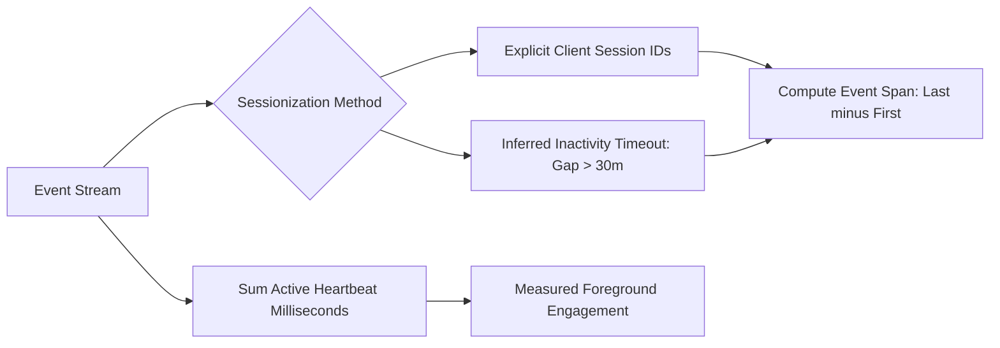

---

### Inputs and output

| Specification Dimension | Detail |
|---|---|
| **Input Telemetry** | Timestamped client/server events (`user_pseudo_id`, `ts_micros`, `event_name`), explicit session tags (`ga_session_id`), and incremental heartbeat parameters (`engagement_time_msec` in `user_engagement`). |
| **Analysis Unit** | Session (either explicit UUID/integer or inferred event cluster), Player-Day, and Inter-session interval. |
| **Observation Window** | Single calendar day or multi-day evaluation window. |
| **Output Metrics** | Total session count, Mean sessions per DAU, Session event span duration (seconds/minutes), Median session duration, Inter-session return gap (hours), Total recorded foreground engagement proxy. |

---

### How it works

#### 1. Sessionization Architectures: Explicit versus Inferred
Analytics pipelines group raw events into sessions using one of two primary paradigms:

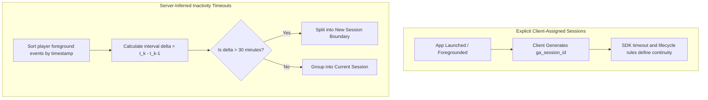

- **Explicit Client Sessions (e.g., Firebase / Google Analytics 4):**
  The client runtime generates an explicit numeric timestamp identifier (`ga_session_id`) upon initial launch or when transitioning to the foreground after an extended pause. Verify tag coverage in the actual export; not every event source or server-originated event necessarily supplies the same session fields.
- **Inferred Inactivity Timeout Sessions (e.g., Traditional Web / Event Store ETL):**
  The analytics backend sorts a player's eligible foreground events chronologically: $t_1 \le t_2 \le \dots \le t_m$. An inactivity threshold $\theta$ (typically $30\text{ minutes}$) is applied:
  $$\Delta t_k = t_k - t_{k-1}$$
  - If $\Delta t_k \le \theta$, event $k$ belongs to the same session as event $k-1$.
  - If $\Delta t_k > \theta$, event $k$ marks the **start of a new inferred session**.

  An incremental duration field can be summed only after its collection semantics are verified. Recorded duration is the sum of eligible incremental milliseconds, divided by 60,000 for minutes. For GA4, `engagement_time_msec` is a proxy based on page focus or app foreground use, not proof of continuous input or human attention. It may appear on events other than `user_engagement`, and platform behavior can overestimate app engagement. See [Google User engagement](https://support.google.com/analytics/answer/11109416?hl=en).

#### 3. Inter-Session Return Gaps
For a player logging $M$ sessions in a day $S_1, S_2 \dots S_M$, the inter-session return gap measures downtime:
$$\text{Gap}_k = t_{\text{first}}(S_{k+1}) - t_{\text{last}}(S_k)$$
A median return gap of 2 hours indicates a frequent "check-in" mobile rhythm, whereas a gap of 22 hours indicates once-a-day ritualistic play.

---

### Worked game example

We evaluate synthetic fixture **EX06** representing a single player's activity stream on a target day.

#### Telemetry Event Stream (Offsets in Minutes from Midnight)
- **Foreground Gameplay Events:** $t = [0, 10, 40, 71]\text{ minutes}$.
- **Background Notification Sync Event:** $t = 90\text{ minutes}$.
- **Inactivity Timeout Rule:** Inferred session split occurs if and only if the gap between consecutive eligible foreground events is **strictly greater than 30 minutes** ($\Delta t > 30$). Gaps $\le 30$ stay in the same session. Background events are excluded.

#### Step-by-Step Sessionization Trace:

1. **Event 1 ($t = 0$) to Event 2 ($t = 10$):**
   $$\Delta t = 10 - 0 = 10\text{ minutes} \le 30 \implies \text{Same Session}$$
2. **Event 2 ($t = 10$) to Event 3 ($t = 40$):**
   $$\Delta t = 40 - 10 = 30\text{ minutes} \le 30 \implies \text{Same Session (Exact Boundary Condition)}$$
3. **Event 3 ($t = 40$) to Event 4 ($t = 71$):**
   $$\Delta t = 71 - 40 = 31\text{ minutes} > 30 \implies \mathbf{Session \; Boundary \; Split!}$$
4. **Event 5 ($t = 90$):**
   Background push receiver event $\implies$ Excluded from foreground player session grouping.

#### Inferred Session Metrics (EX06):
- **Inferred Session 1:** Events at $[0, 10, 40]$.
  $$\text{Event Span}_1 = 40 - 0 = 40\text{ minutes}$$
- **Inferred Session 2:** Single event at $[71]$.
  $$\text{Event Span}_2 = 71 - 71 = 0\text{ minutes}$$
- **Total Inferred Event Span:**
  $$40 + 0 = 40\text{ minutes}$$
- **Inter-Session Return Gap:**
  $$\text{Gap} = t_{\text{start}}(S_2) - t_{\text{end}}(S_1) = 71 - 40 = 31\text{ minutes}$$

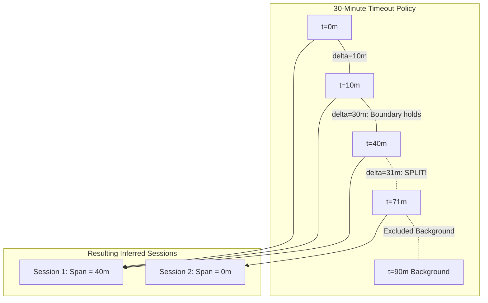

#### Comparison with Explicit Client Session ID:
Suppose the mobile client remained suspended in memory and tagged all four foreground events ($[0, 10, 40, 71]$) with the exact same `ga_session_id`.
- The explicit session duration would be:
  $$\text{Explicit Span} = 71 - 0 = 71\text{ minutes}$$
*Takeaway:* Inferred sessionization splits the activity into two sessions with 40 total minutes of span, whereas explicit ID tracking reports one long 71-minute session spanning the 31-minute idle gap. Neither is inherently "correct"; they represent different definitions of player continuity.

#### Part 2: Incremental Active Engagement Calculation
In a separate telemetry test, a player emits two `user_engagement` events reporting incremental foreground engagement proxy:
- Interval 1: $60,000\text{ ms}$ ($1.0\text{ minute}$).
- Interval 2: $120,000\text{ ms}$ ($2.0\text{ minutes}$).
$$\text{Total Measured Active Engagement} = 60,000 + 120,000 = 180,000\text{ ms} = 3.0\text{ minutes}$$
This confirms that the separate engagement example ($3$ minutes) can be orders of magnitude smaller than total wall-clock session span ($40$ or $71$ minutes).

---

For a verified incremental field, recorded duration is the sum of its eligible increments. If 60,000 ms is on user_engagement and 120,000 ms on another event, an all-event sum is 180,000 ms, while a user_engagement-only query returns 60,000 ms. Neither amount independently proves human attention.

### Assumptions and preparation

1. **Filtering Non-Interactive Events:** Automated background syncs, push notification receipt pings, and crash reporting heartbeats must be filtered out before clustering events into player sessions.
2. **Handling Missing Session Ends:** Mobile apps are frequently terminated abruptly by the OS memory manager or phone shutdown, emitting no `session_end` event. Pipelines must handle missing ends gracefully using timeout thresholds rather than discarding open sessions.
3. **Threshold consistency:** A shared timeout makes the inference policy consistent, but event eligibility, background behavior and SDK lifecycle rules can still differ across platforms.

---

### Advantages

1. **Lifestyle Fit Diagnostics:** Identifies whether players engage in short burst "bite-sized" play or long immersive gaming marathons.
2. **Disentangles Span from Attention:** A validated foreground-duration proxy provides a second view of engagement, while retaining limitations around idling, event coverage and attention.
3. **Return Rhythm Mapping:** Inter-session gaps reveal daily peak hours, helping live-ops teams schedule daily reset rewards, energy refills, and limited-time events.

---

### Disadvantages and failure cases

1. **Single-Event Truncation to Zero:** A player who visits once and performs a single action records a 0-second event span, severely depressing average session length.
2. **Arbitrary Inactivity Thresholds:** Setting the timeout to 30 minutes splits a player who reads a 31-minute in-game guide into two sessions, while grouping a player who took a 29-minute power nap into one session.
3. **Clock Skew on Local Devices:** If the client OS clock shifts or syncs with cell towers mid-session, timestamps can jump backward, creating negative intervals.

#### Common mistake

> **Incorrect Claim:** *"Our average session length is 25 minutes because the time between the first and last event of each session averages 25 minutes. Players are actively playing our game for 25 continuous minutes."*
>
> **Technical Correction:** Event span measures only the **elapsed wall-clock duration between recorded timestamps**; it does **not** measure active gameplay attention. A player who puts their phone down to take a phone call for 20 minutes while the game sits on the pause menu will generate a 25-minute event span with only 5 minutes of real gameplay attention. Foreground engagement is a proxy; measuring input activity or attention requires separate instrumentation and validation.

---

### Evaluation

- **Zero-span fraction audit:** Count sessions with zero event span and inspect a sample of their traces. Equal timestamps or missing events can also produce zero span, so this is not exactly a count of single-event sessions. Report mean, median and the zero-span fraction without a universal alert threshold.
- **Span versus engagement audit:** Compare event spans with the measured engagement proxy, checking event selection, missing intervals and foreground behavior. A discrepancy is an investigation lead; it does not uniquely diagnose background idling.

---

### Alternatives

| Method Alternative | Core Distinction | When to Prefer Over M05 Sessions |
|---|---|---|
| **Cumulative Daily Playtime (M01)** | Sums all active minutes per player-day without attempting to partition events into discrete session buckets. | Prefer when evaluating total daily player exhaustion, battery consumption, or server cost. |
| **Session Gap Inference vs Explicit Session UUIDs** | Inferred applies a universal 30m inactivity rule in ETL; explicit relies on client runtime lifecycle listeners. | Prefer explicit IDs when mobile OS lifecycle transitions are trusted; prefer inferred sessions when aggregating raw server event streams. |

---

### PetVsMonster fit

**Readiness:** Usable with current events for the existing session_start counts; Needs data validation for session IDs, inter-session gaps and duration semantics. [MetricsStore._overviewFor](../../server/lib/src/metrics_store.dart) sums engagement_time_msec only on user_engagement rows, then divides minutes by summed daily DAU. This is an event-selected foreground engagement proxy; other event types may carry increments that it omits. Human attention and complete client emission were not verified. Session reconstruction may require sorting one million events into ten thousand player histories, not merely reading the existing KPI.

---

### Sources and confidence

[Google User engagement](https://support.google.com/analytics/answer/11109416?hl=en) defines the focus/foreground proxy and event placement caveats. [BigQuery export schema](https://support.google.com/analytics/answer/7029846?hl=en) describes exported fields. The [local aggregate](../../server/lib/src/metrics_store.dart) selects user_engagement rows only; total human attention and complete client emission were not verified.

**Evidence limits:** Example arithmetic is checked separately from empirical validity. See the [claim register](game-analytics-methods-sources.md) and [repair verification](game-analytics-methods-verification.md). This remains a pilot awaiting owner review.

---

## M06 RFM scoring and lifecycle groups

### Question and intuition

> **Core Designer Question:** *"Which players are our most valuable active champions, who is cooling down or lapsing, and how do we prevent newly acquired players from being mislabeled as churning veterans?"*

A live-service game's player base is in constant motion. Every day, new players install the game, established veterans grind daily quests, casual players log in sporadically, and formerly active players drift away. Treating all players as an undifferentiated group prevents the studio from directing the right message or mechanic to the right audience:
- Offering an aggressive re-engagement reward to a player who plays four hours every day is wasteful and can disrupt game balance.
- Offering a standard early-game starter pack to a veteran who spent $500 last month is tone-deaf.
- Mislabling a brand-new player who installed 12 hours ago as "at-risk of churn" simply because they have only logged one session distorts lifecycle reporting.

RFM scoring and lifecycle grouping segments players based on three observable behavioral dimensions:
- **Recency ($R$):** How recently did the player log in? (Measures freshness and habit persistence).
- **Frequency ($F$):** How often do they play? (Measures engagement intensity).
- **Monetary ($M$):** How much real money have they spent? (Measures economic commitment).

By combining these dimensions into discrete profile codes and applying lifecycle transition rules, studios can distinguish dedicated champions, cooling players, dormant spenders, and newly acquired users.

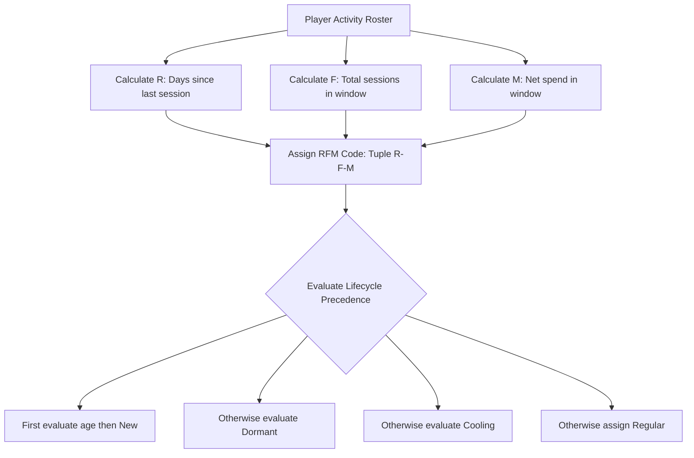

---

### Inputs and output

| Specification Dimension | Detail |
|---|---|
| **Input Telemetry** | Verified event timestamps per player (`user_pseudo_id`, `ts_micros`), earliest observed install timestamp (`first_open`), session counts, and verified in-app purchase receipts (`value_cents`). |
| **Analysis Unit** | Player (`user_pseudo_id`) evaluated at an explicit cutoff date $D_{\text{cutoff}}$. |
| **Observation Window** | Trailing evaluation window of $W$ calendar days (e.g., $10\text{ days}$, $30\text{ days}$). |
| **Output Metrics** | Continuous metrics ($R\text{ days}$, $F\text{ sessions}$, $M\text{ dollars}$), Binned scores ($R_{\text{score}}, F_{\text{score}}, M_{\text{score}} \in \{1, 2, 3\}$), Categorical RFM Code (e.g., `331`), and Deterministic Lifecycle Label (`New`, `Regular`, `Cooling`, `Dormant`). |

---

### How it works

RFM groups records by recency, frequency and monetary value. Its retail conventions need adaptation for games: nonpayers can be common, activity opportunities vary by install age and multiple users can tie at zero spend. [The author-maintained rfm package manual](https://search.r-project.org/CRAN/refmans/rfm/html/00Index.html) is an implementation reference; the bins below are our illustrative policy, not a universal standard.

In free-to-play mobile games, direct retail RFM can require adaptations:
1. **Zero spend and tied bins:** If many records have zero spend, equal-count bins may split identical values or collapse. Inspect ties; fixed bins, a separate payer flag and nonzero-only tiers are possible policies, not mandatory universal choices.
2. **Tuples versus a designed score:** The code `331` identifies three bins. It is not inherently 331 units of value, and equal digit sums do not imply equal profiles. A deliberately weighted combined score can be designed, but its weights and decision validity must be stated and evaluated. Preserve the component tuple even when using such a score.
3. **Non-Monetary Substitution (Progression RFP):** For games with no monetization or cosmetic-only shops, the Monetary dimension ($M$) is often replaced by **Progression ($P$)** (e.g., player level, wave reached, or bosses defeated), yielding an **RFP** model.

#### 2. Defining Binned Scores
Let $t_{\text{cutoff}}$ denote the evaluation timestamp. For an observation window $[t_{\text{start}}, t_{\text{cutoff}})$:
- **Recency ($R$):** Calendar days elapsed between player's last active date and cutoff:
  $$R = \text{date}(t_{\text{cutoff}}) - \text{date}(t_{\text{last}})$$
- **Frequency ($F$):** Total count of unique sessions initiated within the window:
  $$F = \sum_{s \in \text{Sessions}} \mathbb{I}(t_{\text{start}} \le t_s < t_{\text{cutoff}})$$
- **Monetary ($M$):** Net fiat revenue attributed to player within the window:
  $$M = \sum_{p \in \text{Purchases}} \text{Price}(p) - \sum_{r \in \text{Refunds}} \text{Price}(r)$$

Scores are assigned using explicit threshold boundaries:
- Recency: Higher score indicates more recent activity ($R \le 2 \implies 3$; $2 < R \le 6 \implies 2$; $R > 6 \implies 1$).
- Frequency: Higher score indicates more frequent play ($F \ge 4 \implies 3$; $2 \le F \le 3 \implies 2$; $F \le 1 \implies 1$).
- Monetary: Higher score indicates higher spend ($M > \$10 \implies 3$; $\$0 < M \le \$10 \implies 2$; $M = \$0 \implies 1$). Negative net spend requires a separately declared refund or credit policy and remains unscored in this example. Unknown or unverified spend must not be silently scored as $1$; it must be flagged as unrecorded.

#### 3. Deterministic Lifecycle Precedence
To turn multidimensional behavior into operational live-ops cohorts, studios apply lifecycle rules. Because player attributes can satisfy multiple criteria simultaneously, **rules must be evaluated in strict priority order**:

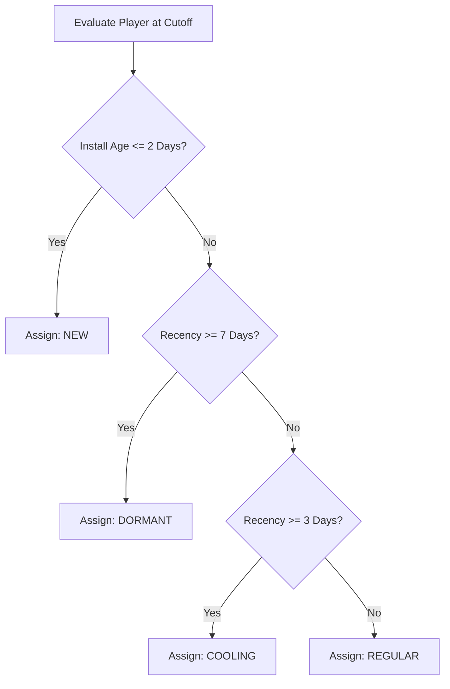

- **Rule 1 (New):** $\text{Install Age} = \text{date}(t_{\text{cutoff}}) - \text{date}(t_{\text{install}}) \le 2\text{ days}$.  
  *Rationale:* A player who installed yesterday has had only 24 hours to play. Scoring them as "low frequency" or "cooling" penalizes lack of opportunity.
- **Rule 2 (Dormant):** (If not New) $R \ge 7\text{ days}$.  
  *Rationale:* Has not logged in for a full week. Considered lapsed or severely at-risk.
- **Rule 3 (Cooling):** (If not New or Dormant) $R \ge 3\text{ days}$.  
  *Rationale:* Formerly active, but has missed their habitual 48-hour return window.
- **Rule 4 (Regular):** (All remaining players).  
  *Rationale:* Actively engaged within the last 48 hours ($R \le 2\text{ days}$).

---

### Worked game example

We evaluate synthetic fixture **EX07** on a 10-day observation window (January 1 through January 10, 2026 inclusive) with cutoff at `2026-01-11 00:00:00 UTC`.

#### Threshold Scoring Scheme (EX07 Policy)
- **Recency ($R$):** Score 3 for $R \le 2$; Score 2 for $2 < R \le 6$; Score 1 for $R > 6$.
- **Frequency ($F$):** Score 3 for $F \ge 4$; Score 2 for $2 \le F \le 3$; Score 1 for $F \le 1$.
- **Monetary ($M$):** Score 1 for $M = \$0$; Score 2 for $\$0 < M \le \$10$; Score 3 for $M > \$10$.

#### Player Evaluation Matrix (EX07)

| Player | First Active Date | Last Active Date | Sessions $F$ | Net USD $M$ | Recency $R$ ($11 - \text{Last}$) | $R$ Score | $F$ Score | $M$ Score | RFM Code | Lifecycle Label |
|---|---|---|---|---|---|---|---|---|---|---|
| **P01** | Day 1 | Day 10 | 5 | $0 | $11 - 10 = 1$ | 3 | 3 | 1 | `331` | **Regular** |
| **P02** | Day 1 | Day 7 | 2 | $5 | $11 - 7 = 4$ | 2 | 2 | 2 | `222` | **Cooling** |
| **P03** | Day 1 | Day 1 | 1 | $20 | $11 - 1 = 10$ | 1 | 1 | 3 | `113` | **Dormant** |
| **P04** | Day 10 | Day 10 | 1 | $0 | $11 - 10 = 1$ | 3 | 1 | 1 | `311` | **New** |

#### Step-by-Step Scoring and Lifecycle Tracing:

1. **Player P01 (Dedicated Non-Spender):**
   - Recency: Last active Day 10. $R = 11 - 10 = 1\text{ day} \implies \text{Score } 3$.
   - Frequency: 5 sessions $\ge 4 \implies \text{Score } 3$.
   - Monetary: $\$0 \implies \text{Score } 1$.
   - **RFM Code:** `331`.
   - *Lifecycle Precedence:* Install age $= 11 - 1 = 10\text{ days}$ (not New); $R = 1 < 7$ (not Dormant); $R = 1 < 3$ (not Cooling). Matches Rule 4: **Regular**.
2. **Player P02 (Casual Payer):**
   - Recency: Last active Day 7. $R = 11 - 7 = 4\text{ days} \implies \text{Score } 2$.
   - Frequency: 2 sessions $\implies \text{Score } 2$.
   - Monetary: $\$5 \implies \text{Score } 2$.
   - **RFM Code:** `222`.
   - *Lifecycle Precedence:* Install age $= 10\text{ days}$; $R = 4 < 7$ (not Dormant); $R = 4 \ge 3 \implies$ Matches Rule 3: **Cooling**.
3. **Player P03 (Lapsed Whale):**
   - Recency: Last active Day 1. $R = 11 - 1 = 10\text{ days} \implies \text{Score } 1$.
   - Frequency: 1 session $\implies \text{Score } 1$.
   - Monetary: $\$20 > 10 \implies \text{Score } 3$.
   - **RFM Code:** `113`.
   - *Lifecycle Precedence:* Install age $= 10\text{ days}$; $R = 10 \ge 7 \implies$ Matches Rule 2: **Dormant**.
   - *Takeaway:* Code `113` identifies a critical business risk: a player with relatively high spend in this small example and no recorded return after Day 1; this does not prove permanent abandonment.
4. **Player P04 (Fresh Install):**
   - Recency: Last active Day 10. $R = 11 - 10 = 1\text{ day} \implies \text{Score } 3$.
   - Frequency: 1 session $\implies \text{Score } 1$.
   - Monetary: $\$0 \implies \text{Score } 1$.
   - **RFM Code:** `311`.
   - *Lifecycle Precedence:* Install age $= 11 - 10 = 1\text{ day} \le 2\text{ days} \implies$ Matches Rule 1: **New**.
   - *Takeaway:* Although P04 has Recency score 3 like P01, the lifecycle precedence correctly flags P04 as `New` rather than `Regular`. P04 has had only 24 hours of opportunity to play.

---

### Assumptions and preparation

1. **Fixed Window Boundaries:** All player statistics must be calculated across the exact same historical time window $[t_{\text{cutoff}} - W, t_{\text{cutoff}})$. Running rolling queries with shifting evaluation dates corrupts cohort tracking.
2. **Separating Known Zero from Unknown Spending:** Players with verified $0 in-app purchases are scored $M=1$. Players whose purchase logs were lost or unintegrated must be excluded or flagged as $M=\text{NULL}$.
3. **Handling Mobile Reinstalls:** If an existing player reinstalls the app and gets a new `user_pseudo_id`, they will falsely appear as `New` (Rule 1). Server-side account authentication links solve this.

---

### Advantages

1. **Intuitive Behavioral Profiles:** The 3-character tuple immediately communicates freshness, engagement, and spend without complex statistical interpretation.
2. **Deterministic and Explainable:** Unlike black-box machine learning clustering, RFM rules are transparent: any designer can trace exactly why a player received a specific label.
3. **Opportunity Normalization via Precedence:** The `New` rule prevents newly acquired users from polluting veteran churn metrics.

---

### Disadvantages and failure cases

1. **Coarse Discretization Cliffs:** A player who spent $10.01 receives Monetary score 3, while a player who spent $9.99 receives score 2, obscuring subtle financial variation.
2. **Zero-Inflation of Monetary Dimension:** If known spending is zero for every player, monetary bins add no differentiation. If payment collection is absent, spending is unknown rather than verified zero.
3. **Retrospective Nature (Not Churn Prediction):** RFM summarizes **what a player has done in the past**. Labeling a player dormant does not predict *when* they will return or whether an intervention will revive them.

#### Common mistake

> **Incorrect Claim:** *"Player P04 has an RFM code of `311`, so their total value score is $3 + 1 + 1 = 5$. Player P03 has code `113`, so their score is $1 + 1 + 3 = 5$. Therefore, both players have equal health and value to the game."*
>
> **Technical Correction:** RFM codes are **categorical diagnostic profiles, not arithmetic numbers**. Adding the digits without a separately justified scoring model discards important profile differences. Player `P04` (`311`) is new and spent $0 in this fixture; player `P03` (`113`) spent $20 and has no observed activity since Day 1. The rule labels P03 dormant, without proving permanent departure. Treating them as identical produces disastrous marketing actions (e.g., sending a "We miss you!" push notification to a player who installed 12 hours ago).

---

### Evaluation

- **Bin evaluation:** Check that bin boundaries match the declared dimension ordering. If a score is intended for a later business decision, evaluate its association with that later outcome using mature follow-up; higher bins are not guaranteed to improve every business metric.
- **Quantile Collapse Diagnostic:** If attempting quantile binning, check whether the 20th, 40th, and 60th percentiles of $M$ are all $0$. If so, document ties and choose a transparent policy such as distinct-value bins, payer-specific tiers or fixed thresholds.

---

### Alternatives

| Method Alternative | Core Distinction | When to Prefer Over M06 RFM |
|---|---|---|
| **K-Means / Cluster Segmentation (M14, future chapter)** | Discovers clusters automatically across multiple continuous metrics (retries, kills, playtime) without arbitrary cutoff bins. | Prefer when exploratory patterns are unknown and player behavior does not map cleanly to retail RFM dimensions. |
| **Predictive Churn Machine Learning (M23)** | Models future probability of non-return using behavioral features rather than classifying historical recency. | Prefer when allocating marketing budget to retain high-value players before they stop logging in. |

---

### PetVsMonster fit

**Readiness:** Needs data validation for spend, history and progression fields. [EventStore](../../server/lib/src/event_store.dart) stores identity and timestamps; [MetricsStore](../../server/lib/src/metrics_store.dart) counts session starts. Recency and frequency queries are plausible after coverage and event validation, without a mandatory summary table. Receipt completeness and refunds were not checked. RF-progression is an alternative only after progression fields are confirmed, and it must be named separately from monetary RFM. Binning ten thousand already-aggregated player rows is relatively simple; building those rows can dominate cost.

---

### Sources and confidence

[The rfm package reference](https://search.r-project.org/CRAN/refmans/rfm/html/00Index.html) provides an author-maintained implementation reference. EX07 defines our bins and precedence; neither those rules nor later predictive value are externally validated. The previously misattributed Hughes book citation has been withdrawn; a corrected bibliographic note is retained in the source register without claiming chapter access.

**Evidence limits:** Example arithmetic is checked separately from empirical validity. See the [claim register](game-analytics-methods-sources.md) and [repair verification](game-analytics-methods-verification.md). This remains a pilot awaiting owner review.

---

## M07 Economy and monetization accounting

### Question and intuition

> **Core Designer Question:** *"Is our virtual gold economy experiencing hyper-inflation due to excessive monster drops, and what is our true net daily revenue per active player after deducting store refunds and adding rewarded ad payouts?"*

Live-service and free-to-play games operate two fundamentally different financial systems simultaneously:
1. **The Internal Virtual Economy:** In-game currencies (e.g., Gold Coins, Mana Gems, Energy) minted by the game and circulated between virtual rewards and gameplay sinks.
2. **The External Real-Money Economy:** Fiat currency transactions (USD, EUR) processed through platform stores (Apple App Store, Google Play, Steam) and ad networks.

Conflating these two systems is one of the most dangerous errors a game studio can make. When players earn millions of gold coins by defeating monsters, the game's virtual currency supply expands. Supply growth does not itself establish price inflation or real-money revenue. Its relationship to purchases depends on sinks, prices, progression and player demand and must be investigated.

Economy and monetization accounting builds separate reconcilable transaction ledgers for virtual resources and fiat cash. It tracks sources (faucets) and sinks (drains) to maintain economic stability, while reconciling gross receipts, store refunds, chargebacks, ad revenue, and active player counts to compute verified financial KPIs like ARPDAU and ARPPU.

```mermaid
flowchart TD
    subgraph Virtual_Economy_Ledger[Virtual Currency Ledger: Gold Coins]
        V_Open[Opening Balance: 100] --> V_Source[+ Sources: Monster Rewards +50]
        V_Source --> V_Sink[- Sinks: Potions -30, Upgrades -20]
        V_Sink --> V_Close[Closing Balance: 100]
    end
    subgraph Real_Money_Ledger[Real-Money Monetization Ledger: USD Cents]
        M_Gross[Gross IAP Purchases: 1000 cents] --> M_Ref[- Refunds: 600 cents]
        M_Ref --> M_NetIAP[Net IAP: 400 cents]
        M_NetIAP --> M_Ad[+ Attributed Ad Network: 50 cents]
        M_Ad --> M_Total[Total Net Revenue: 450 cents]
        M_Total --> M_ARPDAU[ARPDAU: 450 / 4 DAU = 112.5 cents]
    end
```

---

### Inputs and output

| Specification Dimension | Detail |
|---|---|
| **Input Telemetry** | Verified transaction records: `transaction_id` (string), `user_pseudo_id` (string), `currency_type` (virtual token vs fiat currency), `amount` (integer units or integer cents), `transaction_type` (`source`, `sink`, `purchase`, `refund`), and attributed ad impression network payouts. |
| **Analysis Unit** | Transaction (`transaction_id`), Currency Ledger (`currency_type`), and Active Player (`user_pseudo_id`). |
| **Observation Window** | Single calendar settlement date (UTC) or multi-day accounting period. |
| **Output Metrics** | Virtual Opening/Closing balances, Total Sources, Total Sinks, Net virtual currency supply change, Gross IAP revenue, Refund deductions, Net IAP revenue, Ad revenue, Total Net Revenue, Gross Payer Conversion, Net Payer Count, Gross ARPPU, Net ARPPU, and ARPDAU. |

---

### How it works

#### 1. Virtual Currency Source-and-Sink Accounting
Every in-game virtual currency (e.g., Gold Coins) must satisfy the fundamental conservation equation across an observation window:
$$\text{Closing Balance} = \text{Opening Balance} + \sum_{i \in \text{Sources}} \text{Amount}(i) - \sum_{j \in \text{Sinks}} \text{Amount}(j)$$
- **Sources (Faucets):** Any gameplay mechanism that mints new currency into player accounts (e.g., quest rewards, monster kills, daily login bonuses, level-up milestones).
- **Sinks (Drains):** Any gameplay mechanism that permanently consumes and removes currency from the game (e.g., buying consumable potions, paying equipment upgrade fees, entry fees for dungeons).
- **Net supply change:**
  $$\Delta \text{Supply} = \sum \text{Sources} - \sum \text{Sinks}$$
  A positive change means currency supply grew in the defined population and window. Price inflation, affordability and incentive changes require price and usage evidence in addition to supply totals.

   *Reporting policy:* This synthetic example books a refund on its refund date. Some analytics reports instead restate the purchase date. These attribution choices alone do not define formal cash-basis or accrual accounting, which also depends on recognition and settlement rules.

#### 3. Monetization Population Ratios
To evaluate monetization efficiency, the player base is partitioned on the target date into distinct populations:
- **Active Players ($N_{\text{active}}$):** Total distinct DAU on the date.
- **Gross Purchasing Players ($N_{\text{gross\_payer}}$):** Distinct players with $\ge 1$ purchase event in the window.
- **Net Positive Spenders ($N_{\text{net\_payer}}$):** Distinct players whose net spend ($\text{Purchases} - \text{Refunds}$) is strictly greater than zero.

From these populations, standard commercial KPIs are defined:
- **Gross Payer Conversion Rate:**
  $$\text{Conversion}_{\text{payer}} = \frac{N_{\text{gross\_payer}}}{N_{\text{active}}}$$
- **Average Revenue Per Paying User (ARPPU):**
  $$\text{ARPPU}_{\text{net}} = \frac{\text{Revenue}_{\text{net\_iap}}}{N_{\text{gross\_payer}}} \quad \text{or} \quad \text{ARPPU}_{\text{gross}} = \frac{\text{Revenue}_{\text{gross}}}{N_{\text{gross\_payer}}}$$
- **Average Revenue Per Daily Active User (ARPDAU):**
  $$\text{ARPDAU} = \frac{\text{Revenue}_{\text{total}}}{N_{\text{active}}} = \frac{\text{Revenue}_{\text{net\_iap}} + \text{Revenue}_{\text{ads}}}{N_{\text{active}}}$$

---

### Worked game example

We evaluate synthetic fixture **EX08** covering a single calendar day with 4 active players (`P01`, `P02`, `P03`, `P04`).

#### Part 1: Virtual Currency Ledger (Gold Coins)
- **Opening Balance:** $100\text{ coins}$.
- **Raw Transaction Log:**
  - `V1`: $+50\text{ coins}$ (Monster kill bounty source).
  - `V2`: $-30\text{ coins}$ (Health potion purchase sink).
  - `V3`: $-20\text{ coins}$ (Sword upgrade sink).
  - `raw row 4 repeating transaction_id V3`: $-20\text{ coins}$ (Duplicate network transmission of `V3`, identical transaction ID and contents).
- **Deduplication Policy:** Match by unique `transaction_id`. Retain `V3` exactly once; discard `raw row 4 repeating transaction_id V3`.
- **Reconciliation:**
  - Sources: $+50\text{ coins}$.
  - Sinks: $30 + 20 = 50\text{ coins}$.
  - **Closing Balance Oracle:**
    $$\text{Closing Balance} = 100 + 50 - 50 = 100\text{ coins}$$
  *Net supply result:* Supply change is zero for this ledger. That says nothing by itself about prices or the distribution of player balances.

#### Part 2: Real-Money Monetization Ledger (USD Cents)
- **Population:** 4 active players ($N_{\text{active}} = 4$).
- **Raw Transactions:**
  - `T1` (`P01`): Purchase 500-gem pack for $400\text{ cents}$ ($4.00). Ingested twice $\implies$ deduplicated to $400\text{ cents}$.
  - `T2` (`P02`): Purchase Battle Pass for $600\text{ cents}$ ($6.00$).
  - `R1` (`P02`): Full refund of Battle Pass `T2` for $-600\text{ cents}$ (booked on refund date).
  - `P03, P04`: $0\text{ purchases}$.
  - **Attributed Ad Network Revenue:** $50\text{ cents}$ ($0.50) from rewarded video completions.

#### Step-by-Step Accounting Reconciliation:
1. **Gross IAP Revenue:**
   $$\text{T1 } (400) + \text{T2 } (600) = 1,000\text{ cents} \quad (\$10.00)$$
2. **Refund Deductions:**
   $$\text{R1 } (600) = 600\text{ cents} \quad (\$6.00)$$
3. **Net IAP Revenue:**
   $$1,000 - 600 = 400\text{ cents} \quad (\$4.00)$$
4. **Payer Populations:**
   - Gross Purchasers: `P01` and `P02` initiated purchases $\implies N_{\text{gross\_payer}} = 2$.
   - Net Positive Spenders: `P01` net spend is $+400$; `P02` net spend is $600 - 600 = 0$. Spenders $> 0 \implies N_{\text{net\_payer}} = 1$.
5. **Gross Payer Conversion Rate:**
   $$\frac{N_{\text{gross\_payer}}}{N_{\text{active}}} = \frac{2}{4} = 0.50 \quad (50.00\%)$$
6. **ARPPU Metrics:**
   - **Net IAP per Gross Purchaser:**
     $$\frac{400\text{ cents}}{2} = 200\text{ cents} \quad (\$2.00)$$
   - **Gross IAP per Gross Purchaser:**
     $$\frac{1,000\text{ cents}}{2} = 500\text{ cents} \quad (\$5.00)$$
7. **Total Net Monetization (IAP + Ads):**
   $$400\text{ cents (Net IAP)} + 50\text{ cents (Ads)} = 450\text{ cents} \quad (\$4.50)$$
8. **Daily Revenue Per Active User (ARPDAU):**
   $$\text{ARPDAU} = \frac{450\text{ cents}}{4} = 112.50\text{ cents} \quad (\$1.125)$$

---

### Assumptions and preparation

1. **Transaction Key Idempotency:** Mobile networks frequently retry failed HTTP requests, causing clients to submit identical transaction receipts multiple times. Telemetry ingestion must enforce primary key deduplication on transaction UUIDs.
2. **Refund Matching and Sign Conventions:** Refunds must carry explicit negative signs or transaction-type markers (`refund`) to prevent being erroneously added to gross sales.
3. **Segregation of Currencies:** Never aggregate multiple virtual tokens (e.g., Gold Coins and Premium Crystals) into a single composite number. Each currency requires its own independent balance sheet.
4. **Excluded Platform Overhead:** Synthetic ledgers report gross and net receipts; they do not deduct platform store cuts (whose terms vary), local sales tax/VAT, or foreign exchange conversion fees. Net revenue is not profit.

---

### Advantages

1. **Supply and balance visibility:** Tracks currency circulation to alert designers when players are hoarding gold or starving for resources.
2. **Reconciled reporting:** Deduplication and refund handling make analytics totals more auditable, but settlement, receipt validation and completeness still require separate checks.
3. **Complete Monetization Picture:** Blending net IAP with attributed ad payouts ensures rewarded ads are recognized as a core monetization pillar.

---

### Disadvantages and failure cases

1. **Lagged Refund Attribution:** A player may spend $100 today and charge it back 45 days later. Booking refunds on the transaction date restates historical reports; booking on the refund date creates negative spikes on low-revenue days.
2. **Ad Network Reporting Latency:** Ad revenue estimates and settlement can arrive or change later. Record the provider, estimate status and reporting cutoff; do not assume one universal finalization delay.
3. **Shop Visit Conflation:** Tracking store impressions or catalog views as "monetization interest" without verifying actual cryptographic purchase receipts inflates perceived conversion.

#### Common mistake

> **Incorrect Claim:** *"Our players earned 500,000 Gold Coins today, up 40% from yesterday. Our game's monetization and revenue are booming!"*
>
> **Technical Correction:** Earning virtual currency from monster drops is a **virtual economy source, not real-money revenue**. The studio earned $0 from those coins. A change in free rewards might affect demand for purchases, but this is a hypothesis requiring evidence about the game economy and player behavior. Virtual currency supply and real fiat revenue must be analyzed on completely separate ledgers.

---

### Evaluation

- **Balance reconciliation:** Verify closing minus opening equals sources minus sinks for each currency and population. A residual prompts investigation of missing or duplicate events, transfers, resets and timing; it is not proof of an exploit. Reconcile against an independently recorded closing balance rather than deriving both sides from the same totals.
- **Refund ratio:** Divide refunds by gross IAP only when the denominator is positive. A refund-only day has an undefined ratio. Compare counts, timing and product mix with a declared baseline; no universal alert percentage is established here.
- **Transaction conflicts:** Two rows with the same transaction ID and different amounts must be flagged for reconciliation rather than arbitrarily deduplicated. Refund R1 has its own identifier and must not be discarded as a duplicate of T2.

---

### Alternatives

| Method Alternative | Core Distinction | When to Prefer Over M07 Accounting |
|---|---|---|
| **LTV / Lifetime Value Forecasting (M24, future chapter)** | Projects future lifetime revenue using predictive retention and spend models rather than historical accounting. | Prefer when setting user acquisition marketing spend bids and payback periods. |
| **Whale Spending Concentration (Gini Coefficient)** | Quantifies inequality in revenue distribution across paying users rather than tracking total aggregate balances. | Prefer when evaluating whether the game's revenue is dangerously dependent on the top $0.1\%$ of spenders. |

---

### PetVsMonster fit

**Readiness:** Needs data validation for resource amounts, currencies, transaction IDs, receipts, refunds and ad attribution. [EventStore](../../server/lib/src/event_store.dart) can hold JSON parameters, but this does not establish that usable financial fields are emitted. If complete events exist, ledger queries may suffice; otherwise new collection is needed. Dedicated tables are an optional integrity or performance design, not a prerequisite established by this review. Deduplicating a million transaction rows requires stable keys and conflict handling. No payment or telemetry implementation was changed.

---

### Sources and confidence

[GameAnalytics resource events](https://docs.gameanalytics.com/events-metrics-and-filtering/event-types/resource-events/) and [Roblox economy events](https://create.roblox.com/docs/production/analytics/economy-events) document virtual resource flows. EX08 defines its own gross/net, refund-date and ad attribution policies. Arithmetic reconciliation does not establish audited financial statements or current payment telemetry.

**Evidence limits:** Example arithmetic is checked separately from empirical validity. See the [claim register](game-analytics-methods-sources.md) and [repair verification](game-analytics-methods-verification.md). This remains a pilot awaiting owner review.

---

## M08 Spatial and qualitative analysis

### Question and intuition

> **Core Designer Question:** *"Where on our dungeon maps are players dying most frequently relative to actual traffic, and what recurring themes emerge from qualitative playtest recordings and player feedback?"*

Quantitative dashboards excel at telling developers *how many* players logged in, converted, or churned. However, when gameplay breaks down, numeric aggregates alone cannot explain the physical or psychological reality of the player's experience:
- A numeric drop in Level 5 completion does not show whether players are falling into a hidden spike trap, getting cornered by boss adds, or wandering into an empty dead-end.
- A drop in retention cannot differentiate between frustrating microtransactions, boring combat mechanics, or confusing UI layout.

Spatial analysis and qualitative investigation bridge this gap:
1. **Spatial Event Density:** Maps telemetry coordinates $(x, y, z)$ directly onto game levels to visualize combat hot spots, death locations, and movement trajectories. Critically, spatial analysis normalizes raw event counts against player traffic exposure to distinguish genuine hazards from high-traffic thoroughfares.
2. **Qualitative Thematic Coding:** Systematically categorizes freeform player feedback (app store reviews, Discord messages, playtest video commentary) into structured themes using a defined codebook, turning messy text into measurable design insights.

```mermaid
flowchart TD
    subgraph Spatial_Track[Spatial Telemetry Pipeline]
        S1[Log Coordinates x, y, z with Event] --> S2[Bin into 2D Grid Cells or Zones]
        S2 --> S3[Count Total Visits: Exposure]
        S2 --> S4[Count Deaths / Failures]
        S3 & S4 --> S5[Observed risk: Death visits / Visits]
    end
    subgraph Qualitative_Track[Qualitative Research Pipeline]
        Q1[Collect Reviews, Surveys, Playtest Transcripts] --> Q2[Develop Thematic Codebook]
        Q2 --> Q3[Multi-label Thematic Coding]
        Q3 --> Q4[Generate Hypotheses for Quantitative Validation]
    end
```

---

### Inputs and output

| Specification Dimension | Detail |
|---|---|
| **Input Telemetry** | Spatial: Level ID (`level_id`), 2D/3D world coordinates (`pos_x`, `pos_y`, `pos_z`), event type (`death`, `kill`, `visit`), visit episode identifier. Qualitative: Freeform text records, source channel (`app_store`, `discord`, `playtest`), player account ID. |
| **Analysis Unit** | Spatial: Visit Episode per Zone/Grid Cell. Qualitative: Single feedback comment or transcript snippet. |
| **Observation Window** | Level play session or historical feedback collection epoch. |
| **Output Metrics** | Spatial: Raw death counts, Total visits, Death-per-visit rate ($\% $), Observed per-visit risk ratio ($R_B / R_A$). Qualitative: Thematic category counts, Multi-label percentage distribution, Codebook assignment matrix. |

---

### How it works

#### 1. Spatial Event Density and Exposure Normalization
Let a game map be partitioned into discrete spatial zones or regular grid cells $A \in \{1 \dots M\}$ (e.g., $1\text{m} \times 1\text{m}$ tiles or distinct room polygons).

For each zone $A$:
- Let $V_A$ denote the total number of **eligible visit episodes** (times a player entered zone $A$).
- Let $D_A$ denote the number of visits that resulted in a player death.

The raw death count $D_A$ measures absolute mortality volume. However, the **observed death-per-visit risk** under the one-death-per-visit convention is:
$$\text{Death-per-visit risk}(A) = \frac{D_A}{V_A}$$
- *The Highway Fallacy:* A central hub room with $V_1 = 10,000$ visits and $D_1 = 20$ deaths yields a raw death count of $20$, but an observed per-visit risk of only $20 / 10,000 = 0.2\%$. A lethal hidden pit with $V_2 = 10$ visits and $D_2 = 8$ deaths yields a raw count of only $8$, but an observed per-visit risk of $8 / 10 = 80\%$.
- A raw, unnormalized heatmap highlights room 1 as a bright red "hot spot" and room 2 as faint, tricking designers into nerfing the safe central hub while leaving the lethal trap invisible.

#### 2. Qualitative Thematic Coding Instructions
Qualitative coding associates text passages with a declared set of themes. The [UK government guide](https://www.gov.uk/guidance/analyse-your-data-evaluating-digital-health-products) describes coding and thematic analysis; the assignment rules below are our synthetic codebook:
1. **Codebook Construction:** Establish clear, mutually agreed definitions for thematic codes (e.g., `UI Clarity`, `Difficulty`, `Positive Experience`).
2. **Multi-Label Assignment:** Because a single player comment can express multiple independent thoughts (e.g., praise combat while criticizing the UI), comments are tagged using **multi-label coding** rather than forced single-choice classification.
3. **Category Prevalence and Percentage Sums:**  
   For a feedback corpus of $N$ comments, the frequency of theme $T$ is:
   $$\text{Freq}(T) = \frac{|\{ c \in \text{Comments} \mid T \in \text{Tags}(c) \}|}{N}$$
   > [!NOTE]
   > Because comments may receive multiple simultaneous tags, the sum of category frequencies across all themes can **validly exceed 100%**:
   > $$\sum_T \text{Freq}(T) = \frac{\text{total theme assignments}}{N}$$
   This total may be below, equal to or above 100 percent. It is at least 100 percent only if every comment receives at least one code.
4. **The Sampling Representation Limitation:**  
   Qualitative feedback and playtest samples (e.g., 5 or 20 players) are **non-random and self-selected**. Vocal players in Discord or reviews represent an engaged, passionate minority. Qualitative analysis reveals **what categories of friction exist**; it **cannot establish population-wide prevalence**. Once a qualitative problem is identified, quantitative telemetry must be deployed to measure how many players actually experience it.

---

### Worked game example

We evaluate synthetic fixture **EX09** containing two independent exploratory datasets: a spatial dungeon hazard evaluation and a qualitative feedback coding study.

#### Part 1: Spatial Event Density (Dungeon Death Rates)
Two zones in a dungeon level are evaluated over a test weekend:
- **Unit of Analysis:** Independent player visit episode (at most one death per episode).

| Dungeon Zone | Eligible Visit Episodes $V$ | Episodes Ending in Death $D$ | Raw Deaths | Death-per-Visit Rate ($D / V$) |
|---|---|---|---|---|
| **Area A (Central Hub)** | 1,000 | 20 | **20** | $\frac{20}{1,000} = 0.02 \quad (\mathbf{2.00\%})$ |
| **Area B (Boss Lair)** | 100 | 8 | **8** | $\frac{8}{100} = 0.08 \quad (\mathbf{8.00\%})$ |

#### Mathematical Comparison:
- **Raw Count Comparison:** Area A records $2.5\times$ more total deaths than Area B ($20 > 8$).
- **Normalized risk comparison:**
  $$\text{Observed Per-Visit Risk Ratio} = \frac{\text{Rate}(B)}{\text{Rate}(A)} = \frac{0.08}{0.02} = 4.0$$
  *Finding:* The observed fraction of visits ending in death is **four times as high** in B as in A ($8.00\% \text{ vs } 2.00\%$).
- *Design Consequence:* A studio relying on raw event heatmaps would misidentify Area A as the primary problem zone, squandering balance effort on a safe highway while missing B's higher observed per-visit risk. Player ability, visit duration and encounter mix may differ; this is not a causal area effect or a survival hazard ratio.

```mermaid
flowchart TD
    subgraph Raw_vs_Normalized[Spatial Exposure Normalization]
        R1[Area A: 20 Deaths / 1000 Visits] -->|Raw Heatmap: BRIGHT RED| H1[Misleading Hotspot]
        R1 -->|Normalized: 2% Death Rate| N1[Lower observed visit risk]
        R2[Area B: 8 Deaths / 100 Visits] -->|Raw Heatmap: FAINT| H2[Overlooked Hazard]
        R2 -->|Normalized: 8% Death Rate| N2[Observed visit risk four times higher]
    end
```

---

#### Part 2: Qualitative Feedback Thematic Coding
A sample of $N = 5$ player reviews ($C1 \dots C5$) are analyzed using a three-theme codebook:
- `UI Clarity`: Confusion regarding buttons, menus, and shop navigation.
- `Difficulty`: Frustration with level balancing, enemy damage, or boss mechanics.
- `Positive Experience`: Expression of enjoyment, fun combat, or aesthetic praise.

#### Codebook Assignment Matrix (EX09)

| Comment ID | Raw Player Text | Coded Themes |
|---|---|---|
| **C1** | "The upgrade button is hard to find." | `UI Clarity` |
| **C2** | "The shop button is unclear." | `UI Clarity` |
| **C3** | "Level 5 is way too difficult." | `Difficulty` |
| **C4** | "Level 5 is difficult and the upgrade button is hard to find." | `UI Clarity`, `Difficulty` |
| **C5** | "Combat is enjoyable." | `Positive Experience` |

#### Thematic Frequency Calculations:
1. **`UI Clarity`:** Present in $\{C1, C2, C4\} \implies 3 / 5 = 0.60$ ($60.00\%$).
2. **`Difficulty`:** Present in $\{C3, C4\} \implies 2 / 5 = 0.40$ ($40.00\%$).
3. **`Positive Experience`:** Present in $\{C5\} \implies 1 / 5 = 0.20$ ($20.00\%$).
- **Sum of Category Frequencies:**
  $$60.00\% + 40.00\% + 20.00\% = 120.00\%$$
  *(Validly exceeds $100\%$ because comment C4 spans two themes simultaneously).*

*Scientific Scope Limitation:* While $60\%$ of comments in this sample mention UI clarity, this sample of 5 reviews does not prove that $60\%$ of all 50,000 active players struggle with the UI. It provides an actionable hypothesis: *"Players cannot find the upgrade button on Level 5."* The studio could combine exposure to the UI, discovery actions and a sampled usability study. Click counts alone do not establish who could not find the button.

---

### Assumptions and preparation

1. **Visit Episode Boundary Definition:** A visit episode must have clear entry and exit criteria. If a player paces back and forth across a room boundary, the engine must debounce entries to prevent artificially inflating visit denominators.
2. **Double Coding and Inter-Rater Reliability:** When coding qualitative text, two independent reviewers should code a random subset of comments. Record agreement and disagreements under an explicit unit definition; a chance-corrected statistic can be considered but cannot establish objective truth.
3. **Coordinate Frame Alignment:** Game engine coordinate systems (e.g., Unity left-handed $Y$-up vs Unreal $Z$-up) must be mapped accurately to level floorplans.

---

### Advantages

1. **Contextual Grounding:** Explains the spatial and physical mechanics behind numeric drops that funnels and aggregate tables leave mysterious.
2. **Hypothesis Generation:** Qualitative playtests expose unexpected player mental models, usability blunders, and emotional responses that telemetry events cannot capture.
3. **Comparable exposure measure:** Deaths per eligible visit can reveal high-risk low-traffic areas. Retain absolute counts to judge total impact and disclose uncertainty in small samples.

---

### Disadvantages and failure cases

1. **Heatmap Highway Hallucinations:** Raw heatmaps often emphasize high-traffic areas; whether these are the right priorities depends on the question and exposure.
2. **Qualitative Selection Bias:** Vocal players who post negative reviews or participate in Discord surveys have extreme opinions; relying solely on them biases design away from the quiet majority.
3. **High Telemetry Bandwidth:** Logging high-frequency $(x, y, z)$ position coordinates every frame causes mobile battery drain, network lag, and massive database storage costs.

#### Common mistake

> **Incorrect Claim:** *"Our heatmap shows twice as many deaths in the spawn hallway as in the boss room. Therefore, the spawn hallway is our most dangerous area and needs to be made easier."*
>
> **Technical Correction:** This error confuses **absolute event volume with environmental hazard**. If 10,000 players pass through the spawn hallway and 20 die (death rate $= 0.2\%$), while 50 players reach the boss room and 10 die (death rate $= 20\%$), the observed per-visit death risk is **100 times as high** in the boss-room sample. Use normalized rates for per-visit risk and raw counts for total impact. Both can inform priorities; neither alone proves what a design change will do.

---

### Evaluation

- **Exposure audit:** Reconcile deaths and visits using the same zone, population and window. Show both count and risk; verify at most one counted death per episode before calling deaths/visits a probability. Zero visits means the risk is undefined. Inspect resolution, boundary debouncing and repeated-player dependence.
- **Coder agreement:** Define one paired yes/no decision per comment and theme. Five comments times three themes give 15 paired decisions; 13 agreements yield 86.67 percent. Inspect per-theme disagreements and shared-negative effects; this does not establish objective truth, and no universal 80 percent gate is adopted.
- **Untagged counterexample:** Four comments with one UI theme assignment and three untagged comments yield a total theme frequency of 25 percent. The 120 percent in EX09 is a fixture result, not a universal lower bound.

---

### Alternatives

| Method Alternative | Core Distinction | When to Prefer Over M08 Spatial/Qualitative |
|---|---|---|
| **Level Progression Funnels (M04)** | Tracks stage-to-stage progression without recording continuous spatial coordinates or freeform text. | Prefer for high-level progression monitoring when spatial coordinate logging is technically infeasible. |
| **Automated Sentiment Analysis (NLP, M44, future chapter)** | Uses machine learning models to score sentiment polarity across thousands of reviews automatically. | Prefer when processing tens of thousands of app store reviews where manual qualitative coding is too slow. |

---

### PetVsMonster fit

**Readiness:** Needs data validation. The [server schema](../../server/lib/src/event_store.dart) has generic parameters and no dedicated feedback collection, but the separate Unity client and actual payloads were not inspected. Confirm coordinates, zone visits and a feedback corpus before deciding whether new telemetry or ingestion is needed. Aggregating a million points requires coordinate transforms and exposure accounting; reviewing ten thousand comments manually can dominate cost. Recommendations to collect fields are conditional, not claims about present client behavior.

---

### Sources and confidence

[Esri Calculate Rates](https://doc.esri.com/en/arcgis-pro/latest/tool-reference/spatial-statistics/calculate-rates.html) supports count/exposure normalization. [UK government qualitative analysis guidance](https://www.gov.uk/guidance/analyse-your-data-evaluating-digital-health-products) explains coding and themes. EX09 specifies its visit-risk and multi-label arithmetic. Earlier inaccessible book chapter references are not treated as verified support, and Unity emission remains uninspected.

**Evidence limits:** Example arithmetic is checked separately from empirical validity. See the [claim register](game-analytics-methods-sources.md) and [repair verification](game-analytics-methods-verification.md). This remains a pilot awaiting owner review.

---

## Method Selection Matrix

The following matrix compares all eight descriptive and exploratory methods in Family 1 across their core analytical dimensions, operational requirements, and repository readiness.

| Method | Question | Unit | Output | Readiness and data needs | Main limitation |
|---|---|---|---|---|---|
| [M01 Metric aggregation and distributions](#m01-metric-aggregation-and-distributions) | What happened and how varied was it? | Player or player-day | Counts, ratios and distributions | Usable with current events for basic aggregates; validate distribution fields | Averages hide skew and repeated users |
| [M02 Segmentation and cohort analysis](#m02-segmentation-and-cohort-analysis) | Which comparable groups differ? | Tracked player | Segment counts and rates | Usable with current events for platform/version; validate other tags | Composition and selection remain relevant |
| [M03 Retention and stickiness](#m03-retention-and-stickiness) | Who returned in a specified window? | Eligible tracked player | Return fractions and active-user ratios | Needs data validation for coverage and MAU history; exact-day code exists | Missing coverage and unequal follow-up |
| [M04 Funnel and conversion analysis](#m04-funnel-and-conversion-analysis) | Where does a specified path lose completions? | Player path or declared attempt | Step counts, conversion and timing | Usable with current events for implemented player paths; validate step events | Policy and converter selection affect interpretation |
| [M05 Session analysis and engagement frequency](#m05-session-analysis-and-engagement-frequency) | How are observed visits distributed in time? | Session or player-day | Counts, spans and engagement proxy | Usable with current events for current counts; validate ID and duration semantics | Foreground proxy is not attention |
| [M06 RFM scoring and lifecycle groups](#m06-rfm-scoring-and-lifecycle-groups) | How can past activity be grouped? | Tracked player | Tuples and declared lifecycle labels | Needs data validation for spend and history; summary tables are optional | Bins are heuristics and opportunity differs |
| [M07 Economy and monetization accounting](#m07-economy-and-monetization-accounting) | Do flows reconcile and what revenue was attributed? | Transaction and active player | Balances and gross/net ratios | Needs data validation for transaction IDs, currencies and refunds; add collection only if absent | Reconciliation is not proof of completeness or profit |
| [M08 Spatial and qualitative analysis](#m08-spatial-and-qualitative-analysis) | Where are observed problems and what themes occur? | Visit episode or comment | Per-visit risk and theme counts | Needs data validation; coordinates, exposure and feedback availability unknown | Observed risk and selected comments do not establish causes |

---

## Owner Review Prompts

To the project owner and lead engineers: please review this pilot edition of Family 1 (M01–M08) and consider the following evaluative questions before we proceed to subsequent method families (M09–M46).

1. **Self-Explanation Test:** Can you explain each method back in your own words after reading its intuition, diagram, and worked game example?
2. **Mathematical Density:** Are the mathematical formulations, definitions, and notations too dense, too light, or appropriately introduced for the team's needs?
3. **Explanatory Depth:** Do you want more step-by-step arithmetic calculations, game-specific scenarios, Mermaid diagrams, or implementation pseudocode in subsequent chapters?
4. **Actionability of Comparisons:** Are the advantages, limitations, failure cases, and evaluation alternatives specific enough to help you choose between competing analytical approaches?
5. **PetVsMonster Repository Fit:** Does the *PetVsMonster fit* section clearly distinguish current codebase capability, unobserved data fields, and proposed client instrumentation without conflating them?
6. **Reading Ergonomics:** Is each main chapter readable standalone, or does it force too much jumping back and forth to the companion appendices?
7. **Template Exemplar:** Which chapter serves as the best model for future families (M09–M46), and which chapter is the least clear or needs structural revision?

Please record any specific feedback or revision requests in the companion [Verification Register](game-analytics-methods-verification.md) under the *Owner Review Feedback Register* table.

