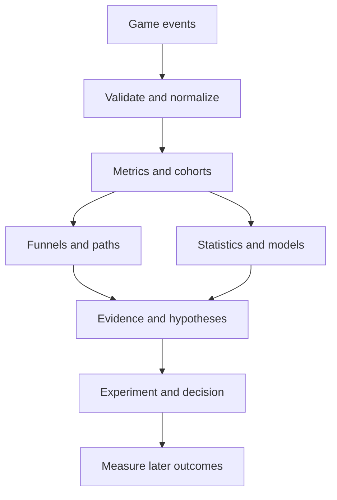

# Game player data analysis methods and platform research

Research report for AnalyticTracker and PetVsMonster
Prepared 19 October 2026

## 1 Purpose and main conclusion

This report explains how other analytics products analyze player behavior, surveys the main families of analysis techniques, and recommends which methods fit PetVsMonster. It is a practical reference for a small game team, not an implementation specification or a claim that every published algorithm is listed. There is no finite list of all data analysis techniques: many methods have hundreds of variants. The catalogue below covers the major useful families, including ordinary statistics, machine learning, causal inference, game economy analysis, and AI explanations.

The main recommendation is to improve trustworthy measurement and decision support before adding more complex AI. AnalyticTracker already contains substantial statistical analysis. The highest value next steps are clearer metric definitions, uncertainty and observation windows, seasonality aware anomaly checks, reliable experiment assignment, and an honestly evaluated churn baseline. A complex model should be adopted only if it improves a real decision on later, unseen players.

Vendor capabilities below come from official documentation consulted on 19 October 2026. These describe public product behavior, not undisclosed proprietary implementations. Algorithm explanations are methodological synthesis grounded in the cited documentation and papers. Recommendations for our project are judgments, not vendor claims. All numerical examples are hypothetical; this report does not measure actual PetVsMonster performance. Source numbers refer to the bibliography.

## 2 How other analytics products work

### GameAnalytics

GameAnalytics organizes game telemetry around event types and standard metrics. Its funnels follow player progress through selected actions, while resource events capture gains and spending in the virtual economy. Progression funnels also expose completion and failure ratios. The useful pattern is to attach game meaning to structured events before building reports. This makes tutorial, progression, purchase and reward flows comparable. [1–3]

Advantages: game specific concepts reduce setup work; structured progression and resource events make designer questions easier to express. Disadvantages: event taxonomy and funnel settings must match game design; proprietary screens cannot compensate for missing telemetry. For AnalyticTracker, adopt stable event semantics and explicit attempt outcomes. Public documentation does not justify claiming that these features use a particular ML model.

### Unity Analytics

Unity documents ordered funnels showing drop off and elapsed time between gameplay steps. This combines conversion with timing: a tutorial may lose players, or simply take too long. The published workflow emphasizes checking design assumptions against observed behavior. [4]

Advantages: natural fit for Unity event instrumentation and progression questions. Disadvantages: a predefined sequence can hide exploration or valid alternate routes; average elapsed times hide long tails. Our opportunity is to show alternative paths, median and upper percentiles, and exact funnel rules beside every result.

### Amplitude

Amplitude combines event segmentation, retention, journeys and reusable cohorts. Predictive cohorts define a starting population, a future outcome and a prediction horizon; scored users can then be analyzed as groups. Its anomaly investigation compares event properties against a baseline and surfaces segments associated with a change. [5–7]

Advantages: a finding can become a reusable cohort and support follow up questions. Disadvantages: automated ranking creates many hypotheses; feature importance and anomaly explanations do not establish causality. Copy the workflow of finding a segment and inspecting its evidence. Do not infer the vendor's exact forecasting or learning algorithm from feature names.

### Firebase and Google Analytics

Firebase A/B Testing connects experience variants with Analytics outcome measurement and targeted audiences. Experiment memberships are available in the BigQuery event export through experiment user properties. This supports independent analysis using the same raw events our project already imports. [8]

Advantages: close fit with our data source; experiment metadata can connect changes to outcomes. Disadvantages: identity, eligibility, exposure and metric definitions still need deliberate design. Export availability does not by itself mean our current importer preserves every required experiment field. Verify this before implementing experiment reports.

### Mixpanel and Roblox

Mixpanel's published Flows workflow explores sequences around user actions. It illustrates a general product analytics pattern: begin with an important event, inspect adjacent behavior, then investigate where users diverge. Flow charts are descriptive and can become noisy when events are too granular. [9]

Roblox documents economy analytics using currency sources and sinks. Its relevance is game economy design: resource supply and spending should be understood separately before interpreting revenue. A large accumulated balance can mean generosity, missing sinks or disengagement; the chart alone cannot decide which. [10]

### Shared pattern worth adopting

Collect meaningful events; define players, sessions and outcomes; aggregate comparable cohorts; inspect funnels and paths; quantify uncertainty; predict future outcomes when useful; validate interventions through experiments. These stages are complementary. An LLM can help navigate and explain them, but it should call deterministic calculations and preserve provenance.

## 3 Data foundations every method needs

Use several analysis units deliberately. An event table answers what happened. An attempt table answers whether one level attempt succeeded, failed or was abandoned. A session table describes one visit. A player snapshot summarizes information available at a cutoff. A cohort table groups comparable install dates. An experiment assignment and exposure table defines who received a variant. Mixing these units silently changes denominators.

Minimum useful fields include pseudonymous player ID, event timestamp, event name, version, platform and relevant parameters. Improve instrumentation with event IDs for deduplication; session and attempt IDs; level ID and configuration version; attempt outcome and duration; economy currency, amount, source or sink and balance; purchase transaction IDs, currency and refunds; and experiment assignment and first exposure. Acquisition channel, country, crash and performance fields enable additional analysis only if collected consistently and with appropriate consent.

Keep readable event vocabulary separate from stable raw identifiers. Renaming a display label must not change event matching. PetVsMonster's actual level events use level_N_start, level_N_complete and level_N_fail; analysis must match that schema rather than assume a generic progression event exists.

Missing data is not zero. A day not imported is unknown; an imported day with no events is observed zero. Late arrivals can revise results. User IDs may change after reinstall; app removal telemetry is not a complete cross platform record of departures. Fix a day boundary and timezone, identify test devices, and disclose partial coverage.

For prediction, define a feature window and a later label window. Example: observe the first 24 hours after first activity, then predict no activity during days 2 through 8. Score only when the feature window closes; evaluate labels only when the full later window is observable. Never use events after the scoring cutoff, or a churn label overlapping the feature window, as predictive inputs. Split chronologically and keep each player out of conflicting train and test groups.

## 4 Descriptive and exploratory techniques

> **Detailed First Family Handbook Pilot:** See [Game Analytics Methods Handbook: Descriptive and Exploratory Analytics](game-analytics-methods-handbook.md) for the detailed first family awaiting owner review (covering M01 through M08 in full technical depth with synthetic fixtures, code inspections, and reproducible calculations). No M09–M46 research was written for the handbook pending owner review.

### 01 Metric aggregation and distributions

How it works: group events by day, player or session and compute counts, unique users, rates, sums, quantiles and histograms. Examples include DAU, sessions per player, median playtime and p90 retries. Define ARPDAU as revenue divided by daily active users; distinguish it from revenue per paying user.

Advantages: cheap, explainable and immediately useful. Disadvantages: averages hide skew; heavy spenders and repeated attempts can dominate totals. Use both player weighted and attempt weighted views. This is the first choice for daily health, not an inferior substitute for AI. [2]

### 02 Segmentation and cohort analysis

How it works: split players by properties or behavior, then compare the same metric. Installation cohorts align player age; platform and version segments isolate differences. Behavioral cohorts need a fixed membership rule and window.

Advantages: reveals differences hidden in totals and supports repeatable follow up. Disadvantages: small cells are unstable; selection bias and Simpson's paradox can reverse aggregate trends. A new version receiving more high quality traffic can appear better without improving gameplay. Standardize cohort age and relevant traffic composition. [5]

### 03 Retention and stickiness

How it works: exact day retention counts cohort members active on day N; rolling retention counts activity on or after a threshold within a defined follow up window. DAU divided by MAU is one stickiness summary. These definitions answer different questions and must not share an unlabeled chart.

Advantages: direct view of repeat engagement. Disadvantages: immature cohorts cannot supply D7 or D30; seasonality, incomplete history and identity resets distort comparisons. Display eligible cohort size and distinguish unobservable cells from zero. A D7 improvement is not automatically a long term revenue improvement. [2,5]

### 04 Funnel and conversion analysis

How it works: match ordered or unordered steps per player within a conversion window. Overall conversion equals completed players divided by entered players. Conditional step conversion divides by players reaching the preceding step. Inspect timing as well as counts.

Advantages: locates onboarding and purchase friction. Disadvantages: entry, reentry, repeated actions, exclusions and alternate paths change results. A player who skips a tutorial step may still be successful. Prefer explicit rules and drill down to timelines before treating a drop as a bug. [1,4]

### 05 Session analysis and engagement frequency

How it works: group events using session IDs or a stated inactivity gap; calculate duration, visits, intersession gaps and feature adoption frequency. Compare distributions by player age and platform.

Advantages: separates one long session from many short returns. Disadvantages: background events inflate duration; inferred gaps do not equal active play. Missing session ends require explicit treatment. For PetVsMonster, compare active gameplay duration against wall clock duration before using either as a churn feature.

### 06 RFM scoring and lifecycle groups

How it works: score recency, frequency and monetary value, then combine bins into interpretable segments such as recent regular players or lapsed purchasers. Without purchase data, use recency and frequency plus progression as a clearly named alternative.

Advantages: simple, action oriented, no training labels needed. Disadvantages: cutoffs are arbitrary, game age confounds frequency, and spend bins can be unstable. Validate whether groups predict meaningful later outcomes. RFM is a practical heuristic rather than a universal player psychology model.

### 07 Economy and monetization accounting

How it works: reconcile currency sources, sinks and balances; inspect earning and spending per player; decompose revenue into active users, payer conversion and revenue per payer. Track ad offers, impressions, rewards and downstream behavior separately.

Advantages: exposes inflation, bottlenecks and broken reward delivery. Disadvantages: premium and earned currency must remain distinct; refunds, real currency conversion and incomplete balances distort conclusions. Counts of shop events cannot substitute for validated transactions. This family needs richer economy telemetry than simple event names. [3,10]

### 08 Spatial and qualitative analysis

How it works: aggregate deaths, positions or clicks into heatmaps; combine telemetry with playtests, feedback coding or sampled session recordings to interpret confusing behavior.

Advantages: identifies map choke points and explains behavior absent from event summaries. Disadvantages: requires spatial or qualitative data; recordings are expensive to review and may expose personal data. Normalize heatmaps by exposure: more deaths in a busy area do not prove higher risk. PetVsMonster cannot reconstruct positions from level start and fail events alone.

## 5 Statistical comparison and uncertainty

### 09 Confidence intervals and bootstrap

How it works: quantify uncertainty around rates and differences. Wilson intervals suit simple proportions; bootstrap repeatedly resamples analysis units and recomputes a statistic. Resample players, not independent events, when players contribute repeated observations.

Advantages: communicates practical uncertainty without pretending estimates are exact. Disadvantages: bootstrap cannot repair selection bias or missing data; tiny samples and dependent time observations need special treatment. Use intervals for D1 differences and player level revenue, and show effect size alongside them. [11]

### 10 Hypothesis tests and effect sizes

How it works: Welch's t test compares means under its assumptions; Mann Whitney compares rank distributions, not necessarily medians; Fisher's exact and chi square tests assess contingency tables. Report absolute differences, relative differences and relevant standardized effects.

Advantages: makes random variability explicit. Disadvantages: p values are not the probability a hypothesis is true; significance is not product value. Heavy tailed revenue, repeated users and many simultaneous tests require care. Cohen's d describes standardized mean separation, not a causal driver. [11]

### 11 Multiple testing and shrinkage

How it works: control false discoveries when scanning many events or levels, for example with Benjamini Hochberg under appropriate dependence conditions. Hierarchical or empirical Bayes models pull noisy small group estimates toward a shared prior.

Advantages: reduces sensational findings from tiny segments. Disadvantages: stricter screening reduces sensitivity; an inappropriate shared prior hides real niche problems. Define a family of hypotheses before adjusting it. Minimum player counts alone are not multiple testing correction. [11]

### 12 Correlation and regression adjustment

How it works: Pearson correlation measures linear association; Spearman uses ranks. Regression models a metric conditional on predictors such as player age, platform and acquisition source. Partial relationships may differ from unadjusted comparisons.

Advantages: quantifies associations and accounts for measured covariates. Disadvantages: unmeasured confounding remains; correlated predictors destabilize coefficients. Controlling for a consequence of treatment can introduce bias. Players watching reward ads may retain longer because they were already engaged; this does not prove ads improve retention. [12]

### 13 Bayesian estimation and decision analysis

How it works: combine a prior distribution with observed evidence to obtain a posterior. A Beta prior with alpha and beta plus s successes in n observations yields posterior mean (s + alpha) / (n + alpha + beta). Use posterior uncertainty and expected loss to guide a decision.

Advantages: supports partial pooling and explicit decision costs. Disadvantages: prior choices and model misspecification matter; credible intervals are conditional on the model. Smoothed level success rates are useful, but do not replace accounting for repeated attempts by the same player. Prior sensitivity should be visible.

## 6 Player grouping and representation

### 14 K means clustering

How it works: choose K centers, assign each player to the nearest center and update centers until stable. It minimizes within cluster squared distance. Log transforms and scaling keep highly skewed counts from dominating.

Advantages: fast, reproducible with controlled seeds and easy to summarize. Disadvantages: favors compact roughly spherical groups; K, outliers and feature choices strongly affect results. Silhouette is an internal geometry score, not evidence that groups are useful. Our existing K means should be checked for stability across later cohorts before naming permanent player types. [13]

### 15 Hierarchical clustering

How it works: repeatedly merge similar groups using a linkage rule and inspect a dendrogram. Cut the tree at a chosen level to obtain segments.

Advantages: reveals nested behavioral structure and supports exploratory interpretation. Disadvantages: common implementations need substantial pairwise memory; early merges are hard to undo, and distance and linkage choices change the result. Best for smaller samples and analyst exploration. [13]

### 16 DBSCAN and HDBSCAN

How it works: form groups around dense neighborhoods, leaving sparse observations as noise; HDBSCAN explores density structure across scales.

Advantages: can find irregularly shaped groups without assigning every unusual player to a normal segment. Disadvantages: distance becomes weak in high dimensional data; density settings and uneven cluster density affect outcomes. Noise means unusual under the representation, not cheating. Use selected, normalized features. [13]

### 17 Gaussian mixture models

How it works: fit a weighted mixture of Gaussian distributions, commonly with expectation maximization. A player receives probabilities of belonging to components.

Advantages: soft membership and flexible covariance are useful when behaviors overlap. Disadvantages: distributional assumptions, local optima and small components can create unstable fits. Compare regularized models and held out likelihood; do not interpret a component as a real persona without validation. [14]

### 18 PCA and visualization embeddings

How it works: PCA projects scaled features onto directions of maximal variance. Nonlinear methods such as t SNE or UMAP emphasize neighborhood structure for visualization.

Advantages: compress redundant features and help analysts inspect broad structure. Disadvantages: PCA directions can be hard to explain; nonlinear plots distort some distances, densities and global relationships. A two dimensional island is not proof of a genuine player population. Evaluate clusters in an appropriate feature space rather than trusting a pretty plot. [15]

## 7 Prediction and player value

### 19 Logistic regression

How it works: transform a weighted feature sum into probability using p = 1 / (1 + exp(-z)). Regularization limits overly large coefficients. Use early behavior to predict a later return or purchase.

Advantages: inexpensive and a strong interpretable baseline. Disadvantages: additive linear log odds miss complex interactions unless features are added; coefficients are conditional associations. Calibrate probabilities on later validation data. This is the recommended first serious future churn model for our project. [16]

### 20 Decision trees

How it works: recursively split feature values to reduce impurity or prediction error; each leaf produces a class rate or estimate. Depth and minimum leaf size constrain complexity.

Advantages: readable rules, nonlinear thresholds and little scaling work. Disadvantages: small data changes can change rules; deep trees overfit. Our existing shallow churn rules are useful exploratory descriptions, but in sample leaf rates are not validated future risk scores. [17]

### 21 Random forests and gradient boosted trees

How it works: random forests average trees trained with randomized data and feature selection. Boosting adds trees sequentially to reduce a loss function.

Advantages: handles nonlinear interactions in tabular player features; often a strong candidate after a linear baseline. Disadvantages: more tuning and less transparent explanations; poor extrapolation and leakage remain risks. Choose them only if chronological evaluation improves precision at the intervention budget or calibrated loss. [18]

### 22 Nearest neighbors and support vector machines

How it works: nearest neighbors predicts from similar training players; an SVM finds a separating margin, optionally using a nonlinear kernel.

Advantages: useful alternative baselines for suitably scaled, moderate sized data. Disadvantages: neighbors suffer in many dimensions and can be slow at scoring; kernel SVMs can be costly and require extra probability calibration. Neither is the default recommendation for our event counts. [19,20]

### 23 Neural networks and sequence models

How it works: neural networks learn nonlinear transformations. RNNs and Transformers can consume ordered events, time gaps and context to predict later behavior. Transformers use attention to combine information across sequence positions.

Advantages: can learn patterns lost by simple aggregated counts. Disadvantages: requires careful sequence construction, more data and compute, and harder debugging. Truncation, vocabulary drift and future events can leak labels. Establish that order adds held out value before adopting them. A larger architecture is not evidence of a better game decision. [21,22]

### 24 Lifetime value models

How it works: predict future net revenue over a stated horizon. Start with cohort cumulative revenue curves, then consider two part models for purchase probability and conditional spend. BG NBD models repeat transaction activity; Gamma Gamma models transaction value under additional assumptions.

Advantages: connects acquisition and retention to business value. Disadvantages: game purchases, ads, heavy spenders and changing offers may violate model assumptions. Separate IAP and ad revenue; validate on mature cohorts and report prediction intervals. Without reliable revenue and acquisition cost data, neither LTV nor ROAS can be estimated credibly. [23]

### 25 Explainability and calibration

How it works: permutation importance measures how prediction degrades when a feature is shuffled. SHAP attributes a model output across input features. Calibration compares predicted probabilities with observed outcome frequencies and may fit a correction on separate data.

Advantages: helps audit behavior and turn scores into understandable evidence. Disadvantages: correlated inputs complicate attribution; explanations describe a model, not causes. Calibration can drift after game changes. A statement such as 70 percent churn risk needs calibration evidence, not just a model that ranks players well. [24,25]

## 8 Retention duration and progression

### 26 Kaplan Meier and log rank comparisons

How it works: estimate survival by multiplying conditional survival fractions across event times. Players without an observed departure are right censored. A log rank test compares survival experience between groups.

Advantages: uses differing follow up lengths instead of treating all recent players as retained. Disadvantages: requires an appropriate censoring mechanism and a clear event definition. Inactivity departure can be detected only after a grace period; historical coverage gaps can masquerade as departures. Survival is not identical to exact day retention. [26]

### 27 Cox regression and other survival models

How it works: Cox regression models a baseline hazard multiplied by exp(weighted predictors), assuming proportional hazards unless extended. Accelerated failure time models relate predictors to event timing; survival forests model nonlinear patterns.

Advantages: studies when churn occurs and measured covariates together. Disadvantages: assumptions, time varying behavior and recurrent returns complicate interpretation. A churned player can return; consider lifecycle states rather than treating inactivity as permanent death. These are later options after validating our censoring rules. [27]

### 28 Level difficulty and attempt outcome models

How it works: calculate per attempt success, player completion, retry distributions, abandonment and subsequent return. Beta smoothing reduces extreme estimates from small samples. Player and level models can separate player ability from level difficulty using a logistic difference between latent ability and difficulty.

Advantages: identifies candidate difficulty walls and differentiates hard content from low skill exposure. Disadvantages: survivors reaching later levels are selected; equipment, upgrades, retries and content versions confound raw rates. Missing terminal events must be classified as unknown or abandoned using explicit rules. Our current completed plus failed attempt denominator excludes unresolved starts, so it is not a start to completion probability. [28 and local code]

### 29 Difficulty optimization and simulation

How it works: simulate player progression under assumptions about skill, resources and failure; vary costs or reward parameters to compare scenarios. Calibrate against observed distributions before evaluating changes.

Advantages: cheap exploration of economy and pacing choices before a live test. Disadvantages: simulator errors can dominate; optimized parameters exploit assumptions rather than improve experience. Treat simulation as scenario planning, then validate a small real change. It cannot establish player satisfaction without behavioral or qualitative evidence.

## 9 Paths associations and networks

### 30 Path exploration and process mining

How it works: sort events per player or session and count common paths, loops and deviations. Process mining compares observed case traces with expected workflows. Choose a meaningful case, such as one tutorial or level attempt.

Advantages: discovers unexpected routes that funnels omit. Disadvantages: repeated low value events create unreadable graphs; case boundaries and simultaneous timestamps can distort order. Compress noisy runs and retain the ability to inspect a few actual traces. Event order suggests a hypothesis, not a cause. [9]

### 31 Markov chains and hidden Markov models

How it works: a first order Markov chain estimates next state probabilities from transition counts. A hidden Markov model assumes unobserved states generate observed events and transition over time.

Advantages: summarizes paths and latent engagement regimes. Disadvantages: first order memory is restrictive; hidden states can be difficult to identify and name. An absorbing quit state is an analytic convention that needs an observation window. Our existing event transition summaries should not be presented as causal reasons for quitting.

### 32 Association rules and frequent itemsets

How it works: mine actions that occur together in a fixed player or session window. Support is the share containing both A and B; confidence is P(B given A); lift is P(B given A) / P(B). Apriori prunes infrequent subsets; FP Growth uses a compressed pattern structure.

Advantages: readable candidate relationships without a target model. Disadvantages: rare combinations produce unstable lift; longer playing users have more opportunities to do everything. Rules do not encode order unless explicitly designed to do so. Show counts, baseline prevalence and a later cohort replication. Our small support threshold is a screening rule, not statistical validation. [29,30]

### 33 Sequential pattern mining

How it works: find frequent ordered subsequences, optionally constrained by time gaps. Unlike a basket rule, it distinguishes fail then upgrade then complete from upgrade then fail.

Advantages: captures repeated gameplay strategies and frustration loops. Disadvantages: candidate counts grow rapidly, and long sessions dominate unless normalized. Use bounded windows, minimum unique players and held out replication. Start with a small set of meaningful event categories rather than all raw events.

### 34 Social and graph analysis

How it works: represent players and interactions as a graph; measure connectivity, communities and peer exposure. Compare behavior at the player or social group level.

Advantages: useful for guild retention, invitations and multiplayer interactions. Disadvantages: needs reliable interaction data; friends influence treatment exposure and break independent player assumptions. A central player is not necessarily an influencer. Defer for PetVsMonster unless social mechanics and network telemetry justify it.

## 10 Time series anomalies and forecasting

### 35 Robust thresholds and control charts

How it works: compare a metric with a stable historical baseline. Median absolute deviation reduces sensitivity to extreme days; EWMA smooths recent deviations; CUSUM accumulates small persistent shifts.

Advantages: cheap, inspectable monitoring for broken events and abrupt engagement changes. Disadvantages: fixed baselines miss seasonality and launch effects; sparse counts and zero MAD require explicit policies. Model event counts and conversion rates differently because their uncertainty differs. Our current MAD alerts should show coverage and baseline points before suggesting a release regression. [31,32]

### 36 Seasonal decomposition and change points

How it works: separate a series into trend, seasonal pattern and remainder, then detect unusual residuals or changes in distribution. A change point may mark a release, campaign or instrumentation change.

Advantages: reduces predictable weekday alerts and locates persistent shifts. Disadvantages: needs repeated seasonal cycles; missing days, multiple releases and changing traffic mix complicate attribution. Show release annotations, but describe temporal coincidence as a hypothesis. A daily series with few weeks of data cannot support every seasonal pattern. [33]

### 37 Forecasting

How it works: compare seasonal naive forecasts with exponential smoothing, ARIMA or regression using lagged values and known calendar factors. Produce future intervals, not only a line.

Advantages: helps plan revenue and traffic and provides an expected range for anomaly checks. Disadvantages: game changes and paid acquisition shifts can break historical patterns. Evaluate with rolling forecast origins and realistic horizons; random row splits leak future information. Reject complex forecasting if it cannot beat the seasonal naive baseline. [33]

### 38 Multivariate anomaly and fraud detection

How it works: Isolation Forest isolates unusual feature combinations; Local Outlier Factor compares local density; autoencoders flag high reconstruction error. Combine statistical signals with hard accounting rules for impossible rewards or event rates.

Advantages: detects unusual combinations missed by single metric thresholds. Disadvantages: rare legitimate players look suspicious; contamination and threshold settings affect false positives. Use manual review and labeled incidents; anomalies are not proof of cheating. Economy and timing telemetry are prerequisites for credible abuse detection. [34]

## 11 Experiments causality and personalization

### 39 Randomized A B experiments

How it works: randomly assign eligible players to variants, record exposure, define one primary metric, and compare outcomes after a fixed observation window. Estimate intention to treat effects using the assignment population; a valid exposure analysis needs additional care.

Advantages: strongest practical way to estimate whether a game change causes improvement. Disadvantages: requires traffic, stable assignment, sufficient follow up and correct measurement. Check sample ratio mismatch; avoid unplanned repeated significance checks and overlapping interventions. Retention, revenue, crashes and progression may need separate guardrails. [8]

### 40 Quasi experimental causal inference

How it works: difference in differences compares treated and control changes under a credible parallel trends assumption. Regression discontinuity uses an assignment threshold; matching and inverse propensity weighting adjust measured pre treatment confounders.

Advantages: can support decisions when randomization is unavailable. Disadvantages: assumptions may fail and unmeasured confounding remains. A version before and after comparison is not automatically causal, even with bootstrap intervals. Specify the causal question and plausible confounders before choosing an estimator. [35]

### 41 Uplift modeling

How it works: estimate how a treatment changes an outcome for different players, using randomized treatment and control data where possible. Predict incremental benefit rather than raw churn probability.

Advantages: avoids spending rewards on players who would return anyway or cannot be persuaded. Disadvantages: individual effects are unobservable, subgroup estimates are noisy and validation needs appropriate treatment data. Evaluate policy value and cost on held out randomized data. High churn risk alone does not identify who benefits from a reward.

### 42 Recommendation and contextual bandits

How it works: recommend content from similarity or learned preference scores. Contextual bandits select an action using player context, observe reward and balance exploration with exploitation; methods include upper confidence bounds and Thompson sampling.

Advantages: adapts selection and can optimize repeated choices. Disadvantages: feedback loops, delayed outcomes and exploration costs complicate evaluation. Log action probabilities for valid off policy analysis. Optimizing ad clicks or immediate purchases may damage later retention. Start only with a clear objective, constraints and experiment infrastructure. [36]

### 43 Reinforcement learning

How it works: learn a policy for sequences of actions that maximize cumulative reward, accounting for how actions change later states. This differs from a contextual bandit, which does not generally model long term state transitions.

Advantages: conceptually suited to sequential pacing and resource decisions. Disadvantages: reward misspecification, sparse feedback, unreliable simulation and risky exploration. Offline logged data may not cover alternative policies. This is a research option, not a sensible first upgrade for our small analytics dashboard.

## 12 Language AI and automated insights

### 44 Text analysis and feedback themes

How it works: classify feedback, cluster text embeddings and summarize recurring themes; combine theme counts with version or cohort context. Evaluate against human coded samples.

Advantages: scales review of comments and can expose issues absent from events. Disadvantages: sentiment misses sarcasm and game context; feedback contributors are self selected and multilingual performance varies. A theme becoming common in reviews does not establish its prevalence across all players. Needs actual text data, which our current event store does not supply by default.

### 45 LLM assisted investigation and reporting

How it works: translate a question into approved analytic queries, retrieve computed results, and generate an explanation linked to those results. Require structured output containing metric definition, scope, sample size, uncertainty, evidence, alternative explanations and a proposed validation step.

Advantages: makes sophisticated analysis accessible and speeds weekly reporting. Disadvantages: hallucinated facts, wrong denominators, prompt injection through event labels and inconsistent reasoning can mislead. Treat imported text as data; constrain queries; keep numerical results outside free form invention. A summary should distinguish observation, hypothesis and suggested experiment. Our existing MCP analysis tools are a natural calculation boundary.

### 46 Automated insight ranking

How it works: generate candidate changes and segment comparisons, then rank by effect size, uncertainty, affected population, novelty and plausible business impact. Deduplicate related alerts and require replication where possible.

Advantages: saves analyst time and focuses attention. Disadvantages: broad scanning creates false discoveries and narratives can overstate causes. A good insight might say: D1 fell by 5 percentage points in a specified mature cohort, concentrated on Android version X; acquisition mix and missing events remain alternatives; inspect affected timelines before testing a fix. That is stronger than an unsupported claim that a level caused churn. [6]

## 13 How to choose and evaluate a method

Choose the question first. What happened calls for metrics and cohorts. Where did players stop calls for funnels and paths. When do they stop returning calls for retention and survival. Who will stop returning calls for supervised prediction. What changed the outcome calls for experiments or defensible causal inference. What should we change calls for a decision model plus validation.

For churn, report prevalence, precision and recall at an actual intervention budget, PR AUC, ROC AUC as a supplementary ranking measure, and probability calibration using reliability plots or Brier score. Accuracy alone can reward a useless majority class predictor. For value prediction, compare MAE or an appropriate distributional loss and aggregate cohort error; avoid MAPE when actual values can be zero. For clustering, check stability, minimum group sizes and operational usefulness alongside silhouette. For alerts, review precision, missed known incidents and alert burden. [25,37]

Use early chronological cohorts for training, later ones for validation and an untouched later period for final testing. Fit scaling, feature selection, imputation and calibration without accessing test outcomes. Group repeated records by player. Evaluate separately across important platforms and versions, and document whether the intended task concerns new players or returning players. Tune thresholds using the actual cost of false positives and missed cases.

No universal sample count guarantees a model works. Requirements depend on event prevalence, effect size, feature count, heterogeneity and decision cost. For a rough illustration, estimating a 50 percent rate within about 5 percentage points at 95 percent confidence needs about 384 independent observations under a simple normal approximation; this is not sufficient evidence for a multifeature predictor or a small A B effect. Learning curves, interval widths and prospective replication are better gates than arbitrary counts.

In a hypothetical level example, 80 of 100 players complete level 5 while 20 do not. That is 80 percent player completion, not 80 percent per attempt success if players retry. If only 10 players reach level 20 and 3 complete, its estimate is much less certain. If engaged users both watch ads and return, the association does not tell us whether offering more ads will increase retention. These distinctions determine whether analysis helps or misleads.

## 14 What AnalyticTracker already contains

The project memory and a targeted inspection of server analysis files show the following implemented families. This is a capability inventory, not a fresh correctness audit or model performance validation. No data was reanalyzed for this report.

| Current capability | Method | Interpretation limit |
|---|---|---|
| Overview and exploration | Aggregates and segment filters | Metric and coverage definitions determine meaning |
| Retention and funnels | Exact day cohorts and configurable event paths | Missing history and immature cohorts need disclosure |
| Player clusters | Standardized features and seeded K means | Group geometry does not establish personas |
| Churn descriptions | First day features, Cohen d and shallow CART | Descriptive rules are not a validated future risk service |
| Level analysis | Beta smoothing, quit summaries and event transitions | Repeated attempts and selected survivors affect comparisons |
| Survival | Kaplan Meier, Greenwood intervals and log rank | Requires appropriate churn and censoring semantics |
| Version comparison | Player bootstrap intervals | Observational version comparisons are not causal effects |
| Associations | Boolean action rules and lift | Sparse rules and exposure time create spurious relationships |
| Anomalies | Rolling median and MAD | No automatic proof of seasonality adjustment or root cause |
| Weekly insights | MCP tools and prompt workflow | Generated prose needs numerical provenance |

Local references: .cursor/memory/mem-system-architecture.md; server/lib/src/analysis/churn.dart; levels.dart; kmeans.dart; features.dart; survival.dart; version_impact.dart; associations.dart; anomalies.dart. Architecture memory supplied the broader inventory; churn and level code were directly inspected for their stated formulas and denominator conventions.

## 15 Recommended order for PetVsMonster

### First improve trust and diagnosis

Publish metric contracts, coverage and cohort eligibility beside results. Add explicit attempt IDs and outcomes if instrumentation allows it. Show player counts and uncertainty for level and cohort comparisons. Treat present churn rules, association lift and version comparisons as exploratory. Add reliable release annotations and compare weekday matched baselines before expanding anomaly sophistication.

### Then validate one predictive use case

Choose one action the team can take, such as deciding which onboarding problem to investigate. Define a future churn label and scoring time, then compare an inactivity or frequency baseline, logistic regression and a constrained boosted tree on later cohorts. If the goal is intervention targeting, build experiment infrastructure before rewarding high risk players. Select the simplest model meeting the decision threshold.

### Then measure whether changes work

Preserve stable experiment assignment and first exposure in the import path. Add a small experiment report with a primary metric, mature follow up, absolute effect, uncertainty and guardrails. Only after credible treatment data exists should we consider uplift or adaptive personalization.

### Add richer methods when data supports them

Economy accounting and LTV require validated transactions and currency flows. Spatial analysis requires positions. Social graphs require interactions. Sequence models require sufficient well ordered traces and evidence that order improves prediction. Deep reinforcement learning and large neural architectures should remain low priority until simpler methods fail a documented business requirement.

Suggested insight record: question; metric definition; time and cohort scope; coverage; player and event counts; estimate and interval; method and model version; evidence links; alternative explanations; recommended action; later validation outcome. This gives an AI report something auditable to explain.

## 16 Glossary

Baseline: the simple rule or model a candidate must beat. Calibration: agreement between predicted probabilities and observed frequencies. Censoring: event time is not fully observed within follow up. Cohort: a group defined by shared timing or behavior. Confounder: a variable affecting both exposure and outcome. Feature: input available at scoring time. Label: later outcome used for training or evaluation. Leakage: unavailable future or outcome information entering training or evaluation. Lift: improvement relative to a baseline; specify whether association lift, model lift or experimental lift. Prediction: estimate of a future outcome. Causal effect: change attributable to an intervention under stated assumptions.

## 17 Sources and reading

Official documentation and original papers consulted on 19 October 2026. URLs may evolve. Source numbers support the associated sections; project recommendations and examples are the author's synthesis. No claim is made about vendors' private algorithms, prices or plan entitlements.

[1] GameAnalytics Funnels. https://docs.gameanalytics.com/products-and-features/analytics-iq/funnels/
[2] GameAnalytics Metrics. https://docs.gameanalytics.com/events-metrics-and-filtering/metrics/
[3] GameAnalytics Resource Events. https://docs.gameanalytics.com/events-metrics-and-filtering/event-types/resource-events/
[4] Unity Analytics Funnels. https://docs.unity.com/en-us/analytics/funnels/funnels
[5] Amplitude Analytics overview. https://amplitude.com/docs/analytics
[6] Amplitude Root Cause Analysis. https://amplitude.com/docs/analytics/root-cause-analysis
[7] Amplitude Build a prediction. https://www.amplitude.com/docs/analytics/predictive/predictions-build
[8] Firebase About A B tests. https://firebase.google.com/docs/ab-testing/ab-concepts
[9] Mixpanel Introducing Flows. https://mixpanel.com/blog/introducing-flows/
[10] Roblox Economy events. https://create.roblox.com/docs/production/analytics/economy-events
[11] Statsmodels Statistics reference including tests and multiple comparisons. https://www.statsmodels.org/stable/stats.html
[12] Scikit learn Linear Models. https://scikit-learn.org/stable/modules/linear_model.html
[13] Scikit learn Clustering. https://scikit-learn.org/stable/modules/clustering.html
[14] Scikit learn Unsupervised learning and Gaussian mixtures. https://scikit-learn.org/stable/unsupervised_learning.html
[15] Scikit learn Decomposing signals in components. https://scikit-learn.org/stable/modules/decomposition.html
[16] Scikit learn LogisticRegression. https://scikit-learn.org/stable/modules/generated/sklearn.linear_model.LogisticRegression.html
[17] Scikit learn Decision Trees. https://scikit-learn.org/stable/modules/tree.html
[18] Scikit learn Ensemble methods. https://scikit-learn.org/stable/modules/ensemble.html
[19] Scikit learn Nearest Neighbors. https://scikit-learn.org/stable/modules/neighbors.html
[20] Scikit learn Support Vector Machines. https://scikit-learn.org/stable/modules/svm.html
[21] Scikit learn Neural network models. https://scikit-learn.org/stable/modules/neural_networks_supervised.html
[22] Vaswani and colleagues Attention Is All You Need. https://arxiv.org/abs/1706.03762
[23] Lifetimes Quickstart covering BG NBD and Gamma Gamma. https://lifetimes.readthedocs.io/en/latest/Quickstart.html
[24] Lundberg and Lee A Unified Approach to Interpreting Model Predictions. https://arxiv.org/abs/1705.07874
[25] Scikit learn Probability calibration. https://scikit-learn.org/stable/modules/calibration.html
[26] Lifelines KaplanMeierFitter. https://lifelines.readthedocs.io/en/stable/fitters/univariate/KaplanMeierFitter.html
[27] Lifelines survival analysis documentation. https://lifelines.readthedocs.io/en/latest/
[28] Dangauthier and colleagues TrueSkill Through Time. Skill inference background rather than evidence about PetVsMonster. https://proceedings.neurips.cc/paper_files/paper/2007/file/9f53d83ec0691550f7d2507d57f4f5a2-Paper.pdf
[29] Mlxtend Association rules. https://rasbt.github.io/mlxtend/user_guide/frequent_patterns/association_rules/
[30] Mlxtend Apriori. https://rasbt.github.io/mlxtend/user_guide/frequent_patterns/apriori/
[31] NIST EWMA Control Charts. https://www.itl.nist.gov/div898/handbook/pmc/section3/pmc324.htm
[32] NIST Univariate and Multivariate Control Charts. https://www.itl.nist.gov/div898/handbook/pmc/section3/pmc3.htm
[33] Hyndman and Athanasopoulos Forecasting Principles and Practice. https://otexts.com/fpp3/
[34] Scikit learn Novelty and Outlier Detection. https://scikit-learn.org/stable/modules/outlier_detection.html
[35] PyWhy DoWhy Identifying causal effect. https://www.pywhy.org/dowhy/v0.11/user_guide/causal_tasks/estimating_causal_effects/identifying_causal_effect/index.html
[36] Li and colleagues A Contextual Bandit Approach to Personalized News Article Recommendation. https://arxiv.org/abs/1003.0146
[37] Scikit learn Metrics reference. https://scikit-learn.org/stable/api/sklearn.metrics.html
