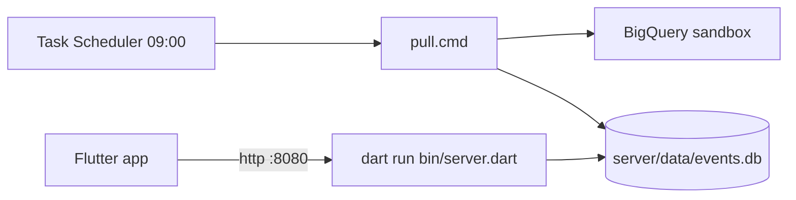

# Run AnalyticTracker locally

## 1. One-time setup (server PC)

1. Firebase console → Project settings → Integrations → BigQuery → link, enable **Daily** export.
2. Google Cloud console → IAM & Admin → Service accounts → create one with roles **BigQuery Data Viewer** and **BigQuery Job User** → Keys → add JSON key → save as `server/secrets/service-account.json`.
3. Copy `server/config.example.json` to `server/config.json`; set `projectId`, `datasetId` (`analytics_<number>`, see BigQuery console) and `location` (dataset Details).
4. Add the Flutter SDK `bin` folder (e.g. `D:\flutter\bin`) to your **user PATH** — the scheduled pull calls `dart`.
5. Windows build only: enable **Developer Mode** (`start ms-settings:developers`) — Flutter plugins need symlinks.
6. From repo root: `flutter pub get`.

## 2. Pull data

- Manual: `cd server; dart run bin/pull.dart config.json`
- Daily: run `server/tools/register-pull-task.ps1` once in PowerShell. Log: `server/logs/pull.log`.
- Exit codes: 0 ok, 1 some days failed (retried next run), 2 aborted (config/auth).
- **Sandbox deletes BigQuery tables after 60 days.** If the pull fails for 60 days in a row, those days are lost. Check `pull.log` and the app's Days tab ("missing").

## 3. Serve

`cd server; dart run bin/server.dart config.json` → listens on all interfaces, port from config (default 8080).

Phones on Wi-Fi: allow the port once (admin PowerShell):
`New-NetFirewallRule -DisplayName 'AnalyticTracker 8080' -Direction Inbound -Protocol TCP -LocalPort 8080 -Action Allow -Profile Private`

## 4. App

- Windows: `cd app; flutter run -d windows`
- Web: `cd app; flutter run -d chrome`
- Android/iOS: `flutter run` with a device; then Settings tab → server URL `http://<PC LAN IP>:8080` (find IP with `ipconfig`).

## 5. Backup

Stop the server, copy `server/data/events.db` (plus `-wal`/`-shm` if present). This file is the only long-term history.

## 6. Claude MCP

Claude Code in this repo can query the dashboard through the `analytic-tracker` MCP server (`.mcp.json`, spec `.cursor/plans/mcp-server-design.md`).

1. Start the API server (section 3) — the MCP calls it; it does not open the database itself.
2. Open Claude Code in `D:\Projects\AnalyticTracker`; approve the `analytic-tracker` project server when asked. `claude mcp list` should show it connected.
3. Tools: `data_health`, `filter_options`, `list_events`, `overview`, `retention`, `progression`, `event_counts`, `param_keys`, `param_values`, `list_funnels`, `run_funnel`, `save_funnel`, `delete_funnel`, `import_export`.
4. `import_export` previews by default (`rows` in file vs `stored` per day). Each day in the file **replaces** that day's stored rows when applied with `dry_run: false`.

Teammate on another PC (after an API token exists — spec §7): same `.mcp.json` entry with `--server http://<server PC LAN IP>:8080`.

## 7. Production API Route Inventory

| Route | Method | Description | Parameters |
|---|---|---|---|
| `/days` | GET | List stored daily sync summaries | None |
| `/filters` | GET | List available platforms & versions | None |
| `/overview` | GET | KPI metrics, DAU/WAU/MAU, user counts | `from`, `to`, `platform?`, `version?`, `test?` |
| `/retention` | GET | Cohort retention table | `from`, `to`, `platform?`, `version?`, `test?` |
| `/progression` | GET | Level/stage completion funnel | `from`, `to`, `platform?`, `version?`, `test?` |
| `/events/names` | GET | List all distinct event names | None |
| `/events/count` | GET | Event frequency counts | `from`, `to`, `name?`, `platform?`, `version?`, `test?` |
| `/events/param-keys` | GET | Parameter keys for an event | `name`, `from`, `to`, `platform?`, `version?`, `test?` |
| `/events/user-prop-keys` | GET | User property keys | `from`, `to`, `platform?`, `version?`, `test?` |
| `/events/param` | GET | Parameter value breakdown | `name`, `key`, `from`, `to`, `platform?`, `version?`, `test?` |
| `/funnels` | GET, POST | List or create saved funnel definitions | Body: `FunnelDef` JSON (POST) |
| `/funnels/<id>` | PUT, DELETE | Update or delete saved funnel | Body: `FunnelDef` JSON (PUT) |
| `/funnels/run` | POST | Execute funnel computation & trends | Body: `def`, `from`, `to`, `breakdown?`, `interval?` |
| `/funnels/players` | POST | List player UIDs at specific funnel step | Body: `def`, `step`, `outcome`, `limit?`, `breakdown?`, `segment?` |
| `/players/<uid>/events` | GET | Chronological event timeline for player | `fromTs`, `toTs`, `limit?`, `test?` |
| `/import` | POST | BigQuery export raw event import | Raw text body; `dryRun=1` query for preview |
| `/analysis/clusters` | GET | K-means player clustering | `from`, `to`, `k?` (2..8 or auto) |
| `/analysis/churn` | GET | Churn prediction decision tree | `from`, `to` |
| `/analysis/levels` | GET | Level difficulty & hazard analysis | `from`, `to` |
| `/analysis/survival` | GET | Kaplan-Meier survival curves & log-rank | `from`, `to`, `by` (`version`/`platform`/`cluster`) |
| `/analysis/version-impact` | GET | Version impact comparisons & bootstrap CI | `from`, `to`, `version?` |
| `/analysis/associations` | GET | Frequent event pattern mining | `from`, `to` |
| `/analysis/anomalies` | GET | Z-score statistical anomaly detection | `from`, `to` |

## 8. Complete 24 MCP Tools Registry

The `analytic-tracker` MCP server exposes 24 tools across four functional groups:
- **Core Metrics (6):** `data_health`, `filter_options`, `list_events`, `overview`, `retention`, `progression`
- **Exploration & Events (5):** `event_counts`, `param_keys`, `user_prop_keys`, `param_values`, `player_timeline`
- **Funnels (6):** `list_funnels`, `get_funnel`, `save_funnel`, `delete_funnel`, `run_funnel`, `funnel_players`
- **Advanced Analytics & Data (7):** `clusters`, `churn_tree`, `level_difficulty`, `survival_curve`, `version_impact`, `event_associations`, `anomaly_alerts`
- **Data Maintenance (1):** `import_export`

## 9. Platform Readiness Matrix & Prerequisites

| Platform | Build Status | Runtime Status | Prerequisites & Verification |
|---|---|---|---|
| **Windows** | READY | VERIFIED | Visual Studio C++ Build Tools 2022, Developer Mode enabled. Release binary at `app\build\windows\x64\runner\Release\analytic_app.exe` (90 KB runner + 8.2 MB `data\app.so`). Verified with Impeller rendering backend on localhost:8080. |
| **Web** | READY | READY | Chrome / Web SDK. Release bundle at `app\build\web`. Verified with `flutter build web --release` (36.5s build). |
| **Android** | PENDING | PENDING | Android SDK version 36.1.0 installed. Prerequisite: install `cmdline-tools` via Android Studio SDK Manager and run `flutter doctor --android-licenses`. Release: `flutter build apk --release`. |
| **iOS** | PENDING | PENDING | Windows host environment cannot compile iOS binaries. Prerequisite: macOS host, Xcode 15+, CocoaPods, and Apple Developer team signing. Release: `flutter build ipa`. |

## 10. Data Automation and Maintenance

- **Scheduled Task:** `AnalyticTrackerPull` registered via `server/tools/register-pull-task.ps1` to trigger daily at 09:00 AM (`pull.cmd`). If machine was offline at trigger time, task executes on next startup (`StartWhenAvailable`).
- **BigQuery Access:** Requires dedicated Service Account with `BigQuery Data Viewer` and `BigQuery Job User` roles on the project and dataset. Service account JSON saved to `server/secrets/service-account.json` (excluded from git).
- **Exit Codes:** 0 = success, 1 = partial failure (retried on next run), 2 = configuration/auth abort.
- **Backup Verification Drill:** Verified with live integrity check `PRAGMA integrity_check;` against SQLite copy. Never perform destructive restores on live writer.
